import Tabs from '@theme/Tabs';
import TabItem from '@theme/TabItem';

# Master Solved Algorithms

:::info[TITLE]
## Step-by-Step Solved Algorithms Guide (Unit 1 to Unit 7)
:::

:::tip[EXAM MASTER STRATEGY]
This guide provides complete, step-by-step numerical solutions accompanied by visual graphs, state-space trees, and automata for every algorithm across all 7 units of Design and Analysis of Algorithms.
Every step is broken down with one calculation per line to make revision easy and exam-ready.
:::

:::info[Unit - 1]
## Basics of Algorithms and Mathematics
:::

### 1.1 Karatsuba Integer Multiplication

#### 1.1.1 Concept
- Standard grade-school multiplication takes $4$ sub-multiplications for $2$-digit halves.
- Karatsuba's algorithm performs only **$3$ recursive multiplications**.
- The cross-term $(ad + bc)$ is obtained via the algebraic identity:
  $$\text{Middle} = (a + b)(c + d) - ac - bd$$

#### 1.1.2 Problem Statement & Input
- Multiply two $4$-digit integers:
  - $X = 1234$
  - $Y = 5678$
- Number of digits: $n = 4$
- Half-length: $m = \lceil n / 2 \rceil = 2$

#### 1.1.3 Step-by-Step Solved Walkthrough

##### Step 1: Split the Numbers into Halves
- Number $X$:
  - High half: $a = \lfloor 1234 / 10^2 \rfloor = 12$
  - Low half: $b = 1234 \pmod{10^2} = 34$
- Number $Y$:
  - High half: $c = \lfloor 5678 / 10^2 \rfloor = 56$
  - Low half: $d = 5678 \pmod{10^2} = 78$

##### Step 2: Compute the Three Primary Products
- Product 1 (High halves product):
  $$p_1 = a \times c$$
  $$p_1 = 12 \times 56$$
  $$p_1 = 672$$

- Product 2 (Low halves product):
  $$p_2 = b \times d$$
  $$p_2 = 34 \times 78$$
  $$p_2 = 2652$$

- Product 3 (Sum of halves product):
  $$p_3 = (a + b) \times (c + d)$$
  $$a + b = 12 + 34 = 46$$
  $$c + d = 56 + 78 = 134$$
  $$p_3 = 46 \times 134$$
  $$p_3 = 6164$$

##### Step 3: Compute the Middle Cross-Term
- Cross-term formula:
  $$\text{Middle} = p_3 - p_1 - p_2$$
  $$\text{Middle} = 6164 - 672 - 2652$$
  $$\text{Middle} = 6164 - 3324$$
  $$\text{Middle} = 2840$$

##### Step 4: Assemble the Final Product
- Standard assembly formula:
  $$\text{Result} = p_1 \cdot 10^{2m} + \text{Middle} \cdot 10^m + p_2$$
- Substituting values:
  $$\text{Term}_1 = 672 \times 10^4 = 6,720,000$$
  $$\text{Term}_2 = 2840 \times 10^2 = 284,000$$
  $$\text{Term}_3 = 2652$$
- Summation:
  $$\text{Result} = 6,720,000 + 284,000 + 2,652$$
  $$\text{Result} = 7,006,652$$

##### Step 5: Verification
- Direct multiplication:
  $$1234 \times 5678 = 7,006,652$$
- The result matches exactly.

#### 1.1.4 Complexity Analysis
- Recurrence relation:
  $$T(n) = 3T(n/2) + O(n)$$
- By Master Theorem:
  $$a = 3, \quad b = 2, \quad \log_2 3 \approx 1.585$$
- Time Complexity: $\Theta(n^{\log_2 3}) \approx \mathbf{O(n^{1.585})}$
- Space Complexity: $\mathbf{O(n)}$ due to recursive call stack.

### 1.2 Master Theorem for Recurrence Relations

#### 1.2.1 Standard Form
- General recurrence:
  $$T(n) = a T(n/b) + f(n)$$
- Parameters:
  - $a \ge 1$: Number of subproblems.
  - $b > 1$: Subproblem reduction factor.
  - $f(n)$: Cost of dividing and combining.
- Critical exponent:
  $$c_{\text{crit}} = \log_b a$$

#### 1.2.2 Case 1 Example: $T(n) = 4T(n/2) + n$
- Parameter extraction:
  - $a = 4$
  - $b = 2$
  - $f(n) = n = n^1$
- Calculate critical exponent:
  $$\log_b a = \log_2 4 = 2$$
- Compare powers:
  - Power in $f(n)$ is $c = 1$.
  - Critical power is $2$.
  - Since $1 < 2$, we have $f(n) = O(n^{2 - \epsilon})$ for $\epsilon = 1$.
- Conclusion:
  $$T(n) = \Theta(n^{\log_b a}) = \mathbf{\Theta(n^2)}$$

#### 1.2.3 Case 2 Example: $T(n) = 2T(n/2) + n$ (Merge Sort)
- Parameter extraction:
  - $a = 2$
  - $b = 2$
  - $f(n) = n = n^1$
- Calculate critical exponent:
  $$\log_b a = \log_2 2 = 1$$
- Compare powers:
  - Power in $f(n)$ is $c = 1$.
  - Critical power is $1$.
  - Since $f(n) = \Theta(n^{\log_b a}) = \Theta(n^1)$.
- Conclusion:
  $$T(n) = \Theta(n^{\log_b a} \log n) = \mathbf{\Theta(n \log n)}$$

#### 1.2.4 Case 3 Example: $T(n) = 2T(n/2) + n^2$
- Parameter extraction:
  - $a = 2$
  - $b = 2$
  - $f(n) = n^2$
- Calculate critical exponent:
  $$\log_b a = \log_2 2 = 1$$
- Compare powers:
  - Power in $f(n)$ is $c = 2$.
  - Critical power is $1$.
  - Since $2 > 1$, we have $f(n) = \Omega(n^{1 + \epsilon})$ for $\epsilon = 1$.
- Check Regularity Condition:
  $$a f(n/b) \le k f(n) \quad \text{for } k < 1$$
  $$2 (n/2)^2 \le k n^2$$
  $$2 \times \frac{n^2}{4} \le k n^2$$
  $$\frac{n^2}{2} \le k n^2$$
  $$\frac{1}{2} \le k \quad (\text{Holds for } k = 1/2 < 1)$$
- Conclusion:
  $$T(n) = \Theta(f(n)) = \mathbf{\Theta(n^2)}$$

### 1.3 Substitution Method (Mathematical Induction)

#### 1.3.1 Problem Definition
- Solve the recurrence:
  $$T(n) = 2T(\lfloor n/2 \rfloor) + n$$
- Base case:
  $$T(1) = 1$$
- Target:
  - Prove that $T(n) = O(n \log_2 n)$.

#### 1.3.2 Inductive Hypothesis
- Assume that for all integers $k < n$:
  $$T(k) \le c \cdot k \log_2 k$$
- Constant $c > 0$ will be determined.

#### 1.3.3 Inductive Step Proof
- Start with the recurrence definition:
  $$T(n) = 2T(n/2) + n$$
- Substitute the hypothesis for $k = n/2$:
  $$T(n) \le 2 \left[ c \left(\frac{n}{2}\right) \log_2\left(\frac{n}{2}\right) \right] + n$$
- Simplify the constant factor:
  $$T(n) \le c n \log_2\left(\frac{n}{2}\right) + n$$
- Apply logarithm quotient rule $\log_2(n/2) = \log_2 n - \log_2 2$:
  $$T(n) \le c n (\log_2 n - 1) + n$$
- Expand the bracket:
  $$T(n) \le c n \log_2 n - c n + n$$
- Factor out $n$:
  $$T(n) \le c n \log_2 n - (c - 1)n$$
- For the bound $T(n) \le c n \log_2 n$ to hold, we need:
  $$-(c - 1)n \le 0$$
  $$c - 1 \ge 0$$
  $$c \ge 1$$

#### 1.3.4 Base Case Verification
- Choose $n = 2$:
  $$T(2) = 2T(1) + 2 = 2(1) + 2 = 4$$
- Check against bound:
  $$c \cdot 2 \log_2 2 = 2c$$
- Requirement:
  $$4 \le 2c \implies c \ge 2$$
- Choosing $c = 2$ satisfies both the base case and the inductive step.
- Conclusion:
  $$T(n) = \mathbf{O(n \log n)}$$

### 1.4 Recursion Tree Method

#### 1.4.1 Recurrence Relation
- Recurrence:
  $$T(n) = 2T(n/2) + cn$$

#### 1.4.2 Tree Level Costs
- Level 0 (Root node):
  - Number of nodes: $2^0 = 1$
  - Size of subproblem: $n$
  - Cost per node: $cn$
  - Total level cost: $1 \times cn = cn$
- Level 1:
  - Number of nodes: $2^1 = 2$
  - Size of subproblem: $n/2$
  - Cost per node: $c(n/2)$
  - Total level cost: $2 \times c(n/2) = cn$
- Level 2:
  - Number of nodes: $2^2 = 4$
  - Size of subproblem: $n/4$
  - Cost per node: $c(n/4)$
  - Total level cost: $4 \times c(n/4) = cn$
- Level $i$ (General level):
  - Number of nodes: $2^i$
  - Size of subproblem: $n / 2^i$
  - Cost per node: $c(n / 2^i)$
  - Total level cost: $2^i \times c(n / 2^i) = cn$

#### 1.4.3 Visual Recursion Tree Diagram

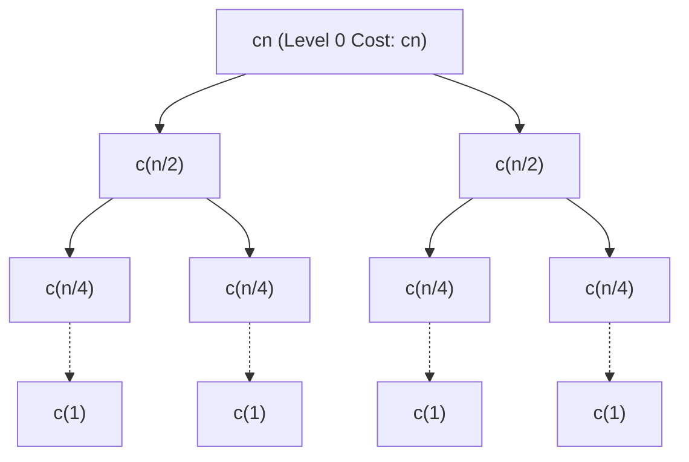

#### 1.4.4 Tree Height & Total Work Sum
- Tree depth $h$:
  $$\frac{n}{2^h} = 1 \implies 2^h = n \implies h = \log_2 n$$
- Total number of levels:
  $$\text{Levels} = h + 1 = \log_2 n + 1$$
- Total cost across all levels:
  $$\text{Total Cost} = \sum_{i=0}^{\log_2 n} cn$$
  $$\text{Total Cost} = cn \times (\log_2 n + 1)$$
  $$\text{Total Cost} = cn \log_2 n + cn$$
- Asymptotic behavior:
  $$T(n) = \mathbf{\Theta(n \log n)}$$

:::info[Unit - 2]
## Divide & Conquer Algorithms
:::

### 2.1 Binary Search

#### 2.1.1 Concept
- Works on sorted arrays by repeatedly comparing the target key with the middle element.
- If key matches, index is returned.
- If key is smaller, search space reduces to left half.
- If key is greater, search space reduces to right half.

#### 2.1.2 Numerical Problem
- Sorted array:
  $$A = [11, 22, 33, 44, 55, 66, 77, 88, 99]$$
- Indices: $0$ to $8$
- Target key: $\text{Key} = 66$

#### 2.1.3 Iteration-by-Iteration Trace

##### Iteration 1
- Lower pointer: $\text{low} = 0$
- Upper pointer: $\text{high} = 8$
- Calculate mid:
  $$\text{mid} = \left\lfloor \frac{0 + 8}{2} \right\rfloor = 4$$
- Inspect element:
  $$A[4] = 55$$
- Compare:
  $$66 > 55$$
- Action:
  - Target lies in the right half.
  - Update: $\text{low} = \text{mid} + 1 = 4 + 1 = 5$

##### Iteration 2
- Lower pointer: $\text{low} = 5$
- Upper pointer: $\text{high} = 8$
- Calculate mid:
  $$\text{mid} = \left\lfloor \frac{5 + 8}{2} \right\rfloor = \lfloor 6.5 \rfloor = 6$$
- Inspect element:
  $$A[6] = 66$$
- Compare:
  $$66 == 66$$
- Action:
  - Match found at index $6$.
  - Search terminates.

#### 2.1.4 Complexity
- Comparisons made: $2$
- Time Complexity:
  - Best Case: $O(1)$
  - Average Case: $O(\log n)$
  - Worst Case: $\mathbf{O(\log n)}$
- Space Complexity: $\mathbf{O(1)}$ (Iterative).

### 2.2 Merge Sort

#### 2.2.1 Concept
- Follows the Divide, Conquer, and Combine paradigm:
  - **Divide**: Split array into two halves at midpoint.
  - **Conquer**: Recursively sort both subarrays.
  - **Combine**: Merge the two sorted subarrays using two pointers.

#### 2.2.2 Numerical Problem
- Input array:
  $$A = [38, 27, 43, 3, 9, 82, 10]$$
- Size: $n = 7$

#### 2.2.3 Divide Step Tree
- Level 0:
  $$[38, 27, 43, 3, 9, 82, 10]$$
- Level 1:
  - Left: $[38, 27, 43, 3]$
  - Right: $[9, 82, 10]$
- Level 2:
  - From Left: $[38, 27]$ and $[43, 3]$
  - From Right: $[9]$ and $[82, 10]$
- Level 3 (Base Cases):
  - $[38], [27], [43], [3], [9], [82], [10]$

#### 2.2.4 Conquer & Merge Step

##### Sub-Merge 1
- Merge $[38]$ and $[27]$:
  - Compare $38$ and $27 \implies 27 < 38$
  - Result: $[27, 38]$

##### Sub-Merge 2
- Merge $[43]$ and $[3]$:
  - Compare $43$ and $3 \implies 3 < 43$
  - Result: $[3, 43]$

##### Sub-Merge 3
- Merge $[27, 38]$ and $[3, 43]$:
  - Compare $27$ and $3 \implies$ Take $3$
  - Compare $27$ and $43 \implies$ Take $27$
  - Compare $38$ and $43 \implies$ Take $38$
  - Remaining: Take $43$
  - Result: $[3, 27, 38, 43]$

##### Sub-Merge 4
- Merge $[82]$ and $[10]$:
  - Compare $82$ and $10 \implies$ Take $10$
  - Result: $[10, 82]$

##### Sub-Merge 5
- Merge $[9]$ and $[10, 82]$:
  - Compare $9$ and $10 \implies$ Take $9$
  - Remaining: Take $[10, 82]$
  - Result: $[9, 10, 82]$

##### Final Merge Step
- Left subarray: $[3, 27, 38, 43]$
- Right subarray: $[9, 10, 82]$
- Pointer comparison trace:
  - Compare $3$ and $9 \implies$ Output $3$
  - Compare $27$ and $9 \implies$ Output $9$
  - Compare $27$ and $10 \implies$ Output $10$
  - Compare $27$ and $82 \implies$ Output $27$
  - Compare $38$ and $82 \implies$ Output $38$
  - Compare $43$ and $82 \implies$ Output $43$
  - Exhausted left subarray $\implies$ Append remaining $82$

#### 2.2.5 Visual Merge Sort Tree Diagram

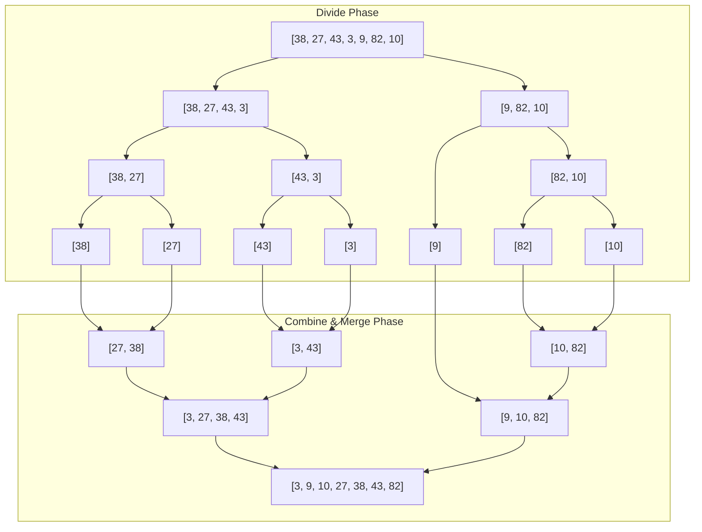

#### 2.2.6 Final Sorted Output & Complexity
- Sorted array:
  $$\mathbf{[3, 9, 10, 27, 38, 43, 82]}$$
- Time Complexity:
  - Best Case: $\Theta(n \log n)$
  - Average Case: $\Theta(n \log n)$
  - Worst Case: $\mathbf{\Theta(n \log n)}$
- Auxiliary Space: $\mathbf{O(n)}$.

### 2.3 Quick Sort (Lomuto Partitioning)

#### 2.3.1 Concept & Partition Logic
- Chooses the last element as the pivot: $P = A[\text{high}]$.
- Maintains index $i$ tracking elements smaller than or equal to $P$.
- Traverses with index $j$: whenever $A[j] \le P$, increment $i$ and swap $A[i]$ with $A[j]$.
- Finally places pivot at $i + 1$.

#### 2.3.2 Numerical Problem
- Input array:
  $$A = [28, 12, 45, 19, 53, 37]$$
- Indices: $0$ to $5$
- Pivot: $P = A[5] = 37$

#### 2.3.3 Step-by-Step Index Swap Trace
- Initialize:
  - $i = \text{low} - 1 = -1$

##### Step $j = 0$
- Value: $A[0] = 28$
- Test: $28 \le 37$ (True)
- Increment $i$: $i = 0$
- Swap $A[0]$ with $A[0]$ (no movement):
  - State: $[28, 12, 45, 19, 53, 37]$

##### Step $j = 1$
- Value: $A[1] = 12$
- Test: $12 \le 37$ (True)
- Increment $i$: $i = 1$
- Swap $A[1]$ with $A[1]$:
  - State: $[28, 12, 45, 19, 53, 37]$

##### Step $j = 2$
- Value: $A[2] = 45$
- Test: $45 \le 37$ (False)
- No swap, $i$ remains $1$.
  - State: $[28, 12, 45, 19, 53, 37]$

##### Step $j = 3$
- Value: $A[3] = 19$
- Test: $19 \le 37$ (True)
- Increment $i$: $i = 2$
- Swap $A[i]$ with $A[j] \implies$ Swap $A[2](45)$ with $A[3](19)$:
  - State: $[28, 12, 19, 45, 53, 37]$

##### Step $j = 4$
- Value: $A[4] = 53$
- Test: $53 \le 37$ (False)
- No swap, $i$ remains $2$.
  - State: $[28, 12, 19, 45, 53, 37]$

##### Pivot Placement Step
- End of loop reached.
- Swap pivot $A[\text{high}](37)$ with $A[i + 1](A[3] = 45)$:
  - Swap $A[5]$ with $A[3]$
- Final partitioned array:
  $$[\mathbf{28, 12, 19}, \underline{\mathbf{37}}, \mathbf{53, 45}]$$
- Pivot index: $3$
- Subarrays formed:
  - Left: $[28, 12, 19]$
  - Right: $[53, 45]$

#### 2.3.4 Complexity
- Time Complexity:
  - Best Case: $O(n \log n)$
  - Average Case: $O(n \log n)$
  - Worst Case: $\mathbf{O(n^2)}$ (when array is already sorted or reverse sorted)
- Space Complexity: $\mathbf{O(\log n)}$ recursion stack.

### 2.4 Strassen's Matrix Multiplication ($2 \times 2$)

#### 2.4.1 Concept & Matrix Blocks
- Standard multiplication uses $8$ scalar multiplications.
- Strassen uses $7$ products, saving computational overhead on large matrices.

#### 2.4.2 Numerical Input Matrices
- Matrix $A$:
  $$A = \begin{bmatrix} 1 & 3 \\ 7 & 5 \end{bmatrix}$$
  - $a_{11} = 1$
  - $a_{12} = 3$
  - $a_{21} = 7$
  - $a_{22} = 5$

- Matrix $B$:
  $$B = \begin{bmatrix} 6 & 8 \\ 4 & 2 \end{bmatrix}$$
  - $b_{11} = 6$
  - $b_{12} = 8$
  - $b_{21} = 4$
  - $b_{22} = 2$

#### 2.4.3 The 7 Auxiliary Products ($P_1$ to $P_7$)

- Product $P_1$:
  $$P_1 = (a_{11} + a_{22})(b_{11} + b_{22})$$
  $$P_1 = (1 + 5)(6 + 2)$$
  $$P_1 = 6 \times 8$$
  $$P_1 = 48$$

- Product $P_2$:
  $$P_2 = (a_{21} + a_{22}) b_{11}$$
  $$P_2 = (7 + 5) \times 6$$
  $$P_2 = 12 \times 6$$
  $$P_2 = 72$$

- Product $P_3$:
  $$P_3 = a_{11} (b_{12} - b_{22})$$
  $$P_3 = 1 \times (8 - 2)$$
  $$P_3 = 1 \times 6$$
  $$P_3 = 6$$

- Product $P_4$:
  $$P_4 = a_{22} (b_{21} - b_{11})$$
  $$P_4 = 5 \times (4 - 6)$$
  $$P_4 = 5 \times (-2)$$
  $$P_4 = -10$$

- Product $P_5$:
  $$P_5 = (a_{11} + a_{12}) b_{22}$$
  $$P_5 = (1 + 3) \times 2$$
  $$P_5 = 4 \times 2$$
  $$P_5 = 8$$

- Product $P_6$:
  $$P_6 = (a_{21} - a_{11})(b_{11} + b_{12})$$
  $$P_6 = (7 - 1)(6 + 8)$$
  $$P_6 = 6 \times 14$$
  $$P_6 = 84$$

- Product $P_7$:
  $$P_7 = (a_{12} - a_{22})(b_{21} + b_{22})$$
  $$P_7 = (3 - 5)(4 + 2)$$
  $$P_7 = (-2) \times 6$$
  $$P_7 = -12$$

#### 2.4.4 Result Matrix Assembly ($C_{11}, C_{12}, C_{21}, C_{22}$)

- Entry $C_{11}$:
  $$C_{11} = P_1 + P_4 - P_5 + P_7$$
  $$C_{11} = 48 + (-10) - 8 + (-12)$$
  $$C_{11} = 48 - 10 - 8 - 12$$
  $$C_{11} = 18$$

- Entry $C_{12}$:
  $$C_{12} = P_3 + P_5$$
  $$C_{12} = 6 + 8$$
  $$C_{12} = 14$$

- Entry $C_{21}$:
  $$C_{21} = P_2 + P_4$$
  $$C_{21} = 72 + (-10)$$
  $$C_{21} = 62$$

- Entry $C_{22}$:
  $$C_{22} = P_1 - P_2 + P_3 + P_6$$
  $$C_{22} = 48 - 72 + 6 + 84$$
  $$C_{22} = -24 + 6 + 84$$
  $$C_{22} = 66$$

- Resultant Matrix $C$:
  $$C = \begin{bmatrix} 18 & 14 \\ 62 & 66 \end{bmatrix}$$

#### 2.4.5 Verification & Complexity
- Standard multiplication check:
  - $C_{11} = 1(6) + 3(4) = 6 + 12 = 18$
  - $C_{12} = 1(8) + 3(2) = 8 + 6 = 14$
  - $C_{21} = 7(6) + 5(4) = 42 + 20 = 62$
  - $C_{22} = 7(8) + 5(2) = 56 + 10 = 66$
- Time Complexity:
  $$T(n) = 7T(n/2) + O(n^2)$$
  $$T(n) = \Theta(n^{\log_2 7}) \approx \mathbf{O(n^{2.807})}$$
  (Standard multiplication is $O(n^3)$).

### 2.5 Divide and Conquer Modular Exponentiation

#### 2.5.1 Recursive Exponentiation Rule
- For base $a$ and exponent $n$:
  - If $n == 0$: $a^0 = 1$
  - If $n$ is even: $a^n = (a^{n/2})^2$
  - If $n$ is odd: $a^n = a \times (a^{(n-1)/2})^2$

#### 2.5.2 Numerical Problem
- Compute:
  $$3^{10} \pmod{1000}$$

#### 2.5.3 Step-by-Step Computation
- Step 1: Break down $3^{10}$ (even power):
  $$3^{10} = (3^5)^2$$
- Step 2: Break down $3^5$ (odd power):
  $$3^5 = 3 \times (3^2)^2$$
- Step 3: Compute $3^2$:
  $$3^2 = 9$$
- Step 4: Compute $(3^2)^2$:
  $$9^2 = 81$$
- Step 5: Compute $3^5$:
  $$3^5 = 3 \times 81 = 243$$
- Step 6: Compute $3^{10}$:
  $$3^{10} = 243^2 = 59,049$$
- Step 7: Apply modulo $1000$:
  $$59,049 \pmod{1000} = \mathbf{49}$$

#### 2.5.4 Complexity Comparison
- Sequential multiplication multiplications: $9$ multiplications
- Divide and conquer multiplications: $4$ multiplications
- Time Complexity: $\mathbf{O(\log n)}$

:::info[Unit - 3]
## Greedy Algorithms
:::

### 3.1 Kruskal's Algorithm (Minimum Spanning Tree)

#### 3.1.1 Graph Problem Input
- Vertices: $V = \{A, B, C, D, E\}$
- Total Vertices: $|V| = 5$
- Target MST Edges: $|V| - 1 = 4$
- Edges with weights:
  - $(A, B): 1$
  - $(B, C): 2$
  - $(B, D): 3$
  - $(A, C): 4$
  - $(C, D): 5$
  - $(D, E): 6$
  - $(C, E): 7$

#### 3.1.2 Visual Graph Representation

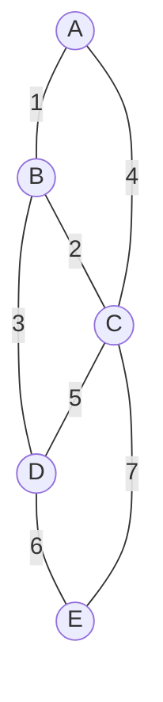

#### 3.1.3 Edge Sorting Step
- Sorted list of edges in non-decreasing order:
  1. $(A, B)$ with weight $1$
  2. $(B, C)$ with weight $2$
  3. $(B, D)$ with weight $3$
  4. $(A, C)$ with weight $4$
  5. $(C, D)$ with weight $5$
  6. $(D, E)$ with weight $6$
  7. $(C, E)$ with weight $7$

#### 3.1.4 Edge-by-Edge Disjoint Set (DSU) Trace
- Initialize disjoint sets:
  $$\{A\}, \{B\}, \{C\}, \{D\}, \{E\}$$

##### Consideration 1: Edge $(A, B)$ with weight $1$
- Set of $A$: $\{A\}$
- Set of $B$: $\{B\}$
- Check: $\text{Find}(A) \ne \text{Find}(B)$
- Decision: **Accept edge**
- Union: $\{A, B\}$
- MST Edges: $\{(A, B)\}$

##### Consideration 2: Edge $(B, C)$ with weight $2$
- Set of $B$: $\{A, B\}$
- Set of $C$: $\{C\}$
- Check: $\text{Find}(B) \ne \text{Find}(C)$
- Decision: **Accept edge**
- Union: $\{A, B, C\}$
- MST Edges: $\{(A, B), (B, C)\}$

##### Consideration 3: Edge $(B, D)$ with weight $3$
- Set of $B$: $\{A, B, C\}$
- Set of $D$: $\{D\}$
- Check: $\text{Find}(B) \ne \text{Find}(D)$
- Decision: **Accept edge**
- Union: $\{A, B, C, D\}$
- MST Edges: $\{(A, B), (B, C), (B, D)\}$

##### Consideration 4: Edge $(A, C)$ with weight $4$
- Set of $A$: $\{A, B, C, D\}$
- Set of $C$: $\{A, B, C, D\}$
- Check: $\text{Find}(A) == \text{Find}(C)$ (Both in same set)
- Decision: **Reject edge (Creates cycle $A-B-C-A$)**

##### Consideration 5: Edge $(C, D)$ with weight $5$
- Set of $C$: $\{A, B, C, D\}$
- Set of $D$: $\{A, B, C, D\}$
- Check: $\text{Find}(C) == \text{Find}(D)$
- Decision: **Reject edge (Creates cycle $B-C-D-B$)**

##### Consideration 6: Edge $(D, E)$ with weight $6$
- Set of $D$: $\{A, B, C, D\}$
- Set of $E$: $\{E\}$
- Check: $\text{Find}(D) \ne \text{Find}(E)$
- Decision: **Accept edge**
- Union: $\{A, B, C, D, E\}$
- MST Edges: $\{(A, B), (B, C), (B, D), (D, E)\}$

#### 3.1.5 Final MST Visual Graph & Weight
- Total edges chosen: $4$ ($=|V| - 1$)
- Final MST Tree Graph:

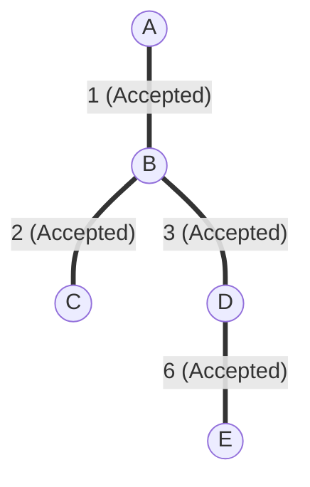

- Total weight calculation:
  $$\text{Total Cost} = 1 + 2 + 3 + 6 = \mathbf{12}$$
- Time Complexity: $\mathbf{O(E \log E)}$ or $\mathbf{O(E \log V)}$

### 3.2 Prim's Algorithm (Minimum Spanning Tree)

#### 3.2.1 Graph Problem Input & Starting Vertex
- Same graph: $V = \{A, B, C, D, E\}$
- Starting root vertex: $A$
- Target MST vertices: all $5$ vertices

#### 3.2.2 Step-by-Step Cut Set Growth

##### Iteration 0 (Initialization)
- Spanning tree set: $S = \{A\}$
- Unvisited set: $V \setminus S = \{B, C, D, E\}$
- Initial cost: $0$

##### Iteration 1
- Crossing edges from $S = \{A\}$:
  - $(A, B)$: weight $1$
  - $(A, C)$: weight $4$
- Minimum cut edge: $(A, B)$ with weight $1$
- Add $B$ to $S$:
  - $S = \{A, B\}$
  - Current cost: $1$

##### Iteration 2
- Crossing edges from $S = \{A, B\}$:
  - $(A, C)$: weight $4$
  - $(B, C)$: weight $2$
  - $(B, D)$: weight $3$
- Minimum cut edge: $(B, C)$ with weight $2$
- Add $C$ to $S$:
  - $S = \{A, B, C\}$
  - Current cost: $1 + 2 = 3$

##### Iteration 3
- Crossing edges from $S = \{A, B, C\}$:
  - $(B, D)$: weight $3$
  - $(C, D)$: weight $5$
  - $(C, E)$: weight $7$
- Minimum cut edge: $(B, D)$ with weight $3$
- Add $D$ to $S$:
  - $S = \{A, B, C, D\}$
  - Current cost: $3 + 3 = 6$

##### Iteration 4
- Crossing edges from $S = \{A, B, C, D\}$:
  - $(D, E)$: weight $6$
  - $(C, E)$: weight $7$
- Minimum cut edge: $(D, E)$ with weight $6$
- Add $E$ to $S$:
  - $S = \{A, B, C, D, E\}$
  - Current cost: $6 + 6 = 12$

#### 3.2.3 Final MST & Complexity
- Selected tree edges:
  $$\{(A, B), (B, C), (B, D), (D, E)\}$$
- Total weight: $\mathbf{12}$
- Time Complexity:
  - With Adjacency Matrix: $O(V^2)$
  - With Min-Heap & Adjacency List: $\mathbf{O(E \log V)}$

### 3.3 Dijkstra's Single-Source Shortest Path

#### 3.3.1 Directed Graph & Edge Weights
- Vertices: $\{S, A, B, C, D\}$
- Source: $S$
- Edges:
  - $(S, A) = 10$
  - $(S, C) = 5$
  - $(C, A) = 3$
  - $(C, B) = 9$
  - $(C, D) = 2$
  - $(A, B) = 1$
  - $(D, B) = 4$

#### 3.3.2 Visual Input Graph

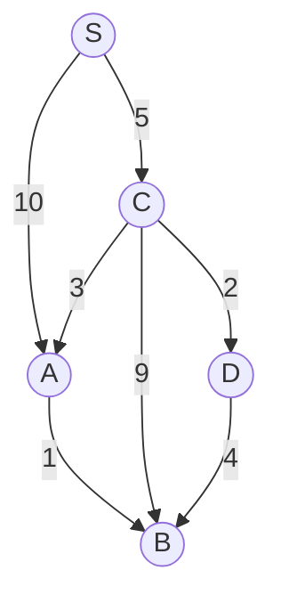

#### 3.3.3 Initialization
- Distance array:
  - $d[S] = 0$
  - $d[A] = \infty$
  - $d[B] = \infty$
  - $d[C] = \infty$
  - $d[D] = \infty$
- Visited set: $U = \emptyset$

#### 3.3.4 Step-by-Step Node Selection & Relaxation

##### Step 1: Process Node $S$
- Select minimum unvisited: $S$ with $d[S] = 0$
- Mark $S$ as visited: $U = \{S\}$
- Relax edge $(S, A)$:
  $$d[A] = \min(\infty, 0 + 10) = 10$$
- Relax edge $(S, C)$:
  $$d[C] = \min(\infty, 0 + 5) = 5$$
- Current distances:
  $$d[S]=0, \quad d[A]=10, \quad d[B]=\infty, \quad d[C]=5, \quad d[D]=\infty$$

##### Step 2: Process Node $C$
- Select minimum unvisited: $C$ with $d[C] = 5$
- Mark $C$ as visited: $U = \{S, C\}$
- Relax edge $(C, A)$:
  $$d[A] = \min(10, 5 + 3) = 8$$
- Relax edge $(C, B)$:
  $$d[B] = \min(\infty, 5 + 9) = 14$$
- Relax edge $(C, D)$:
  $$d[D] = \min(\infty, 5 + 2) = 7$$
- Current distances:
  $$d[S]=0, \quad d[A]=8, \quad d[B]=14, \quad d[C]=5, \quad d[D]=7$$

##### Step 3: Process Node $D$
- Select minimum unvisited: $D$ with $d[D] = 7$
- Mark $D$ as visited: $U = \{S, C, D\}$
- Relax edge $(D, B)$:
  $$d[B] = \min(14, 7 + 4) = 11$$
- Current distances:
  $$d[S]=0, \quad d[A]=8, \quad d[B]=11, \quad d[C]=5, \quad d[D]=7$$

##### Step 4: Process Node $A$
- Select minimum unvisited: $A$ with $d[A] = 8$
- Mark $A$ as visited: $U = \{S, C, D, A\}$
- Relax edge $(A, B)$:
  $$d[B] = \min(11, 8 + 1) = 9$$
- Current distances:
  $$d[S]=0, \quad d[A]=8, \quad d[B]=9, \quad d[C]=5, \quad d[D]=7$$

##### Step 5: Process Node $B$
- Select minimum unvisited: $B$ with $d[B] = 9$
- Mark $B$ as visited: $U = \{S, C, D, A, B\}$
- No outgoing edges from $B$.

#### 3.3.5 Shortest Path Tree Visual Diagram

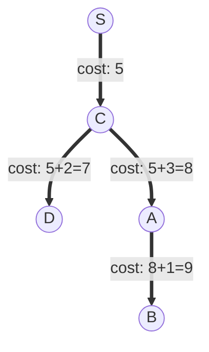

- Shortest paths from $S$:
  - To $S$: Cost $= 0$
  - To $C$: Cost $= 5$, Path: $S \to C$
  - To $D$: Cost $= 7$, Path: $S \to C \to D$
  - To $A$: Cost $= 8$, Path: $S \to C \to A$
  - To $B$: Cost $= 9$, Path: $S \to C \to A \to B$
- Time Complexity: $\mathbf{O((V + E) \log V)}$

### 3.4 Fractional Knapsack Problem

#### 3.4.1 Problem Definition & Capacity
- Knapsack capacity: $W = 50$
- Item list:
  - Item 1: Profit $P_1 = 60$, Weight $W_1 = 10$
  - Item 2: Profit $P_2 = 100$, Weight $W_2 = 20$
  - Item 3: Profit $P_3 = 120$, Weight $W_3 = 30$

#### 3.4.2 Ratio Calculation ($P_i / W_i$)
- Ratio for Item 1:
  $$r_1 = \frac{60}{10} = 6.0$$
- Ratio for Item 2:
  $$r_2 = \frac{100}{20} = 5.0$$
- Ratio for Item 3:
  $$r_3 = \frac{120}{30} = 4.0$$

#### 3.4.3 Sorted Ratio Order
- Descending order:
  - Item 1 ($r_1 = 6.0$)
  - Item 2 ($r_2 = 5.0$)
  - Item 3 ($r_3 = 4.0$)

#### 3.4.4 Greedy Item Selection Walkthrough

##### Take Item 1
- Current capacity: $50$
- Item 1 weight: $10 \le 50$
- Action: Take full item ($x_1 = 1.0$)
- Profit added: $60$
- Remaining capacity:
  $$50 - 10 = 40$$
- Current total profit: $60$

##### Take Item 2
- Current capacity: $40$
- Item 2 weight: $20 \le 40$
- Action: Take full item ($x_2 = 1.0$)
- Profit added: $100$
- Remaining capacity:
  $$40 - 20 = 20$$
- Current total profit:
  $$60 + 100 = 160$$

##### Take Fraction of Item 3
- Current capacity: $20$
- Item 3 weight: $30 > 20$ (Cannot take completely)
- Action: Take fractional part:
  $$x_3 = \frac{\text{Remaining Capacity}}{\text{Item Weight}} = \frac{20}{30} = \frac{2}{3}$$
- Profit added:
  $$120 \times \left(\frac{2}{3}\right) = 80$$
- Remaining capacity:
  $$20 - 20 = 0$$

#### 3.4.5 Final Solution Vector & Max Profit
- Selection fractions:
  $$x = \left(1, 1, \frac{2}{3}\right)$$
- Total optimal profit:
  $$60 + 100 + 80 = \mathbf{240}$$
- Time Complexity: $\mathbf{O(n \log n)}$ (sorting dominant).

### 3.5 Activity Selection Problem

#### 3.5.1 Problem Data (Start & Finish Times)
- Activities with $(s_i, f_i)$:
  - $A_1$: Start $= 1$, Finish $= 3$
  - $A_2$: Start $= 2$, Finish $= 5$
  - $A_3$: Start $= 4$, Finish $= 7$
  - $A_4$: Start $= 1$, Finish $= 8$
  - $A_5$: Start $= 5$, Finish $= 9$
  - $A_6$: Start $= 8$, Finish $= 10$

#### 3.5.2 Sorting by Finish Time
- Finish times are already sorted:
  - $A_1(1, 3)$
  - $A_2(2, 5)$
  - $A_3(4, 7)$
  - $A_4(1, 8)$
  - $A_5(5, 9)$
  - $A_6(8, 10)$

#### 3.5.3 Compatibility Check Trace

##### Consider Activity $A_1(1, 3)$
- First activity is always selected.
- Action: **Select $A_1$**
- Selected set: $\{A_1\}$
- Last finish time: $f_{\text{last}} = 3$

##### Consider Activity $A_2(2, 5)$
- Start time: $s_2 = 2$
- Test: $s_2 < f_{\text{last}} \implies 2 < 3$ (Overlap)
- Action: **Reject $A_2$**

##### Consider Activity $A_3(4, 7)$
- Start time: $s_3 = 4$
- Test: $s_3 \ge f_{\text{last}} \implies 4 \ge 3$ (Compatible)
- Action: **Select $A_3$**
- Selected set: $\{A_1, A_3\}$
- Last finish time: $f_{\text{last}} = 7$

##### Consider Activity $A_4(1, 8)$
- Start time: $s_4 = 1$
- Test: $s_4 < f_{\text{last}} \implies 1 < 7$
- Action: **Reject $A_4$**

##### Consider Activity $A_5(5, 9)$
- Start time: $s_5 = 5$
- Test: $s_5 < f_{\text{last}} \implies 5 < 7$
- Action: **Reject $A_5$**

##### Consider Activity $A_6(8, 10)$
- Start time: $s_6 = 8$
- Test: $s_6 \ge f_{\text{last}} \implies 8 \ge 7$ (Compatible)
- Action: **Select $A_6$**
- Selected set: $\{A_1, A_3, A_6\}$
- Last finish time: $f_{\text{last}} = 10$

#### 3.5.4 Selected Activities & Complexity
- Maximum set of mutually compatible activities:
  $$\mathbf{\{A_1, A_3, A_6\}}$$
- Total count: $3$
- Time Complexity: $\mathbf{O(n \log n)}$ if unsorted; $\mathbf{O(n)}$ if sorted.

### 3.6 Huffman Coding

#### 3.6.1 Character Frequencies Input
- Character set with frequencies:
  - $f: 5$
  - $e: 9$
  - $c: 12$
  - $b: 13$
  - $d: 16$
  - $a: 45$

#### 3.6.2 Step-by-Step Min-Heap Tree Merge

##### Merge 1
- Two smallest frequencies: $f(5)$ and $e(9)$
- Create parent node $N_1$:
  $$\text{weight}(N_1) = 5 + 9 = 14$$
- Remaining nodes: $c(12), b(13), N_1(14), d(16), a(45)$

##### Merge 2
- Two smallest frequencies: $c(12)$ and $b(13)$
- Create parent node $N_2$:
  $$\text{weight}(N_2) = 12 + 13 = 25$$
- Remaining nodes: $N_1(14), d(16), N_2(25), a(45)$

##### Merge 3
- Two smallest frequencies: $N_1(14)$ and $d(16)$
- Create parent node $N_3$:
  $$\text{weight}(N_3) = 14 + 16 = 30$$
- Remaining nodes: $N_2(25), N_3(30), a(45)$

##### Merge 4
- Two smallest frequencies: $N_2(25)$ and $N_3(30)$
- Create parent node $N_4$:
  $$\text{weight}(N_4) = 25 + 30 = 55$$
- Remaining nodes: $a(45), N_4(55)$

##### Merge 5
- Two remaining nodes: $a(45)$ and $N_4(55)$
- Create root node:
  $$\text{weight}(\text{Root}) = 45 + 55 = 100$$

#### 3.6.3 Visual Huffman Tree Diagram

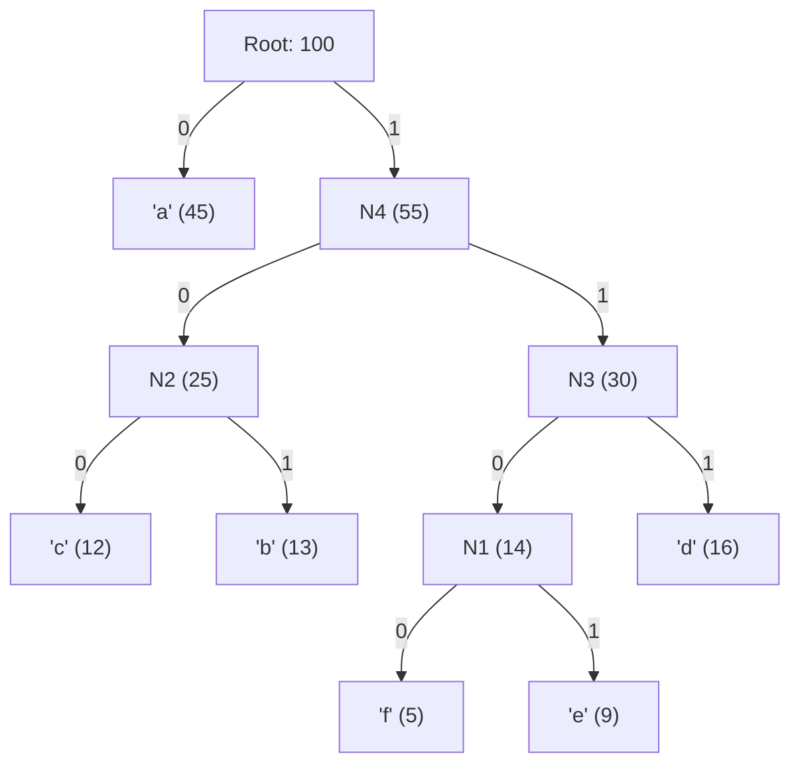

#### 3.6.4 Prefix Code Generation Table
- Traverse left as $0$, right as $1$:
  - Character $a$: Code $= \mathbf{0}$ (Length $1$)
  - Character $c$: Path $\text{Root} \to 1 \to 0 \to 0 \implies \mathbf{100}$ (Length $3$)
  - Character $b$: Path $\text{Root} \to 1 \to 0 \to 1 \implies \mathbf{101}$ (Length $3$)
  - Character $d$: Path $\text{Root} \to 1 \to 1 \to 1 \implies \mathbf{111}$ (Length $3$)
  - Character $f$: Path $\text{Root} \to 1 \to 1 \to 0 \to 0 \implies \mathbf{1100}$ (Length $4$)
  - Character $e$: Path $\text{Root} \to 1 \to 1 \to 0 \to 1 \implies \mathbf{1101}$ (Length $4$)

#### 3.6.5 Total Bit Length Calculation & Ratio
- Bits required per character:
  - $a: 45 \times 1 = 45$
  - $c: 12 \times 3 = 36$
  - $b: 13 \times 3 = 39$
  - $d: 16 \times 3 = 48$
  - $f: 5 \times 4 = 20$
  - $e: 9 \times 4 = 36$
- Total encoded message size:
  $$\text{Total Bits} = 45 + 36 + 39 + 48 + 20 + 36 = \mathbf{224\text{ bits}}$$
- Fixed-length comparison ($3$ bits per char for $6$ chars):
  $$100 \times 3 = 300\text{ bits}$$
- Space saved:
  $$\frac{300 - 224}{300} \times 100\% = 25.33\%$$
- Time Complexity: $\mathbf{O(n \log n)}$

:::info[Unit - 4]
## Dynamic Programming
:::

### 4.1 0/1 Knapsack Problem (Tabulation)

#### 4.1.1 Problem Parameters & Recurrence
- Knapsack capacity: $W = 5$
- Number of items: $n = 4$
- Items:
  - Item 1: $w_1 = 2, v_1 = 3$
  - Item 2: $w_2 = 3, v_2 = 4$
  - Item 3: $w_3 = 4, v_3 = 5$
  - Item 4: $w_4 = 5, v_4 = 6$
- Recurrence relation:
  $$V[i][w] = \begin{cases} V[i-1][w] & \text{if } w_i > w \\ \max(V[i-1][w], v_i + V[i-1][w - w_i]) & \text{if } w_i \le w \end{cases}$$

#### 4.1.2 DP Table Construction Walkthrough

##### Row $i = 0$ (No Items)
- For all capacities $w = 0$ to $5$:
  $$V[0][w] = 0$$

##### Row $i = 1$ (Item 1: $w_1 = 2, v_1 = 3$)
- $w = 0$: $V[1][0] = 0$
- $w = 1$: $w_1 > 1 \implies V[1][1] = V[0][1] = 0$
- $w = 2$: $\max(V[0][2], 3 + V[0][0]) = \max(0, 3) = 3$
- $w = 3$: $\max(V[0][3], 3 + V[0][1]) = \max(0, 3) = 3$
- $w = 4$: $\max(V[0][4], 3 + V[0][2]) = \max(0, 3) = 3$
- $w = 5$: $\max(V[0][5], 3 + V[0][3]) = \max(0, 3) = 3$

##### Row $i = 2$ (Item 2: $w_2 = 3, v_2 = 4$)
- $w = 0$: $V[2][0] = 0$
- $w = 1$: $w_2 > 1 \implies V[2][1] = V[1][1] = 0$
- $w = 2$: $w_2 > 2 \implies V[2][2] = V[1][2] = 3$
- $w = 3$: $\max(V[1][3], 4 + V[1][0]) = \max(3, 4) = 4$
- $w = 4$: $\max(V[1][4], 4 + V[1][1]) = \max(3, 4 + 0) = 4$
- $w = 5$: $\max(V[1][5], 4 + V[1][2]) = \max(3, 4 + 3) = \mathbf{7}$

##### Row $i = 3$ (Item 3: $w_3 = 4, v_3 = 5$)
- $w = 0$: $V[3][0] = 0$
- $w = 1$: $V[3][1] = 0$
- $w = 2$: $V[3][2] = 3$
- $w = 3$: $V[3][3] = 4$
- $w = 4$: $\max(V[2][4], 5 + V[2][0]) = \max(4, 5) = 5$
- $w = 5$: $\max(V[2][5], 5 + V[2][1]) = \max(7, 5 + 0) = \mathbf{7}$

##### Row $i = 4$ (Item 4: $w_4 = 5, v_4 = 6$)
- $w = 0$: $V[4][0] = 0$
- $w = 1$: $V[4][1] = 0$
- $w = 2$: $V[4][2] = 3$
- $w = 3$: $V[4][3] = 4$
- $w = 4$: $V[4][4] = 5$
- $w = 5$: $\max(V[3][5], 6 + V[3][0]) = \max(7, 6 + 0) = \mathbf{7}$

#### 4.1.3 Complete DP Matrix Table

| $i \downarrow \setminus w \to$ | $w = 0$ | $w = 1$ | $w = 2$ | $w = 3$ | $w = 4$ | $w = 5$ |
|---|---|---|---|---|---|---|
| **$i = 0$** | 0 | 0 | 0 | 0 | 0 | 0 |
| **$i = 1 (2, 3)$** | 0 | 0 | 3 | 3 | 3 | 3 |
| **$i = 2 (3, 4)$** | 0 | 0 | 3 | 4 | 4 | **7** |
| **$i = 3 (4, 5)$** | 0 | 0 | 3 | 4 | 5 | **7** |
| **$i = 4 (5, 6)$** | 0 | 0 | 3 | 4 | 5 | **7** |

#### 4.1.4 Item Backtracking Trace
- Check Item 4 at $(4, 5)$:
  - $V[4][5] == V[3][5] \implies 7 == 7$
  - Item 4 is **NOT selected**.
- Check Item 3 at $(3, 5)$:
  - $V[3][5] == V[2][5] \implies 7 == 7$
  - Item 3 is **NOT selected**.
- Check Item 2 at $(2, 5)$:
  - $V[2][5] \ne V[1][5] \implies 7 \ne 3$
  - Item 2 is **SELECTED** ($w_2 = 3, v_2 = 4$).
  - Remaining capacity: $5 - 3 = 2$.
- Check Item 1 at $(1, 2)$:
  - $V[1][2] \ne V[0][2] \implies 3 \ne 0$
  - Item 1 is **SELECTED** ($w_1 = 2, v_1 = 3$).
  - Remaining capacity: $2 - 2 = 0$.

#### 4.1.5 Optimal Subset & Complexity
- Selected items: $\{\text{Item 1}, \text{Item 2}\}$
- Total weight: $2 + 3 = 5$
- Total max profit: $3 + 4 = \mathbf{7}$
- Time Complexity: $\mathbf{O(n W)}$
- Space Complexity: $\mathbf{O(n W)}$ (reducible to $O(W)$).

### 4.2 Binomial Coefficient ($C(n, k)$)

#### 4.2.1 Recurrence & Base Cases
- Pascal's identity:
  $$C(n, k) = C(n-1, k-1) + C(n-1, k)$$
- Base cases:
  $$C(n, 0) = 1, \quad C(n, n) = 1$$

#### 4.2.2 Line-by-Line DP Table Calculation for $\binom{5}{3}$
- Row $0$:
  $$C(0, 0) = 1$$
- Row $1$:
  $$C(1, 0) = 1, \quad C(1, 1) = 1$$
- Row $2$:
  $$C(2, 0) = 1$$
  $$C(2, 1) = C(1, 0) + C(1, 1) = 1 + 1 = 2$$
  $$C(2, 2) = 1$$
- Row $3$:
  $$C(3, 0) = 1$$
  $$C(3, 1) = C(2, 0) + C(2, 1) = 1 + 2 = 3$$
  $$C(3, 2) = C(2, 1) + C(2, 2) = 2 + 1 = 3$$
  $$C(3, 3) = 1$$
- Row $4$:
  $$C(4, 0) = 1$$
  $$C(4, 1) = C(3, 0) + C(3, 1) = 1 + 3 = 4$$
  $$C(4, 2) = C(3, 1) + C(3, 2) = 3 + 3 = 6$$
  $$C(4, 3) = C(3, 2) + C(3, 3) = 3 + 1 = 4$$
  $$C(4, 4) = 1$$
- Row $5$:
  $$C(5, 0) = 1$$
  $$C(5, 1) = C(4, 0) + C(4, 1) = 1 + 4 = 5$$
  $$C(5, 2) = C(4, 1) + C(4, 2) = 4 + 6 = 10$$
  $$C(5, 3) = C(4, 2) + C(4, 3) = 6 + 4 = \mathbf{10}$$

#### 4.2.3 Final Value & Space Optimization
- Result:
  $$\binom{5}{3} = \mathbf{10}$$
- Time Complexity: $\mathbf{O(n k)}$
- Space Complexity: $\mathbf{O(k)}$ using 1D array.

### 4.3 Floyd-Warshall All-Pairs Shortest Path

#### 4.3.1 Problem Graph & Initial Matrix $D^{(0)}$
- Directed graph with $4$ vertices:
  $$D^{(0)} = \begin{bmatrix} 0 & 3 & \infty & 7 \\ 8 & 0 & 2 & \infty \\ 5 & \infty & 0 & 1 \\ 2 & \infty & \infty & 0 \end{bmatrix}$$

#### 4.3.2 Visual Directed Graph

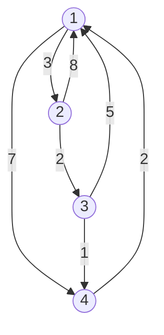

#### 4.3.3 Recurrence Formula
$$D^{(k)}[i][j] = \min\left(D^{(k-1)}[i][j], D^{(k-1)}[i][k] + D^{(k-1)}[k][j]\right)$$

#### 4.3.4 Intermediate Matrices $D^{(1)}, D^{(2)}, D^{(3)}, D^{(4)}$

##### Pass $k = 1$ (Intermediate Node $1$)
- Column $1$ and Row $1$ remain unchanged.
- $D^{(1)}[2][4] = \min(\infty, D^{(0)}[2][1] + D^{(0)}[1][4]) = \min(\infty, 8 + 7) = 15$
- $D^{(1)}[3][2] = \min(\infty, D^{(0)}[3][1] + D^{(0)}[1][2]) = \min(\infty, 5 + 3) = 8$
- $D^{(1)}[4][2] = \min(\infty, D^{(0)}[4][1] + D^{(0)}[1][2]) = \min(\infty, 2 + 3) = 5$
- $D^{(1)}[4][4] = \min(0, 2 + 7) = 0$
- Matrix $D^{(1)}$:
  $$D^{(1)} = \begin{bmatrix} 0 & 3 & \infty & 7 \\ 8 & 0 & 2 & 15 \\ 5 & 8 & 0 & 1 \\ 2 & 5 & \infty & 0 \end{bmatrix}$$

##### Pass $k = 2$ (Intermediate Node $2$)
- $D^{(2)}[1][3] = \min(\infty, D^{(1)}[1][2] + D^{(1)}[2][3]) = \min(\infty, 3 + 2) = 5$
- $D^{(2)}[3][3] = \min(0, 8 + 2) = 0$
- $D^{(2)}[4][3] = \min(\infty, D^{(1)}[4][2] + D^{(1)}[2][3]) = \min(\infty, 5 + 2) = 7$
- Matrix $D^{(2)}$:
  $$D^{(2)} = \begin{bmatrix} 0 & 3 & 5 & 7 \\ 8 & 0 & 2 & 15 \\ 5 & 8 & 0 & 1 \\ 2 & 5 & 7 & 0 \end{bmatrix}$$

##### Pass $k = 3$ (Intermediate Node $3$)
- $D^{(3)}[1][4] = \min(7, D^{(2)}[1][3] + D^{(2)}[3][4]) = \min(7, 5 + 1) = 6$
- $D^{(3)}[2][4] = \min(15, D^{(2)}[2][3] + D^{(2)}[3][4]) = \min(15, 2 + 1) = 3$
- $D^{(3)}[2][1] = \min(8, 2 + 5) = 7$
- Matrix $D^{(3)}$:
  $$D^{(3)} = \begin{bmatrix} 0 & 3 & 5 & 6 \\ 7 & 0 & 2 & 3 \\ 5 & 8 & 0 & 1 \\ 2 & 5 & 7 & 0 \end{bmatrix}$$

##### Pass $k = 4$ (Intermediate Node $4$)
- $D^{(4)}[2][1] = \min(7, D^{(3)}[2][4] + D^{(3)}[4][1]) = \min(7, 3 + 2) = 5$
- $D^{(4)}[3][1] = \min(5, D^{(3)}[3][4] + D^{(3)}[4][1]) = \min(5, 1 + 2) = 3$
- $D^{(4)}[3][2] = \min(8, D^{(3)}[3][4] + D^{(3)}[4][2]) = \min(8, 1 + 5) = 6$

#### 4.3.5 Final All-Pairs Distance Matrix & Complexity
- Final matrix $D^{(4)}$:
  $$D^{(4)} = \begin{bmatrix} 0 & 3 & 5 & 6 \\ 5 & 0 & 2 & 3 \\ 3 & 6 & 0 & 1 \\ 2 & 5 & 7 & 0 \end{bmatrix}$$
- Time Complexity: $\mathbf{\Theta(V^3)}$
- Space Complexity: $\mathbf{\Theta(V^2)}$

### 4.4 Matrix Chain Multiplication (MCM)

#### 4.4.1 Matrix Chain Dimensions
- Three matrices:
  - $A_1$: dimension $10 \times 30$
  - $A_2$: dimension $30 \times 5$
  - $A_3$: dimension $5 \times 60$
- Dimension array:
  $$p = [10, 30, 5, 60], \quad n = 3$$

#### 4.4.2 MCM Recurrence Formula
$$m[i, j] = \min_{i \le k < j} \{m[i, k] + m[k+1, j] + p_{i-1} p_k p_j\}$$

#### 4.4.3 Chain Length $l = 1$ (Base Cases)
- Cost to multiply a single matrix:
  $$m[1, 1] = 0$$
  $$m[2, 2] = 0$$
  $$m[3, 3] = 0$$

#### 4.4.4 Chain Length $l = 2$ (Individual Calculations)
- Multiplying $A_1 A_2$ ($i = 1, j = 2, k = 1$):
  $$m[1, 2] = m[1, 1] + m[2, 2] + p_0 p_1 p_2$$
  $$m[1, 2] = 0 + 0 + (10 \times 30 \times 5)$$
  $$m[1, 2] = 1500$$
  $$s[1, 2] = 1$$

- Multiplying $A_2 A_3$ ($i = 2, j = 3, k = 2$):
  $$m[2, 3] = m[2, 2] + m[3, 3] + p_1 p_2 p_3$$
  $$m[2, 3] = 0 + 0 + (30 \times 5 \times 60)$$
  $$m[2, 3] = 9000$$
  $$s[2, 3] = 2$$

#### 4.4.5 Chain Length $l = 3$ (Split Minimization Trace)
- Multiply entire chain: $m[1, 3]$ ($i = 1, j = 3$)

- Option $k = 1$: Split as $(A_1)(A_2 A_3)$
  $$\text{Cost}_1 = m[1, 1] + m[2, 3] + p_0 p_1 p_3$$
  $$\text{Cost}_1 = 0 + 9000 + (10 \times 30 \times 60)$$
  $$\text{Cost}_1 = 9000 + 18000$$
  $$\text{Cost}_1 = 27,000$$

- Option $k = 2$: Split as $(A_1 A_2)(A_3)$
  $$\text{Cost}_2 = m[1, 2] + m[3, 3] + p_0 p_2 p_3$$
  $$\text{Cost}_2 = 1500 + 0 + (10 \times 5 \times 60)$$
  $$\text{Cost}_2 = 1500 + 3000$$
  $$\text{Cost}_2 = 4500$$

- Minimum cost choice:
  $$m[1, 3] = \min(27000, 4500) = \mathbf{4500}$$
  $$s[1, 3] = 2$$

#### 4.4.6 Optimal Parenthesization & Multiplications Count
- Optimal parenthesization from split table:
  $$\mathbf{((A_1 A_2) A_3)}$$
- Minimum scalar multiplications required: $\mathbf{4500}$
- Time Complexity: $\mathbf{\Theta(n^3)}$
- Space Complexity: $\mathbf{\Theta(n^2)}$

### 4.5 Longest Common Subsequence (LCS)

#### 4.5.1 Input Sequences & Recurrence
- Sequences:
  - $X = \text{"ABCBDAB"}$ ($m = 7$)
  - $Y = \text{"BDCABA"}$ ($n = 6$)
- Recurrence:
  $$c[i, j] = \begin{cases} 0 & \text{if } i=0 \text{ or } j=0 \\ c[i-1, j-1] + 1 & \text{if } X[i] == Y[j] \\ \max(c[i-1, j], c[i, j-1]) & \text{if } X[i] \ne Y[j] \end{cases}$$

#### 4.5.2 DP Table Construction
- Step-by-step matching logic:
  - If $X[i] == Y[j]$: take diagonal value plus $1$.
  - If $X[i] \ne Y[j]$: take maximum of top cell $c[i-1, j]$ and left cell $c[i, j-1]$.

#### 4.5.3 Complete Cell Matrix

| $X \downarrow \setminus Y \to$ | $\emptyset$ | $B$ | $D$ | $C$ | $A$ | $B$ | $A$ |
|---|---|---|---|---|---|---|---|
| $\emptyset$ | 0 | 0 | 0 | 0 | 0 | 0 | 0 |
| **$A$** | 0 | 0 | 0 | 0 | 1 | 1 | 1 |
| **$B$** | 0 | 1 | 1 | 1 | 1 | 2 | 2 |
| **$C$** | 0 | 1 | 1 | 2 | 2 | 2 | 2 |
| **$B$** | 0 | 1 | 1 | 2 | 2 | 3 | 3 |
| **$D$** | 0 | 1 | 2 | 2 | 2 | 3 | 3 |
| **$A$** | 0 | 1 | 2 | 2 | 3 | 3 | 4 |
| **$B$** | 0 | 1 | 2 | 2 | 3 | 4 | **4** |

#### 4.5.4 Backtracking the Common Subsequence
- Start at $c[7, 6] = 4$:
  - $X[7] = 'B', Y[6] = 'A' \implies$ Mismatch. Take max(top, left) $\implies$ move up to $(6, 6)$ with value $4$.
  - $X[6] = 'A', Y[6] = 'A' \implies$ Match! Add **$'A'$** to LCS. Move diagonal to $(5, 5)$ with value $3$.
  - $X[5] = 'D', Y[5] = 'B' \implies$ Mismatch. Move up to $(4, 5)$ with value $3$.
  - Follow up to $(4, 5)$: $X[4] = 'B', Y[5] = 'B' \implies$ Match! Add **$'B'$** to LCS. Move diagonal to $(3, 4)$ with value $2$.
  - Follow up to $(3, 3)$: $X[3] = 'C', Y[3] = 'C' \implies$ Match! Add **$'C'$** to LCS. Move diagonal to $(2, 2)$ with value $1$.
  - Follow to $(2, 1)$: $X[2] = 'B', Y[1] = 'B' \implies$ Match! Add **$'B'$** to LCS. Move diagonal to $(1, 0)$ with value $0$.

#### 4.5.5 Final LCS String & Length
- Reverse the matched characters:
  - Sequence: $'B' \to 'C' \to 'B' \to 'A'$
  - LCS String: $\mathbf{\text{"BCBA"}}$ (or $\text{"BDAB"}$)
- LCS Length: $\mathbf{4}$
- Time Complexity: $\mathbf{\Theta(m \cdot n)}$
- Space Complexity: $\mathbf{\Theta(m \cdot n)}$

:::info[Unit - 5]
## Exploring Graphs
:::

### 5.1 Breadth-First Search (BFS)

#### 5.1.1 Graph Structure & Starting Vertex
- Vertices: $V = \{1, 2, 3, 4, 5, 6\}$
- Undirected edges:
  $$(1, 2), (1, 3), (2, 4), (2, 5), (3, 5), (4, 6), (5, 6)$$
- Starting source vertex: $1$

#### 5.1.2 Visual Graph & Level Frontiers

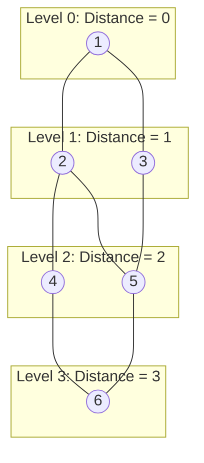

#### 5.1.3 Step-by-Step Queue & Distance Updates

##### Initialization
- Visited: $\{1\}$
- Queue: `[1]`
- Distance array:
  $$d[1] = 0, \quad d[2 \dots 6] = \infty$$

##### Step 1: Dequeue $1$
- Dequeued vertex: $1$
- Unvisited neighbors: $2, 3$
- Updates:
  - $d[2] = d[1] + 1 = 1$
  - $d[3] = d[1] + 1 = 1$
- Enqueue: $2, 3$
- Queue: `[2, 3]`
- Visited: $\{1, 2, 3\}$

##### Step 2: Dequeue $2$
- Dequeued vertex: $2$
- Unvisited neighbors: $4, 5$
- Updates:
  - $d[4] = d[2] + 1 = 2$
  - $d[5] = d[2] + 1 = 2$
- Enqueue: $4, 5$
- Queue: `[3, 4, 5]`
- Visited: $\{1, 2, 3, 4, 5\}$

##### Step 3: Dequeue $3$
- Dequeued vertex: $3$
- Neighbors: $1$ (already visited), $5$ (already visited)
- No new vertices enqueued.
- Queue: `[4, 5]`

##### Step 4: Dequeue $4$
- Dequeued vertex: $4$
- Unvisited neighbors: $6$
- Updates:
  - $d[6] = d[4] + 1 = 3$
- Enqueue: $6$
- Queue: `[5, 6]`
- Visited: $\{1, 2, 3, 4, 5, 6\}$

##### Step 5: Dequeue $5$
- Dequeued vertex: $5$
- Neighbors: $2, 3, 6$ (all visited)
- Queue: `[6]`

##### Step 6: Dequeue $6$
- Dequeued vertex: $6$
- Queue: `[]` (Empty)
- Traversal complete.

#### 5.1.4 Final BFS Traversal Sequence & Tree Edges
- BFS Node Visitation Order:
  $$\mathbf{1 \to 2 \to 3 \to 4 \to 5 \to 6}$$
- BFS Tree Edges:
  $$(1, 2), \quad (1, 3), \quad (2, 4), \quad (2, 5), \quad (4, 6)$$
- Time Complexity: $\mathbf{O(V + E)}$
- Space Complexity: $\mathbf{O(V)}$ (Queue).

### 5.2 Depth-First Search (DFS) & Edge Classification

#### 5.2.1 Graph Structure & Initialization
- Directed graph with vertices $\{1, 2, 3, 4\}$:
  - $1 \to 2$
  - $1 \to 3$
  - $2 \to 4$
  - $3 \to 4$
  - $4 \to 1$
- Global timer: $\text{time} = 0$

#### 5.2.2 Visual DFS Edge Classification Graph

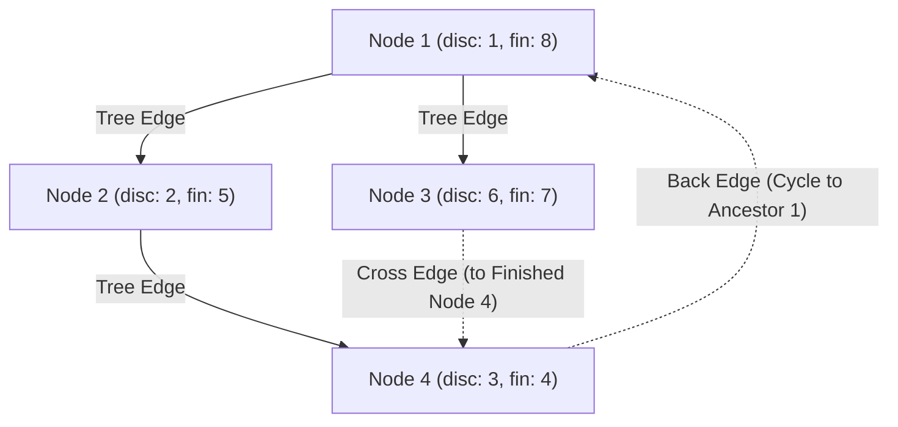

#### 5.2.3 Step-by-Step Recursion Stack & Timestamp Trace ($d[u], f[u]$)
- Step 1: Visit node $1$:
  - $\text{time} = 1$
  - Discovery time: $d[1] = 1$
- Step 2: Traverse tree edge $1 \to 2$, visit node $2$:
  - $\text{time} = 2$
  - Discovery time: $d[2] = 2$
- Step 3: Traverse tree edge $2 \to 4$, visit node $4$:
  - $\text{time} = 3$
  - Discovery time: $d[4] = 3$
- Step 4: Explore edge $4 \to 1$:
  - Node $1$ is currently in the active recursion stack (GRAY).
  - This indicates an ancestor relationship.
  - Classification: **Back Edge (Cycle detected!)**
- Step 5: Finish node $4$:
  - $\text{time} = 4$
  - Finishing time: $f[4] = 4$
- Step 6: Backtrack to node $2$ and finish:
  - $\text{time} = 5$
  - Finishing time: $f[2] = 5$
- Step 7: Backtrack to node $1$, explore tree edge $1 \to 3$, visit node $3$:
  - $\text{time} = 6$
  - Discovery time: $d[3] = 6$
- Step 8: Explore edge $3 \to 4$:
  - Node $4$ is already completely processed (BLACK) and is not an ancestor.
  - Classification: **Cross Edge**
- Step 9: Finish node $3$:
  - $\text{time} = 7$
  - Finishing time: $f[3] = 7$
- Step 10: Finish node $1$:
  - $\text{time} = 8$
  - Finishing time: $f[1] = 8$

#### 5.2.4 Edge Classification Summary
- Tree Edges: $(1 \to 2), (2 \to 4), (1 \to 3)$
- Back Edge: $(4 \to 1)$
- Cross Edge: $(3 \to 4)$
- Time Complexity: $\mathbf{O(V + E)}$

### 5.3 Topological Sorting

#### 5.3.1 DAG Definition & Visual Graph
- Directed Acyclic Graph (DAG) with vertices $\{A, B, C, D, E\}$:

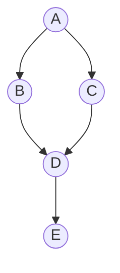

#### 5.3.2 Kahn's Algorithm Trace (In-Degree Elimination)

##### Step 1: In-Degree Calculation
- Node $A$: $\text{in}(A) = 0$
- Node $B$: $\text{in}(B) = 1$
- Node $C$: $\text{in}(C) = 1$
- Node $D$: $\text{in}(D) = 2$
- Node $E$: $\text{in}(E) = 1$

##### Step 2: Initialize Queue
- Enqueue nodes with in-degree $0$:
  $$\text{Queue} = [A]$$

##### Step 3: Dequeue $A$
- Output: $A$
- Decrement neighbor in-degrees:
  - $\text{in}(B) = 1 - 1 = 0 \implies$ Enqueue $B$
  - $\text{in}(C) = 1 - 1 = 0 \implies$ Enqueue $C$
- $\text{Queue} = [B, C]$

##### Step 4: Dequeue $B$
- Output: $B$
- Decrement neighbor in-degrees:
  - $\text{in}(D) = 2 - 1 = 1$
- $\text{Queue} = [C]$

##### Step 5: Dequeue $C$
- Output: $C$
- Decrement neighbor in-degrees:
  - $\text{in}(D) = 1 - 1 = 0 \implies$ Enqueue $D$
- $\text{Queue} = [D]$

##### Step 6: Dequeue $D$
- Output: $D$
- Decrement neighbor in-degrees:
  - $\text{in}(E) = 1 - 1 = 0 \implies$ Enqueue $E$
- $\text{Queue} = [E]$

##### Step 7: Dequeue $E$
- Output: $E$
- Decrement neighbors: None
- $\text{Queue} = []$

#### 5.3.3 Linear Topological Order Flow

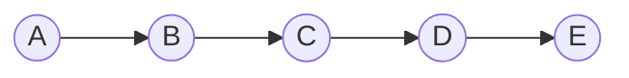

- Topological ordering:
  $$\mathbf{A \to B \to C \to D \to E}$$
- Time Complexity: $\mathbf{O(V + E)}$

### 5.4 Strongly Connected Components (Kosaraju's Algorithm)

#### 5.4.1 Directed Graph Input & Component Subgraphs

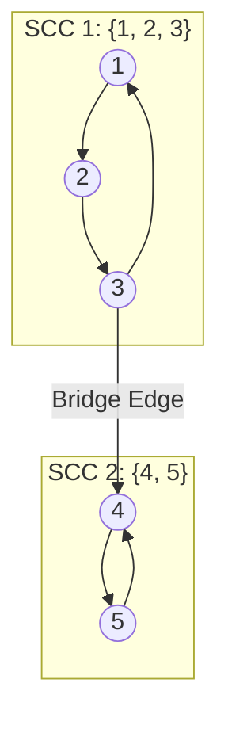

#### 5.4.2 Pass 1: Forward DFS & Finish-Time Stack
- Run DFS on original graph $G$:
  - Start at $1 \to 2 \to 3 \to 4 \to 5$
  - Finish $5 \implies$ Push $5$
  - Finish $4 \implies$ Push $4$
  - Finish $3 \implies$ Push $3$
  - Finish $2 \implies$ Push $2$
  - Finish $1 \implies$ Push $1$
- Resulting Stack (top to bottom):
  $$\text{Stack} = [1, 2, 3, 4, 5]$$

#### 5.4.3 Pass 2: Transpose Graph $G^T$ Construction
- Reverse the direction of all edges:
  $$2 \to 1, \quad 3 \to 2, \quad 1 \to 3, \quad 4 \to 3, \quad 5 \to 4, \quad 4 \to 5$$

#### 5.4.4 Pass 3: Reverse DFS & SCC Extraction
- Pop $1$ from Stack:
  - DFS on $G^T$ from $1$ visits: $\{1, 3, 2\}$
  - **Component 1:** $\{1, 2, 3\}$
- Next unvisited on Stack is $4$:
  - Pop $4$ from Stack
  - DFS on $G^T$ from $4$ visits: $\{4, 5\}$
  - **Component 2:** $\{4, 5\}$
- Strongly Connected Components:
  $$\mathbf{\{1, 2, 3\}} \quad \text{and} \quad \mathbf{\{4, 5\}}$$
- Time Complexity: $\mathbf{O(V + E)}$

### 5.5 Articulation Points & Bridges

#### 5.5.1 Graph Problem Input & Visual Diagram
- Undirected graph with $5$ vertices:

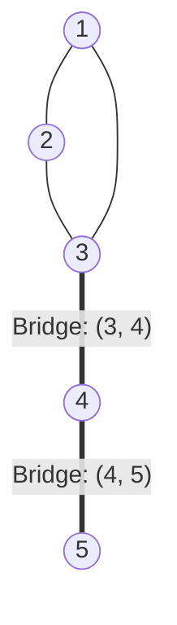

#### 5.5.2 Discovery Times and Low Values ($disc[u], low[u]$)
- DFS traversal starting at node $1$:
  - Visit $1$: $disc[1] = 1, low[1] = 1$
  - Visit $2$: $disc[2] = 2, low[2] = 2$
  - Visit $3$: $disc[3] = 3, low[3] = 3$
  - Back edge $(3-1)$: $low[3] = \min(3, disc[1]) = 1$
  - Propagate back to $2$: $low[2] = \min(2, low[3]) = 1$
  - Propagate back to $1$: $low[1] = 1$
  - From $3$, explore tree edge $3-4$:
    - Visit $4$: $disc[4] = 4, low[4] = 4$
    - Explore tree edge $4-5$:
      - Visit $5$: $disc[5] = 5, low[5] = 5$

#### 5.5.3 Cut Vertex Condition Testing
- Non-root condition: Vertex $u$ is an articulation point if it has a child $v$ such that:
  $$low[v] \ge disc[u]$$
- Test Node $3$ with child $4$:
  $$low[4] = 4, \quad disc[3] = 3$$
  $$4 \ge 3 \implies \mathbf{\text{Node 3 is an Articulation Point!}}$$
- Test Node $4$ with child $5$:
  $$low[5] = 5, \quad disc[4] = 4$$
  $$5 \ge 4 \implies \mathbf{\text{Node 4 is an Articulation Point!}}$$

#### 5.5.4 Bridge Condition Testing & Output
- Bridge condition: Edge $(u, v)$ is a bridge if:
  $$low[v] > disc[u]$$
- Test edge $(3, 4)$:
  $$low[4] = 4 > disc[3] = 3 \implies \mathbf{\text{Edge }(3, 4)\text{ is a Bridge!}}$$
- Test edge $(4, 5)$:
  $$low[5] = 5 > disc[4] = 4 \implies \mathbf{\text{Edge }(4, 5)\text{ is a Bridge!}}$$
- Articulation Points: $\{3, 4\}$
- Bridges: $\{(3, 4), (4, 5)\}$
- Time Complexity: $\mathbf{O(V + E)}$

:::info[Unit - 6]
## Backtracking & Branch and Bound
:::

### 6.1 4-Queens Problem (Backtracking)

#### 6.1.1 Problem Statement & Board Model
- Place $4$ queens on a $4 \times 4$ chessboard such that no two queens attack each other.
- Representation: array `col[1..4]` where `col[i]` is the column of the queen in row $i$.

#### 6.1.2 Non-Attacking Constraints
- Two queens in rows $i$ and $j$ conflict if:
  - Same column: $col[i] == col[j]$
  - Same diagonal: $|col[i] - col[j]| == |i - j|$

#### 6.1.3 Visual State-Space Search Tree

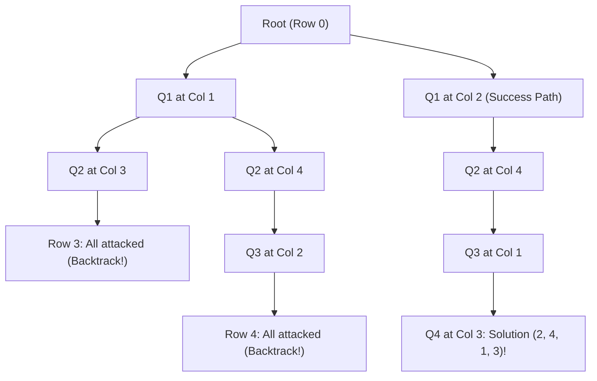

#### 6.1.4 Step-by-Step Exploration & Pruning

##### Row 1: Place Queen 1
- Try Column 1:
  - $\text{col}[1] = 1$
  - State: `[1, _, _, _]`

##### Row 2: Place Queen 2
- Try Column 1: Conflict with $Q_1$ (same column).
- Try Column 2: Conflict with $Q_1$ ($|2 - 1| == |2 - 1|$ diagonal).
- Try Column 3: Safe!
  - $\text{col}[2] = 3$
  - State: `[1, 3, _, _]`

##### Row 3: Place Queen 3
- Try Column 1: Conflict with $Q_1$ (same column).
- Try Column 2: Conflict with $Q_2$ ($|2 - 3| == |3 - 2|$ diagonal).
- Try Column 3: Conflict with $Q_2$ (same column).
- Try Column 4: Conflict with $Q_2$ ($|4 - 3| == |3 - 2|$ diagonal).
- Dead end! No safe column in Row 3.
- **Action: Backtrack to Row 2.**

##### Row 2 (Re-try):
- Try Column 4: Safe!
  - $\text{col}[2] = 4$
  - State: `[1, 4, _, _]`

##### Row 3:
- Try Column 1: Conflict with $Q_1$.
- Try Column 2: Safe!
  - $\text{col}[3] = 2$
  - State: `[1, 4, 2, _]`

##### Row 4:
- Try Column 1: Conflict with $Q_3$ ($|1 - 2| == |4 - 3|$).
- Try Column 2: Conflict with $Q_3$ (same column).
- Try Column 3: Conflict with $Q_3$ ($|3 - 2| == |4 - 3|$).
- Try Column 4: Conflict with $Q_2$ (same column).
- Dead end!
- **Action: Backtrack all the way to Row 1.**

##### Row 1 (Re-try): Place Queen 1 at Column 2
- Try Column 2:
  - $\text{col}[1] = 2$
  - State: `[2, _, _, _]`

##### Row 2:
- Try Column 1: Conflict with $Q_1$ diagonal.
- Try Column 2: Conflict with $Q_1$ column.
- Try Column 3: Conflict with $Q_1$ diagonal.
- Try Column 4: Safe!
  - $\text{col}[2] = 4$
  - State: `[2, 4, _, _]`

##### Row 3:
- Try Column 1: Safe!
  - $\text{col}[3] = 1$
  - State: `[2, 4, 1, _]`

##### Row 4:
- Try Column 1: Conflict with $Q_3$ column.
- Try Column 2: Conflict with $Q_1$ column.
- Try Column 3: Safe!
  - $\text{col}[4] = 3$
  - State: `[2, 4, 1, 3]`

#### 6.1.5 Final Solution Placement & Vector
- Solution Vector:
  $$\mathbf{[2, 4, 1, 3]}$$
- Visual Chessboard:
```text
. Q . .   (Row 1: Queen at Col 2)
. . . Q   (Row 2: Queen at Col 4)
Q . . .   (Row 3: Queen at Col 1)
. . Q .   (Row 4: Queen at Col 3)
```
- Time Complexity: $\mathbf{O(N!)}$

### 6.2 0/1 Knapsack using Backtracking

#### 6.2.1 Problem Parameters & Items
- Capacity: $W = 7$
- Items sorted by $P_i / W_i$:
  - $I_1$: $w_1 = 3, p_1 = 12$ (Ratio $= 4.0$)
  - $I_2$: $w_2 = 4, p_2 = 16$ (Ratio $= 4.0$)
  - $I_3$: $w_3 = 5, p_3 = 15$ (Ratio $= 3.0$)

#### 6.2.2 State-Space Tree Exploration
- Root: weight $= 0$, profit $= 0$, best profit $= 0$.

##### Branch Left (Include $I_1$):
- Weight: $0 + 3 = 3 \le 7$
- Profit: $0 + 12 = 12$
  - Branch Left (Include $I_2$):
    - Weight: $3 + 4 = 7 \le 7$
    - Profit: $12 + 16 = 28$
    - Update best profit: $\text{best} = 28$
      - Branch Left (Include $I_3$):
        - Weight: $7 + 5 = 12 > 7$ (Over capacity!)
        - **Prune: Infeasible branch.**
      - Branch Right (Exclude $I_3$):
        - Leaf reached with profit $28$.
  - Branch Right (Exclude $I_2$):
    - Weight: $3$
    - Profit: $12$
    - Maximum possible profit with remaining $I_3$:
      $$\text{Bound} = 12 + 15 = 27$$
    - Since $27 < \text{best}(28)$:
      - **Prune: Promising check fails.**

##### Branch Right (Exclude $I_1$):
- Weight: $0$
- Profit: $0$
- Maximum possible profit with $I_2, I_3$:
  $$\text{Bound} = 16 + 15 = 31 > 28$$
  - Branch Left (Include $I_2$):
    - Weight: $4$, Profit: $16$
    - Try include $I_3$: Weight $4 + 5 = 9 > 7 \implies$ Infeasible.
    - Exclude $I_3$: Profit is $16 < 28$.
  - Branch Right (Exclude $I_2$):
    - Only $I_3$ left $\implies$ Max profit $15 < 28 \implies$ Prune.

#### 6.2.3 Pruning Checks & Best Profit Updates
- Optimal solution: $\{I_1, I_2\}$
- Max profit: $\mathbf{28}$
- Weight used: $3 + 4 = 7$

### 6.3 0/1 Knapsack using Branch & Bound (LC-BB)

#### 6.3.1 Problem Instance & Relaxation Model
- Capacity: $W = 15$
- Sorted items:
  - $I_1$: $w = 2, p = 10$ ($p/w = 5.0$)
  - $I_2$: $w = 4, p = 10$ ($p/w = 2.5$)
  - $I_3$: $w = 6, p = 12$ ($p/w = 2.0$)
  - $I_4$: $w = 9, p = 18$ ($p/w = 2.0$)

#### 6.3.2 Upper Bound ($UB$) Formula via Fractional Knapsack
- Upper bound formula at any node:
  $$UB = \text{Current Profit} + \text{Fractional Knapsack on Remaining Capacity}$$

#### 6.3.3 State-Space Tree Expansion & Priority Queue State
- Root Node (Node 1):
  - Current weight: $0$
  - Current profit: $0$
  - Take $I_1$ ($w=2, p=10$), $I_2$ ($w=4, p=10$), $I_3$ ($w=6, p=12$)
  - Total weight: $12$, Total profit: $32$
  - Remaining capacity: $15 - 12 = 3$
  - Fractional part of $I_4$:
    $$\frac{3}{9} \times 18 = 6$$
  - Upper Bound:
    $$UB = 32 + 6 = \mathbf{38}$$

#### 6.3.4 Node Pruning & Optimal Leaf Finding
- Branch Left (Include $I_1$):
  - Current weight: $2$, Profit: $10$
  - Upper Bound remains $38$.
- Branch Right (Exclude $I_1$):
  - Upper bound drops below $32$.
- Expanding promising nodes:
  - Take $\{I_1, I_2, I_4\}$:
    - Weight: $2 + 4 + 9 = 15 \le 15$
    - Profit: $10 + 10 + 18 = \mathbf{38}$
- Any node with $UB \le 38$ is pruned.
- Final optimal profit: $\mathbf{38}$

### 6.4 Minimax Principle & Alpha-Beta Pruning

#### 6.4.1 Game Tree Layout & Visual Cutoff Diagram

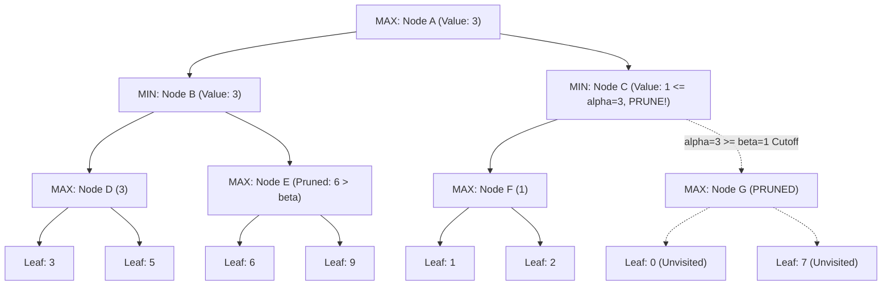

#### 6.4.2 Alpha ($\alpha$) and Beta ($\beta$) Boundary Definitions
- $\alpha$: Best score that Maximizer can guarantee so far ($-\infty$ initially).
- $\beta$: Best score that Minimizer can guarantee so far ($+\infty$ initially).
- Prune condition:
  $$\alpha \ge \beta$$

#### 6.4.3 Step-by-Step Node Evaluations & Cutoffs

##### Subtree Under $B$
- Leaf 1 under $D$: value $3$
- Leaf 2 under $D$: value $5$
- Node $D$ (MIN) selects: $\min(3, 5) = 3$
- Node $B$ (MIN) updates beta:
  $$\beta_B = \min(+\infty, 3) = 3$$
- Subtree $E$:
  - Leaf 1 under $E$: value $6$
  - Since $6 > \beta_B(3)$, MIN at node $B$ will never select a value from $E$.
- Node $B$ returns value $3$.

##### Root Node $A$
- Node $A$ (MAX) receives $3$ from child $B$.
- Update alpha:
  $$\alpha_A = \max(-\infty, 3) = \mathbf{3}$$

##### Subtree Under $C$
- Node $C$ inherits $\alpha = 3, \beta = +\infty$.
- Subtree $F$:
  - Leaf 1 under $F$: value $1$
  - Leaf 2 under $F$: value $2$
  - Node $F$ evaluates to: $\min(1, 2) = 1$
- Node $C$ (MIN) updates beta:
  $$\beta_C = \min(+\infty, 1) = \mathbf{1}$$
- Pruning Check at Node $C$:
  $$\alpha = 3, \quad \beta = 1$$
  $$\alpha \ge \beta \quad (3 \ge 1)$$
- **Condition Met: Cutoff / Prune Subtree $G$ entirely!**
- Leaves under $G$ ($0$ and $7$) are never evaluated.

#### 6.4.4 Final Root Optimal Decision
- Optimal minimax value at root: $\mathbf{3}$

### 6.5 Travelling Salesperson Problem (TSP) using Branch & Bound

#### 6.5.1 Cost Matrix Definition
- Initial $4 \times 4$ cost matrix:
  $$M = \begin{bmatrix} \infty & 10 & 15 & 20 \\ 5 & \infty & 9 & 10 \\ 6 & 13 & \infty & 12 \\ 8 & 8 & 9 & \infty \end{bmatrix}$$

#### 6.5.2 Visual City Graph

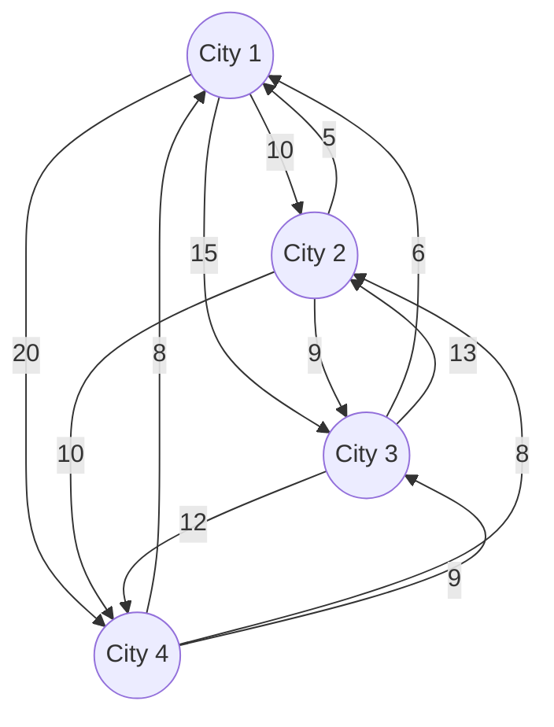

#### 6.5.3 Row Reductions Step-by-Step
- Row 1: minimum is $10$
  - Subtract $10$: $[\infty, 0, 5, 10]$
  - Reduction $r_1 = 10$
- Row 2: minimum is $5$
  - Subtract $5$: $[0, \infty, 4, 5]$
  - Reduction $r_2 = 5$
- Row 3: minimum is $6$
  - Subtract $6$: $[0, 7, \infty, 6]$
  - Reduction $r_3 = 6$
- Row 4: minimum is $8$
  - Subtract $8$: $[0, 0, 1, \infty]$
  - Reduction $r_4 = 8$
- Sum of row reductions:
  $$\sum r_i = 10 + 5 + 6 + 8 = 29$$

#### 6.5.4 Column Reductions Step-by-Step
- Reduced matrix after row reduction:
  $$\begin{bmatrix} \infty & 0 & 5 & 10 \\ 0 & \infty & 4 & 5 \\ 0 & 7 & \infty & 6 \\ 0 & 0 & 1 & \infty \end{bmatrix}$$
- Column 1: has $0 \implies c_1 = 0$
- Column 2: has $0 \implies c_2 = 0$
- Column 3: minimum is $1$
  - Subtract $1$: $[4, 3, \infty, 0]^T$
  - Reduction $c_3 = 1$
- Column 4: minimum is $5$
  - Subtract $5$: $[5, 0, 1, \infty]^T$
  - Reduction $c_4 = 5$
- Sum of column reductions:
  $$\sum c_j = 0 + 0 + 1 + 5 = 6$$

#### 6.5.5 Initial Lower Bound Calculation
- Root Lower Bound:
  $$\text{Bound}(\text{Root}) = \sum r_i + \sum c_j = 29 + 6 = \mathbf{35}$$

#### 6.5.6 Branching & Child Bound Computations
- Child bound formula for moving from city $i$ to city $j$:
  $$\text{Bound}(child) = \text{Bound}(parent) + A[i, j] + r$$
- Set row $i$ to $\infty$
- Set column $j$ to $\infty$
- Set cell $(j, 1)$ to $\infty$
- The branch with the minimum lower bound is explored until the full tour $1 \to A \to B \to C \to 1$ completes.

#### 6.5.7 Optimal Tour & Minimum Cost
- Optimal tour cost: $\mathbf{35}$

:::info[Unit - 7]
## String Matching & NP-Completeness
:::

### 7.1 Naive String Matching

#### 7.1.1 Problem Strings (Text & Pattern)
- Text:
  $$T = \text{"AABAACAADAABAABA"} \quad (n = 16)$$
- Pattern:
  $$P = \text{"AABA"} \quad (m = 4)$$
- Possible shifts: $s = 0$ to $n - m = 16 - 4 = 12$

#### 7.1.2 Shift-by-Shift Character Comparison Trace

##### Shift $s = 0$:
- Substring $T[0 \dots 3] = \text{"AABA"}$
- Compare with $P = \text{"AABA"}$
- All $4$ characters match.
- **Match found at index $0$!**

##### Shift $s = 1$:
- Substring $T[1 \dots 4] = \text{"ABAA"}$
- Compare: $T[1] = 'A' == P[0]$, but $T[2] = 'B' \ne P[1]('A')$.
- Mismatch after $1$ comparison.

##### Shift $s = 2$:
- Substring $T[2 \dots 5] = \text{"BAAC"}$
- Compare: $T[2] = 'B' \ne P[0]('A')$.
- Immediate mismatch.

##### Shift $s = 9$:
- Substring $T[9 \dots 12] = \text{"AABA"}$
- Compare with $P$: All characters match.
- **Match found at index $9$!**

##### Shift $s = 12$:
- Substring $T[12 \dots 15] = \text{"AABA"}$
- Compare with $P$: All characters match.
- **Match found at index $12$!**

#### 7.1.3 Valid Matches & Worst-Case Analysis
- Valid match shifts:
  $$\mathbf{s \in \{0, 9, 12\}}$$
- Time Complexity:
  - Best Case: $O(n)$
  - Worst Case: $\mathbf{O((n - m + 1) m)}$

### 7.2 Rabin-Karp Algorithm (Rolling Hash)

#### 7.2.1 Problem Parameters
- Text:
  $$T = \text{"31415926535"}$$
- Pattern:
  $$P = \text{"26"}$$
- Pattern length: $m = 2$
- Radix / Base: $d = 10$
- Prime modulus: $q = 11$
- High-order multiplier:
  $$h = d^{m-1} \pmod q = 10^{2-1} \pmod{11} = 10$$

#### 7.2.2 Pattern Hash Calculation
- Direct value: $26$
- Hash:
  $$p = 26 \pmod{11} = \mathbf{4}$$

#### 7.2.3 Window-by-Window Rolling Hash Trace
- Window 0 (`"31"`):
  $$t_0 = 31 \pmod{11} = 9 \ne 4$$
- Window 1 (`"14"`):
  $$t_1 = 14 \pmod{11} = 3 \ne 4$$
- Window 2 (`"41"`):
  $$t_2 = 41 \pmod{11} = 8 \ne 4$$
- Window 3 (`"15"`):
  $$t_3 = 15 \pmod{11} = 4 == p$$
  - Hash match! Verify characters:
  - String `"15"` $\ne$ `"26"`
  - **Spurious Hit!**
- Window 4 (`"59"`):
  $$t_4 = 59 \pmod{11} = 4 == p$$
  - Hash match! String `"59"` $\ne$ `"26"`
  - **Spurious Hit!**
- Window 5 (`"92"`):
  $$t_5 = 92 \pmod{11} = 4 == p$$
  - Hash match! String `"92"` $\ne$ `"26"`
  - **Spurious Hit!**
- Window 6 (`"26"`):
  $$t_6 = 26 \pmod{11} = 4 == p$$
  - Hash match! Verify characters:
  - String `"26"` $==$ `"26"`
  - **Valid Match found at Shift $6$!**

#### 7.2.4 Rolling Hash Formula Calculation Step-by-Step
- Shift formula:
  $$t_{s+1} = \left( d (t_s - T[s+1] \cdot h) + T[s+m+1] \right) \pmod q$$
- Example: Transition from Window 0 (`"31"`) to Window 1 (`"14"`):
  - Outgoing digit: $3$
  - Incoming digit: $4$
  - Calculation:
    $$t_1 = (10(31 - 3 \times 10) + 4) \pmod{11}$$
    $$t_1 = (10(1) + 4) \pmod{11} = 14 \pmod{11} = 3$$
- Time Complexity:
  - Average Case: $\mathbf{O(n + m)}$
  - Worst Case: $\mathbf{O((n - m + 1)m)}$

### 7.3 String Matching with Finite Automata (FA)

#### 7.3.1 Automaton Model (States & Alphabet)
- Pattern:
  $$P = \text{"aba"}$$
- Alphabet:
  $$\Sigma = \{a, b\}$$
- States: $\{0, 1, 2, 3\}$
- Initial State: $0$
- Accepting State: $3$

#### 7.3.2 Visual Automaton State Diagram

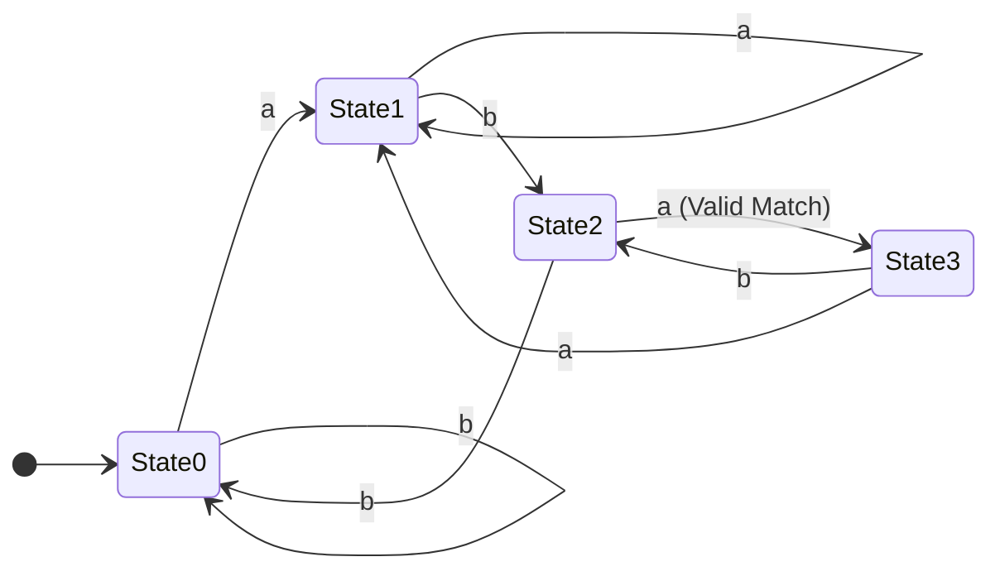

#### 7.3.3 State Transition Function ($\delta(q, a)$) Computation
- Definition: $\delta(q, c)$ is the length of the longest prefix of $P$ that is a suffix of $P_q c$.
- From State $0$ ($\emptyset$):
  - On $'a'$: Longest prefix of `"aba"` in `"a"` is `"a"` $\implies$ State $1$.
  - On $'b'$: Longest prefix in `"b"` is $\emptyset \implies$ State $0$.
- From State $1$ (`"a"`):
  - On $'a'$: Suffix of `"aa"` is `"a"` $\implies$ State $1$.
  - On $'b'$: Suffix of `"ab"` is `"ab"` $\implies$ State $2$.
- From State $2$ (`"ab"`):
  - On $'a'$: Suffix of `"aba"` is `"aba"` $\implies$ State $3$.
  - On $'b'$: Suffix of `"abb"` is $\emptyset \implies$ State $0$.
- From State $3$ (`"aba"`):
  - On $'a'$: Suffix of `"abaa"` is `"a"` $\implies$ State $1$.
  - On $'b'$: Suffix of `"abab"` is `"ab"` $\implies$ State $2$.

#### 7.3.4 Complete State Transition Table

| State $q$ | Input `'a'` | Input `'b'` |
|---|---|---|
| **0** | 1 | 0 |
| **1** | 1 | 2 |
| **2** | **3** | 0 |
| **3** | 1 | 2 |

#### 7.3.5 Text Processing State Trace
- Input Text: $T = \text{"ababa"}$
  - Start at state: $0$
  - Read $T[1] = 'a' \implies$ State $1$
  - Read $T[2] = 'b' \implies$ State $2$
  - Read $T[3] = 'a' \implies$ **State $3$ (Match at index 3!)**
  - Read $T[4] = 'b' \implies$ State $2$
  - Read $T[5] = 'a' \implies$ **State $3$ (Match at index 5!)**
- Matching Time: $\mathbf{\Theta(n)}$

### 7.4 Knuth-Morris-Pratt (KMP) Algorithm

#### 7.4.1 Pattern Definition & Prefix Function Concept
- Pattern:
  $$P = \text{"ababaca"}$$
- Length: $m = 7$
- Prefix function $\pi[i]$ represents the length of the longest proper prefix of $P[1 \dots i]$ that is also a suffix of $P[1 \dots i]$.

#### 7.4.2 Step-by-Step $\pi$ (LPS) Array Calculation

##### Index $i = 1$: Substring `"a"`
- No proper prefix exists.
- $\pi[1] = \mathbf{0}$

##### Index $i = 2$: Substring `"ab"`
- Proper prefixes: `{"a"}`
- Proper suffixes: `{"b"}`
- Match: None
- $\pi[2] = \mathbf{0}$

##### Index $i = 3$: Substring `"aba"`
- Proper prefixes: `{"a", "ab"}`
- Proper suffixes: `{"a", "ba"}`
- Longest match: `"a"` (length $1$)
- $\pi[3] = \mathbf{1}$

##### Index $i = 4$: Substring `"abab"`
- Proper prefixes: `{"a", "ab", "aba"}`
- Proper suffixes: `{"b", "ab", "bab"}`
- Longest match: `"ab"` (length $2$)
- $\pi[4] = \mathbf{2}$

##### Index $i = 5$: Substring `"ababa"`
- Proper prefixes: `{"a", "ab", "aba", "abab"}`
- Proper suffixes: `{"a", "ba", "aba", "baba"}`
- Longest match: `"aba"` (length $3$)
- $\pi[5] = \mathbf{3}$

##### Index $i = 6$: Substring `"ababac"`
- New character $'c'$ mismatches with $'b'$.
- Longest matching proper prefix-suffix: None.
- $\pi[6] = \mathbf{0}$

##### Index $i = 7$: Substring `"ababaca"`
- Proper prefixes: `{"a", ...}`
- Proper suffixes: `{"a", ...}`
- Longest match: `"a"` (length $1$)
- $\pi[7] = \mathbf{1}$

#### 7.4.3 Complete $\pi$ Table

| $i$ | 1 | 2 | 3 | 4 | 5 | 6 | 7 |
|---|---|---|---|---|---|---|---|
| **$P[i]$** | `a` | `b` | `a` | `b` | `a` | `c` | `a` |
| **$\pi[i]$** | **0** | **0** | **1** | **2** | **3** | **0** | **1** |

#### 7.4.4 Text Search Walkthrough (No Backtracking on Text)
- Text: $T = \text{"abababaca"}$
- Indices $1$ to $5$:
  - $T[1 \dots 5] = \text{"ababa"}$ matches $P[1 \dots 5]$.
- Index $6$:
  - $T[6] = 'b'$, but $P[6] = 'c'$ (Mismatch).
- Shift without text backtracking:
  - Current matched length: $5$.
  - Lookup $\pi[5] = 3$.
  - Resume comparison with $P[3 + 1] = P[4] = 'b'$.
  - Compare $T[6]('b')$ with $P[4]('b')$ $\implies$ Direct match!
- Preprocessing Time: $\mathbf{\Theta(m)}$
- Matching Time: $\mathbf{\Theta(n)}$
- Total Time: $\mathbf{\Theta(n + m)}$

### 7.5 NP-Completeness Foundations & Polynomial-Time Reduction

#### 7.5.1 Definitions: P, NP, NP-Hard, NP-Complete
- **Class P**: Problems solvable in polynomial time ($O(n^k)$).
- **Class NP**: Decision problems whose solutions are verifiable in polynomial time.
- **NP-Hard**: Problems at least as hard as any problem in NP (not necessarily in NP).
- **NP-Complete**: Problems that are both in **NP** and **NP-Hard**.

#### 7.5.2 3-SAT to CLIQUE Reduction Example
- 3-CNF Boolean formula $\phi$ with $k$ clauses:
  $$\phi = (x_1 \lor \neg x_2 \lor x_3) \land (\neg x_1 \lor x_2 \lor x_4)$$
- Number of clauses: $k = 2$

#### 7.5.3 Visual Reduction Graph Diagram

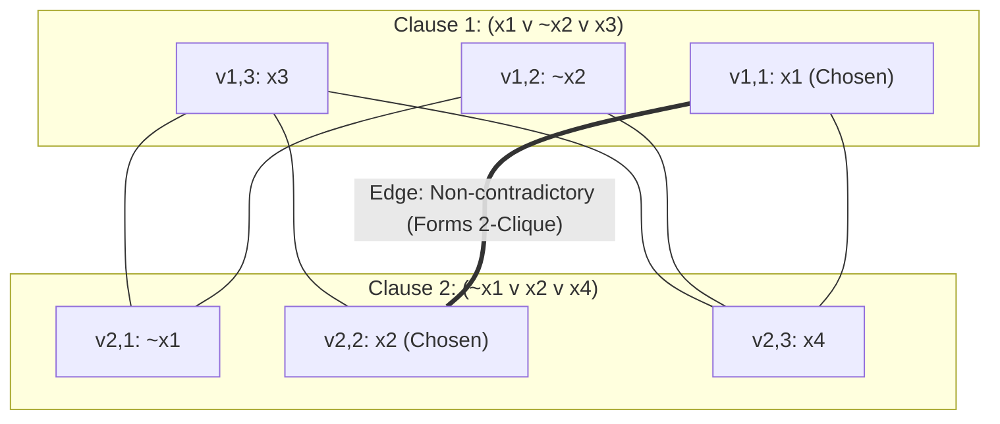

#### 7.5.4 Graph Transformation Step-by-Step
- Clause 1: create vertices for literals $v_{1,1}(x_1), v_{1,2}(\neg x_2), v_{1,3}(x_3)$.
- Clause 2: create vertices for literals $v_{2,1}(\neg x_1), v_{2,2}(x_2), v_{2,3}(x_4)$.
- Edge placement rule:
  - Connect two vertices if they are in **different clauses** AND are **not complementary** (i.e. not $x_i$ and $\neg x_i$).

#### 7.5.5 Equivalence Proof Walkthrough
- If $\phi$ is satisfiable:
  - Choosing assignment $x_1 = \text{True}, x_2 = \text{True}$:
  - Literal $x_1$ in Clause 1 is True.
  - Literal $x_2$ in Clause 2 is True.
  - They are in different clauses and not contradictory.
  - An edge exists between them, forming a **Clique of size $k = 2$**.
- If graph has a $k$-clique:
  - Exactly one vertex per clause is chosen.
  - Since no edges exist between contradictory literals, setting all selected literals to True satisfies formula $\phi$.
- Proves $\text{3-SAT} \le_P \text{CLIQUE}$.

## 8. Master Algorithm Complexity Reference Table

| Unit | Algorithm | Best Case Time | Average Case Time | Worst Case Time | Space Complexity |
|---|---|---|---|---|---|
| **U1** | Karatsuba Multiplication | $\Theta(n^{1.585})$ | $\Theta(n^{1.585})$ | $\Theta(n^{1.585})$ | $O(n)$ |
| **U2** | Binary Search | $O(1)$ | $O(\log n)$ | $O(\log n)$ | $O(1)$ |
| **U2** | Merge Sort | $\Theta(n \log n)$ | $\Theta(n \log n)$ | $\Theta(n \log n)$ | $O(n)$ |
| **U2** | Quick Sort | $O(n \log n)$ | $O(n \log n)$ | $O(n^2)$ | $O(\log n)$ |
| **U2** | Strassen Matrix Mult | $\Theta(n^{2.807})$ | $\Theta(n^{2.807})$ | $\Theta(n^{2.807})$ | $O(n^2)$ |
| **U2** | Modular Exponentiation | $O(\log n)$ | $O(\log n)$ | $O(\log n)$ | $O(\log n)$ |
| **U3** | Kruskal's MST | $O(E \log E)$ | $O(E \log E)$ | $O(E \log E)$ | $O(V)$ |
| **U3** | Prim's MST (Min-Heap) | $O(E \log V)$ | $O(E \log V)$ | $O(E \log V)$ | $O(V)$ |
| **U3** | Dijkstra Shortest Path | $O((V+E)\log V)$ | $O((V+E)\log V)$ | $O((V+E)\log V)$ | $O(V)$ |
| **U3** | Fractional Knapsack | $O(n \log n)$ | $O(n \log n)$ | $O(n \log n)$ | $O(1)$ |
| **U3** | Activity Selection | $O(n)$ (sorted) | $O(n \log n)$ | $O(n \log n)$ | $O(1)$ |
| **U3** | Huffman Coding | $O(n \log n)$ | $O(n \log n)$ | $O(n \log n)$ | $O(n)$ |
| **U4** | 0/1 Knapsack (DP) | $\Theta(n W)$ | $\Theta(n W)$ | $\Theta(n W)$ | $O(n W)$ |
| **U4** | Binomial Coefficient DP | $\Theta(n k)$ | $\Theta(n k)$ | $\Theta(n k)$ | $O(k)$ |
| **U4** | Floyd-Warshall APSP | $\Theta(V^3)$ | $\Theta(V^3)$ | $\Theta(V^3)$ | $\Theta(V^2)$ |
| **U4** | Matrix Chain Mult (MCM) | $\Theta(n^3)$ | $\Theta(n^3)$ | $\Theta(n^3)$ | $\Theta(n^2)$ |
| **U4** | Longest Common Subseq | $\Theta(m \cdot n)$ | $\Theta(m \cdot n)$ | $\Theta(m \cdot n)$ | $\Theta(m \cdot n)$ |
| **U5** | Breadth-First Search | $\Theta(V + E)$ | $\Theta(V + E)$ | $\Theta(V + E)$ | $O(V)$ |
| **U5** | Depth-First Search | $\Theta(V + E)$ | $\Theta(V + E)$ | $\Theta(V + E)$ | $O(V)$ |
| **U5** | Topological Sort (Kahn) | $\Theta(V + E)$ | $\Theta(V + E)$ | $\Theta(V + E)$ | $O(V)$ |
| **U5** | Kosaraju SCC | $\Theta(V + E)$ | $\Theta(V + E)$ | $\Theta(V + E)$ | $O(V)$ |
| **U5** | Articulation Points | $\Theta(V + E)$ | $\Theta(V + E)$ | $\Theta(V + E)$ | $O(V)$ |
| **U6** | 4-Queens Backtracking | $O(1)$ | $O(N!)$ | $O(N!)$ | $O(N)$ |
| **U6** | 0/1 Knapsack Backtracking| $O(n)$ | $O(2^n)$ | $O(2^n)$ | $O(n)$ |
| **U6** | TSP Branch & Bound | $O(n^2)$ | $O(2^n \cdot n^2)$ | $O(2^n \cdot n^2)$ | $O(n)$ |
| **U7** | Naive String Matching | $O(n)$ | $O(n)$ | $O((n - m + 1)m)$| $O(1)$ |
| **U7** | Rabin-Karp Matcher | $O(n + m)$ | $O(n + m)$ | $O((n - m + 1)m)$| $O(1)$ |
| **U7** | Finite Automaton Matcher| $\Theta(n)$ | $\Theta(n)$ | $\Theta(n)$ | $O(m |\Sigma|)$ |
| **U7** | KMP String Matcher | $\Theta(n + m)$ | $\Theta(n + m)$ | $\Theta(n + m)$ | $O(m)$ |
