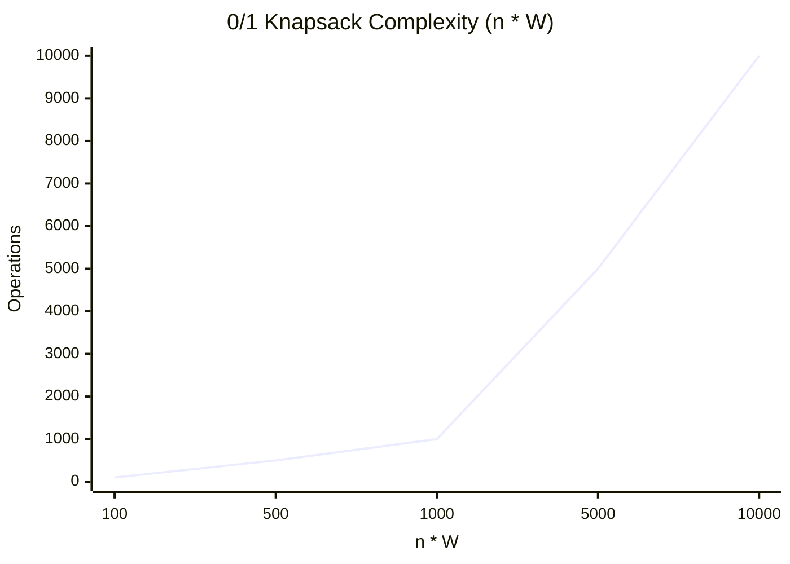
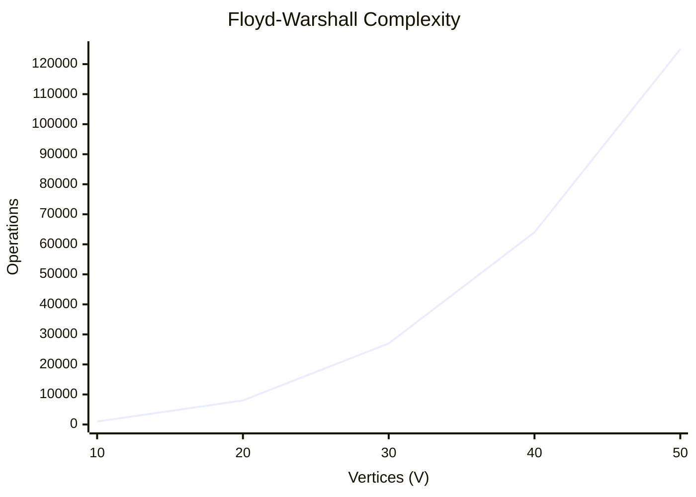
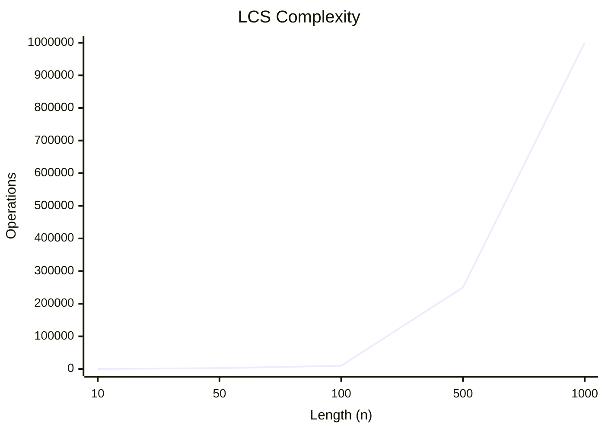

import Tabs from '@theme/Tabs';
import TabItem from '@theme/TabItem';

# Unit - 4
:::info[TITLE]
## Dynamic Programming
:::

## 1. Introduction

### 1.1 Overview
- A dynamic-programming algorithm solves every sub-problem just **once** and then **saves its answer** in a table.
- It avoids the work of **re-computing** the answer every time the sub-problem is encountered.
- **Example**: If there are multiple items with weights and profits, and we need to fit them into a bag to maximize profit, DP helps to efficiently find the optimal answer.

## 2. Principle of Optimality

### 2.1 Concept
- The dynamic programming algorithm obtains the solution using the **principle of optimality**.
- It states that "in an optimal sequence of decisions or choices, each subsequence must also be optimal."
- If it is not possible to apply the principle of optimality, then it is almost impossible to obtain the solution using the dynamic programming approach.

## 3. Generalized Solution using DP

### 3.1 Four Steps
1. **Characterize** the structure of an optimal solution.
2. **Recursively define** the value of an optimal solution.
3. **Compute the value** of an optimal solution in a bottom-up fashion.
4. **Construct an optimal solution** from the computed information.

## 4. 0/1 Knapsack Problem

### 4.1 Concept
- We are given $n$ items, each with a weight $w_i$ and a value $v_i$, and a knapsack of capacity $W$.
- The goal is to maximize the value without exceeding the knapsack capacity.
- Unlike Fractional Knapsack, we **cannot break** items (it's either 0 or 1).

### 4.2 Step-by-Step Explanation
1. **Initialize** a 2D array $V[0 \dots n][0 \dots W]$.
2. Set $V[i][0] = 0$ for $0 \le i \le n$.
3. Iterate through items $i$ from 1 to $n$ and weights $j$ from 1 to $W$:
   - If $j < w_i$: The item can't be included. $V[i][j] = V[i - 1][j]$.
   - Else: Take the max of excluding the item or including the item.
     $V[i][j] = \max(V[i - 1][j], V[i - 1][j - w_i] + v_i)$.
4. The answer is found at $V[n][W]$.

### 4.3 Algorithm Complexity
- **Time Complexity**: $O(n \times W)$, where $n$ is the number of items and $W$ is the knapsack capacity.
- **Space Complexity**: $O(n \times W)$ for the 2D DP table. Can be optimized to $O(W)$ using a 1D array.



### 4.4 Algorithm

<Tabs>
<TabItem value="simple" label="Simple (Easy to Remember)" default>

### 💡 The Big Idea in Plain English
Unlike Fractional Knapsack where you could cut items into pieces, here each item is a solid object (like a laptop or TV): you either **take the whole thing (1)** or **leave it behind (0)**.
For every item, you make a very simple comparison:
1. **Leave it**: Keep the best profit you already made using previous items with current space.
2. **Take it**: Add this item's value, plus the best profit you could make with whatever weight capacity remains in your bag.
Compare both options, pick the maximum, and store it in a table so you never re-calculate!

### 👣 3 Easy Steps to Remember
1. **Create a Grid**: Rows = items ($0 \dots n$), Columns = capacities ($0 \dots W$).
   - With 0 items or 0 capacity, profit is always $0$ (fill first row and column with 0).
2. **Decide for Each Item & Capacity**:
   - For item $i$ and bag capacity $w$:
   - **Too heavy to fit? ($wt[i] > w$)**: You have no choice $\to$ copy the profit directly from the row above ($K[i-1, w]$).
   - **It fits!**: Take the maximum of **leaving it** vs. **taking it**:
     $$K[i, w] = \max(val[i] + K[i-1, w - wt[i]], \; K[i-1, w])$$
3. **Read the Solution**: The bottom-right corner $K[n, W]$ is the absolute maximum profit!

> **🧠 Memory Trick:** **0 or 1 choice $\to$ If too heavy: copy from above $\to$ If it fits: $\max(\text{Take it}, \text{Leave it})$!** Time and space complexity: $O(n \times W)$.

</TabItem>
<TabItem value="code" label="Formal Algorithm (Code)">

```text showLineNumbers
Algorithm 01Knapsack(n, W, wt, val)
// Computes maximum achievable value for 0/1 Knapsack using dynamic programming
// Input: Number of items n, capacity W, weight array wt[1..n], profit array val[1..n]
// Output: Maximum profit stored in K[n, W]
{
    for w <- 0 to W do
        K[0, w] <- 0;

    for i <- 1 to n do
    {
        K[i, 0] <- 0;
        for w <- 1 to W do
        {
            if (wt[i] <= w) then
                K[i, w] <- max(val[i] + K[i - 1, w - wt[i]], K[i - 1, w]);
            else
                K[i, w] <- K[i - 1, w];
        }
    }
    return K[n, W];
}
```

</TabItem>
</Tabs>

## 5. Binomial Coefficient

### 5.1 Concept
- A binomial coefficient $C(n, k)$ calculates the number of ways to choose $k$ items from $n$ items.
- $C(n, k) = C(n-1, k-1) + C(n-1, k)$.
- DP avoids redundant calculations by storing intermediate values.

### 5.2 Step-by-Step Explanation
1. Initialize a 2D array $C$ of size $(n+1) \times (k+1)$.
2. Loop $i$ from 0 to $n$, and $j$ from 0 to $\min(i, k)$.
3. Base cases: If $j == 0$ or $j == i$, then $C[i][j] = 1$.
4. Otherwise: $C[i][j] = C[i-1][j-1] + C[i-1][j]$.
5. Return $C[n][k]$.

### 5.3 Algorithm Complexity
- **Time Complexity**: $O(n \times k)$
- **Space Complexity**: $O(n \times k)$ or $O(k)$ with a 1D array optimization.

### 5.4 Algorithm

<Tabs>
<TabItem value="simple" label="Simple (Easy to Remember)" default>

### 💡 The Big Idea in Plain English
Think of **Pascal's Triangle**:
Every number inside the triangle is simply the **sum of the two numbers directly above it**!
To pick $k$ friends out of $n$ candidates ($C(n, k)$), imagine looking at one specific friend (say, Alex):
- **Alex is picked**: You now need $k-1$ more people from the remaining $n-1$ friends ($C(n-1, k-1)$).
- **Alex is skipped**: You still need $k$ people from the remaining $n-1$ friends ($C(n-1, k)$).
Adding both scenarios gives: $C(n, k) = C(n-1, k-1) + C(n-1, k)$.
Dynamic Programming builds this table row by row from top to bottom, avoiding slow factorials completely!

### 👣 3 Easy Steps to Remember
1. **Set Edge Base Cases to 1**:
   - Picking 0 items from $i$ is always $1$ way ($C[i, 0] = 1$).
   - Picking all $i$ items from $i$ is always $1$ way ($C[i, i] = 1$).
2. **Fill from Top to Bottom**:
   - For every cell $(i, j)$: add the cell diagonally above-left and the cell directly above:
     $$C[i, j] = C[i-1, j-1] + C[i-1, j]$$
3. **Lookup the Value**: $C[n, k]$ contains the final binomial coefficient.

> **🧠 Memory Trick:** **Pascal's Triangle $\to$ Outer edges are 1 $\to$ Every inner number is the sum of the two above it!** Time complexity: $O(n \times k)$.

</TabItem>
<TabItem value="code" label="Formal Algorithm (Code)">

```text showLineNumbers
Algorithm BinomialCoefficient(n, k)
// Computes C(n, k) using bottom-up dynamic programming (Pascal identity)
// Input: Non-negative integers n and k (0 <= k <= n)
// Output: Binomial coefficient C(n, k)
{
    for i <- 0 to n do
    {
        for j <- 0 to min(i, k) do
        {
            // Base cases: C(n, 0) = 1 and C(n, n) = 1
            if (j = 0 or j = i) then
                C[i, j] <- 1;
            else
                C[i, j] <- C[i - 1, j - 1] + C[i - 1, j];
        }
    }
    return C[n, k];
}
```

</TabItem>
</Tabs>

## 6. Floyd-Warshall Algorithm (All Pairs Shortest Path)

### 6.1 Concept
- Finds the shortest paths between **all pairs of vertices** in a weighted graph.
- Works for graphs with negative weight edges (but no negative weight cycles).

### 6.2 Step-by-Step Explanation
1. Initialize the solution matrix same as the input graph matrix as a first step.
2. Update the solution matrix by considering all vertices as an intermediate vertex.
3. The idea is to one by one pick all vertices and update all shortest paths which include the picked vertex as an intermediate vertex in the shortest path.
4. If $dist[i][j] > dist[i][k] + dist[k][j]$, update $dist[i][j]$.

### 6.3 Algorithm Complexity
- **Time Complexity**: $\Theta(V^3)$
- **Space Complexity**: $\Theta(V^2)$



### 6.4 Algorithm

<Tabs>
<TabItem value="simple" label="Simple (Easy to Remember)" default>

### 💡 The Big Idea in Plain English
While Dijkstra finds paths from *one* source, Floyd-Warshall finds the shortest path between **every pair of vertices** $(i, j)$ at the same time!
Think of booking flights between two cities $i$ and $j$:
You test whether taking a **layover at city $k$** makes the trip faster:
*"Is direct flight $i \to j$ faster, or flight $i \to k$ plus flight $k \to j$?"*
If the layover is cheaper, take the shortcut!
By testing every possible layover city $k$ one by one, all shortest routes are solved.

### 👣 3 Easy Steps to Remember
1. **Initialize the Distance Grid**: Copy direct edge weights into table $D$. If there is no road between $i$ and $j$, set $D[i, j] = \infty$. Distance from any city to itself is $0$.
2. **Three Nested Loops (Layover $k$ MUST be the outer loop!)**:
   - Outer loop $k$: Try vertex $k$ as the intermediate stop ($1 \dots V$).
   - Middle loop $i$: Try vertex $i$ as the starting point ($1 \dots V$).
   - Inner loop $j$: Try vertex $j$ as the ending destination ($1 \dots V$).
3. **Shortcut Update Formula**:
   - If going through $k$ is shorter:
     $$\text{if } (D[i, k] + D[k, j] < D[i, j]) \implies D[i, j] = D[i, k] + D[k, j]$$

> **🧠 Memory Trick:** **3 nested loops with intermediate $k$ outside $\to D[i, j] = \min(\text{direct}, D[i, k] + D[k, j])$.** All-pairs shortest paths in $\Theta(V^3)$ time, handles negative edges (no negative cycles).

</TabItem>
<TabItem value="code" label="Formal Algorithm (Code)">

```text showLineNumbers
Algorithm FloydWarshall(W, V)
// Computes all-pairs shortest paths using dynamic programming
// Input: Weight matrix W[1..V, 1..V] where W[i, j] = infinity if no edge (i, j) exists
// Output: Distance matrix D[1..V, 1..V] of shortest path lengths
{
    for i <- 1 to V do
        for j <- 1 to V do
            D[i, j] <- W[i, j];

    for k <- 1 to V do             // Intermediate vertex
        for i <- 1 to V do         // Source vertex
            for j <- 1 to V do     // Destination vertex
                if (D[i, k] + D[k, j] < D[i, j]) then
                    D[i, j] <- D[i, k] + D[k, j];

    return D;
}
```

</TabItem>
</Tabs>

## 7. Matrix Chain Multiplication

### 7.1 Concept
- Determines the most efficient way to multiply a given sequence of matrices.
- The problem is not actually to perform the multiplications, but merely to decide the sequence of the matrix multiplications involved.
- Many options exist because matrix multiplication is associative.

### 7.2 Step-by-Step Explanation
1. Let the input array `p` represent matrix dimensions such that matrix $i$ has dimension $p[i-1] \times p[i]$.
2. Construct a 2D array `m[n][n]` to store the minimum scalar multiplications.
3. For chain length $L = 2$ to $n$:
   - For $i = 1$ to $n - L + 1$, set $j = i + L - 1$.
   - Compute `m[i][j]` by checking all possible partition points $k$ from $i$ to $j-1$.
   - Cost is `m[i][k] + m[k+1][j] + p[i-1]*p[k]*p[j]`.
   - Take the minimum of all possible $k$'s.
4. `m[1][n-1]` holds the optimal cost.

### 7.3 Algorithm Complexity
- **Time Complexity**: $O(n^3)$
- **Space Complexity**: $O(n^2)$

### 7.4 Algorithm

<Tabs>
<TabItem value="simple" label="Simple (Easy to Remember)" default>

### 💡 The Big Idea in Plain English
Multiplying three matrices $(A \times B \times C)$ always produces the same numerical answer whether you do $(AB)C$ or $A(BC)$.
**BUT** the number of scalar multiplications can vary wildly:
- One way might take **7,500 operations**.
- The other way might take **75,000 operations** (10 times slower!).
We don't actually multiply the numbers here — we just figure out **where to put brackets (parentheses)** to do the least amount of work!
We test every possible place to put a split/cut point $k$ and pick the cheapest cut.

### 👣 3 Easy Steps to Remember
1. **Base Case (Single Matrix)**: Multiplying one matrix by itself costs 0 multiplications: $m[i, i] = 0$ (the main diagonal is all 0).
2. **Grow Chain Length $L$ from 2 to $n-1$**:
   - Solve all 2-matrix products first ($AB, BC, CD$).
   - Then solve all 3-matrix products ($ABC, BCD$).
   - Continue expanding the window until the entire chain is solved.
3. **Try Every Cut Point $k$**:
   - For any chain from matrix $i$ to $j$, test splitting at every position $k$ from $i$ to $j-1$:
     $$\text{Cost} = \underbrace{m[i, k]}_{\text{cost of left}} + \underbrace{m[k+1, j]}_{\text{cost of right}} + \underbrace{(p_{i-1} \times p_k \times p_j)}_{\text{cost to multiply the two resulting matrices}}$$
   - Keep the minimum cost in $m[i, j]$ and record the winning cut $k$ in $s[i, j]$.
4. **Optimal Cost**: $m[1, n-1]$ gives the minimum total operations.

> **🧠 Memory Trick:** **Try every cut $k$ between $i$ and $j$:** Left cost + Right cost + $(p_{i-1} \cdot p_k \cdot p_j)$. Solve by increasing chain length $L$. Time: $O(n^3)$, Space: $O(n^2)$.

</TabItem>
<TabItem value="code" label="Formal Algorithm (Code)">

```text showLineNumbers
Algorithm MatrixChainOrder(p, n)
// Computes minimum scalar multiplications for matrix chain A_1 * A_2 * ... * A_{n-1}
// Input: Dimension sequence p = <p_0, p_1, ..., p_{n-1}> where matrix A_i is p_{i-1} x p_i
// Output: Table m[1..n-1, 1..n-1] containing optimal multiplication costs
{
    for i <- 1 to n - 1 do
        m[i, i] <- 0;

    for L <- 2 to n - 1 do                 // L is the chain length
    {
        for i <- 1 to (n - 1) - L + 1 do
        {
            j <- i + L - 1;
            m[i, j] <- infinity;
            for k <- i to j - 1 do
            {
                q <- m[i, k] + m[k + 1, j] + p[i - 1] * p[k] * p[j];
                if (q < m[i, j]) then
                {
                    m[i, j] <- q;
                    s[i, j] <- k;          // Optimal split point
                }
            }
        }
    }
    return m[1, n - 1];
}
```

</TabItem>
</Tabs>

## 8. Longest Common Subsequence (LCS)

### 8.1 Concept
- Given two sequences, find the length of the longest subsequence present in both of them.
- A subsequence is a sequence that appears in the same relative order, but not necessarily contiguous.

### 8.2 Step-by-Step Explanation
1. Let the two strings be $X$ of length $m$ and $Y$ of length $n$.
2. Create a 2D array $L[m+1][n+1]$.
3. Loop through the characters of $X$ and $Y$.
4. If $X[i-1] == Y[j-1]$, then $L[i][j] = L[i-1][j-1] + 1$.
5. If they are different, $L[i][j] = \max(L[i-1][j], L[i][j-1])$.
6. $L[m][n]$ contains the length of the LCS.

### 8.3 Algorithm Complexity
- **Time Complexity**: $O(m \times n)$
- **Space Complexity**: $O(m \times n)$



### 8.4 Algorithm

<Tabs>
<TabItem value="simple" label="Simple (Easy to Remember)" default>

### 💡 The Big Idea in Plain English
Think of how Git `diff` or DNA comparison works:
You have two words (like `X = "ABCBDAB"` and `Y = "BDCABA"`). You want to find the longest sequence of letters that appear in **both words in the same relative order**, even if other letters are in between.
As you compare letter $X[i]$ with letter $Y[j]$:
- **Letters Match?** Awesome! That's $+1$ to your score: take the score from before these two letters existed (diagonally up-left) and add $1$.
- **Letters Don't Match?** You can't use both letters together. Pick the better choice between ignoring $X[i]$ (cell above) or ignoring $Y[j]$ (cell to the left)!

### 👣 3 Easy Steps to Remember
1. **Make a Grid**: Rows for characters of $X$, columns for characters of $Y$.
   - Row 0 and Column 0 are all $0$ (comparing anything against an empty string gives 0).
2. **Fill Every Cell $(i, j)$**:
   - **Match ($X[i] == Y[j]$)**: Take the top-left diagonal value and add 1:
     $$c[i, j] = c[i-1, j-1] + 1$$
   - **Mismatch ($X[i] \ne Y[j]$)**: Take the maximum of the cell above and the cell to the left:
     $$c[i, j] = \max(c[i-1, j], \; c[i, j-1])$$
3. **Finish**: Cell $c[m, n]$ in the bottom-right corner gives the length of the LCS!

> **🧠 Memory Trick:** **Letters match? Go diagonal $+ 1$. Letters differ? Take $\max(\text{Up}, \text{Left})$!** Grid size: $(m+1) \times (n+1)$. Time & space: $O(m \times n)$.

</TabItem>
<TabItem value="code" label="Formal Algorithm (Code)">

```text showLineNumbers
Algorithm LCS_Length(X, Y, m, n)
// Finds length of Longest Common Subsequence of sequences X[1..m] and Y[1..n]
// Input: Sequences X of length m and Y of length n
// Output: Table c[0..m, 0..n] containing lengths of LCS
{
    for i <- 0 to m do
        c[i, 0] <- 0;
    for j <- 0 to n do
        c[0, j] <- 0;

    for i <- 1 to m do
    {
        for j <- 1 to n do
        {
            if (X[i] = Y[j]) then
                c[i, j] <- c[i - 1, j - 1] + 1;
            else if (c[i - 1, j] >= c[i, j - 1]) then
                c[i, j] <- c[i - 1, j];
            else
                c[i, j] <- c[i, j - 1];
        }
    }
    return c[m, n];
}
```

</TabItem>
</Tabs>
