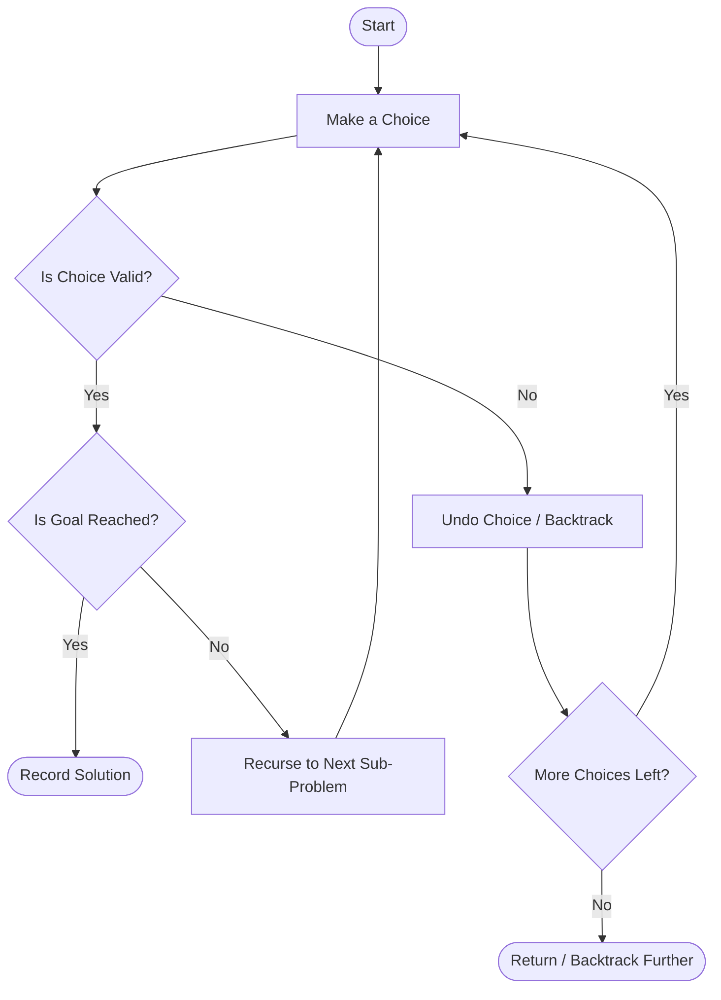
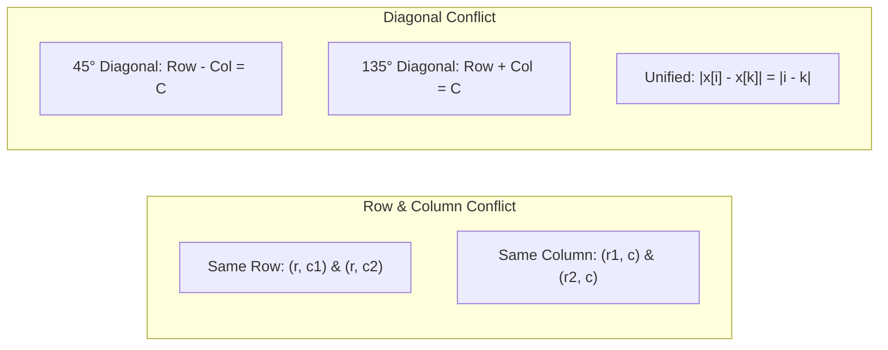
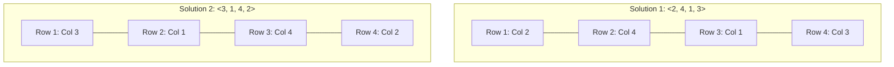
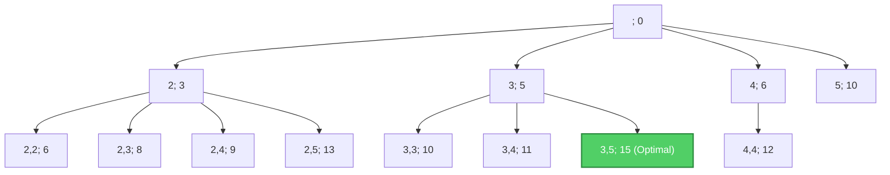
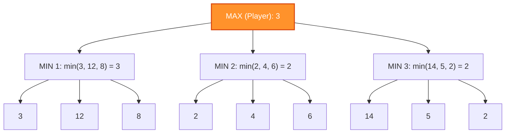
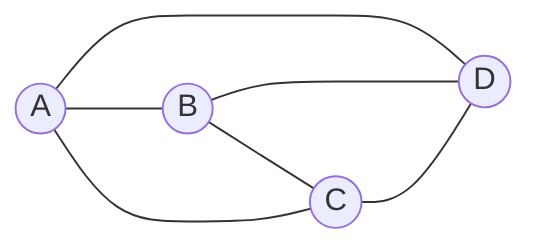

import Tabs from '@theme/Tabs';
import TabItem from '@theme/TabItem';

# Unit - 6
:::info[TITLE]
## Backtracking & Branch and Bound
:::

## 1. Introduction to Backtracking

### 1.1 Core Concept and Philosophy
**Backtracking** is a systematic, general algorithmic technique that considers searching every possible combination in order to solve an optimization or constraint-satisfaction problem.
- **Recursive Technique**: Builds candidates for solutions incrementally and abandons a candidate ("backtracks") as soon as it determines that the candidate cannot lead to a valid solution.
- **Trial and Error**: If a sub-problem attempt fails to reach a feasible or optimal solution, we **undo** the preceding step (backtrack) and try an alternative branch.
- **Search Strategy**: Traverses the **State Space Tree** in **Depth-First Search (DFS)** order.



### 1.2 State Space Tree and DFS Traversal
- **State Space Tree**: A tree representing all possible configurations (partial and complete candidate solutions) of the problem.
  - **Root**: Initial state before making any choices.
  - **Internal Nodes**: Partial solutions under construction.
  - **Leaf Nodes**: Complete configurations (either valid solutions or dead-ends).
  - **Live Node**: A node that has been generated and whose children have not yet been completely explored.
  - **E-Node (Expansion Node)**: The live node currently being explored.
  - **Dead Node**: A generated node that cannot be expanded further or has been pruned.

### 1.3 Explicit vs. Implicit Constraints
All constraint-satisfaction problems require two distinct categories of constraints:

| Constraint Type | Definition | Example in N-Queens | Example in Knapsack |
| :--- | :--- | :--- | :--- |
| **Explicit Constraints** | Rules that restrict each vector component $x_i$ to take values strictly from a predefined domain $S_i$. Independent of other components. | $x_i \in \{1, 2, \dots, n\}$ (queen $i$ must be placed in a valid column). | $x_i \in \{0, 1\}$ (an item is either taken or left behind). |
| **Implicit Constraints** | Relational criteria that determine whether the selected tuple satisfies the problem's objective and rules. Depends on interactions between components. | No two queens share the same row, column, or diagonal: $x_i \ne x_j$ and $\|x_i - x_j\| \ne \|i - j\|$. | Total weight cannot exceed capacity: $\sum w_i x_i \le W$. |

### 1.4 General Backtracking Algorithm Schema

<Tabs>
<TabItem value="simple" label="Simple (Easy to Remember)" default>

### 💡 The Big Idea in Plain English
Think of solving a Sudoku puzzle with a pencil and an eraser:
At each empty cell $k$, you try a candidate number:
- **Violates a rule?** Don't waste time filling out the rest of the puzzle! Immediately erase it and try the next number.
- **Valid and whole board is filled ($k == n$)?** You solved it! Write down the answer.
- **Valid but more cells remain?** Move on to the next cell ($k + 1$) and repeat!
Backtracking avoids brute-forcing millions of combinations by quitting hopeless paths early.

### 👣 3 Easy Steps to Remember
1. **Try Every Candidate**: For position $k$, test each allowed value $x[k]$ in its domain.
2. **Check Feasibility (The Bounding Function)**:
   - If the partial assignment $x[1 \dots k]$ breaks a rule, immediately discard it.
3. **Recurse or Record**:
   - If valid and $k == n$: you've completed all decisions! Output the solution.
   - If valid and $k < n$: make a recursive call to decide the next item: `backtrack(k + 1)`.

> **🧠 Memory Trick:** **Try candidate $\to$ Valid? $\to$ Yes & complete: record answer $\to$ Yes & incomplete: step forward (`k+1`) $\to$ No: prune and try next candidate!**

</TabItem>
<TabItem value="code" label="Formal Algorithm (Code)">

```text showLineNumbers
procedure backtrack(k)
    for each element x[k] in Domain(k) do
        if isValid(x[1..k]) then
            if k == n then
                write(x[1..n])  // Solution found
            else
                backtrack(k + 1)
```

</TabItem>
</Tabs>

## 2. The N-Queens Problem

### 2.1 Problem Definition
The **$N$-Queens Problem** consists of placing $N$ chess queens on an $N \times N$ chessboard such that **no two queens attack each other**.
- In chess, a queen can move any number of squares horizontally, vertically, or diagonally.
- Therefore, no two queens can share the **same row**, the **same column**, or the **same diagonal**.

### 2.2 Attack Conditions and Conflict Formulas
Let row indices be $i, k \in \{1, \dots, N\}$, and let $x[i]$ represent the column where the queen in row $i$ is placed:

1. **Same Row Conflict**:
   - Prevented inherently by placing exactly one queen per row (each row $i$ has exactly one $x[i]$).
2. **Same Column Conflict**:
   $$
   x[i] = x[k]
   $$
3. **Same Diagonal Conflict**:
   - **$45^\circ$ Diagonal** (slope $+1$): $Row - Col = \text{constant} \implies i - x[i] = k - x[k]$
   - **$135^\circ$ Diagonal** (slope $-1$): $Row + Col = \text{constant} \implies i + x[i] = k + x[k]$
   - **Unified Absolute Formula**:
     $$
     |x[i] - x[k]| = |i - k|
     $$



### 2.3 $k$-Promising Solutions
- **Definition**: A placement of $k$ queens ($1 \le k \le N$) in the first $k$ rows is called **$k$-promising** if none of the $k$ queens threaten each other.
- An **$N$-promising** placement represents a complete, valid solution to the $N$-Queens problem.
- A **$0$-promising** state is an invalid configuration where a conflict already exists, prompting immediate backtracking.

### 2.4 Solutions Count Table for Different $N$

| Number of Queens ($N$) | Board Size | Total Configurations ($N^N$) | Valid Solutions Count |
| :---: | :---: | :---: | :---: |
| **1** | $1 \times 1$ | 1 | **1** |
| **2** | $2 \times 2$ | 4 | **0** |
| **3** | $3 \times 3$ | 27 | **0** |
| **4** | $4 \times 4$ | 256 | **2** |
| **5** | $5 \times 5$ | 3,125 | **10** |
| **6** | $6 \times 6$ | 46,656 | **4** |
| **7** | $7 \times 7$ | 823,543 | **40** |
| **8** | $8 \times 8$ | 16,777,216 | **92** |
| **9** | $9 \times 9$ | $3.87 \times 10^8$ | **352** |
| **10** | $10 \times 10$ | $10^{10}$ | **724** |

## 3. The 4-Queens Problem Walkthrough

### 3.1 $4 \times 4$ Chessboard Analysis
On a $4 \times 4$ board, there are exactly **2 distinct valid solutions**:
1. Solution 1: $\langle 2, 4, 1, 3 \rangle$
   - Row 1 $\to$ Column 2
   - Row 2 $\to$ Column 4
   - Row 3 $\to$ Column 1
   - Row 4 $\to$ Column 3
2. Solution 2: $\langle 3, 1, 4, 2 \rangle$
   - Row 1 $\to$ Column 3
   - Row 2 $\to$ Column 1
   - Row 3 $\to$ Column 4
   - Row 4 $\to$ Column 2



### 3.2 Promising States and Vector Representations
Let us trace the derivation of $\langle 2, 4, 1, 3 \rangle$:
- **1-Promising**: Place $Q_1$ at $(1, 2) \implies sol = [2, 0, 0, 0]$
- **2-Promising**: Try row 2:
  - $(2, 1) \implies$ diagonal conflict with $(1, 2)$ ($2-1 = 1 \ne 1-2$, but $|2-1| = |1-2| = 1$)
  - $(2, 2) \implies$ same column conflict
  - $(2, 3) \implies$ diagonal conflict ($|2-1| = |3-2| = 1$)
  - $(2, 4) \implies$ **safe!** $\implies sol = [2, 4, 0, 0]$
- **3-Promising**: Try row 3:
  - $(3, 1) \implies$ **safe!** $\implies sol = [2, 4, 1, 0]$
- **4-Promising**: Try row 4:
  - $(4, 1) \implies$ col conflict
  - $(4, 2) \implies$ col conflict
  - $(4, 3) \implies$ **safe!** $\implies sol = [2, 4, 1, 3]$ (Valid Solution)

### 3.3 State Space Tree Tracing
The complete 4-Queens State Space Tree contains $4^4 = 256$ leaf nodes under brute force, but backtracking prunes most nodes early:
- Placing $Q_1$ at column 1 leads to dead ends in row 3, forcing backtracks to try $Q_1$ at column 2.
- The two branches that reach leaf level $k = 4$ are paths $2 \to 4 \to 1 \to 3$ and $3 \to 1 \to 4 \to 2$.

## 4. N-Queens Algorithm and Implementation

### 4.1 Recursive Queens Algorithm (Slide Pseudocode)

<Tabs>
<TabItem value="simple" label="Simple (Easy to Remember)" default>

### 💡 The Big Idea in Plain English
How do you place $N$ queens on an $N \times N$ chessboard without any queen attacking another?
Since a queen attacks across entire rows, columns, and diagonals:
We naturally place **exactly one queen per row**, working row by row from top to bottom.
To know if a square is safe, we maintain three "danger sets":
1. **Occupied Columns**: Can't share a column.
2. **$45^\circ$ Diagonals**: Can't share a major diagonal ($j - k$).
3. **$135^\circ$ Diagonals**: Can't share a minor diagonal ($j + k$).
If all three checks pass, place the queen and step down to the next row!

### 👣 3 Easy Steps to Remember
1. **Base Case**: If you reach row $k = n$, all $n$ queens are safely placed $\to$ print the solution vector!
2. **Try Columns $j = 1 \dots n$**:
   - Check if column $j$ is free and neither diagonal is occupied.
3. **Place & Recurse**:
   - If safe: set `sol[k+1] = j`, add $j$ and its diagonals to the forbidden sets, and call `queens(k+1)`.
   - If no column works in the next row, recursion automatically backtracks and tries the next column in the current row!

> **🧠 Memory Trick:** **1 Queen per row $\to$ Check column & both diagonals ($j-k$, $j+k$) $\to$ Safe? Go to next row $\to$ Stuck? Backtrack!**

</TabItem>
<TabItem value="code" label="Formal Algorithm (Code)">

```text showLineNumbers
procedure queens(k, col, diag45, diag135)
    {sol[1..k] is k-promising,
     col = {sol[i] | 1 <= i <= k},
     diag45 = {sol[i] - i + 1 | 1 <= i <= k}, and
     diag135 = {sol[i] + i - 1 | 1 <= i <= k}}
    if k = n then
        write sol
    else
        for j <- 1 to n do
            if j not in col and (j - k) not in diag45 and (j + k) not in diag135 then
                sol[k + 1] <- j
                queens(k + 1, col U {j}, diag45 U {j - k}, diag135 U {j + k})
```

</TabItem>
</Tabs>

### 4.2 Complexity Analysis
- **Time Complexity**: Upper bounded by $O(N!)$. While a brute-force search evaluates $O(N^N)$ configurations, backtracking checks only permutations ($N!$) and aggressively prunes conflicting diagonal branches early.
- **Space Complexity**: $O(N)$ auxiliary space for the recursive call stack and tracking arrays for columns and diagonals.

### 4.3 Standard Backtracking Formulation (Place & NQueens Algorithm)

<Tabs>
<TabItem value="simple" label="Simple (Easy to Remember)" default>

### 💡 The Big Idea in Plain English
This is the classic, exam-favorite version of N-Queens:
An array `x[k] = i` means: *"In row $k$, the queen is at column $i$."*
Before putting a queen in row $k$ at column $i$, `Place(k, i)` checks against every previous queen in row $j$ ($1 \dots k-1$):
1. **Same Column?** `x[j] == i` $\implies$ Conflict!
2. **Same Diagonal?** If horizontal distance equals vertical distance: $|x[j] - i| == |j - k|$ $\implies$ Conflict!
If both tests pass for all earlier queens, it's safe! Put the queen down and move to row $k+1$.

### 👣 3 Easy Steps to Remember
1. **Safety Guard (`Place(k, i)`)**:
   - Loop through all previous rows ($j = 1 \dots k-1$).
   - Return `false` if `x[j] == i` (same column) OR $|x[j] - i| == |j - k|$ (diagonal clash).
   - If clear across all previous queens, return `true`.
2. **The Queen Placer (`NQueens(k, n)`)**:
   - For each column $i$ from $1$ to $n$:
   - If `Place(k, i)` is safe: assign `x[k] = i`.
   - If $k == n$: all $n$ queens placed $\to$ print `x[1..n]`!
   - Otherwise: move to the next row $\to$ call `NQueens(k + 1, n)`.

> **🧠 Memory Trick:** **Diagonal clash:** $|x[j] - i| == |j - k|$ ($\Delta\text{col} == \Delta\text{row}$). Check safety $\to$ place $\to$ step to row $k+1$!

</TabItem>
<TabItem value="code" label="Formal Algorithm (Code)">

```text showLineNumbers
Algorithm Place(k, i)
// Returns true if a queen can be placed in kth row and ith column.
// Otherwise returns false. x[] is a global array whose first (k - 1)
// values have been set. abs(r) returns the absolute value of r.
{
    for j <- 1 to k - 1 do
    {
        // Check for column conflict or diagonal conflict
        if (x[j] = i or abs(x[j] - i) = abs(j - k)) then
            return false;
    }
    return true;
}

Algorithm NQueens(k, n)
// Using backtracking, this procedure prints all possible placements of
// n queens on an n x n chessboard so that no two queens attack each other.
{
    for i <- 1 to n do
    {
        if Place(k, i) then
        {
            x[k] <- i;
            if (k = n) then
                write(x[1..n]);
            else
                NQueens(k + 1, n);
        }
    }
}
```

</TabItem>
</Tabs>

## 5. Branch and Bound

### 5.1 Concept and Comparison with Backtracking
**Branch and Bound (B&B)** is an algorithmic paradigm primarily designed for **optimization problems** (minimization or maximization).

| Feature | Backtracking | Branch and Bound |
| :--- | :--- | :--- |
| **Primary Goal** | Decision or constraint-satisfaction problems (find one or all valid solutions) | Optimization problems (find the best/optimal solution) |
| **Search Traversal** | **Depth-First Search (DFS)** exclusively | **FIFO (BFS)**, **LIFO**, or **Least-Cost (LC-BB)** using a Priority Queue |
| **Pruning Mechanism** | Bounding via explicit/implicit feasibility constraints | Pruning via **Bounding Functions** (upper/lower bounds compared against current best) |
| **Efficiency** | Can spend time in unpromising deep subtrees | Prunes non-optimal subtrees earlier using mathematical bounds |

### 5.2 Bounding Functions and Pruning Strategies
At any node $x$ in the state space tree:
- For **Minimization**: Compute a **Lower Bound** $\hat{c}(x)$. If $\hat{c}(x) \ge$ current best, prune node $x$.
- For **Maximization**: Compute an **Upper Bound** $\hat{u}(x)$. If $\hat{u}(x) \le$ current best, prune node $x$.

### 5.3 Depth-First Branch and Bound (DFBB) on N-Queens
When using Depth-First Branch and Bound on $N$-Queens:
- Nodes maintain a bound on maximum achievable non-attacking placements.
- A path is immediately pruned whenever the number of remaining available rows is insufficient to beat the current best feasible solution.

## 6. Knapsack Problem using Backtracking & Branch and Bound

### 6.1 Problem Formulation
We are given $n$ types of objects and a knapsack of capacity $W$:
- Each item has weight $w_k$ and value $v_k$.
- We may take an object or leave it behind, but we **cannot take a fraction** of an object.
- **Goal**: Maximize total profit $\sum v_k x_k$ subject to $\sum w_k x_k \le W$.

### 6.2 State Space Tree Representation
- Each node in the tree is represented by the format:
  $$
  (\text{Selected Weights}; \text{Current Total Value})
  $$
- The left of the semicolon shows the weights of chosen items, and the right represents the accumulated value.
- Exploration proceeds in depth-first order, updating the global best solution whenever an allowable load is reached.

### 6.3 Step-by-Step Trace Example
Given:
- Weights: $w = (2, 3, 4, 5)$
- Values: $v = (3, 5, 6, 10)$
- Capacity: $W = 8$



- Level 1: Try starting with item of weight 2, 3, 4, or 5.
- Combining items with weights $(3, 5)$:
  - Total weight: $3 + 5 = 8 \le 8$
  - Total value: $5 + 10 = 15$
- Combining $(2, 2, 4) \implies$ weight 8, value $3 + 3 + 6 = 12$.
- Combining $(2, 3, 3) \implies$ weight 8, value $3 + 5 + 5 = 13$.
- **Optimal Load**: Items with weights $3$ and $5$, giving maximum total value = **15**.

### 6.4 Recursive Algorithm Pseudocode (Slide Algorithm)

<Tabs>
<TabItem value="simple" label="Simple (Easy to Remember)" default>

### 💡 The Big Idea in Plain English
Think of packing a backpack that has $r$ units of remaining capacity:
For each available item type from $i$ to $n$:
If the item fits ($w[k] \le r$), calculate the total profit of taking it: its own value $v[k]$ plus whatever best profit you can pack into the remaining space ($r - w[k]$).
Pick the maximum value across all choices!

### 👣 3 Easy Steps to Remember
1. **Loop Through Items**: Try each item $k$ from $i$ to $n$.
2. **Check Capacity**:
   - If item $k$ fits ($w[k] \le r$):
   - Add its profit to the best recursive solution for the remaining weight: $v[k] + \text{backpack}(k, r - w[k])$.
3. **Keep the Maximum**: Compare with current best $b = \max(b, \text{new value})$ and return $b$.

> **🧠 Memory Trick:** **Loop items $\to$ If fits: Value $+$ recurse on leftover weight $\to$ Return max!**

</TabItem>
<TabItem value="code" label="Formal Algorithm (Code)">

```text showLineNumbers
function backpack(i, r)
    {Calculates the value of the best load that can
     be constructed using items of type i to n and
     whose total weight does not exceed r}
    b <- 0
    {Try each allowed kind of item in turn}
    for k <- i to n do
        if w[k] <= r then
            b <- max(b, v[k] + backpack(k, r - w[k]))
    return b
```

</TabItem>
</Tabs>

### 6.5 Backtracking 0/1 Knapsack Algorithm with Bounding Function

<Tabs>
<TabItem value="simple" label="Simple (Easy to Remember)" default>

### 💡 The Big Idea in Plain English
Instead of dumbly testing all $2^n$ combinations of taking or leaving items, we use a **smart bounding check** (Branch & Bound):
At each item $k$, you explore two branches:
1. **Left Branch (Take item $k$)**: If the item fits, add it to your bag ($y[k] = 1$) and move to item $k+1$.
2. **Right Branch (Skip item $k$)**: Don't pack it ($y[k] = 0$). **BUT FIRST**, compute an optimistic upper bound: *"Even if I stuffed all remaining space with the best fractional items from the rest of the store, could I possibly beat my current best profit?"*
If the answer is **NO**, don't bother searching this subtree! **Prune it immediately!**

### 👣 3 Easy Steps to Remember
1. **Left Branch (Include Item)**:
   - If current weight $+$ item weight $\le m$:
   - Set $y[k] = 1$ and recurse `BKnap(k + 1)`.
   - If you reached the last item ($k == n$) and profit beats `maxprofit`: update `maxprofit` and save the best set $x$.
2. **Right Branch (Exclude Item with Bound Check)**:
   - Compute `Bound(cp, cw, k)` (optimistic upper bound on remaining potential profit).
   - **Only explore if `Bound() > maxprofit`**: set $y[k] = 0$ and recurse `BKnap(k + 1)`.
   - If bound $\le$ `maxprofit`: prune this branch completely!
3. **Finish**: `maxprofit` contains the global maximum value.

> **🧠 Memory Trick:** **Left: Take item if it fits $\to$ Right: Skip item ONLY IF optimistic bound beats current maxprofit (otherwise PRUNE)!**

</TabItem>
<TabItem value="code" label="Formal Algorithm (Code)">

```text showLineNumbers
Algorithm BKnap(k, cp, cw)
// Generates optimal solution for 0/1 Knapsack using Backtracking
// cp is current profit; cw is current weight; k is current item index
// w[i] and p[i] are weights and profits sorted such that p[i]/w[i] >= p[i+1]/w[i+1]
// m is knapsack capacity; maxprofit is maximum profit found so far
{
    // Generate left child: Include item k
    if (cw + w[k] <= m) then
    {
        y[k] <- 1;
        if (k < n) then
            BKnap(k + 1, cp + p[k], cw + w[k]);
        if (cp + p[k] > maxprofit and k = n) then
        {
            maxprofit <- cp + p[k];
            for j <- 1 to n do x[j] <- y[j];
        }
    }

    // Generate right child: Exclude item k
    if (Bound(cp, cw, k) > maxprofit) then
    {
        y[k] <- 0;
        if (k < n) then
            BKnap(k + 1, cp, cw);
        if (cp > maxprofit and k = n) then
        {
            maxprofit <- cp;
            for j <- 1 to n do x[j] <- y[j];
        }
    }
}
```

</TabItem>
</Tabs>

## 7. Minimax Principle in Game Trees

### 7.1 Concept and Zero-Sum Games
The **Minimax Principle** is a decision rule used in two-player, zero-sum games of perfect information (such as Chess, Checkers, and Tic-Tac-Toe):
- **Zero-Sum**: An advantage gained by one player represents an equivalent disadvantage to the other player.
- **Two Players**:
  - **MAX Player**: Strives to **maximize** their score (profit/gain).
  - **MIN Player (Opponent)**: Strives to **minimize** the MAX player's score (minimizing loss).

### 7.2 Decision Rule: Minimizing Maximum Loss
Minimax ensures that a player chooses a strategy that **minimizes the maximum possible loss** (or maximizes the minimum possible gain) guaranteed against an optimal opponent.

### 7.3 Working of the Minimax Algorithm
1. The game state is modeled as a tree where levels alternate between **MAX turns** and **MIN turns**.
2. Recursion proceeds down the tree to terminal leaf states (evaluated by a heuristic evaluation function).
3. Evaluated leaf scores are backed up through the tree:
   - At a **MIN node**: Value is the minimum of its children's scores:
     $$
     V(\text{node}) = \min_{c \in \text{children}} V(c)
     $$
   - At a **MAX node**: Value is the maximum of its children's scores:
     $$
     V(\text{node}) = \max_{c \in \text{children}} V(c)
     $$



### 7.4 Numerical Game Tree Walkthrough
From the slide's game tree:
- **Left Branch**: Leaves are $\{3, 12, 8\} \implies \text{MIN chooses } \min(3, 12, 8) = 3$.
- **Middle Branch**: Leaves are $\{2, 4, 6\} \implies \text{MIN chooses } \min(2, 4, 6) = 2$.
- **Right Branch**: Leaves are $\{14, 5, 2\} \implies \text{MIN chooses } \min(14, 5, 2) = 2$.
- **Root (MAX)**: Evaluates the three choices $\{3, 2, 2\} \implies \max(3, 2, 2) = \mathbf{3}$.
- The optimal move for MAX is the **left branch**, guaranteeing a payout of at least 3.

### 7.5 Tic-Tac-Toe Game Tree Example
Terminal utility payoffs:
- $+10$: Player $X$ (MAX) wins.
- $-10$: Player $O$ (MIN) wins.
- $0$: Draw.

By recursively evaluating possible remaining moves:
- If a move leads directly to a board where $X$ completes 3-in-a-row $\implies +10$.
- If $O$ can block or make a winning line $\implies -10$.
- Backtracking propagates these outcomes so $X$ always selects the move maximizing guaranteed outcome.

### 7.6 Minimax Decision Algorithm

<Tabs>
<TabItem value="simple" label="Simple (Easy to Remember)" default>

### 💡 The Big Idea in Plain English
Think of playing Chess or Tic-Tac-Toe against a world grandmaster:
There are two opposing players:
- **YOU (The MAX Player)**: Striving to achieve the **highest score** possible.
- **OPPONENT (The MIN Player)**: Mercilessly trying to give you the **lowest score** possible.
To pick your best move, you peer into the future:
1. On **your turn**, you pick the move that gives the **MAXIMUM** score.
2. On the **opponent's turn**, you assume they will choose whatever leaves you with the **MINIMUM** score.
By backing up these scores from the end of the game tree, you find the move that guarantees your highest possible payout!

### 👣 3 Easy Steps to Remember
1. **Base Case**: If the game is over (terminal leaf) or maximum search depth is reached: return the static evaluation score of the board.
2. **If it's MAX's Turn (You)**:
   - Initialize `bestValue = -infinity`.
   - Try every possible move, recursively calling Minimax on the opponent's turn.
   - Choose the maximum outcome: `bestValue = max(bestValue, val)`.
3. **If it's MIN's Turn (Opponent)**:
   - Initialize `bestValue = +infinity`.
   - Try every possible move, recursively calling Minimax on your turn.
   - Choose the minimum outcome: `bestValue = min(bestValue, val)`.

> **🧠 Memory Trick:** **Your turn? Choose the MAX! Opponent's turn? Choose the MIN!** Minimizes your maximum possible loss against an optimal opponent.

</TabItem>
<TabItem value="code" label="Formal Algorithm (Code)">

```text showLineNumbers
Algorithm Minimax(node, depth, isMaximizingPlayer)
// Recursively evaluates game tree to determine optimal value for current player
// Input: node representing game state, current depth, boolean isMaximizingPlayer
// Output: Evaluated optimal score for current game position
{
    if (depth = max_depth or is_terminal(node)) then
        return evaluate(node);

    if isMaximizingPlayer then
    {
        bestValue <- -infinity;
        for each child in get_children(node) do
        {
            val <- Minimax(child, depth + 1, false);
            bestValue <- max(bestValue, val);
        }
        return bestValue;
    }
    else
    {
        bestValue <- +infinity;
        for each child in get_children(node) do
        {
            val <- Minimax(child, depth + 1, true);
            bestValue <- min(bestValue, val);
        }
        return bestValue;
    }
}
```

</TabItem>
</Tabs>

## 8. Travelling Salesman Problem (TSP)

### 8.1 Problem Statement and Graph Representation
- Given a set of $n$ cities and the distance (cost) between every pair of vertices.
- **Objective**: Find the **shortest possible route** (Hamiltonian cycle of minimum total weight) that visits every city **exactly once** and returns to the starting city.



### 8.2 Backtracking Formulation
- Generates permutations of tours starting at a designated city (e.g., city 1).
- Maintains `current_cost` along the path.
- **Pruning rule**: If `current_cost >= min_cost_so_far`, the branch is immediately abandoned.

### 8.3 Branch and Bound Formulation (Reduced Cost Matrix)
Using **Least Cost Branch and Bound (LCBB)**:
1. **Reduce Matrix**: Subtract the minimum value from each row and column so that every row and column has at least one zero. The sum of subtracted amounts provides a **Lower Bound** on tour cost.
2. For each possible next city, construct a child node, recalculate the reduced matrix cost, and select the child with the lowest bound.

### 8.4 Complexity and NP-Hard Classification
- **Classification**: **NP-hard** optimization problem.
- **Brute Force Search**: $(n - 1)! / 2$ possible tours $\implies O(n!)$ time.
- **Branch and Bound**: Prunes significant portions of the state space tree, though worst-case remains exponential.

### 8.5 TSP Backtracking Algorithm

<Tabs>
<TabItem value="simple" label="Simple (Easy to Remember)" default>

### 💡 The Big Idea in Plain English
A travelling salesperson must start from City 1, visit every other city **exactly once**, and return back home at the **minimum total expense**.
Using backtracking with a cost boundary:
You drive from city to city, keeping a running total of your travel costs.
Before driving to the next unvisited city, you ask:
*"Has my trip cost already exceeded the best complete tour I discovered earlier?"*
If yes, stop right there! **Turn around immediately (prune)!** Continuing down this road is guaranteed to be more expensive.
If no, visit the city, mark it off, and recurse. When you return, unmark it (backtrack) so alternative routes can try it!

### 👣 3 Easy Steps to Remember
1. **Base Case (Tour Finished)**:
   - When all $n$ cities have been visited (`count == n`) and a road exists back to the starting city:
   - Update `minCost = min(minCost, cost + road_home)`.
2. **Try Unvisited Next Cities**:
   - For each candidate city: if it hasn't been visited yet and has a connecting road:
   - **Bounding Prune**: Only drive there if `cost + road < minCost`. If it already costs more, prune!
   - Mark as visited: `visited[nextCity] = true`.
   - Step forward: call `TSPBacktrack(...)` with incremented count and accumulated cost.
   - **Backtrack**: Reset `visited[nextCity] = false` so other routes can test visiting this city!
3. **Finish**: `minCost` contains the cost of the optimal Hamiltonian tour.

> **🧠 Memory Trick:** **Drive from city to city $\to$ Accumulated cost already $\ge \text{minCost}$? PRUNE! $\to$ Else: mark visited, recurse, unmark visited (backtrack)!** NP-Hard optimization.

</TabItem>
<TabItem value="code" label="Formal Algorithm (Code)">

```text showLineNumbers
Algorithm TSPBacktrack(currCity, count, cost, start)
// Solves Travelling Salesperson Problem using backtracking with cost bounding
// graph[1..n, 1..n] is adjacency cost matrix; visited[1..n] tracks visited cities
// minCost stores the minimum Hamiltonian tour cost found so far
{
    if (count = n and graph[currCity, start] > 0) then
    {
        minCost <- min(minCost, cost + graph[currCity, start]);
        return;
    }

    for nextCity <- 1 to n do
    {
        if (not visited[nextCity] and graph[currCity, nextCity] > 0) then
        {
            // Prune if current accumulated cost already exceeds best found tour
            if (cost + graph[currCity, nextCity] < minCost) then
            {
                visited[nextCity] <- true;
                TSPBacktrack(nextCity, count + 1, cost + graph[currCity, nextCity], start);
                visited[nextCity] <- false; // Backtrack
            }
        }
    }
}
```

</TabItem>
</Tabs>

## 9. Summary and Quick Revision Cheat Sheet

### 9.1 Comparison of Core Problem Paradigms

| Problem / Technique | Primary Paradigm | State Space Exploration | Key Bounding / Pruning Criteria | Worst-Case Time |
| :--- | :--- | :--- | :--- | :---: |
| **N-Queens** | Backtracking | Depth-First Search (DFS) | Row, Column, and Diagonal non-attack conditions | $O(N!)$ |
| **Knapsack (B&B)** | Branch & Bound / Backtracking | Depth-First / Best-First | Exceeding capacity $W$ or upper bound on fractional profit | $O(2^n)$ |
| **Minimax** | Game Tree Search | Depth-First (Adversarial) | Zero-sum terminal evaluation, min-max score backup | $O(b^m)$ |
| **TSP** | Branch & Bound / Backtracking | Least Cost / DFS | Cost matrix reduction bounds or current best tour cost | $O(n!)$ |

### 9.2 Formula & Constraint Reference Card
- **Diagonal Attack Formula**: Two queens at $(i, x[i])$ and $(k, x[k])$ attack each other diagonally if and only if:
  $$
  |x[i] - x[k]| = |i - k|
  $$
- **Minimax Decision**:
  $$
  V(\text{MAX}) = \max(V(\text{children})), \quad V(\text{MIN}) = \min(V(\text{children}))
  $$
- **Constraints**:
  - Explicit: domain-level restriction on individual variable ($x_i \in S_i$).
  - Implicit: relational restriction among multiple variables ($f(x_1, \dots, x_n) \le C$).