# AWS Services Creation Guide

:::info[TITLE]
## Step-by-Step Hands-On Guide for AWS Services (Units 1–6)
:::

This comprehensive practical guide provides end-to-end, click-by-click console workflows and equivalent AWS CLI commands to create and configure all primary AWS services covered across Units 1 through 6 of the AWS Fundamentals curriculum.

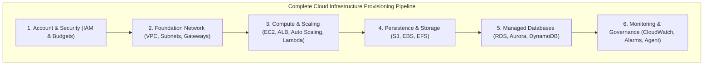

## 1. Account Hardening & Billing Governance (Unit 1 & Unit 6)

Before deploying application infrastructure, secure the root account and configure automated billing safeguards to prevent unexpected charges.

### 1.1 Securing the AWS Root Account and Enabling MFA

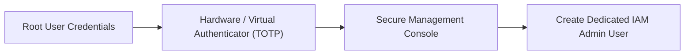

#### Console Step-by-Step Instructions
1. Log in to the **AWS Management Console** using your root email address and password.
2. In the top-right corner, click your account name $\to$ select **Security credentials**.
3. Under **Multi-factor authentication (MFA)**:
   - Click **Assign MFA**.
   - **Device name:** Enter `Root-MFA-Device`.
   - **MFA device type:** Select *Authenticator app* (Google Authenticator, Microsoft Authenticator, or Authy).
   - Click **Next**.
4. Open your authenticator application on your smartphone, scan the displayed QR code, and enter two consecutive 6-digit MFA codes. Click **Add MFA**.
5. Under **Access keys**, ensure that **no active access keys** exist for the root account. If any are present, click **Actions** $\to$ **Delete**.

### 1.2 Creating a Zero-Spend / Monthly Budget Alert via AWS Budgets

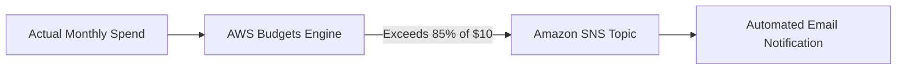

#### Console Step-by-Step Instructions
1. In the console search bar, type `AWS Budgets` and select the service.
2. Click **Create budget**.
3. Under **Budget setup**, choose **Customize (advanced)** $\to$ select **Cost budget** $\to$ click **Next**.
4. In **Budget details**:
   - **Budget name:** `Monthly-Free-Tier-Threshold`
   - **Period:** `Monthly`
   - **Budget effective date:** `Recurring budget`
   - **Budgeting method:** `Fixed`
   - **Enter budgeted amount ($):** Enter `10.00` (or `1.00` for strict zero-spend alerts).
5. Click **Next** to proceed to the **Set alerts** tab.
6. Click **Add an alert threshold**:
   - **Threshold:** Set to `85%` of budgeted amount.
   - **Trigger:** `Actual`
   - **Email recipients:** Enter your personal or operational email address.
7. Click **Next** $\to$ review configurations $\to$ click **Create budget**.

## 2. Networking & VPC Services Setup (Unit 2)

Deploy a production-ready, custom 2-tier Virtual Private Cloud (VPC) featuring public and private subnets, an Internet Gateway, a NAT Gateway, custom route tables, and granular Security Groups.

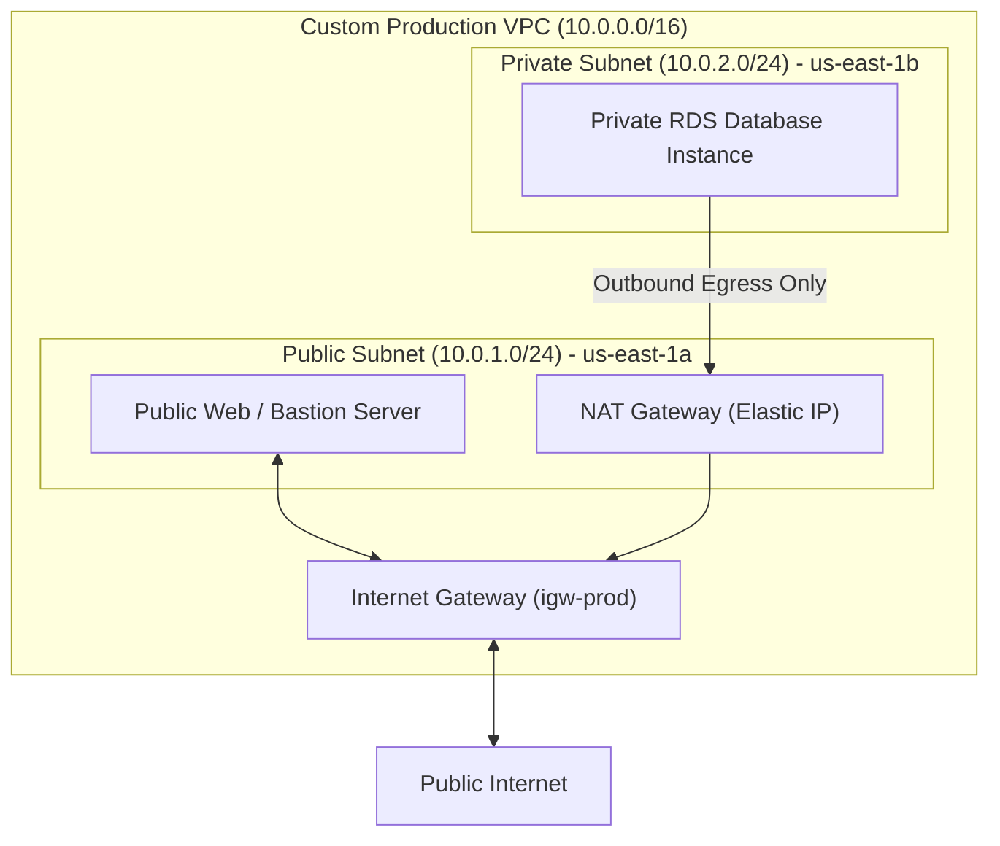

### 2.1 Step-by-Step: Creating a Custom VPC
1. Navigate to **VPC Console** $\to$ click **Create VPC**.
2. Select **VPC only** (to understand each individual component manually).
3. Configure settings:
   - **Name tag:** `Production-VPC`
   - **IPv4 CIDR block:** `10.0.0.0/16`
   - **IPv6 CIDR block:** `No IPv6 CIDR block`
   - **Tenancy:** `Default`
4. Click **Create VPC**.
5. Select `Production-VPC` $\to$ click **Actions** $\to$ **Edit VPC settings** $\to$ check **Enable DNS hostnames** and **Enable DNS resolution** $\to$ click **Save changes**.

#### AWS CLI Command
```bash
aws ec2 create-vpc \
    --cidr-block 10.0.0.0/16 \
    --tag-specifications "ResourceType=vpc,Tags=[{Key=Name,Value=Production-VPC}]"
```

### 2.2 Step-by-Step: Creating Public and Private Subnets
1. In the VPC console, click **Subnets** $\to$ click **Create subnet**.
2. Select **VPC ID:** `Production-VPC`.
3. Configure the **Public Subnet**:
   - **Subnet name:** `Public-Subnet-1A`
   - **Availability Zone:** Select primary AZ (e.g., `us-east-1a`)
   - **IPv4 subnet CIDR block:** `10.0.1.0/24`
4. Click **Add new subnet** to configure the **Private Subnet**:
   - **Subnet name:** `Private-Subnet-1B`
   - **Availability Zone:** Select secondary AZ (e.g., `us-east-1b`)
   - **IPv4 subnet CIDR block:** `10.0.2.0/24`
5. Click **Create subnet**.
6. Select `Public-Subnet-1A` $\to$ click **Actions** $\to$ **Edit subnet settings** $\to$ check **Enable auto-assign public IPv4 address** $\to$ click **Save**.

#### AWS CLI Commands
```bash
# Create Public Subnet
aws ec2 create-subnet \
    --vpc-id <VPC-ID> \
    --cidr-block 10.0.1.0/24 \
    --availability-zone us-east-1a \
    --tag-specifications "ResourceType=subnet,Tags=[{Key=Name,Value=Public-Subnet-1A}]"

# Enable Auto-Assign Public IP
aws ec2 modify-subnet-attribute \
    --subnet-id <PUBLIC-SUBNET-ID> \
    --map-public-ip-on-launch

# Create Private Subnet
aws ec2 create-subnet \
    --vpc-id <VPC-ID> \
    --cidr-block 10.0.2.0/24 \
    --availability-zone us-east-1b \
    --tag-specifications "ResourceType=subnet,Tags=[{Key=Name,Value=Private-Subnet-1B}]"
```

### 2.3 Step-by-Step: Attaching an Internet Gateway (IGW)
1. Click **Internet Gateways** in the left navigation pane $\to$ click **Create internet gateway**.
2. **Name tag:** `Production-IGW` $\to$ click **Create internet gateway**.
3. Select `Production-IGW` $\to$ click **Actions** $\to$ **Attach to VPC**.
4. Choose `Production-VPC` $\to$ click **Attach internet gateway**.

#### AWS CLI Command
```bash
# Create IGW
aws ec2 create-internet-gateway \
    --tag-specifications "ResourceType=internet-gateway,Tags=[{Key=Name,Value=Production-IGW}]"

# Attach to VPC
aws ec2 attach-internet-gateway \
    --internet-gateway-id <IGW-ID> \
    --vpc-id <VPC-ID>
```

### 2.4 Step-by-Step: Provisioning a NAT Gateway with an Elastic IP
1. Click **NAT Gateways** in the left navigation pane $\to$ click **Create NAT gateway**.
2. **Name:** `Production-NAT-GW`
3. **Subnet:** Select **`Public-Subnet-1A`** (NAT Gateways must reside in a public subnet with an Internet Gateway route).
4. **Connectivity type:** `Public`
5. Under **Elastic IP allocation ID**, click **Allocate Elastic IP**.
6. Click **Create NAT gateway** (takes 1–2 minutes to become `Available`).

#### AWS CLI Command
```bash
# Allocate Elastic IP
aws ec2 allocate-address --domain vpc

# Create NAT Gateway in Public Subnet
aws ec2 create-nat-gateway \
    --subnet-id <PUBLIC-SUBNET-ID> \
    --allocation-id <EIP-ALLOCATION-ID> \
    --tag-specifications "ResourceType=natgateway,Tags=[{Key=Name,Value=Production-NAT-GW}]"
```

### 2.5 Step-by-Step: Configuring Route Tables
1. Click **Route Tables** $\to$ click **Create route table**.
2. **Public Route Table:**
   - Name: `Public-RT`
   - VPC: `Production-VPC`
   - Click **Create route table**.
   - Under **Routes** tab $\to$ click **Edit routes** $\to$ **Add route**:
     - Destination: `0.0.0.0/0`
     - Target: Select `Internet Gateway` $\to$ choose `Production-IGW`.
     - Click **Save changes**.
   - Under **Subnet associations** tab $\to$ click **Edit subnet associations** $\to$ select `Public-Subnet-1A` $\to$ click **Save associations**.
3. **Private Route Table:**
   - Name: `Private-RT`
   - VPC: `Production-VPC`
   - Click **Create route table**.
   - Under **Routes** tab $\to$ click **Edit routes** $\to$ **Add route**:
     - Destination: `0.0.0.0/0`
     - Target: Select `NAT Gateway` $\to$ choose `Production-NAT-GW`.
     - Click **Save changes**.
   - Under **Subnet associations** tab $\to$ click **Edit subnet associations** $\to$ select `Private-Subnet-1B` $\to$ click **Save associations**.

### 2.6 Step-by-Step: Configuring Security Groups (Web-SG and DB-SG)
1. In the VPC Console, click **Security Groups** $\to$ click **Create security group**.
2. **Create Web-Tier Security Group (`Web-SG`):**
   - Security group name: `Web-SG`
   - Description: `Allow inbound HTTP, HTTPS, and administrative SSH`
   - VPC: `Production-VPC`
   - **Inbound rules:**
     - Rule 1: Type `HTTP`, Port `80`, Source `0.0.0.0/0` (Anywhere IPv4).
     - Rule 2: Type `HTTPS`, Port `443`, Source `0.0.0.0/0` (Anywhere IPv4).
     - Rule 3: Type `SSH`, Port `22`, Source `My IP` (restrict to your IP).
   - Click **Create security group**.
3. **Create Database-Tier Security Group (`DB-SG`):**
   - Security group name: `DB-SG`
   - Description: `Allow MySQL traffic exclusively from Web-SG`
   - VPC: `Production-VPC`
   - **Inbound rules:**
     - Rule 1: Type `MySQL/Aurora`, Port `3306`, Source: Type `Custom` and select the Security Group ID of **`Web-SG`** (e.g., `sg-0123456789abcdef`).
   - Click **Create security group**.

## 3. Compute Services Setup (Unit 3)

Provision scalable virtual compute instances, configure elastic load balancing, establish auto-scaling groups, and deploy serverless functions.

### 3.1 Step-by-Step: Launching an Amazon EC2 Linux Instance

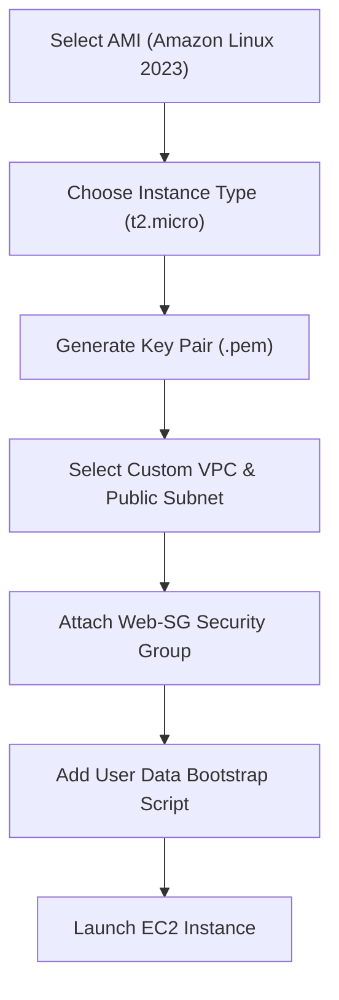

#### Console Step-by-Step Instructions
1. Navigate to **EC2 Dashboard** $\to$ click **Launch instance**.
2. **Name and tags:** Enter `Web-Server-01`.
3. **Application and OS Images (Amazon Machine Image):** Select **Amazon Linux** $\to$ choose **Amazon Linux 2023 AMI** (Free Tier eligible).
4. **Instance type:** Select `t2.micro` (1 vCPU, 1 GiB RAM).
5. **Key pair (login):**
   - Click **Create new key pair**.
   - Key pair name: `ec2-demo-key`
   - Key pair type: `RSA`
   - Private key format: `.pem` (for OpenSSH / macOS / Linux / Windows Terminal).
   - Click **Create key pair** and save the downloaded `.pem` file.
6. **Network settings:** Click **Edit**:
   - **VPC:** Select `Production-VPC`.
   - **Subnet:** Select `Public-Subnet-1A`.
   - **Auto-assign public IP:** `Enable`.
   - **Firewall (security groups):** Choose **Select existing security group** $\to$ select `Web-SG`.
7. **Configure storage:** Default `8 GiB` General Purpose SSD (`gp3`).
8. **Advanced details $\to$ User data:** Paste the following automated bootstrap script:
   ```bash
   #!/bin/bash
   dnf update -y
   dnf install -y httpd
   systemctl start httpd
   systemctl enable httpd
   echo "<h1>Deployed via AWS EC2 User Data on $(hostname -f)</h1>" > /var/www/html/index.html
   ```
9. Click **Launch instance**.

#### Verifying via SSH and HTTP
```bash
# Set secure key permissions (Linux/macOS)
chmod 400 ec2-demo-key.pem

# Connect via SSH
ssh -i "ec2-demo-key.pem" ec2-user@<EC2-PUBLIC-IPV4-ADDRESS>

# Verify web server response
curl http://<EC2-PUBLIC-IPV4-ADDRESS>
```

### 3.2 Step-by-Step: Creating an Application Load Balancer (ALB)

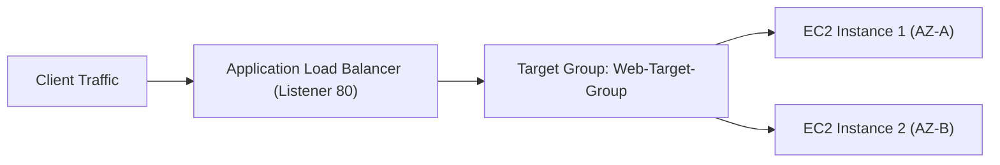

#### Console Step-by-Step Instructions
1. In the EC2 Console, navigate to **Target Groups** (under Load Balancing) $\to$ click **Create target group**.
2. **Basic configuration:**
   - Target type: **Instances**
   - Target group name: `Web-Target-Group`
   - Protocol: `HTTP`, Port: `80`
   - VPC: Select `Production-VPC`
   - Protocol version: `HTTP1`
3. **Health checks:**
   - Health check protocol: `HTTP`
   - Health check path: `/index.html`
   - Click **Next**.
4. **Register targets:** Select `Web-Server-01` $\to$ click **Include as pending below** $\to$ click **Create target group**.
5. Navigate to **Load Balancers** $\to$ click **Create load balancer**.
6. Under **Application Load Balancer**, click **Create**.
7. **Basic configuration:**
   - Load balancer name: `Production-ALB`
   - Scheme: **Internet-facing**
   - IP address type: `IPv4`
8. **Network mapping:**
   - VPC: `Production-VPC`
   - Mappings: Select at least two Availability Zones and their respective public subnets (e.g., `Public-Subnet-1A` and `Public-Subnet-1B`).
9. **Security groups:** Remove the default SG and select **`Web-SG`**.
10. **Listeners and routing:**
    - Protocol: `HTTP`, Port: `80`
    - Default action: Forward to **`Web-Target-Group`**.
11. Click **Create load balancer**. Copy the **DNS name** (e.g., `Production-ALB-12345.us-east-1.elb.amazonaws.com`) to test in a browser once provisioned.

### 3.3 Step-by-Step: Creating an EC2 Auto Scaling Group (ASG)

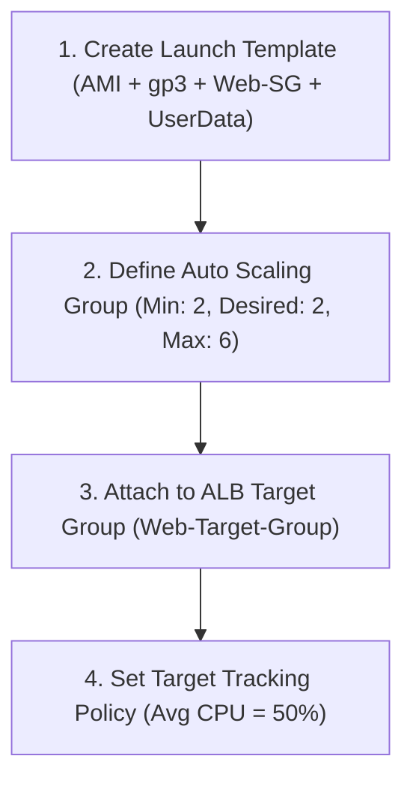

#### Console Step-by-Step Instructions
1. Navigate to **Launch Templates** (under Instances) $\to$ click **Create launch template**.
   - Launch template name: `Web-Launch-Template`
   - Template version description: `v1.0 Production web server`
   - AMI: `Amazon Linux 2023`
   - Instance type: `t2.micro`
   - Key pair: `ec2-demo-key`
   - Security groups: Select `Web-SG`
   - Advanced details $\to$ User data: Paste the Apache bootstrap script from Section 3.1.
   - Click **Create launch template**.
2. Navigate to **Auto Scaling Groups** $\to$ click **Create Auto Scaling group**.
3. **Step 1: Choose launch template:**
   - Auto Scaling group name: `Production-Web-ASG`
   - Launch template: Select `Web-Launch-Template` (version `Default (1)`).
   - Click **Next**.
4. **Step 2: Choose instance launch options:**
   - VPC: `Production-VPC`
   - Availability Zones and subnets: Select `Public-Subnet-1A` and `Public-Subnet-1B`.
   - Click **Next**.
5. **Step 3: Configure advanced options:**
   - Load balancing: Select **Attach to an existing load balancer**.
   - Existing load balancer target groups: Choose **`Web-Target-Group`**.
   - Health checks: Select **Turn on Elastic Load Balancing health checks**.
   - Health check grace period: `300 seconds`.
   - Click **Next**.
6. **Step 4: Configure group size and scaling policies:**
   - **Desired capacity:** `2`
   - **Minimum capacity:** `2`
   - **Maximum capacity:** `6`
   - **Scaling policies:** Select **Target tracking scaling policy**:
     - Metric type: `Average CPU utilization`
     - Target value: `50`
     - Instance warmup: `300 seconds`
   - Click **Next** $\to$ **Next** $\to$ click **Create Auto Scaling group**.

### 3.4 Step-by-Step: Creating a Serverless REST API (Lambda + API Gateway)

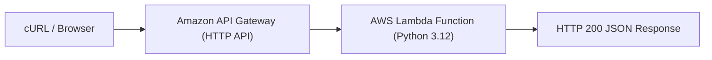

#### Console Step-by-Step Instructions
1. Open the **AWS Lambda Console** $\to$ click **Create function**.
2. Select **Author from scratch**:
   - **Function name:** `OrderProcessingService`
   - **Runtime:** `Python 3.12`
   - **Architecture:** `x86_64`
   - **Execution role:** Select *Create a new role with basic Lambda permissions*.
3. Click **Create function**.
4. In the **Code source** editor, replace the default code in `lambda_function.py`:
   ```python
   import json
   import os
   from datetime import datetime

   def lambda_handler(event, context):
       query_params = event.get('queryStringParameters') or {}
       item = query_params.get('item', 'Laptop')
       
       payload = {
           "status": "Order Accepted",
           "item_name": item,
           "processed_at": datetime.utcnow().isoformat() + "Z",
           "serverless_backend": "AWS Lambda + API Gateway"
       }
       
       return {
           "statusCode": 200,
           "headers": {
               "Content-Type": "application/json",
               "Access-Control-Allow-Origin": "*"
           },
           "body": json.dumps(payload)
       }
   ```
5. Click **Deploy** to commit the changes.
6. In the **Function overview** section at the top, click **+ Add trigger**.
7. Select **API Gateway**:
   - **API:** *Create a new API*
   - **API type:** *HTTP API*
   - **Security:** *Open*
8. Click **Add**.
9. Copy the generated **API endpoint URL** from the trigger card and test with `curl`:
   ```bash
   curl "https://<API-ID>.execute-api.us-east-1.amazonaws.com/default/OrderProcessingService?item=MechanicalKeyboard"
   ```

### 3.5 Step-by-Step: Deploying via AWS Elastic Beanstalk (PaaS)
1. Open the **AWS Elastic Beanstalk Console** $\to$ click **Create application**.
2. **Application details:** Enter Application name: `Enterprise-Web-Portal`.
3. **Platform:**
   - Platform: `Python`
   - Platform branch: `Python 3.11 running on 64-bit Amazon Linux 2023`
4. **Application code:** Select **Sample application** (or choose *Upload your code* and provide a `.zip` file containing `application.py` and `requirements.txt`).
5. **Configuration presets:** Choose **High availability** (creates load-balanced, multi-AZ environment) or **Single instance** (free tier/testing).
6. Click **Next** $\to$ specify service role and EC2 key pair $\to$ click **Submit**.
7. Wait 3–5 minutes while Beanstalk provisions the EC2 instances, Auto Scaling group, and load balancer. When health status displays `OK (Green)`, click the public environment URL to view the live site.

## 4. Storage Services Setup (Unit 4)

Configure object storage with S3, persistent block storage with EBS, and shared multi-instance network filesystems with EFS.

### 4.1 Step-by-Step: Creating an S3 Bucket and Hosting a Static Website

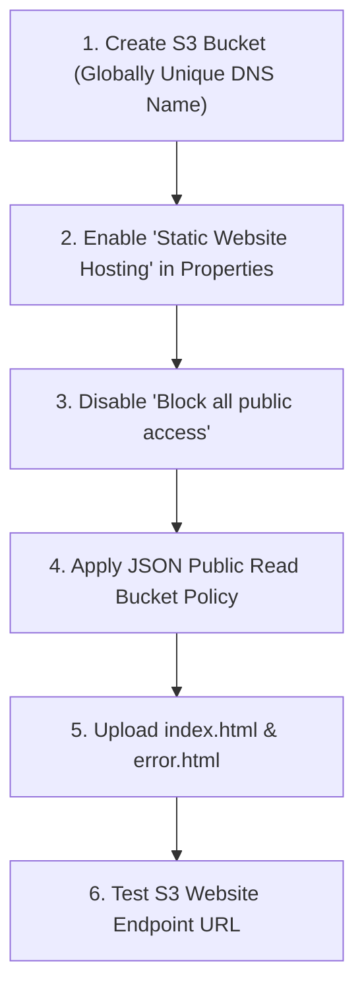

#### Console Step-by-Step Instructions
1. Open the **Amazon S3 Console** $\to$ click **Create bucket**.
2. **Bucket name:** Enter a globally unique name (e.g., `prod-static-web-2026-demo`).
3. **AWS Region:** Select your primary region (e.g., `us-east-1`).
4. **Object Ownership:** Select `ACLs disabled (recommended)`.
5. Under **Block Public Access settings for this bucket**:
   - **Uncheck** *Block all public access*.
   - Check the acknowledgement box: *"I acknowledge that the current settings might result in this bucket and the objects within becoming public."*
6. Click **Create bucket**.
7. Open the newly created bucket $\to$ click the **Properties** tab $\to$ scroll to the bottom:
   - Under **Static website hosting**, click **Edit**.
   - Select **Enable**.
   - Hosting type: `Host a static website`.
   - Index document: `index.html`.
   - Error document: `error.html`.
   - Click **Save changes**. Note the generated **Bucket website endpoint URL**.
8. Click the **Permissions** tab $\to$ under **Bucket policy**, click **Edit** $\to$ paste the policy below (replace `<YOUR-BUCKET-NAME>`):
   ```json
   {
     "Version": "2012-10-17",
     "Statement": [
       {
         "Sid": "PublicReadGetObject",
         "Effect": "Allow",
         "Principal": "*",
         "Action": "s3:GetObject",
         "Resource": "arn:aws:s3:::<YOUR-BUCKET-NAME>/*"
       }
     ]
   }
   ```
9. Click **Save changes**.
10. Click the **Objects** tab $\to$ click **Upload** $\to$ upload your local `index.html` file $\to$ click **Upload**.
11. Navigate to the Bucket website endpoint URL in your browser to verify.

### 4.2 Step-by-Step: Configuring S3 Lifecycle Rules
1. In your S3 bucket, click the **Management** tab.
2. Under **Lifecycle rules**, click **Create lifecycle rule**.
3. **Lifecycle rule name:** `TransitionToArchiveAndExpire`.
4. **Choose a rule scope:** Select *Apply to all objects in the bucket* $\to$ acknowledge the prompt.
5. **Lifecycle rule actions:**
   - Check: *Move current versions of objects between storage classes*
   - Check: *Expire current versions of objects*
6. **Transition configuration:**
   - Transition 1: Select `Standard-IA`, Days after object creation: `30`.
   - Click **Add transition** $\to$ Transition 2: Select `Glacier Flexible Retrieval`, Days after object creation: `90`.
7. **Expiration configuration:**
   - Days after object creation: `365`.
8. Click **Create rule**.

### 4.3 Step-by-Step: Creating, Attaching, Formatting, and Mounting an EBS Volume

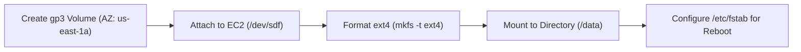

#### Console Step-by-Step Instructions
1. Open **EC2 Console** $\to$ under Storage, click **Volumes** $\to$ click **Create volume**.
2. **Volume type:** `General Purpose SSD (gp3)`.
3. **Size:** `20 GiB`.
4. **Availability Zone:** Select **the exact Availability Zone** where your EC2 instance resides (e.g., `us-east-1a`). EBS volumes cannot cross AZ boundaries.
5. Click **Create volume**.
6. Select the created volume $\to$ click **Actions** $\to$ **Attach volume**:
   - Instance: Select your running EC2 instance.
   - Device name: `/dev/sdf`.
   - Click **Attach volume**.

#### Operating System Formatting & Mounting Commands (via SSH)
```bash
# 1. List block storage devices to confirm attachment
lsblk

# 2. Check if disk has an existing filesystem
sudo file -s /dev/xvdf
# (If output reads '/dev/xvdf: data', the disk is unformatted)

# 3. Format the volume with ext4 filesystem
sudo mkfs -t ext4 /dev/xvdf

# 4. Create target mount directory
sudo mkdir -p /data

# 5. Mount the volume
sudo mount /dev/xvdf /data

# 6. Verify filesystem disk space
df -hT /data

# 7. Configure persistent auto-mounting on reboot
# Find UUID of the new partition
sudo blkid /dev/xvdf

# Add entry to /etc/fstab (replace with your actual UUID)
echo "UUID=12345678-abcd-1234-ef01-123456789abc  /data  ext4  defaults,nofail  0  2" | sudo tee -a /etc/fstab
```

### 4.4 Step-by-Step: Creating and Mounting Amazon EFS (Elastic File System)

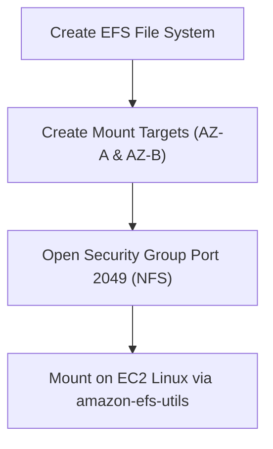

#### Console Step-by-Step Instructions
1. Open the **Amazon EFS Console** $\to$ click **Create file system**.
2. Click **Customize**:
   - Name: `Shared-Enterprise-EFS`
   - File system type: **Regional** (replicates across $\ge 3$ AZs).
   - Automatic backups: `Enabled`.
   - Lifecycle management: Transition to IA after `30 days`.
   - Performance mode: `General Purpose`.
   - Throughput mode: `Elastic`.
   - Click **Next**.
3. **Network access:**
   - VPC: Select `Production-VPC`.
   - Mount targets: For each Availability Zone, select the respective subnet and attach a Security Group that **allows inbound TCP port 2049 (NFS)** from `Web-SG`.
   - Click **Next** $\to$ **Next** $\to$ click **Create**.
4. Note your **File System ID** (e.g., `fs-0123456789abcdef0`).

#### Mounting EFS on an Amazon EC2 Linux Instance
```bash
# 1. Install Amazon EFS utilities
sudo dnf install -y amazon-efs-utils

# 2. Create local directory mount point
sudo mkdir -p /mnt/efs/shared

# 3. Mount using TLS encryption
sudo mount -t efs -o tls fs-0123456789abcdef0:/ /mnt/efs/shared

# 4. Configure auto-mounting in /etc/fstab
echo "fs-0123456789abcdef0:/ /mnt/efs/shared efs _netdev,tls 0 0" | sudo tee -a /etc/fstab
```

## 5. Database Services Setup (Unit 5)

Deploy relational and NoSQL database engines on AWS, including Amazon RDS MySQL, Amazon Aurora, and Amazon DynamoDB.

### 5.1 Step-by-Step: Launching an Amazon RDS MySQL Instance

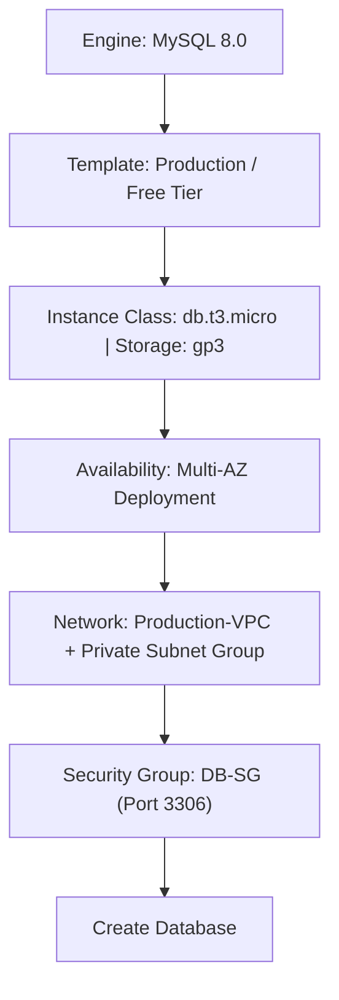

#### Console Step-by-Step Instructions
1. Open **Amazon RDS Console** $\to$ in the left navigation pane, click **Subnet groups** $\to$ click **Create DB subnet group**:
   - Name: `production-db-subnet-group`
   - Description: `Private subnets for RDS across AZs`
   - VPC: `Production-VPC`
   - Add subnets: Select Availability Zones `us-east-1a` and `us-east-1b`, and choose their respective private subnets.
   - Click **Create**.
2. Click **Databases** $\to$ click **Create database**.
3. Choose a database creation method: **Standard create**.
4. **Engine options:**
   - Engine type: `MySQL`
   - Engine Version: Select default latest (e.g., `MySQL 8.0.35`).
5. **Templates:** Choose **Production** (for Multi-AZ high availability) or **Free tier**.
6. **Settings:**
   - DB instance identifier: `prod-mysql-instance`
   - Master username: `dbadmin`
   - Master password: Enter a robust password (minimum 8 characters).
7. **Instance configuration:**
   - DB instance class: `Burstable classes (includes t classes)` $\to$ `db.t3.micro`.
8. **Storage:**
   - Storage type: `General Purpose SSD (gp3)`
   - Allocated storage: `20 GiB`
   - Check: **Enable storage autoscaling** (Maximum storage threshold: `100 GiB`).
9. **Availability & durability:**
   - Select **Multi-AZ DB Instance** (creates standby replica in different AZ).
10. **Connectivity:**
    - Virtual private cloud (VPC): `Production-VPC`
    - DB subnet group: `production-db-subnet-group`
    - Public access: **No** (critical security requirement).
    - Existing VPC security groups: Remove default and select **`DB-SG`**.
    - Database port: `3306`.
11. **Database authentication:** `Password authentication`.
12. **Additional configuration:**
    - Initial database name: `appdb`
    - Enable automated backups: Retention period `7 days`.
13. Click **Create database**. Once status is `Available`, copy the **Endpoint** to connect from your application servers.

#### AWS CLI Command
```bash
aws rds create-db-instance \
    --db-instance-identifier prod-mysql-instance \
    --db-instance-class db.t3.micro \
    --engine mysql \
    --master-username dbadmin \
    --master-user-password "SecurePassw0rd2026!" \
    --allocated-storage 20 \
    --storage-type gp3 \
    --db-subnet-group-name production-db-subnet-group \
    --vpc-security-group-ids <DB-SG-ID> \
    --no-publicly-accessible \
    --multi-az \
    --backup-retention-period 7
```

### 5.2 Step-by-Step: Creating an Amazon Aurora Serverless v2 Cluster
1. In the **RDS Console** $\to$ click **Create database**.
2. **Engine options:** Select **Amazon Aurora**.
3. **Edition:** `Amazon Aurora MySQL-Compatible Edition`.
4. **Templates:** Choose **Production**.
5. **Settings:**
   - DB cluster identifier: `aurora-cluster-demo`
   - Master username: `auroraadmin`
   - Master password: Enter a strong password.
6. **Instance configuration:**
   - Choose **Serverless v2**.
   - Set Capacity range: Minimum ACUs: `0.5` | Maximum ACUs: `16.0` (1 ACU provides ~2 GiB RAM and associated compute).
7. **Connectivity:**
   - VPC: `Production-VPC`.
   - DB subnet group: `production-db-subnet-group`.
   - Security group: `DB-SG`.
8. Click **Create database**. Aurora provisions a distributed cluster with automatic 6-way storage replication across 3 AZs.

### 5.3 Step-by-Step: Creating an Amazon DynamoDB NoSQL Table

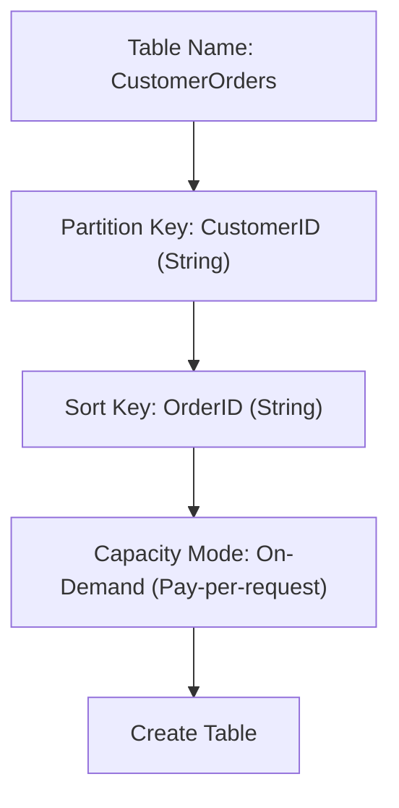

#### Console Step-by-Step Instructions
1. Open the **Amazon DynamoDB Console** $\to$ click **Create table**.
2. **Table details:**
   - Table name: `CustomerOrders`
   - **Partition key (PK):** `CustomerID` (Type: `String`)
   - Check **Add sort key** $\to$ **Sort key (SK):** `OrderID` (Type: `String`)
3. **Table settings:**
   - Select **Customize settings**.
   - Under **Read/write capacity settings**, select **On-demand** (seamless auto-scaling, pay-per-request).
   - Under **Secondary indexes**, click **Create global secondary index (GSI)**:
     - Partition key: `OrderStatus` (Type: `String`)
     - Sort key: `OrderDate` (Type: `String`)
     - Index name: `OrderStatus-OrderDate-index`
     - Projected attributes: `All`
     - Click **Create index**.
4. Click **Create table**.

#### Inserting and Querying Items via AWS CLI
```bash
# Insert an item into DynamoDB
aws dynamodb put-item \
    --table-name CustomerOrders \
    --item '{
        "CustomerID": {"S": "CUST-1001"},
        "OrderID": {"S": "ORD-5001"},
        "OrderStatus": {"S": "SHIPPED"},
        "OrderDate": {"S": "2026-11-25"},
        "TotalAmount": {"N": "149.99"}
    }'

# Query item by Partition Key and Sort Key
aws dynamodb get-item \
    --table-name CustomerOrders \
    --key '{
        "CustomerID": {"S": "CUST-1001"},
        "OrderID": {"S": "ORD-5001"}
    }'
```

## 6. Security, Monitoring & Governance Setup (Unit 6)

Configure granular IAM roles, install observability monitoring agents, and establish automated CloudWatch alarm triggers.

### 6.1 Step-by-Step: Creating an IAM Role for EC2 Access to S3

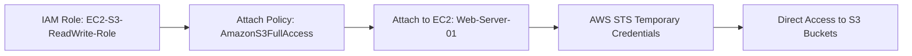

#### Console Step-by-Step Instructions
1. Open the **AWS IAM Console** $\to$ click **Roles** in the left navigation pane $\to$ click **Create role**.
2. **Trusted entity type:** Select **AWS service**.
3. **Use case:** Choose **EC2** $\to$ click **Next**.
4. **Add permissions:**
   - Search for policy: `AmazonS3FullAccess` (or create a custom least-privilege policy).
   - Check the checkbox next to the policy.
   - Click **Next**.
5. **Name, review, and create:**
   - Role name: `EC2-S3-Access-Role`
   - Description: `Allows EC2 instances to call AWS S3 APIs`
   - Click **Create role**.
6. **Attach Role to EC2 Instance:**
   - Open **EC2 Console** $\to$ click **Instances**.
   - Select `Web-Server-01` $\to$ click **Actions** $\to$ **Security** $\to$ **Modify IAM role**.
   - Select `EC2-S3-Access-Role` from the dropdown $\to$ click **Update IAM role**.
7. **Verification on EC2 via SSH:**
   ```bash
   # Confirm instance can query S3 without any embedded credentials
   aws s3 ls
   ```

### 6.2 Step-by-Step: Configuring Amazon CloudWatch Alarms for Auto Scaling

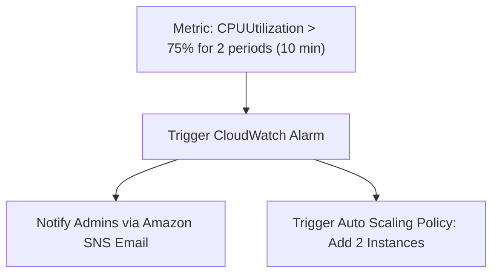

#### Console Step-by-Step Instructions
1. Open the **Amazon CloudWatch Console** $\to$ in the left navigation pane, click **Alarms** $\to$ **All alarms** $\to$ click **Create alarm**.
2. Click **Select metric** $\to$ choose **EC2** $\to$ **By Auto Scaling Group**.
3. Locate `Production-Web-ASG` $\to$ select the **CPUUtilization** metric $\to$ click **Select metric**.
4. **Specify metric and conditions:**
   - Statistic: `Average`
   - Period: `5 minutes`
   - Threshold type: `Static`
   - Whenever CPUUtilization is: `Greater` than `75`
   - Click **Next**.
5. **Configure actions:**
   - Alarm state trigger: `In alarm`
   - Send a notification to: Select **Create new topic**:
     - Topic name: `Production-High-CPU-Alerts`
     - Email endpoints: Enter your administrative email.
     - Click **Create topic**.
   - Under **Auto Scaling action**, click **Add Auto Scaling action**:
     - Group: `Production-Web-ASG`
     - Take the following action: `Add 2 instances`
   - Click **Next**.
6. **Add name and description:**
   - Alarm name: `ASG-High-CPU-Utilization-Alarm`
   - Description: `Triggers horizontal scale-out when average CPU exceeds 75% for 10 minutes`
   - Click **Next** $\to$ click **Create alarm**.
7. Confirm the subscription email sent to your inbox to enable SNS delivery.

### 6.3 Step-by-Step: Installing CloudWatch Unified Agent for RAM & Disk Monitoring

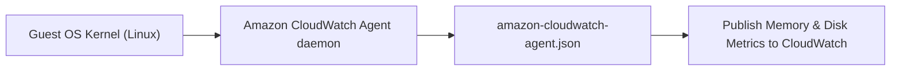

#### Console & Operating System Instructions
1. Attach the managed policy `CloudWatchAgentServerPolicy` to your EC2 IAM role (`EC2-S3-Access-Role`).
2. SSH into your Amazon EC2 Linux instance and run:
   ```bash
   # 1. Download and install the CloudWatch Agent package
   sudo dnf install -y amazon-cloudwatch-agent

   # 2. Create the CloudWatch Agent configuration JSON file
   sudo tee /opt/aws/amazon-cloudwatch-agent/etc/amazon-cloudwatch-agent.json > /dev/null << 'EOF'
   {
     "metrics": {
       "metrics_collected": {
         "mem": {
           "measurement": [
             "mem_used_percent"
           ],
           "metrics_collection_interval": 60
         },
         "disk": {
           "measurement": [
             "used_percent"
           ],
           "resources": [
             "/"
           ],
           "metrics_collection_interval": 60
         }
       }
     }
   }
   EOF

   # 3. Start and enable the CloudWatch Agent service
   sudo /opt/aws/amazon-cloudwatch-agent/bin/amazon-cloudwatch-agent-ctl \
       -a fetch-config \
       -m ec2 \
       -s \
       -c file:/opt/aws/amazon-cloudwatch-agent/etc/amazon-cloudwatch-agent.json

   # 4. Verify agent daemon status
   sudo systemctl status amazon-cloudwatch-agent
   ```
3. Open the **CloudWatch Console** $\to$ navigate to **Metrics** $\to$ under Custom Namespaces, select **CWAgent** to view real-time `mem_used_percent` and `disk_used_percent` graphs.

## 7. Master Troubleshooting & Gotchas Cheatsheet

| Service | Common Failure Mode | Root Cause | Immediate Remediation |
| :--- | :--- | :--- | :--- |
| **EC2 SSH** | Connection timed out on port 22 | Security group lacks rule for client IP, or instance is in a private subnet with no public IP. | Verify Security Group inbound rule allows port 22 from your current IP; ensure instance has an attached public IPv4 address. |
| **VPC NAT** | Instances in private subnet cannot reach the internet | Route table for private subnet does not route `0.0.0.0/0` to NAT Gateway, or NAT Gateway was deployed in private subnet. | Deploy NAT Gateway in a **public subnet** with an Elastic IP; update private route table destination `0.0.0.0/0` $\to$ `nat-xxxx`. |
| **NACLs** | Web requests hang and time out | Outbound NACL rule does not allow ephemeral return ports. | Add Outbound rule to NACL allowing TCP ports `1024–65535` to `0.0.0.0/0`. |
| **S3 Website** | HTTP 403 Forbidden on website URL | Bucket policy is missing or Block Public Access is still enabled. | In Bucket Permissions, uncheck *Block all public access* and attach the JSON policy allowing `s3:GetObject` to `*`. |
| **EBS Mount** | Volume attachment rejected | EBS volume was created in a different Availability Zone than the EC2 instance. | EBS volumes cannot cross AZs. Snapshot the volume and create a new volume in the EC2 instance's Availability Zone. |
| **RDS Connect** | Application times out connecting to database | RDS Security Group is not allowing inbound port 3306 from Web-SG, or RDS is not in the same VPC. | Update RDS Security Group to allow MySQL port 3306 with source set to the security group ID of the web server (`Web-SG`). |
| **CloudWatch** | Cannot view RAM / Memory utilization % | CloudWatch hypervisor only monitors CPU, network, and disk I/O from outside the VM. | Install and configure the **Amazon CloudWatch Agent** inside the guest OS. |
