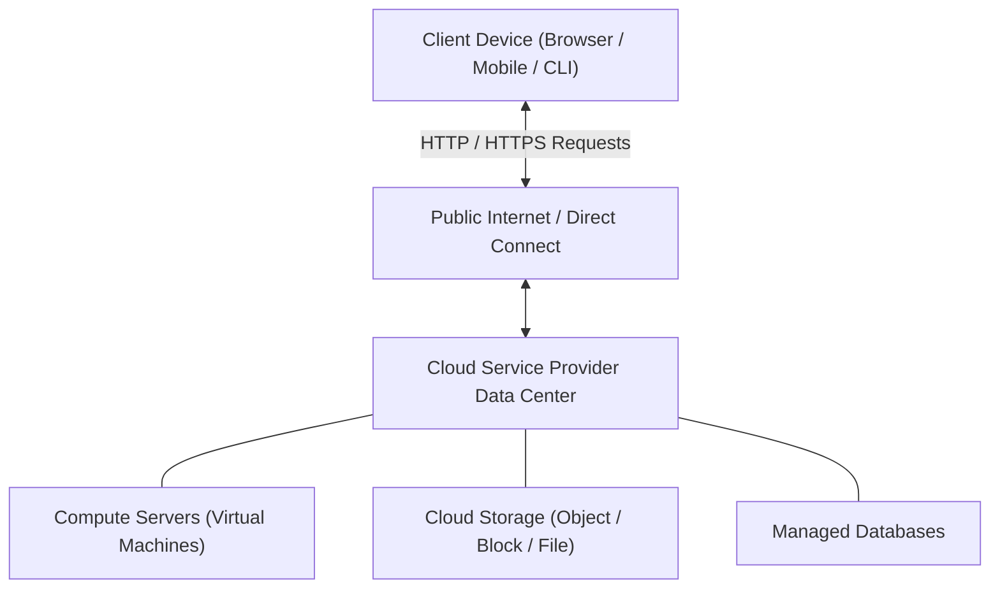
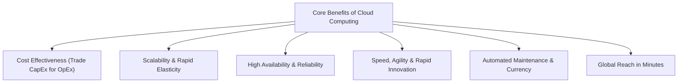
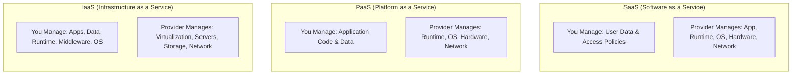
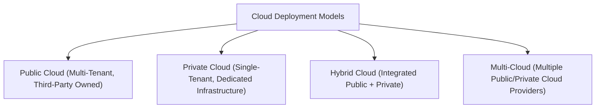
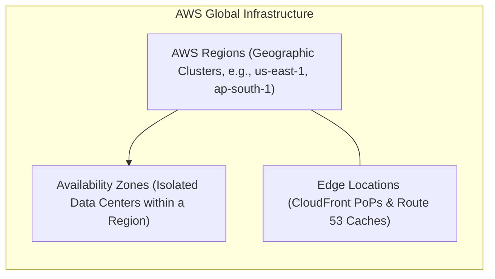

# Unit - 1

:::info[TITLE]
## Introduction to Cloud Computing and AWS
:::

## 1. What is Cloud Computing?

Cloud computing is a technology paradigm that enables on-demand access to a shared pool of configurable computing resources (such as servers, storage, databases, networking, software, and analytics) over the internet, eliminating the requirement for direct user management, physical hardware procurement, or on-premises infrastructure.

### 1.1 The Client-Server Architecture

Cloud computing operates fundamentally on the classical client-server model:
- **Client (Front-End):** User devices (laptops, mobile phones, thin clients, web browsers) initiate service requests across the internet.
- **Server (Back-End):** High-capacity physical and virtual server clusters hosted in remote data centers process requests, execute logic, query databases, and return results to clients.

### 1.2 Core Attributes of Cloud Computing

- **On-Demand Self-Service:** Consumers can provision computing capabilities (server time, network storage) automatically as needed without requiring human interaction with the service provider.
- **Pay-As-You-Go Pricing:** Users pay strictly for consumed resources (measured by compute seconds, gigabytes stored, or data transferred) without upfront capital commitments.
- **Broad Network Access:** Cloud capabilities are accessible over standard networks via heterogeneous client platforms (workstations, tablets, smartphones).
- **Resource Pooling (Multi-Tenancy):** Computing resources are dynamically pooled to serve multiple consumers using virtualization, where physical resources are securely partitioned.
- **Rapid Elasticity:** Resources can be provisioned and released elastically—often automatically—to scale rapidly outward and inward commensurate with workload demand.
- **Measured Service:** Resource usage is monitored, controlled, and reported transparently for billing and optimization.

## 2. Key Benefits of Cloud Computing

Modern cloud computing offers distinct operational, economic, and architectural advantages over traditional on-premises data centers:

### 2.1 Cost Efficiency (CapEx to OpEx)
- **Elimination of Capital Expenditure (CapEx):** Avoids massive upfront investments in physical servers, data center real estate, cooling systems, power backup generators, and network switches.
- **Operational Expenditure (OpEx):** Converts fixed overhead costs into variable operating expenses. Organizations pay only for the compute cycles and storage utilized.
- **Economies of Scale:** Because cloud providers aggregate demand from millions of customers, they achieve massive purchasing efficiencies, continually passing lower prices down to customers.

### 2.2 Scalability and Flexibility
- **Horizontal Scaling (Scale Out / Scale In):** Dynamically add or remove identical server instances to handle changing traffic spikes (e.g., e-commerce flash sales).
- **Vertical Scaling (Scale Up / Scale Down):** Upgrade or downgrade the CPU, RAM, or storage capacity of an existing virtual instance.
- **Elastic Capacity:** Automatically matches provisioned capacity to real-time workload fluctuations, avoiding over-provisioning and idle hardware waste.

### 2.3 Security and Reliability
- **Enterprise-Grade Infrastructure Security:** Cloud providers implement physical security, biometric access controls, environmental protections, DDoS mitigations, and compliance certifications (ISO 27001, SOC 1/2/3, PCI-DSS, HIPAA).
- **Automated Redundancy:** Architectures utilize redundant power grids, dual internet service providers, and multi-facility clustering to eliminate single points of failure.
- **Data Protection:** Native support for encryption-at-rest (AES-256) and encryption-in-transit (TLS/SSL).

### 2.4 Accessibility and Collaboration
- **Anywhere, Anytime Access:** Resources, management consoles, and application endpoints are accessible globally via secure web endpoints and APIs.
- **Centralized Workflows:** Distributed engineering teams collaborate on unified platforms with integrated source control, CI/CD pipelines, and shared datasets.

### 2.5 Automated Maintenance and Currency
- **Managed Upgrades:** Providers automatically apply firmware patches, hypervisor security updates, and hardware refreshes without disrupting tenant operations.
- **Zero Physical Maintenance:** Eliminates the "undifferentiated heavy lifting" of racking servers, routing cables, replacing failed hard drives, and servicing power supplies.

### 2.6 Innovation and Speed to Market
- **Instant Provisioning:** Spin up hundreds of virtual servers, data lakes, or machine learning clusters in minutes rather than waiting months for hardware procurement and installation.
- **Low-Risk Experimentation:** Rapidly test proof-of-concept architectures and terminate resources immediately if objectives are unmet, incurring negligible cost.

## 3. Cloud Service Models

Cloud computing provides three standardized service delivery tiers, categorized by the level of management control retained by the customer versus offloaded to the cloud vendor.

### 3.1 Infrastructure as a Service (IaaS)
- **Concept:** Provides foundational raw computing infrastructure—virtual machines, raw block storage, software-defined networks, and firewalls.
- **Customer Responsibilities:** Installing and configuring the Operating System (Linux/Windows), installing patches, configuring middleware, managing runtimes, deploying application code, and maintaining data backups.
- **Provider Responsibilities:** Physical data centers, electrical power, cooling, physical servers, hardware virtualization (hypervisors), and physical networking.
- **Real-Life Analogy:** Leasing an unfurnished apartment or commercial building shell. The landlord maintains the structure, elevators, and pipes, but the tenant brings all furniture, utilities, and interior fixtures.
- **AWS Example:** **Amazon EC2 (Elastic Compute Cloud)**, **Amazon EBS (Elastic Block Store)**, **Amazon VPC**.
- **Industry Examples:** Google Compute Engine (GCE), Microsoft Azure VMs, Cisco Metapod.

### 3.2 Platform as a Service (PaaS)
- **Concept:** Provides a managed development and deployment environment where the underlying operating system, server hardware, and network stack are abstracted away.
- **Customer Responsibilities:** Writing application code, configuring application-specific settings, and managing data.
- **Provider Responsibilities:** Hardware provisioning, OS installation and kernel patching, runtime environment configuration (e.g., Node.js, Python, Java, PHP), web server maintenance (Apache, Nginx), and auto-scaling.
- **Real-Life Analogy:** Dining at a catered event. The venue provides the kitchen, appliances, gas, and cleaning staff; you bring the recipe and food presentation.
- **AWS Example:** **AWS Elastic Beanstalk**, **AWS App Runner**.
- **Industry Examples:** Heroku, Google App Engine, Microsoft Azure App Services.

### 3.3 Software as a Service (SaaS)
- **Concept:** Delivers a complete, fully operational software application over the web, accessible via a browser or lightweight client interface.
- **Customer Responsibilities:** Managing user access credentials, profile settings, and data entered into the application.
- **Provider Responsibilities:** The entire application lifecycle—underlying hardware, OS, runtime, application code, security patching, database management, and feature enhancements.
- **Real-Life Analogy:** Taking a public bus or taxi. You pay for the ride to reach your destination without owning, fueling, insuring, or maintaining the vehicle.
- **AWS Example:** **Amazon WorkMail**, **Amazon Chime**, **Amazon QuickSight**.
- **Industry Examples:** Google Workspace (Gmail, Google Drive), Microsoft 365, Salesforce, Dropbox.

### 3.4 Summary Comparison: Shared Management Matrix

| Architectural Layer | On-Premises | IaaS | PaaS | SaaS |
| :--- | :---: | :---: | :---: | :---: |
| **Applications** | Customer | Customer | Customer | **Provider** |
| **Data** | Customer | Customer | Customer | **Provider** |
| **Runtime** | Customer | Customer | **Provider** | **Provider** |
| **Middleware** | Customer | Customer | **Provider** | **Provider** |
| **Operating System** | Customer | Customer | **Provider** | **Provider** |
| **Virtualization / Hypervisor** | Customer | **Provider** | **Provider** | **Provider** |
| **Servers & Compute Hardware** | Customer | **Provider** | **Provider** | **Provider** |
| **Storage Infrastructure** | Customer | **Provider** | **Provider** | **Provider** |
| **Networking Infrastructure** | Customer | **Provider** | **Provider** | **Provider** |

## 4. Cloud Deployment Models

Cloud deployment models define the ownership, management boundaries, multi-tenancy status, and hosting location of cloud infrastructure.

### 4.1 Public Cloud
- **Definition:** Infrastructure owned, operated, and maintained by a third-party cloud service provider, delivered over the public internet and shared across multiple independent tenant organizations (multi-tenant architecture).
- **Key Characteristics:**
  - Multi-tenant pooling with strict logical isolation (hypervisors, network encapsulation).
  - High scalability with virtually limitless on-demand capacity.
  - Pay-as-you-go billing with zero capital investment.
- **Advantages:**
  - Extreme scalability matching variable workload demands.
  - Low capital expense and reduced operational management overhead.
  - Instant provisioning and global reach across international data centers.
- **Disadvantages:**
  - Multi-tenant shared infrastructure raises compliance and data residency concerns for heavily regulated sectors.
  - Limited direct visibility into physical host hardware and hypervisor layers.
  - Potential cost spikes if resource consumption is unmonitored.
- **Major Providers:** Amazon Web Services (AWS), Microsoft Azure, Google Cloud Platform (GCP), Alibaba Cloud, Oracle Cloud.

### 4.2 Private Cloud
- **Definition:** Cloud infrastructure provisioned and operated exclusively for a single organization (single-tenant architecture). Can be physically located on-premises in an enterprise data center or externally hosted by a third-party provider.
- **Key Characteristics:**
  - Dedicated hardware with no resource contention from external tenants ("no noisy neighbors").
  - Complete control over physical security, network topology, hypervisor configurations, and compliance.
- **Advantages:**
  - Enhanced security and strict data privacy for sensitive enterprise workloads.
  - Full architectural customization tailored to specialized legacy enterprise software.
  - Predictable performance and simplified compliance with strict regulatory frameworks (e.g., defense, banking).
- **Disadvantages:**
  - High upfront capital expenditure (CapEx) for hardware procurement, network cabling, and data center facilities.
  - Ongoing internal operational burden for maintenance, hardware repairs, and updates.
  - Slower, finite scalability bounded by physical hardware capacity.
- **Common Technologies:** OpenStack, VMware vSphere/Cloud Foundation, Microsoft Azure Stack.

### 4.3 Hybrid Cloud
- **Definition:** An integrated computing environment combining at least one private cloud (or on-premises data center) and at least one public cloud, connected via standardized networking technologies (VPN, dedicated interconnects) allowing data and applications to move seamlessly between them.
- **Key Characteristics:**
  - Workload portability between private and public infrastructures.
  - **Cloud Bursting:** Applications run on-premises for steady baseline traffic, but dynamically burst into the public cloud during temporary spikes in demand.
  - Unified orchestration, monitoring, and network connectivity.
- **Advantages:**
  - **Flexibility:** Workloads are placed in the optimal environment based on security, compliance, performance, or cost.
  - **Cost Optimization:** Maintain legacy steady-state systems on existing private hardware while leveraging public cloud elasticity for variable loads.
  - **Business Continuity & Disaster Recovery:** Private workloads can fail over to public cloud resources during localized data center outages.
- **Disadvantages:**
  - High architectural and networking complexity requiring sophisticated routing, identity federation, and hybrid security monitoring.
  - Potential overhead of maintaining multiple operational toolsets and private infrastructure alongside public cloud contracts.
- **AWS Solutions:** **AWS Outposts**, **AWS Direct Connect**, **AWS Storage Gateway**.

### 4.4 Multi-Cloud
- **Definition:** An architectural strategy where an enterprise utilizes computing services from two or more distinct cloud providers (e.g., running compute on AWS, AI services on GCP, and enterprise directory services on Azure).
- **Key Characteristics:**
  - Avoidance of single-vendor dependencies.
  - Distribution of application workloads across multiple proprietary cloud platforms.
- **Advantages:**
  - **Vendor Independence:** Mitigates vendor lock-in and provides leverage during enterprise pricing negotiations.
  - **High Resilience & Availability:** Workload redundancy across independent providers protects against global outages of a single cloud vendor.
  - **Best-of-Breed Capabilities:** Allows selecting best-in-class specialized services (e.g., advanced analytics, specialized compute instances) across vendors.
- **Disadvantages:**
  - Substantial management complexity requiring multi-cloud governance and abstraction frameworks (Kubernetes, Terraform).
  - High data egress fees when transferring large data volumes between different cloud provider networks.
  - Fragmented security policies, skill gap challenges, and duplicate tooling costs.

## 5. What is AWS?

Amazon Web Services (AWS) is the world's most comprehensive and broadly adopted cloud platform, launched commercially by Amazon in **2006**.

### 5.1 Overview and Scale
- **Pioneering Cloud Computing:** AWS transformed modern enterprise IT by offering raw compute and storage primitives on demand over the internet with zero upfront capital expenditure.
- **Extensive Service Portfolio:** Offers over 200 fully featured services covering compute, storage, databases, networking, analytics, machine learning, artificial intelligence, Internet of Things (IoT), security, and application deployment.
- **Global Adoption:** Serves millions of active customers, including fast-growing startups, Fortune 500 enterprises, and leading government agencies in over 190 countries.

### 5.2 Key Strategic Value Propositions
- **Pay-As-You-Go Economics:** Eliminates capacity forecasting; billing matches exact usage down to the second.
- **Massive Elasticity:** Instantly provision thousands of server instances and terminate them when tasks conclude.
- **Secure by Design:** Built to satisfy the security requirements of military, global financial institutions, and high-security enterprise organizations.

## 6. The AWS Global Infrastructure

AWS delivers low-latency, highly resilient cloud services globally through a tiered, geographically dispersed physical infrastructure model composed of **Regions**, **Availability Zones (AZs)**, and **Edge Locations**.

### 6.1 AWS Regions
- **Definition:** A Region is a physical, geographically separate location in the world where AWS clusters multiple data centers.
- **Quantity & Naming:** AWS operates 39+ geographic regions worldwide (with ongoing expansions). Regions follow standard naming conventions such as `us-east-1` (N. Virginia), `eu-west-1` (Ireland), and `ap-south-1` (Mumbai).
- **Isolation:** Each AWS Region is completely independent and isolated from all other regions. This design guarantees fault isolation and stability; a disruption in one region cannot propagate to another.
- **Regional Scoping:** The majority of AWS services (including Amazon EC2, Amazon VPC, and Amazon S3) are regionally scoped.
- **Criteria for Selecting an AWS Region:**
  1. **Latency & Proximity to Users:** Select regions geographically closest to target end-users to minimize network transit time.
  2. **Legal Compliance & Data Sovereignty:** Many governments require personal and financial customer data to remain within specific national boundaries (e.g., GDPR in Europe, RBI guidelines in India).
  3. **Service Availability:** Newer AWS services are often introduced first in major flagship regions (like `us-east-1`) before rolling out globally.
  4. **Cost Discrepancies:** Service pricing varies across regions due to local tax structures, electricity costs, real estate, and hardware import tariffs.

### 6.2 Availability Zones (AZs)
- **Definition:** An Availability Zone is one or more discrete, physical data center facilities within an AWS Region, each equipped with independent, redundant power supplies, industrial cooling, and physical security.
- **Regional Composition:** Every AWS Region contains a **minimum of three Availability Zones** (e.g., `ap-south-1a`, `ap-south-1b`, `ap-south-1c`).
- **Physical Separation & Interconnection:**
  - AZs within a region are physically separated by meaningful distances (typically several miles, up to 100 km) to safeguard against localized natural disasters, flooding, and power grid failures.
  - AZs are interconnected using private, redundant, high-bandwidth, ultra-low-latency fiber-optic networking.
- **High Availability & Fault Tolerance:** Deploying application instances across multiple AZs (Multi-AZ architecture) ensures continuous operations. If hardware fails in one AZ, incoming traffic automatically routes to surviving instances in healthy AZs.

### 6.3 Edge Locations & Content Delivery
- **Definition:** Edge Locations are specialized Points of Presence (PoPs) situated in major metropolitan cities worldwide, geographically separated from core AWS Regions.
- **Purpose:** Specifically engineered to cache web assets and terminate user connections as close to end-users as possible, dramatically minimizing latency.
- **Key Services Utilizing Edge Locations:**
  - **Amazon CloudFront:** AWS's global Content Delivery Network (CDN) that caches static and dynamic web content (images, videos, stylesheets, APIs).
  - **Amazon Route 53:** Highly available, global Domain Name System (DNS) service providing fast DNS resolutions.
  - **AWS WAF & AWS Shield:** Enforces edge-based application filtering and automated DDoS mitigation prior to traffic reaching core infrastructure.
- **Infrastructure Footprint:** Features over 400+ Points of Presence, supplemented by AWS Local Zones (for single-digit millisecond latency application hosting in urban centers) and AWS Wavelength (embedded directly within 5G telecommunication networks).

## 7. Review and Exam Questions

### 7.1 Short-Answer Questions
1. **Define Cloud Computing according to the standard NIST model.**
   - *Answer:* Cloud computing is a model for enabling ubiquitous, convenient, on-demand network access to a shared pool of configurable computing resources (networks, servers, storage, applications, services) that can be rapidly provisioned and released with minimal management effort or service provider interaction.
2. **What is the fundamental difference between CapEx and OpEx?**
   - *Answer:* Capital Expenditure (CapEx) involves large upfront capital payments for permanent physical assets (servers, buildings). Operational Expenditure (OpEx) represents day-to-day ongoing operational expenses where organizations pay strictly for consumed services as they go.
3. **What is the difference between an AWS Region and an Availability Zone?**
   - *Answer:* An AWS Region is a broad geographic area containing multiple data centers. An Availability Zone (AZ) is an individual, isolated physical data center facility (or cluster of facilities) equipped with independent power and cooling located within that Region.

### 7.2 Descriptive and Comparative Questions
4. **Compare IaaS, PaaS, and SaaS across management responsibilities and provide an AWS service example for each.**
   - *Answer:* Under IaaS (Amazon EC2), the user manages OS, runtime, and apps, while AWS manages hardware and virtualization. Under PaaS (AWS Elastic Beanstalk), the user manages only code and data, while AWS manages the OS and runtime. Under SaaS (Amazon WorkMail), AWS manages all infrastructure and application layers, and the user simply interacts with the software.
5. **Explain the four cloud deployment models, outlining their trade-offs.**
   - *Answer:* Public cloud offers multi-tenant elasticity and zero hardware management but less control. Private cloud offers single-tenant dedicated control and security at higher capital cost. Hybrid cloud integrates public and private environments for workload mobility and cloud bursting. Multi-cloud uses multiple independent vendors to prevent lock-in and maximize resilience.
6. **Describe the factors an enterprise must evaluate when selecting an AWS Region for their workload.**
   - *Answer:* Enterprises must evaluate: (1) network latency to end users, (2) regulatory compliance and legal data sovereignty, (3) specific AWS service availability, and (4) regional cost variations.
