# Unit - 2

:::info[TITLE]
## Networking Services on AWS
:::

## 1. Networking Fundamentals

Computer networking represents the interconnected system of computing devices, switches, routers, and transmission media that communicate with one another using standardized communication protocols to exchange data and share hardware and software resources.

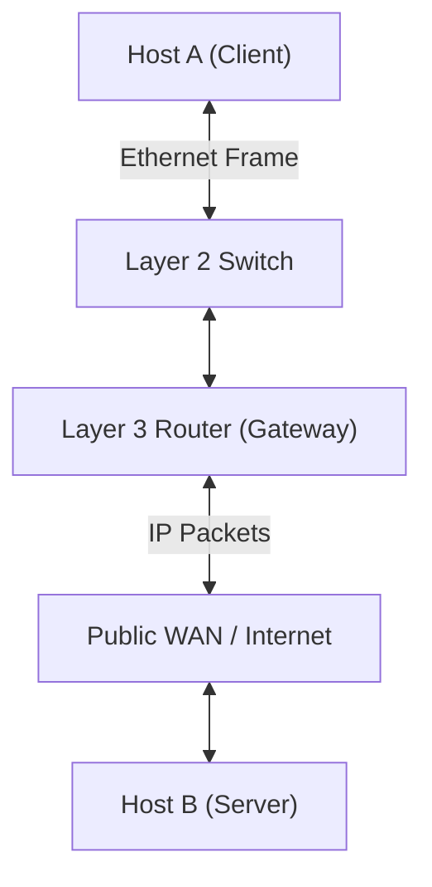

### 1.1 Core Definitions and Protocols

#### 1.1.1 Communication Protocols
A **protocol** is an agreed-upon set of rules, syntax, semantics, and synchronization standards that govern how data is formatted, transmitted, routed, and received across a telecommunication network.
- **TCP/IP Suite (Transmission Control Protocol / Internet Protocol):** The foundational protocol suite of the global Internet.
  - **TCP (Layer 4):** Connection-oriented protocol providing reliable, ordered, error-checked delivery of a stream of octets. It uses a three-way handshake (`SYN`, `SYN-ACK`, `ACK`), sequence numbers, acknowledgments, and windowing for flow and congestion control.
  - **IP (Layer 3):** Connectionless, best-effort packet delivery protocol responsible for logical addressing (IPv4/IPv6) and routing packets across intermediate networks from source host to destination host.

#### 1.1.2 Packets and Data Chunking
Data transmitted across digital networks is not sent in a single contiguous stream; instead, it is segmented into discrete units termed **packets**:
- **Payload:** The actual user data or upper-layer protocol data unit.
- **Header:** Metadata prepended to the payload containing routing instructions, source/destination IP addresses, protocol type, time-to-live (TTL), packet length, and checksums.
- **Packet Switching Advantages:** Enables multiplexing of multiple concurrent conversations over shared physical links, dynamic rerouting around failed links, and efficient utilization of bandwidth.

### 1.2 Importance of Computer Networking
1. **Resource Sharing:** Enables multiple users and distributed applications to concurrently access costly hardware (storage arrays, printers, GPUs) and software services.
2. **Data Exchange & Synchronization:** Facilitates real-time data replication, distributed databases, file sharing, and web services.
3. **Communication and Collaboration:** Powers instant messaging, video conferencing, email, and API-driven application workflows.
4. **Centralized Administration and Security:** Allows centralized authentication, monitoring, patching, and access policy enforcement across enterprise assets.

### 1.3 Classification of Networks by Geographical Scope

| Network Type | Full Name | Geographic Scope | Typical Ownership | Typical Latency / Speed | Example |
| :--- | :--- | :--- | :--- | :--- | :--- |
| **LAN** | Local Area Network | Single room, building, or campus (up to a few kilometers) | Privately owned by a single enterprise or individual | Ultra-low latency (&lt;1 ms), High speed (1–100 Gbps) | Corporate office network, Home Wi-Fi |
| **MAN** | Metropolitan Area Network | An entire city or metropolitan municipality (10–100 km) | Telecom provider, consortium, or public utility | Moderate latency (1–5 ms), High speed (10–100 Gbps dark fiber) | City-wide cable television network, municipal campus mesh |
| **WAN** | Wide Area Network | Country, continent, or globally distributed | Multiple service providers and telecommunications carriers | Higher latency (10–200+ ms), Variable speeds | The global public Internet, AWS Global Backbone Network |

## 2. The OSI Reference Model & Transport Protocols

The Open Systems Interconnection (OSI) model is a conceptual 7-layer framework developed by the International Organization for Standardization (ISO) to standardize telecommunication and computer network communication.

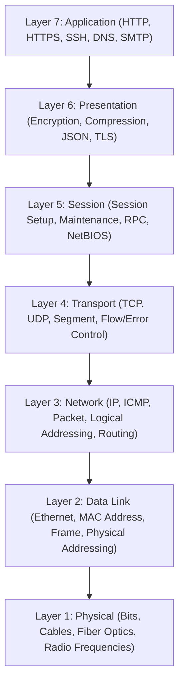

### 2.1 Overview of the 7 Layers

1. **Layer 7 — Application Layer:** Closest to the end user. Interfaces directly with user software applications (e.g., web browsers, email clients). Protocols: `HTTP`, `HTTPS`, `DNS`, `FTP`, `SMTP`, `SSH`.
2. **Layer 6 — Presentation Layer:** Translates, encrypts, and compresses data formats between the network and application. Handles character encodings (`ASCII`, `UTF-8`) and cryptographic serialization (`TLS/SSL`).
3. **Layer 5 — Session Layer:** Establishes, manages, synchronizes, and terminates communication sessions and dialogues between applications on two communicating end systems (e.g., `RPC`, `NetBIOS`).
4. **Layer 4 — Transport Layer:** Provides transparent end-to-end data transfer, connection management, flow control, segment reassembly, and error recovery. Protocols: `TCP`, `UDP`.
5. **Layer 3 — Network Layer:** Manages logical addressing (IP addresses), path determination (routing), packet forwarding, fragmentation, and delivery error reporting (`ICMP`). Hardware: Routers, Layer 3 switches.
6. **Layer 2 — Data Link Layer:** Handles node-to-node frame transfer across the physical medium, physical MAC addressing, media access control (`CSMA/CD`), and link-layer error detection (`CRC`). Hardware: Switches, Bridges.
7. **Layer 1 — Physical Layer:** Transmits raw unstructured bit streams (`0`s and `1`s) over physical communication channels (copper cables, fiber optics, radio frequencies).

### 2.2 OSI Layer 3 (Network Layer) Deep Dive
The Network Layer delivers variable-length data packets from a source host to a destination host across one or more networks:
- **Routing Functions:** Evaluates network topology using routing protocols (`BGP`, `OSPF`) to select optimal transmission paths.
- **Fragmentation and Reassembly:** If a packet exceeds the Maximum Transmission Unit (`MTU`) of an intermediate link (standard Ethernet MTU is 1500 bytes), Layer 3 splits the packet and reassembles it at the destination.
- **Delivery Error Reporting:** Employs Internet Control Message Protocol (`ICMP`) to transmit operational error messages (such as `Destination Unreachable` or `TTL Expired in Transit`).

### 2.3 OSI Layer 4 (Transport Layer) & Protocol Classes (TP0–TP4)
The Transport Layer regulates link reliability through flow control (sliding window), segmentation/reassembly, and error control (retransmissions). In ISO standard OSI networks, five classes of Connection-Oriented Transport Protocols exist:

| Feature / Capability | TP0 (Simple Class) | TP1 (Basic Error Recovery) | TP2 (Multiplexing) | TP3 (Error Recovery & Multiplexing) | TP4 (Error Detection & Recovery) |
| :--- | :--- | :--- | :--- | :--- | :--- |
| **Underlying Network Type** | Connection-Oriented (Type A) | Connection-Oriented (Type B) | Connection-Oriented (Type A) | Connection-Oriented (Type B) | Connection-Oriented & Connectionless (Type C / IP) |
| **Segmentation & Reassembly** | Yes | Yes | Yes | Yes | Yes |
| **Concatenation & Separation** | No | Yes | Yes | Yes | Yes |
| **Explicit Flow Control** | No | No | Yes | Yes | Yes |
| **Multiplexing over Single Circuit** | No | No | Yes | Yes | Yes |
| **Error Recovery** | No | Yes | No | Yes | Yes |
| **Retransmission on Timeout** | No | No | No | No | Yes |
| **Reinitiate Connection on PDU Failure** | No | Yes | No | Yes | No |
| **Reliable Transport Service** | No | Yes | No | Yes | Yes |

:::note[TP4 and Modern TCP]
**TP4** is functionally equivalent to modern **TCP**: it assumes the underlying network is unreliable (like the Internet or IP Layer 3) and guarantees complete, ordered, error-free delivery via end-to-end checksums, timeouts, and automatic retransmissions.
:::

## 3. IP Addressing, Classful Networks, and CIDR

An **Internet Protocol (IPv4) address** is a 32-bit numerical label assigned to each network interface connected to an IP network.

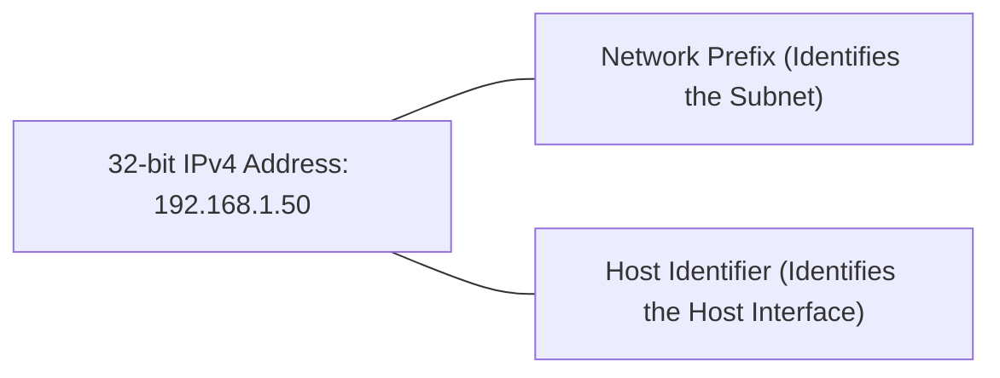

### 3.1 Anatomical Structure of an IPv4 Address
An IPv4 address consists of 32 bits grouped into four 8-bit octets, separated by periods (dotted-decimal notation, e.g., `192.168.1.1`):
- **Network Prefix:** Identifies the specific physical or logical network/subnet.
- **Host Number:** Identifies the specific network interface controller (NIC) within that network.

### 3.2 Historical Classful IP Addressing (Early 1980s – 1993)
Before 1993, IP addresses were rigidly partitioned into predefined classes based on their leading bits:

| Class | Leading Bits | First Octet Range | Default Subnet Mask | Network Prefix Bits | Host Identifier Bits | Total Networks | Usable Hosts per Network |
| :--- | :--- | :--- | :--- | :--- | :--- | :--- | :--- |
| **Class A** | `0` | `1 – 126` | `255.0.0.0 (/8)` | 8 bits | 24 bits | 126 | $2^{24} - 2 = 16,777,214$ |
| **Class B** | `10` | `128 – 191` | `255.255.0.0 (/16)` | 16 bits | 16 bits | 16,384 | $2^{16} - 2 = 65,534$ |
| **Class C** | `110` | `192 – 223` | `255.255.255.0 (/24)` | 24 bits | 8 bits | 2,097,152 | $2^8 - 2 = 254$ |
| **Class D** | `1110` | `224 – 239` | N/A (Multicast) | Reserved for Multicast Groups (No host addressing) | N/A | N/A | N/A |
| **Class E** | `1111` | `240 – 255` | N/A (Experimental) | Reserved for Scientific Research and Future Use | N/A | N/A | N/A |

:::warning[Problems with Classful Addressing]
1. **Severe Address Inefficiency & Exhaustion:** An organization needing 500 IP addresses had to obtain a Class B network ($65,534$ addresses), wasting over $65,000$ usable addresses. Class C networks ($254$ hosts) were too small for mid-sized enterprises.
2. **Routing Table Explosion:** Backbone routers required individual routing table entries for each assigned Class C network, threatening memory and compute limits on global routers by 1993.
:::

### 3.3 CIDR (Classless Inter-Domain Routing - 1993)
CIDR abandoned fixed address classes in favor of variable-length subnet masks (VLSM). Under CIDR, the network prefix length is explicitly appended to the IP address via slash notation:

$$\text{IPv4 Address} / \text{Prefix Length } (n)$$

Where $n$ represents the number of leading contiguous bits allocated to the network prefix, leaving $32 - n$ bits for host allocation:
- **Slash Notation:** `192.0.2.0/18` denotes that the first 18 bits represent the network prefix, leaving $32 - 18 = 14$ bits for hosts ($2^{14} = 16,384$ total IP addresses).
- **Subnet Mask Equivalence:** The prefix `/24` corresponds to netmask `255.255.255.0`.
- **Trailing Zero Truncation:** Under CIDR conventions, `192.0.2.0/18` can be written concisely as `192.0.2/18`.
- **Route Aggregation (Supernetting):** Multiple contiguous network routes can be collapsed into a single summarized routing entry, drastically shrinking global BGP routing table sizes.

### 3.4 Public vs. Private IP Addresses (RFC 1918)

| Feature | Private IP Address (RFC 1918) | Public IP Address |
| :--- | :--- | :--- |
| **Scope of Visibility** | Local to private network (LAN or VPC); non-routable on the public Internet. | Globally unique; directly routable across the worldwide Internet. |
| **Standard Ranges** | `10.0.0.0/8` (`10.0.0.0` – `10.255.255.255`) `172.16.0.0/12` (`172.16.0.0` – `172.31.255.255`) `192.168.0.0/16` (`192.168.0.0` – `192.168.255.255`) | All unreserved IPv4 addresses outside RFC 1918, loopback (`127.0.0.0/8`), APIPA (`169.254.0.0/16`), and multicast. |
| **Cost & Assignment** | Free of charge; allocated internally by local network administrators or DHCP. | Allocated and registered by IANA/RIRs; purchased or rented via ISPs and cloud providers. |
| **Internet Access Method** | Requires Network Address Translation (`NAT`) or Proxy to access the Internet. | Direct communication with Internet nodes without translation. |
| **Inspection Command** | `ipconfig` (Windows) or `ifconfig` / `ip addr` (Linux). | Queried via public lookup APIs (e.g., `curl ifconfig.me`). |

## 4. Amazon Virtual Private Cloud (VPC) Architecture

An **Amazon Virtual Private Cloud (VPC)** is a logically isolated virtual network dedicated to an AWS customer account within a specific AWS Region. It closely resembles a traditional physical data center network, leveraging AWS's software-defined networking (SDN) infrastructure.

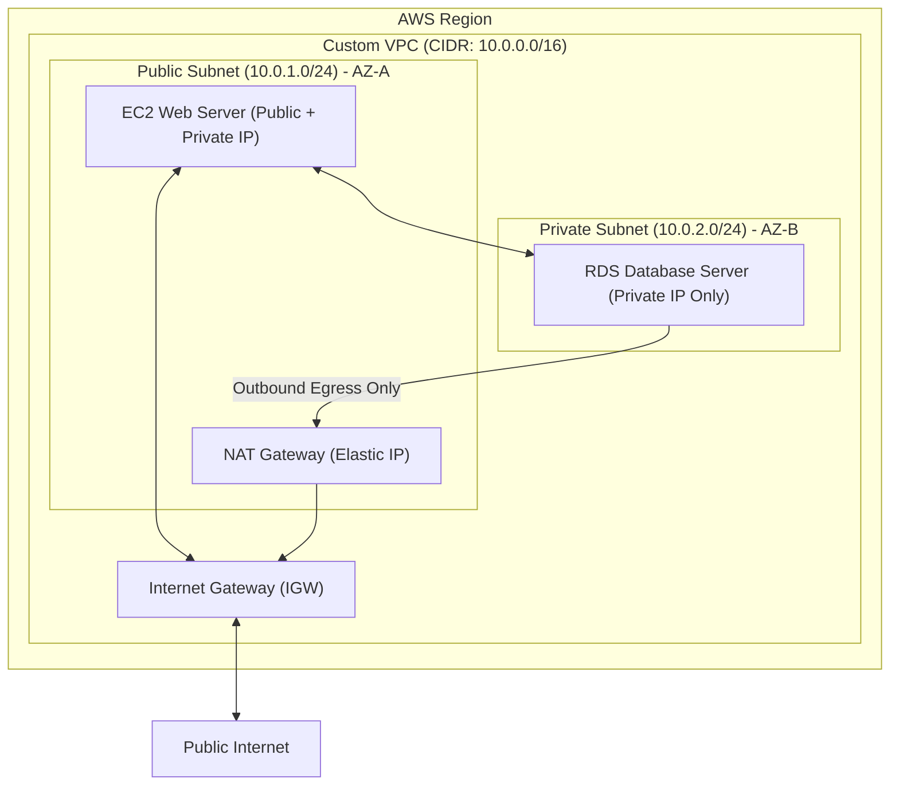

### 4.1 The Concept of Isolation in Public Cloud
In a public cloud, physical servers, hypervisors, and core fiber networks are shared among multiple tenants. A VPC provides **complete logical isolation**:
- **Analogy:** Consider a public restaurant. In a standard public cloud without VPC isolation, you sit in an open dining hall where everyone mingles. A VPC is equivalent to reserving a private, soundproof dining room inside the restaurant: you share the restaurant's kitchen and utilities (AWS global physical infrastructure), but your private room is locked, walled off, and accessible only by guests you explicitly permit.
- **Isolation Technologies:**
  1. **Subnets and VLAN Segmentation:** Customer traffic is tagged and isolated across physical links using software-defined overlays (such as Geneve and VXLAN encapsulated by the AWS Nitro System).
  2. **VPN Encryption:** IPsec tunnels encrypt traffic between on-premises sites and VPCs.
  3. **Network Address Translation (NAT):** Hides internal IP structures from external networks.
  4. **Border Gateway Protocol (BGP):** Dynamically isolates route advertisement tables.

### 4.2 Default VPC vs. Custom VPC

| Feature / Dimension | Default VPC | Custom VPC |
| :--- | :--- | :--- |
| **Creation Trigger** | Automatically created by AWS in every region upon account provisioning. | Manually created by user via Console, CLI, or Infrastructure as Code (`IaC`). |
| **IPv4 CIDR Block** | Fixed predefined CIDR: `172.31.0.0/16` ($65,536$ addresses). | User-selected CIDR (e.g., `10.0.0.0/16`, size between `/16` and `/28`). |
| **Subnet Setup** | Pre-configured with one public subnet in each Availability Zone (`/20` block). | User explicitly designs public and private subnets across target AZs. |
| **Internet Gateway** | Attached automatically out of the box with public routing enabled. | Must be manually created, attached to VPC, and routed via route table. |
| **Public IP on Launch** | "Auto-assign public IPv4 address" is enabled by default for all instances. | Disabled by default; user chooses whether subnets assign public IPs. |
| **VPC Peering Capability** | Cannot peer two Default VPCs if their CIDR blocks overlap (`172.31.0.0/16`). | Easily peered with other VPCs or on-premises networks with non-overlapping CIDRs. |
| **Primary Use Case** | Quick prototyping, testing, sandbox experiments, student learning. | Production workloads, secure multi-tier enterprise deployments. |

## 5. Core VPC Components

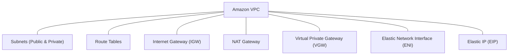

1. **Subnet:** A subdivision of a VPC's IP CIDR block associated with a **single specific Availability Zone**. Instances in a VPC reside within subnets.
2. **Route Table:** A set of routing rules (associations of destination CIDRs to target gateways/interfaces) that determines where network traffic from subnets or gateways is directed.
3. **Internet Gateway (IGW):** A horizontally scaled, redundant, highly available VPC component that enables communication between instances in the VPC and the Internet without performance bottlenecks. Performs 1:1 NAT between private and public IPs.
4. **NAT Gateway (Network Address Translation):** A managed AWS service deployed in a public subnet that enables outbound-only Internet egress for private subnet instances (for software patches, OS updates) while blocking unsolicited inbound connections from the Internet.
5. **Virtual Private Gateway (VGW):** The VPN concentrator / hub on the Amazon side of an Amazon Site-to-Site VPN or AWS Direct Connect connection.
6. **Customer Gateway (CGW):** An AWS resource that represents the physical customer appliance or software application on the customer's on-premises side of an IPsec VPN connection.
7. **Elastic Network Interface (ENI):** A virtual network interface card (vNIC) that can be attached to and detached from EC2 instances in a VPC. It maintains a primary private IP, secondary private IPs, an optional Elastic IP, MAC address, and attached security groups.
8. **Elastic IP Address (EIP):** A static, reserved, public IPv4 address designed for dynamic cloud computing. Unlike dynamic public IPs, an EIP does not change when an EC2 instance is stopped and restarted.

## 6. Subnets & Subnetting Strategies

Subnets allow network engineers to partition VPC address space into logical segments for isolation, security, and administrative efficiency.

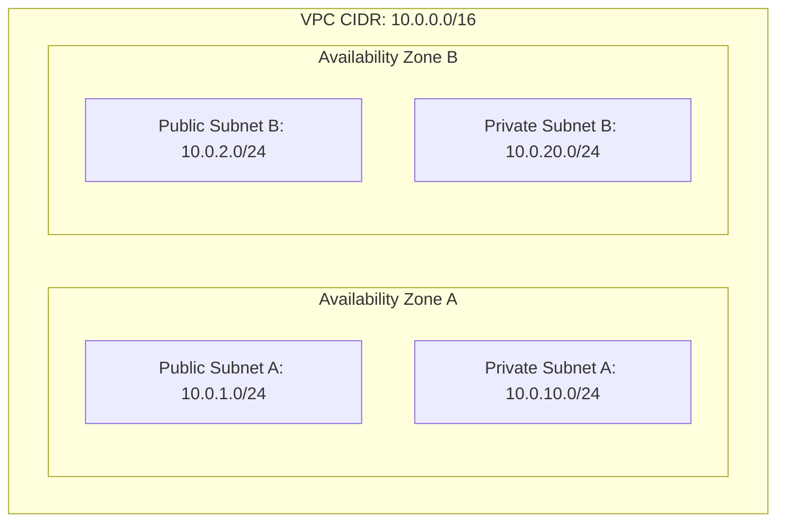

### 6.1 Public Subnets vs. Private Subnets
- **Public Subnet:** A subnet whose associated route table includes a default route (`0.0.0.0/0`) directed to an **Internet Gateway (IGW)**. Workloads requiring public Internet access (such as web servers, public API gateways, reverse proxies, and NAT gateways) reside here.
- **Private Subnet:** A subnet whose route table does NOT route directly to an IGW. Instances in private subnets cannot be reached directly from the Internet. Outbound Internet access is achieved indirectly by routing through a NAT Gateway or NAT instance residing in a public subnet.

### 6.2 AWS Reserved IP Addresses per Subnet
In any AWS VPC subnet, **5 IP addresses** are automatically reserved by AWS and cannot be assigned to host instances. For a subnet with CIDR `10.0.0.0/24` ($256$ total addresses):

| IP Address | Purpose / Reserved Function |
| :--- | :--- |
| `10.0.0.0` | **Network Address:** The base network wire address. |
| `10.0.0.1` | **VPC Local Router:** Reserved by AWS for the default subnet router / gateway. |
| `10.0.0.2` | **DNS Resolver:** Reserved by AWS for the Amazon Provided DNS (Amazon Route 53 Resolver). |
| `10.0.0.3` | **Future Use:** Reserved by AWS for future functionality. |
| `10.0.0.255` | **Broadcast Address:** Network broadcast address (AWS does not support broadcast; reserved for compatibility). |

$$\text{Usable Hosts} = 2^{(32 - n)} - 5$$

For a `/24` subnet: $256 - 5 = 251$ usable host IP addresses.

### 6.3 Subnetting Strategies in Production
1. **Tiered Architectural Isolation (Multi-Tier Architecture):**
   - **Presentation / Web Tier (Public Subnets):** Load balancers, public ingress reverse proxies.
   - **Application / Logic Tier (Private Subnets):** Microservices, backend application servers.
   - **Database / Persistence Tier (Isolated Private Subnets):** Relational databases (`RDS`), caches (`ElastiCache`), data warehouses.
2. **Multi-AZ Redundancy:** Deploy matching public and private subnets across at least two Availability Zones to guarantee fault tolerance against data center outages.

## 7. Route Tables and Traffic Routing

A route table contains a set of rules (called routes) that determine where network packets leaving a subnet are directed.

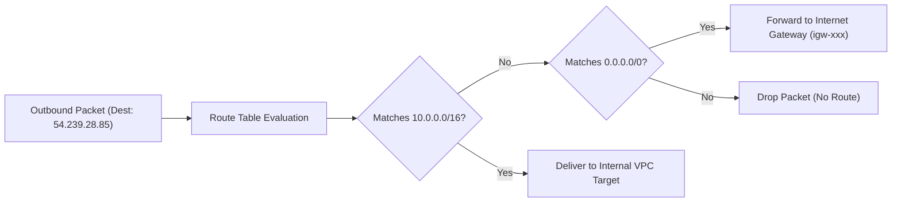

### 7.1 Main vs. Custom Route Tables
- **Main Route Table:** Created automatically when a VPC is provisioned. It controls routing for all subnets that are not explicitly associated with any other custom route table.
- **Custom Route Table:** Explicitly created by the cloud engineer to override main routing behaviors. Best practice dictates creating dedicated custom route tables for public subnets and private subnets rather than altering the main route table.

### 7.2 Routing Priority & Longest Prefix Match
When a packet matches multiple entries in a route table, AWS routes the packet using the **most specific route** (longest prefix match rule):
- `10.0.0.0/16` $\to$ `local` (VPC internal traffic)
- `10.0.1.0/24` $\to$ `pcx-12345` (VPC Peering connection)
- `0.0.0.0/0` $\to$ `igw-abcde` (Internet traffic)

A packet destined for `10.0.1.25` matches both `10.0.0.0/16` and `10.0.1.0/24`. Because `/24` has a longer prefix length than `/16`, traffic is routed across the peering connection `pcx-12345`.

## 8. Network Security: Security Groups vs. Network ACLs (NACLs)

AWS provides two distinct layers of firewall security to safeguard cloud resources: **Security Groups** (host-level virtual firewalls) and **Network Access Control Lists** (subnet-level boundary firewalls).

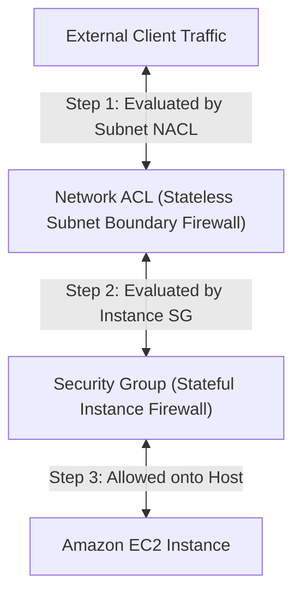

### 8.1 In-Depth Comparison Matrix

| Architectural Dimension | Security Groups (SGs) | Network ACLs (NACLs) |
| :--- | :--- | :--- |
| **Operational Boundary** | **Instance Level** (Operates at the virtual network interface `ENI` level). | **Subnet Level** (Operates at the perimeter boundary of the subnet). |
| **State Nature** | **Stateful:** If an inbound request is permitted, return outbound traffic is automatically allowed regardless of outbound rules. | **Stateless:** Inbound and outbound traffic are evaluated independently; return traffic must be explicitly permitted. |
| **Rule Types Supported** | **Allow Rules ONLY.** You cannot explicitly deny specific IP addresses. | **Allow AND Deny Rules.** Can explicitly deny traffic from rogue or malicious IP addresses. |
| **Rule Evaluation Logic** | **All rules are evaluated simultaneously** before making an allow decision. | **Rules are evaluated in strict numerical order** (lowest number first). The first rule that matches takes immediate effect. |
| **Ephemeral Port Handling** | Handled automatically due to stateful connection tracking. | Outbound rules must explicitly allow ephemeral ports (`1024 – 65535`) for client return traffic. |
| **Attachment Cardinality** | Multiple Security Groups can be attached to a single EC2 instance / ENI. | Each subnet can be associated with **exactly one** NACL at a time. |
| **Default Configuration** | Default SG: Denies all inbound, allows all outbound. Custom SG: Denies all inbound, allows all outbound. | Default NACL: Allows all inbound and outbound. Custom NACL: Denies all inbound and outbound until configured. |

### 8.2 The Ephemeral Port Problem in NACLs
Because NACLs are completely stateless, when a client connects to a web server on port `80`, the web server sends response packets back to the client's temporary source port (called an **ephemeral port**). 
- In Linux clients, ephemeral ports typically range from `32768 – 60999`.
- Windows and modern NAT gateways use `1024 – 65535`.
- **NACL Rule Requirement:** To allow web servers in a subnet protected by a custom NACL to return data to users, an outbound NACL rule permitting TCP traffic on ports `1024 – 65535` is mandatory.

## 9. VPC Security Services & Traffic Inspection

### 9.1 VPC Flow Logs
**VPC Flow Logs** is an agentless feature that captures IP traffic information flowing to and from network interfaces in a VPC:
- **Capture Scope:** Can be configured at three distinct levels: VPC level, Subnet level, or specific Elastic Network Interface (ENI) level.
- **Log Publishing Targets:** Amazon CloudWatch Logs, Amazon S3 bucket, or Amazon Kinesis Data Firehose.
- **Data Captured:** Source IP, destination IP, source port, destination port, protocol (`6` for TCP, `17` for UDP), packets transferred, bytes transferred, start/end time, and action (`ACCEPT` or `REJECT`).
- **Use Cases:** Diagnosing overly restrictive security group rules, auditing network traffic patterns, identifying malicious scanning or data exfiltration.

### 9.2 Traffic Mirroring
Traffic Mirroring copies inbound and outbound network traffic from an ENI and streams it out-of-band to security and monitoring appliances:
- Enables deep packet inspection (`DPI`), network anomaly detection, intrusion detection systems (`IDS`), and content inspection without installing software agents inside the guest OS.

### 9.3 AWS Network Firewall
A stateful, managed network firewall and intrusion detection/prevention service (`IDS/IPS`) that provides stateful inspection, application protocol detection (e.g., filtering traffic based on HTTP host headers or TLS Server Name Indication), and Suricata-compatible rule sets.

### 9.4 Architectural Best Practices for VPC Security
1. **Principle of Least Privilege:** Restrict security group ingress rules to only necessary ports and specific trusted source CIDRs (never leave SSH port `22` or RDP port `3389` open to `0.0.0.0/0`).
2. **Multi-Factor Authentication (MFA):** Enforce MFA on all AWS IAM identities managing network infrastructure.
3. **Bastion Hosts / AWS Systems Manager Session Manager:** Access private EC2 instances securely without exposing public SSH ports by using Session Manager or hardened bastion jump boxes in public subnets.
4. **Isolate Sensitive Workloads:** Ensure databases and proprietary compute engines reside strictly within private subnets with no public IP allocation.

## 10. AWS Shield & AWS WAF

AWS provides specialized edge security services to protect cloud applications against distributed denial-of-service (DDoS) attacks and web application vulnerabilities.

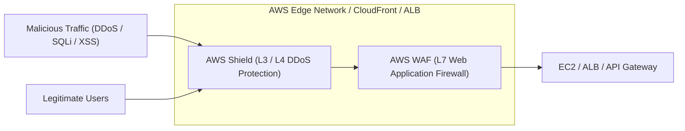

### 10.1 AWS Shield (DDoS Mitigation)
AWS Shield protects applications against Distributed Denial of Service attacks:
- **AWS Shield Standard:** Automatically enabled for all AWS customers at **no additional cost**. Protects against common Layer 3 (Network) and Layer 4 (Transport) attacks such as SYN floods, UDP reflection attacks, and HTTP slowloris attacks across CloudFront, Route 53, and Elastic Load Balancing.
- **AWS Shield Advanced:** A paid tier (\$3,000/month subscription plus data transfer fees) providing specialized protection:
  - 24/7 access to the AWS DDoS Response Team (DRT).
  - Financial protection against bill spikes caused by DDoS attacks.
  - Advanced Layer 7 attack detection and automatic rule mitigation.

### 10.2 AWS WAF (Web Application Firewall)
AWS WAF inspects **Layer 7 (Application Layer)** HTTP and HTTPS traffic forwarded to Amazon CloudFront, AWS AppSync, Amazon API Gateway, or an Application Load Balancer (ALB):
- **Protection Capabilities:** Filters common web exploits that compromise security, degrade availability, or consume excessive resources:
  - SQL Injection (`SQLi`)
  - Cross-Site Scripting (`XSS`)
  - HTTP Flood Attacks (Rate-based rules, e.g., block IPs making &gt;2,000 requests in 5 minutes)
  - Geographic blocking (Geo-match conditions)
- **Web ACL Rules:** Users configure Web Access Control Lists (Web ACLs) containing custom rules or AWS Managed Rules (pre-configured threat signatures managed by AWS and cybersecurity partners).

## 11. Multi-VPC Connectivity: VPC Peering vs. AWS Transit Gateway

As enterprise cloud footprints expand across multiple VPCs and AWS accounts, connecting isolated networks becomes critical.

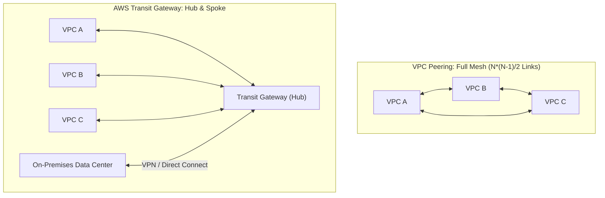

### 11.1 VPC Peering
A networking connection between two VPCs that enables routing using private IPv4 or IPv6 addresses.
- **One-to-One Direct Connection:** Connects exactly two VPCs.
- **No Transitive Routing:** If VPC A is peered with VPC B, and VPC B is peered with VPC C, **VPC A cannot communicate with VPC C through VPC B**. An explicit peering connection between A and C must be established.
- **Full-Mesh Scaling Complexity:** For $N$ VPCs requiring mutual interconnection, the number of peering connections required scales quadratically:

$$\text{Peering Connections} = \frac{N(N - 1)}{2}$$

For 10 VPCs, 45 peering links are needed; for 100 VPCs, 4,950 links are required.

### 11.2 AWS Transit Gateway
AWS Transit Gateway acts as a **cloud regional virtual router** connecting VPCs, on-premises data centers, and VPN connections via a central hub:
- **Hub-and-Spoke Topology:** Simplifies network architecture from a complex mesh into a clean hub-and-spoke model.
- **Transitive Routing Supported:** Interconnected VPCs can communicate across the central hub using Transit Gateway route tables.
- **Massive Scalability:** Connects up to 5,000 VPCs and supports gigabits-to-terabits per second throughput with equal-cost multi-path (ECMP) routing.

### 11.3 Architectural Comparison

| Architectural Dimension | VPC Peering | AWS Transit Gateway |
| :--- | :--- | :--- |
| **Topology** | Point-to-Point Mesh | Centralized Hub-and-Spoke |
| **Transitive Routing** | **No** (Strictly non-transitive) | **Yes** (Fully transitive across attached VPCs) |
| **Setup & Operational Cost** | Free connection setup (pay only for cross-AZ/cross-region data transfer) | Hourly charge per attachment (\$0.05/hr) + per-GB data processing fee |
| **Throughput / Latency** | Direct point-to-point bandwidth (no hop); lowest possible latency | High throughput via central hub with sub-millisecond inter-VPC latency |
| **Cross-Account Support** | Yes (via AWS Resource Access Manager or manual approval) | Yes (via AWS Resource Access Manager `RAM`) |
| **Best Used When** | Simple 2–3 VPC communication with high inter-VPC data transfer volumes | Enterprise multi-account architectures with tens to hundreds of VPCs |

## 12. DNS and AWS Route 53

The **Domain Name System (DNS)** is a hierarchical, distributed naming system that translates human-friendly domain names (e.g., `www.example.com`) into computer-routable IP addresses (e.g., `192.0.2.1` or `2600:1f18:..`).

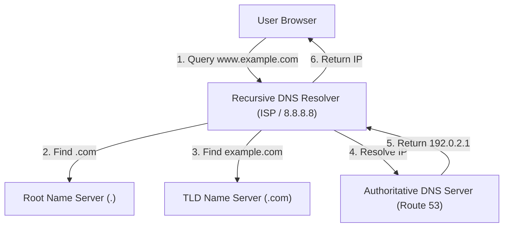

### 12.1 AWS Route 53 Overview
**Amazon Route 53** is a highly available and scalable cloud Domain Name System (DNS) web service operating over TCP/UDP port 53:
- Provides domain name registration, authoritative DNS routing, and resource health checking.
- Supports public hosted zones (routable on the Internet) and private hosted zones (routable only within designated VPCs).

### 12.2 Route 53 Routing Policies

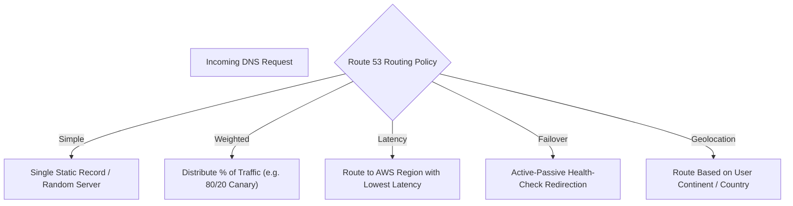

1. **Simple Routing Policy:** Single resource record returning one or more fixed IP addresses. If multiple IPs are specified, Route 53 returns them in randomized order. Does not support health checks.
2. **Weighted Routing Policy:** Assigns numerical relative weights (e.g., 70% to Server Group A, 30% to Server Group B) to distribute traffic across resources. Commonly used for A/B testing and canary software deployments.
3. **Latency-Based Routing Policy:** Routes end users to the AWS Region that provides the lowest network round-trip latency for their geographical location.
4. **Failover Routing Policy:** Implements **Active-Passive disaster recovery**. Route 53 monitors primary resource health checks; if the primary resource fails, traffic automatically redirects to the standby secondary resource.
5. **Geolocation Routing Policy:** Directs traffic based on the geographic location of the DNS requester (by continent, country, or US state) to deliver localized language content or comply with licensing boundaries.
6. **Multi-Value Answer Routing Policy:** Returns multiple healthy IP addresses in response to DNS queries, acting as a lightweight DNS-level load balancer with integrated health checking.

## 13. Amazon CloudFront (Content Delivery Network - CDN)

**Amazon CloudFront** is a fast, highly secure, globally distributed Content Delivery Network (CDN) service that accelerates the delivery of static and dynamic web content, video streams, APIs, and software downloads.

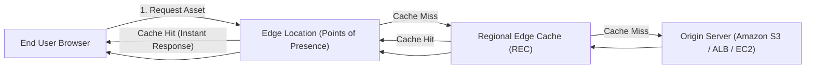

### 13.1 CloudFront Architecture & Components
1. **Edge Locations (Points of Presence - PoPs):** Hundreds of geographically distributed data center nodes located in major population centers worldwide. They cache copies of static files (images, CSS, JS, media files) close to users to deliver sub-millisecond responses.
2. **Regional Edge Caches (RECs):** Larger caching tiers positioned between Edge Locations and Origin servers that hold content too rarely accessed for PoPs, eliminating unnecessary origin load.
3. **Origin Servers:** The authoritative source of original application content. Supported origins:
   - Amazon S3 Bucket (static assets, images, video)
   - Application Load Balancer (ALB) or Amazon EC2 instance (dynamic content, APIs)
   - On-premises web servers or custom HTTP backends

### 13.2 Core Benefits of CloudFront
- **Reduced Latency:** Content is served directly from the nearest PoP, bypassing long multi-hop transit routes across the public Internet.
- **Origin Offloading:** Up to 90%+ of static GET requests are absorbed by the CDN cache, dramatically reducing server CPU load and bandwidth consumption at the origin.
- **Enhanced Security & HTTPS:** Terminates TLS/SSL connections at the edge, supports custom SSL certificates via AWS Certificate Manager (`ACM`), and integrates natively with AWS WAF and AWS Shield.
- **Dynamic Content Acceleration:** Employs persistent, optimized TCP connections and route optimization across the AWS private global backbone for dynamic API calls.

## 14. Step-by-Step Practical Implementation: Building a Production-Grade 2-Tier VPC

The following step-by-step guide demonstrates designing and deploying a secure, two-tier VPC containing a public subnet (web servers) and a private subnet (database servers) from scratch.

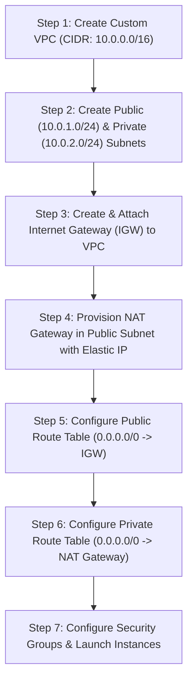

### 14.1 Step 1: Create the Custom VPC
1. Open the AWS Management Console and navigate to **VPC**.
2. Click **Create VPC**.
3. Select **VPC only**.
4. Configure settings:
   - **Name tag:** `Production-VPC`
   - **IPv4 CIDR block:** `10.0.0.0/16`
   - **IPv6 CIDR block:** No IPv6 CIDR block
   - **Tenancy:** Default
5. Click **Create VPC**.

### 14.2 Step 2: Create Subnets
1. In the VPC navigation pane, click **Subnets** $\to$ **Create subnet**.
2. Select `Production-VPC`.
3. Configure the **Public Subnet**:
   - **Subnet name:** `Public-Subnet-AZ1`
   - **Availability Zone:** Select primary AZ (e.g., `us-east-1a`)
   - **IPv4 subnet CIDR block:** `10.0.1.0/24`
4. Configure the **Private Subnet**:
   - **Subnet name:** `Private-Subnet-AZ1`
   - **Availability Zone:** Select same AZ (`us-east-1a`) or secondary AZ
   - **IPv4 subnet CIDR block:** `10.0.2.0/24`
5. Click **Create subnet**.
6. Select `Public-Subnet-AZ1`, click **Actions** $\to$ **Edit subnet settings**, and enable **Enable auto-assign public IPv4 address**.

### 14.3 Step 3: Attach Internet Gateway (IGW)
1. In the navigation pane, click **Internet Gateways** $\to$ **Create internet gateway**.
2. Set Name tag: `Prod-IGW`. Click **Create internet gateway**.
3. Select `Prod-IGW`, click **Actions** $\to$ **Attach to VPC**, choose `Production-VPC`, and click **Attach internet gateway**.

### 14.4 Step 4: Deploy NAT Gateway
1. In the navigation pane, click **NAT Gateways** $\to$ **Create NAT gateway**.
2. Name: `Prod-NAT-Gateway`.
3. Subnet: Select **`Public-Subnet-AZ1`** (a NAT Gateway must always be deployed in a public subnet).
4. Connectivity type: **Public**.
5. Click **Allocate Elastic IP** to assign a new dedicated static public IPv4 address.
6. Click **Create NAT gateway**.

### 14.5 Step 5: Configure Route Tables
1. Click **Route Tables** $\to$ **Create route table**:
   - Name: `Public-RT`
   - VPC: `Production-VPC`
   - Routes tab $\to$ **Edit routes** $\to$ Add Route: Destination `0.0.0.0/0`, Target `Internet Gateway` (`igw-xxxx`).
   - Subnet associations tab $\to$ **Edit subnet associations** $\to$ Associate `Public-Subnet-AZ1`.
2. Click **Create route table**:
   - Name: `Private-RT`
   - VPC: `Production-VPC`
   - Routes tab $\to$ **Edit routes** $\to$ Add Route: Destination `0.0.0.0/0`, Target `NAT Gateway` (`nat-xxxx`).
   - Subnet associations tab $\to$ **Edit subnet associations** $\to$ Associate `Private-Subnet-AZ1`.

### 14.6 Step 6: Configure Security Groups
1. **Web-Tier Security Group (`Web-SG`):**
   - Inbound: Allow `HTTP` (port 80) from `0.0.0.0/0`.
   - Inbound: Allow `HTTPS` (port 443) from `0.0.0.0/0`.
   - Inbound: Allow `SSH` (port 22) from your administrative IP (`x.x.x.x/32`).
2. **Database-Tier Security Group (`DB-SG`):**
   - Inbound: Allow `MySQL/Aurora` (port 3306) **ONLY from source `Web-SG`** (referencing the security group ID, preventing all direct public access).
   - Inbound: Deny all direct external ingress.

## 15. Comprehensive Review & Exam Question Bank

### 15.1 Short Answer Questions

#### Q1: What is the primary difference between a public subnet and a private subnet in AWS VPC?
A **public subnet** has a direct route to an attached Internet Gateway (`0.0.0.0/0` $\to$ `igw-xxx`) in its route table, allowing instances with public IPs to communicate bidirectionally with the Internet. A **private subnet** does not route directly to an Internet Gateway; its instances possess only private IPs and can only reach the Internet for outbound traffic through a NAT Gateway or NAT instance located in a public subnet.

#### Q2: Why are 5 IP addresses unavailable in every AWS VPC subnet?
In any AWS subnet, AWS reserves 5 IP addresses for internal networking:
- `.0`: Network address.
- `.1`: Assigned to the default VPC subnet router.
- `.2`: Assigned to the Amazon Route 53 DNS resolver.
- `.3`: Reserved by AWS for future use.
- `.255`: Network broadcast address (broadcast is not supported on AWS virtual networks).

#### Q3: State two key architectural differences between Security Groups and Network ACLs.
1. **Scope:** Security Groups apply at the virtual instance / ENI level, whereas NACLs apply at the subnet boundary level.
2. **Statefulness:** Security Groups are **stateful** (return traffic is automatically allowed regardless of outbound rules), whereas NACLs are **stateless** (inbound and outbound rules must be explicitly configured, including ephemeral return ports).

#### Q4: What is the purpose of CIDR notation, and what does `/18` signify in `192.0.2.0/18`?
Classless Inter-Domain Routing (CIDR) replaces rigid classful network masks with variable-length prefixes. In `192.0.2.0/18`, the suffix `/18` indicates that the first 18 bits are designated for the network prefix, leaving $32 - 18 = 14$ bits for host addressing, which provides $2^{14} = 16,384$ total IP addresses.

#### Q5: Explain the term "Non-Transitive Routing" in the context of VPC Peering.
Non-transitive routing means that network traffic cannot pass through an intermediate VPC to reach another VPC. If VPC A is peered with VPC B, and VPC B is peered with VPC C, traffic from VPC A cannot transit across VPC B to reach VPC C. A direct VPC peering connection between VPC A and VPC C must be explicitly established.

### 15.2 Long Answer Questions

#### Q6: Explain the 7 layers of the OSI model with particular emphasis on Layer 3 and Layer 4 functions and OSI Transport Protocol classes (TP0–TP4).
The OSI 7-layer model standardizes network communications from hardware to application software:
- **Layer 7 (Application):** User application interfaces (`HTTP`, `DNS`).
- **Layer 6 (Presentation):** Data translation, compression, and encryption (`TLS`).
- **Layer 5 (Session):** Communication session management (`RPC`).
- **Layer 4 (Transport):** Transparent, reliable end-to-end data transfer, flow control, segmentation, and error control. Standard OSI transport classes range from TP0 to TP4:
  - *TP0:* Minimal class, segmentation only, assumes a reliable underlying network.
  - *TP1:* Basic error recovery with sequence numbers.
  - *TP2:* Adds multiplexing and explicit flow control over virtual circuits.
  - *TP3:* Combines error recovery and multiplexing.
  - *TP4:* The most robust class, providing full error detection, retransmissions on timeouts, and reliable delivery over unreliable (connectionless) IP networks, serving as the blueprint for TCP.
- **Layer 3 (Network):** Governs logical addressing, packet routing, MTU fragmentation, and ICMP error reporting across heterogeneous networks.
- **Layer 2 (Data Link):** MAC addressing, frame switching, and link-level CRC checks.
- **Layer 1 (Physical):** Bitstream transmission over electrical, optical, or radio channels.

#### Q7: Contrast AWS Transit Gateway with VPC Peering. Explain their architectural topologies, cost structures, and selection criteria.
- **Topology:** VPC Peering requires point-to-point mesh connectivity. For $N$ VPCs, it requires $[N(N-1)]/2$ links. Transit Gateway uses a central hub-and-spoke virtual router where each VPC establishes a single attachment to the central hub.
- **Routing:** VPC Peering is non-transitive; Transit Gateway natively supports transitive routing across connected VPCs and on-premises networks.
- **Cost:** VPC Peering has no hourly connection charge (customers pay standard data transfer fees). Transit Gateway incurs an hourly fee per attachment plus per-GB data processing charges.
- **Selection Criteria:** Use VPC Peering for small setups (2–5 VPCs) with high data transfer requirements. Use Transit Gateway for medium-to-large enterprise architectures with dozens or hundreds of VPCs requiring centralized governance and transitive connectivity.

### 15.3 Multiple Choice Questions

#### Q8: Which AWS Route 53 routing policy should be selected to split user traffic in an 80/20 ratio for canary testing?
- (A) Simple Routing
- (B) Latency-Based Routing
- (C) Weighted Routing
- (D) Failover Routing
- **Correct Answer:** **(C) Weighted Routing** (allows assigning relative numeric weightings such as 80 and 20 to route proportions of traffic).

#### Q9: What happens when an incoming packet matches an explicit DENY rule at number 50 and an explicit ALLOW rule at number 20 in an AWS Network ACL?
- (A) The packet is denied because DENY rules override ALLOW rules.
- (B) The packet is allowed because NACL rules are evaluated in numerical order from lowest to highest, and rule 20 matches first.
- (C) The packet is dropped because of conflicting rules.
- (D) The packet is forwarded to the Security Group for resolution.
- **Correct Answer:** **(B)** (Network ACLs evaluate rules sequentially starting from the lowest rule number; evaluation terminates on the first match).

#### Q10: Where must a public NAT Gateway be deployed within an Amazon VPC?
- (A) In an isolated private subnet.
- (B) In a public subnet with an attached Elastic IP.
- (C) Outside the VPC in the AWS Edge Location.
- (D) Directly attached to the Virtual Private Gateway.
- **Correct Answer:** **(B) In a public subnet with an attached Elastic IP** (the NAT Gateway needs direct internet routing via an IGW to forward private outbound requests).

### 15.4 Troubleshooting & Architecture Scenarios

#### Scenario A: The Inaccessible Private Web Server
- **Problem:** An administrator launched an EC2 instance in a private subnet, installed an Nginx web server, and configured the Security Group to allow inbound HTTP port 80. However, external users cannot load the website.
- **Root Cause:** The private subnet has no route to an Internet Gateway (`0.0.0.0/0` $\to$ `igw-xxx`), and the EC2 instance lacks a public IPv4 address.
- **Solution:** Place an Application Load Balancer in the **public subnets** with an attached public IP and route table to the IGW. Configure target groups to forward traffic internally to the EC2 instance's private IP in the private subnet.

#### Scenario B: The Asymmetric NACL Outage
- **Problem:** A developer created a custom NACL and added an Inbound rule: `Rule 100: Allow TCP Port 80 from 0.0.0.0/0`. When testing with `curl`, requests hang and time out.
- **Root Cause:** NACLs are **stateless**. The inbound packet reaches the web server, but response traffic attempting to exit through the ephemeral port range (`1024 – 65535`) is blocked because the custom NACL's outbound table has only the default `Rule * Deny All`.
- **Solution:** Add an Outbound NACL rule: `Rule 100: Allow TCP Ports 1024–65535 to 0.0.0.0/0`.
