# Unit - 3

:::info[TITLE]
## Compute Services on AWS
:::

## 1. Cloud Compute & Infrastructure as a Service (IaaS)

Cloud compute refers to the on-demand provisioning and management of configurable computing resources (virtual processor cores, random-access memory, local storage, and virtual network interfaces) delivered over the internet with zero physical hardware investment.

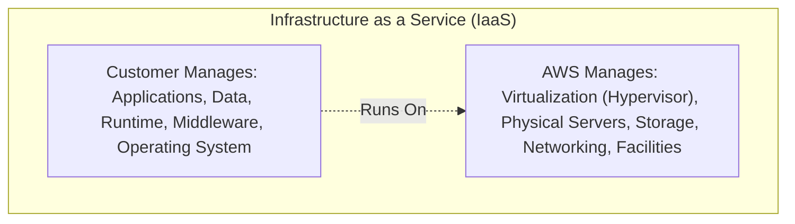

### 1.1 The Concept of IaaS
Infrastructure as a Service (IaaS) represents the foundational category of cloud computing services. Under the IaaS paradigm:
- **Customer Control:** The cloud consumer exercises full administrative control over the guest operating system (Linux or Windows), middleware, database engines, security configurations (firewalls, user permissions), runtime environments, and deployed application binaries.
- **Provider Responsibility:** The cloud service provider (CSP) manages, patches, and secures the underlying physical compute hardware, server chassis, bare-metal hypervisors (e.g., AWS Nitro System, Xen), uninterruptible power supplies, physical facilities, and perimeter security.
- **On-Demand Elasticity:** Compute capacity can be scaled up (vertical scaling: adding more vCPUs/RAM) or scaled out (horizontal scaling: launching additional virtual instances) within minutes via automated APIs or web consoles.

### 1.2 Enterprise Applications of IaaS
1. **Development, Staging, and Testing:** Rapid creation and teardown of isolated, reproducible staging environments without waiting for physical hardware procurement cycles.
2. **Web Application Hosting:** Running production web servers, e-commerce storefronts, microservices, and customer-facing APIs.
3. **High-Performance Computing (HPC):** Solving computationally intensive engineering, financial risk analysis, genomics, and weather modeling problems utilizing hundreds or thousands of high-speed virtual processor cores.
4. **Big Data Processing & Machine Learning:** Executing distributed analytics engines (Apache Spark, Hadoop, Presto) and training deep learning neural networks.
5. **Storage, Backup, and Disaster Recovery:** Replicating on-premises enterprise workloads to the cloud for rapid failover and disaster recovery.

## 2. Amazon EC2 (Elastic Compute Cloud)

**Amazon Elastic Compute Cloud (Amazon EC2)** is an on-demand, web-service-driven infrastructure compute service that provides resizable, secure virtual servers (termed **EC2 instances**) in the cloud.

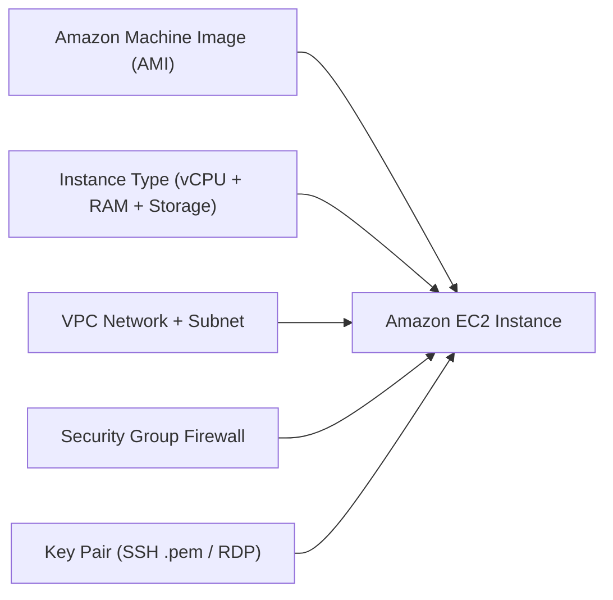

### 2.1 Core Features of Amazon EC2
1. **Elastic, Resizable Compute:** Instances can be launched, stopped, resized, or terminated programmatically via the AWS Management Console, AWS CLI, or Software Development Kits (SDKs).
2. **Amazon Machine Images (AMIs):** Pre-configured template packages containing the operating system, initial software packages, libraries, and launch configurations needed to initialize an instance.
3. **Broad Operating System Ecosystem:** Full support for commercial and open-source operating systems, including Amazon Linux 2023, Red Hat Enterprise Linux (RHEL), Ubuntu, SUSE Linux Enterprise Server, and Microsoft Windows Server.
4. **Deep Ecosystem Integration:** Integrates natively with Amazon VPC for networking isolation, Amazon EBS for persistent block storage, AWS IAM for role-based security credentials, and Amazon CloudWatch for telemetry.
5. **Amazon Time Sync Service:** A highly accurate reference clock accessible from all EC2 instances over IP `169.254.169.123` via Network Time Protocol (NTP), utilizing redundant satellite-connected atomic clocks within AWS data centers.

### 2.2 EC2 Instance Families and Specializations

AWS organizes EC2 instances into distinct families optimized for differing workload resource profiles:

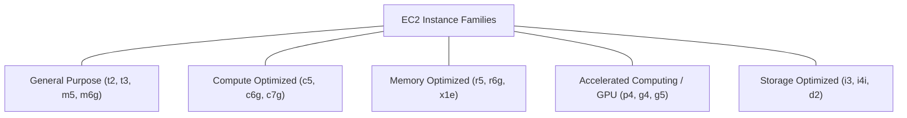

| Instance Family | Major Types | Resource Profile | Workload Use Cases |
| :--- | :--- | :--- | :--- |
| **General Purpose** | `t2`, `t3`, `t4g`, `m5`, `m6i`, `m6g` | Equal balance of compute, memory, and networking performance. | Web and application servers, enterprise microservices, small/medium databases, code repositories. |
| **Burstable Performance** | `t2.micro`, `t3.nano` to `t3.2xlarge` | Baseline CPU capability with ability to burst above baseline using accumulated **CPU Credits**. | Low-traffic websites, developer workstations, test environments, background cron jobs. |
| **Compute Optimized** | `c5`, `c6g`, `c6i`, `c7g` | High ratio of compute performance (vCPU) relative to memory. | High-performance web servers, scientific modeling, batch processing, video transcoding, distributed analytics. |
| **Memory Optimized** | `r5`, `r6g`, `x1e`, `u-6tb1` | High memory footprint per vCPU (up to terabytes of RAM). | In-memory caches (`Redis`, `Memcached`), large relational databases (`Oracle`, `SAP HANA`), real-time streaming analytics. |
| **Accelerated Computing** | `p4`, `g4dn`, `g5`, `trn1` | Hardware accelerators: GPUs (Nvidia A100/T4) or AWS Trainium/Inferentia. | Machine learning model training, deep neural networks, graphics rendering, 3D visualization, video encoding. |
| **Storage Optimized** | `i3`, `i4i`, `d2`, `d3` | Massive, direct-attached, low-latency NVMe SSD or high-density HDD storage. | NoSQL databases (`Cassandra`, `MongoDB`), distributed file systems, data warehouses, Elasticsearch. |

### 2.3 Burstable Performance Instances & The CPU Credit Model
Burstable instances (the `t` series, such as `t2.micro` which is eligible for the AWS Free Tier) are engineered for applications that do not utilize continuous 100% CPU capacity:
- **Baseline Performance:** Each instance type has an assigned baseline processing percentage (e.g., `t2.micro` has a baseline of 10% of a single core).
- **CPU Credits:** When the instance operates below its baseline threshold, it accumulates CPU credits. Each CPU credit equals one vCPU running at 100% utilization for one full minute.
- **Bursting:** When incoming user traffic spikes, the instance automatically consumes accumulated credits to burst up to 100% of the vCPU core without throttling. If all credits are exhausted in `Standard` mode, performance drops down to baseline.

## 3. Step-by-Step EC2 Instance Launch Workflow

Launching an EC2 instance involves a structured sequence of configuration decisions in the AWS Management Console:

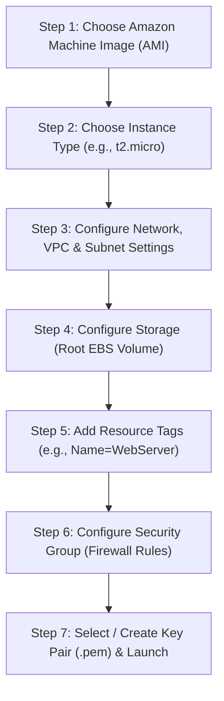

### 3.1 Step 1: Select an Amazon Machine Image (AMI)
- Navigate to **EC2 Dashboard** $\to$ **Launch Instance**.
- Enter an instance name (e.g., `Web-Server-01`).
- Select the **Amazon Machine Image (AMI)**: Choose **Amazon Linux 2023 AMI** (Free Tier eligible) or Ubuntu Server.

### 3.2 Step 2: Choose Instance Type
- Under **Instance type**, select `t2.micro` (1 vCPU, 1 GiB RAM).
- This meets Free Tier specifications (750 hours per month free for eligible accounts).

### 3.3 Step 3: Key Pair Configuration
- Under **Key pair (login)**, select **Create new key pair**:
  - Key pair name: `ec2-keypair`
  - Key pair type: `RSA`
  - Private key file format: `.pem` (for OpenSSH / Linux / macOS / Windows Terminal) or `.ppk` (for PuTTY).
- Download and store the generated `.pem` file securely. On Linux/macOS, restrict permissions:
  ```bash
  chmod 400 ec2-keypair.pem
  ```

### 3.4 Step 4: Network and Security Group Configuration
- Under **Network settings**, click **Edit**:
  - **VPC:** Select default VPC or custom VPC.
  - **Subnet:** Choose a public subnet (e.g., `us-east-1a`).
  - **Auto-assign public IP:** Select **Enable** (to receive a public IPv4 address for direct SSH/HTTP access).
- **Firewall (Security Groups):** Create a new Security Group:
  - Rule 1 (SSH): Type `SSH`, Port `22`, Source `My IP` (best practice to restrict management access to your administrative public IP).
  - Rule 2 (HTTP): Type `HTTP`, Port `80`, Source `Anywhere` (`0.0.0.0/0`) to allow web traffic.

### 3.5 Step 5: Configure Storage & Launch
- Under **Configure storage**, specify the Root volume size: default `8 GiB` or `30 GiB` General Purpose SSD (`gp3`).
- In **Advanced details**, you can enter a shell bootstrap script into **User data** to automatically install software on first boot:
  ```bash
  #!/bin/bash
  dnf update -y
  dnf install -y httpd
  systemctl start httpd
  systemctl enable httpd
  echo "<h1>Hello from Amazon EC2 instance $(hostname -f)</h1>" > /var/www/html/index.html
  ```
- Click **Launch instance**. Once in `Running` state, connect via SSH:
  ```bash
  ssh -i "ec2-keypair.pem" ec2-user@<Instance-Public-IPv4-Address>
  ```

## 4. Elastic Load Balancing (ELB)

**Elastic Load Balancing (ELB)** automatically distributes incoming application network traffic across multiple targets—such as Amazon EC2 instances, containers, IP addresses, and AWS Lambda functions—in one or more Availability Zones.

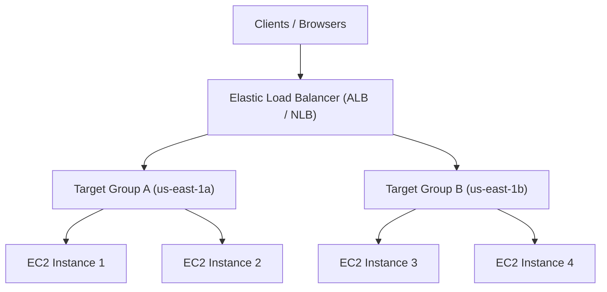

### 4.1 Comparison of Load Balancer Types

| Feature / Dimension | Application Load Balancer (ALB) | Network Load Balancer (NLB) | Gateway Load Balancer (GWLB) | Classic Load Balancer (CLB) |
| :--- | :--- | :--- | :--- | :--- |
| **OSI Layer** | **Layer 7** (Application Layer) | **Layer 4** (Transport Layer) | **Layer 3** (Network Gateway) | Layer 4 & Layer 7 (Legacy) |
| **Supported Protocols** | `HTTP`, `HTTPS`, `gRPC`, `WebSockets` | `TCP`, `UDP`, `TLS` | `IP` (Raw Layer 3 Packets) | `HTTP`, `HTTPS`, `TCP`, `SSL` |
| **Performance / Latency** | High throughput; millisecond latency (~10–20 ms) | Ultra-high performance; millions of requests/sec; **sub-millisecond latency** | Scales third-party virtual network appliances | Baseline legacy performance |
| **Static / Elastic IP** | No (uses dynamic DNS names) | **Yes** (assigns static IP / Elastic IP per AZ) | Transparent bump-in-the-wire | No |
| **Routing Intelligence** | Path-based (`/api`, `/img`), Host-based (`app.domain.com`), HTTP headers, Query parameters | IP protocol, source/destination IP, and port only | Route table-based forwarding to inspection appliances | Basic round-robin routing |
| **Security & WAF** | Direct native integration with **AWS WAF** | No direct AWS WAF integration | Operates alongside firewall appliances | Limited security features |
| **Best Used For** | Web applications, microservices, containerized services (`ECS`/`EKS`) | High-throughput gaming, financial trading, VoIP, non-HTTP protocols | Deploying third-party firewalls and IDS/IPS appliances | Legacy EC2-Classic migrations |

### 4.2 Key Components of Elastic Load Balancing
1. **Listeners:** A process that checks for connection requests using the protocol and port configured by the administrator (e.g., Listener for `HTTPS` on port `443`).
2. **Target Groups:** Groups of logical targets (EC2 instances, microservice ports, Lambda functions) to which the load balancer routes requests.
3. **Health Checks:** Periodic diagnostic probes sent to registered targets. If a target fails to respond with an HTTP `200–399` status code within configured timeout thresholds, ELB marks it **unhealthy** and stops routing traffic to it until health is restored.
4. **Sticky Sessions (Session Affinity):** Directs requests from the same user session to the same backend target using generated HTTP cookies.
5. **Cross-Zone Load Balancing:** When enabled, distributes incoming traffic evenly across all registered targets in all enabled Availability Zones rather than balancing only across AZs.

## 5. Amazon EC2 Auto Scaling (ASG)

**Amazon EC2 Auto Scaling** automatically adds or removes EC2 instances according to conditions defined by cloud administrators, ensuring that the fleet possesses sufficient capacity to handle changing application demand while minimizing costs during quiet periods.

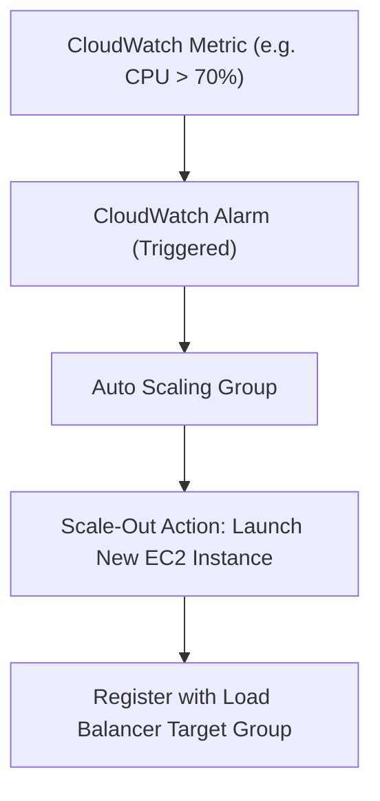

### 5.1 Core Architectural Components of Auto Scaling
1. **Launch Template (Recommended) / Launch Configuration (Legacy):** Specifies instance configuration parameters: AMI ID, instance type, key pair, security groups, EBS block device mappings, and bootstrap user-data scripts. Launch templates support versioning and multi-instance-type configurations.
2. **Auto Scaling Group (ASG):** The operational container defining:
   - **VPC & Subnets:** The specific Availability Zones and subnets across which instances are distributed.
   - **Capacity Bounds:**
     - **Minimum Size:** The baseline number of instances that must always be running (e.g., `2`).
     - **Maximum Size:** The upper limit of instances permitted during peak traffic spikes (e.g., `10`).
     - **Desired Capacity:** The target number of instances the ASG actively maintains (e.g., `4`).
3. **Cooldown Period:** A configurable buffer period (default: **300 seconds / 5 minutes**) that pauses scaling actions following a scale-in or scale-out event, allowing newly launched instances time to boot, stabilize, and take on load before additional capacity calculations occur.

### 5.2 Auto Scaling Policies

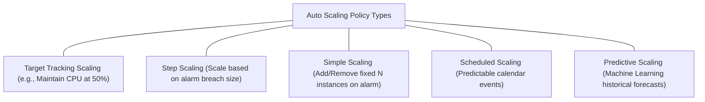

- **Target Tracking Scaling:** Functions like a thermostat: you configure a target metric value (e.g., average ASG CPU utilization = 50%), and AWS automatically adjusts capacity up or down to keep the metric at the target.
- **Step Scaling:** Adjusts capacity based on the magnitude of the metric alarm breach (e.g., if CPU is between 70% and 80%, add 2 instances; if CPU exceeds 80%, add 4 instances).
- **Simple Scaling:** Waits for a single CloudWatch alarm threshold breach and executes a single scaling adjustment, then enters a full cooldown period.
- **Scheduled Scaling:** Adjusts capacity automatically according to a predefined schedule (e.g., scale up instances every Friday at 4:00 PM before a weekend traffic surge).
- **Predictive Scaling:** Uses machine learning models to analyze historical traffic patterns over weeks and proactively schedules capacity adjustments prior to forecasted demand spikes.

### 5.3 The EC2 Auto Scaling Lifecycle

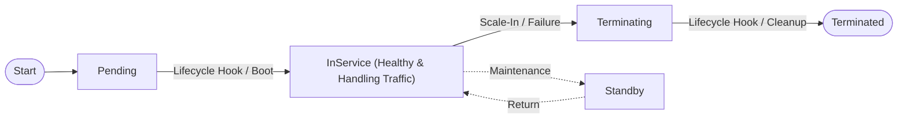

1. **Pending:** An instance is launched and begins OS initialization.
2. **Pending:Wait (Optional Lifecycle Hook):** Pauses the launch to allow execution of custom configuration scripts or software installations before entering service.
3. **InService:** The instance is fully running, healthy, registered with the ELB Target Group, and actively processing user requests.
4. **Terminating:** Triggered by scale-in policies, health-check failure, or manual detachment.
5. **Terminating:Wait (Optional Lifecycle Hook):** Pauses termination to allow log extraction, memory dumps, or completion of active transactions.
6. **Terminated:** The instance is completely stopped and destroyed; its EBS root volume is deleted if configured.

## 6. Serverless Computing & AWS Lambda

**Serverless computing** is an execution model in which the cloud provider completely abstracts server management, automatically provisions and scales runtime resources in response to events, and charges strictly for the compute time consumed.

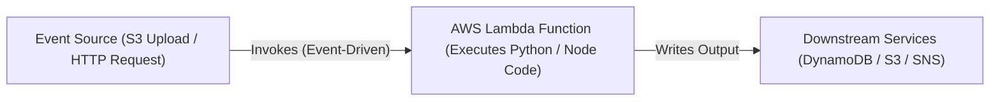

### 6.1 Key Characteristics of Serverless Architectures
1. **Zero Server Administration:** No operating system patching, security kernel updates, hypervisor maintenance, or server provisioning.
2. **Continuous, Automatic Elastic Scaling:** Functions scale instantaneously from zero to thousands of concurrent executions in response to event volume.
3. **Pay Strictly for Value (Pay-per-Use):** Zero cost when idle. Invocations are billed in **1-millisecond increments** based on consumed execution duration and allocated memory.
4. **Built-in Fault Tolerance & High Availability:** Serverless runtimes are natively replicated across multiple Availability Zones in a region.
5. **Stateless Execution:** Compute instances are ephemeral; state must be persisted externally in services like Amazon S3, DynamoDB, or ElastiCache.

### 6.2 Benefits vs. Challenges of Serverless

| Architectural Dimension | Advantages / Benefits | Technical Challenges & Limitations |
| :--- | :--- | :--- |
| **Operational Overhead** | Zero infrastructure management; developers focus exclusively on business code. | Reduced low-level system control; cannot tune OS kernel flags or install custom drivers. |
| **Cost Model** | No idle server costs; ideal for intermittent or spiky traffic workloads. | Can become more expensive than reserved EC2 instances for steady-state 24/7 compute. |
| **Elasticity** | Instant horizontal concurrency scaling from zero to thousands of requests. | **Cold Starts:** Initial container instantiation adds millisecond latency for infrequently invoked functions. |
| **Execution Limits** | Automatic micro-billing down to 1 ms increments. | **Maximum Execution Duration:** 15 minutes (900 seconds) max per invocation. |
| **Memory Allocation** | Scalable memory from 128 MB to 10,240 MB (10 GB). | Maximum temporary scratch disk space (`/tmp`) is 10,240 MB (10 GB). |

### 6.3 Common Use Cases for AWS Lambda
- **Real-Time File & Image Processing:** Automatically resizing an uploaded user photograph and generating thumbnails whenever a new image lands in an Amazon S3 bucket.
- **Serverless Web Applications & REST APIs:** Combining **Amazon API Gateway** with AWS Lambda backend functions to power microservice architectures without managing web servers.
- **Real-Time Stream Processing:** Ingesting and analyzing streaming IoT telemetry data from **Amazon Kinesis** or Apache Kafka topics.
- **Automated Operations & Cron Workflows:** Running periodic maintenance scripts, auditing IAM user permissions, and taking scheduled EBS snapshots triggered by Amazon EventBridge rules.

## 7. Step-by-Step Lab: Building a Serverless REST API with Lambda & API Gateway

The following lab guides you through creating a serverless microservice using AWS Lambda and exposing it via an HTTP API Gateway endpoint.

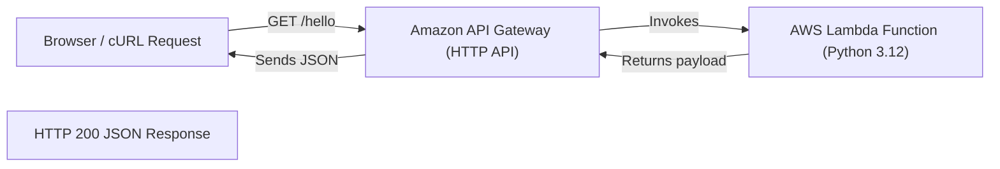

### 7.1 Step 1: Create the AWS Lambda Function
1. Open the AWS Management Console and navigate to **AWS Lambda**.
2. Click **Create function**.
3. Choose **Author from scratch**.
4. Configure basic information:
   - **Function name:** `HelloServerlessFunction`
   - **Runtime:** `Python 3.12` (or current Python 3.x)
   - **Architecture:** `x86_64`
   - **Execution role:** Select *Create a new role with basic Lambda permissions* (grants permission to write logs to Amazon CloudWatch Logs).
5. Click **Create function**.

### 7.2 Step 2: Implement and Deploy the Function Code
1. In the **Code** tab, open `lambda_function.py` and replace the contents with:
   ```python
   import json
   from datetime import datetime

   def lambda_handler(event, context):
       query_params = event.get('queryStringParameters') or {}
       user_name = query_params.get('name', 'Cloud Engineer')
       
       response_payload = {
           "status": "success",
           "message": f"Hello, {user_name}! Welcome to AWS Serverless.",
           "timestamp": datetime.utcnow().isoformat() + "Z"
       }
       
       return {
           "statusCode": 200,
           "headers": {
               "Content-Type": "application/json",
               "Access-Control-Allow-Origin": "*"
           },
           "body": json.dumps(response_payload)
       }
   ```
2. Click **Deploy** to commit the function changes.

### 7.3 Step 3: Add an API Gateway Trigger
1. In the **Function overview** diagram at the top of the console, click **+ Add trigger**.
2. Select **API Gateway**.
3. Configure the trigger:
   - **API:** *Create a new API*
   - **API type:** *HTTP API* (lightweight, low-latency, cost-effective)
   - **Security:** *Open* (for public demo testing)
4. Click **Add**.

### 7.4 Step 4: Test the Live API Endpoint
1. In the **Triggers** panel, locate the generated **API endpoint URL** (e.g., `https://abcdef123.execute-api.us-east-1.amazonaws.com/default/HelloServerlessFunction`).
2. Open a web browser or run `curl`:
   ```bash
   curl -X GET "https://<your-api-id>.execute-api.us-east-1.amazonaws.com/default/HelloServerlessFunction?name=Ankur"
   ```
3. Expected JSON response:
   ```json
   {
     "status": "success",
     "message": "Hello, Ankur! Welcome to AWS Serverless.",
     "timestamp": "2026-11-25T05:00:00Z"
   }
   ```

## 8. Platform as a Service (PaaS) — AWS Elastic Beanstalk

**AWS Elastic Beanstalk** is an easy-to-use Platform as a Service (PaaS) for deploying, managing, and scaling web applications and services developed with Java, .NET, PHP, Node.js, Python, Ruby, Go, and Docker on familiar servers such as Apache, Nginx, Passenger, and IIS.

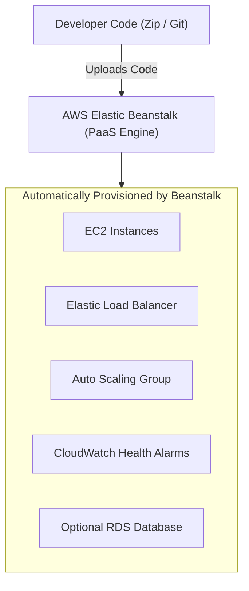

### 8.1 How Elastic Beanstalk Works
With Elastic Beanstalk, developers simply upload their application code or source bundle. Elastic Beanstalk automatically handles the heavy lifting:
- Capacity provisioning
- Load balancing
- Automatic scaling
- Application health monitoring

:::note[IaaS Control Retained]
Unlike closed proprietary PaaS platforms, Elastic Beanstalk does not hide the underlying infrastructure. Administrators retain **full access to and control over** the provisioned EC2 instances, security groups, and load balancers.
:::

### 8.2 Supported Platforms & Environment Tiers
- **Supported Runtimes:** Python, Node.js, Java SE, Java with Tomcat, .NET Core, PHP, Go, Ruby, and Docker (Single-container and Multi-container).
- **Environment Tiers:**
  1. **Web Server Tier:** Standard tier serving HTTP/HTTPS requests from clients via an Elastic Load Balancer backed by an Auto Scaling Group of EC2 instances.
  2. **Worker Tier:** Optimized for asynchronous background task processing. Pulls long-running background tasks from an **Amazon SQS queue** and passes them via HTTP daemon to worker processes.

### 8.3 Step-by-Step Elastic Beanstalk Deployment Workflow
1. **Navigate to Elastic Beanstalk Console:** Click **Create application**.
2. **Application Details:** Provide Application Name (e.g., `My-Web-App`).
3. **Platform Selection:** Choose platform (e.g., `Python`, Platform branch: `Python 3.11 running on 64-bit Amazon Linux 2023`).
4. **Application Code:** Select **Sample application** or **Upload your code** (upload a ZIP file containing `application.py` and `requirements.txt`).
5. **Configuration Preset:** Choose **Single instance** (for dev/test) or **High availability** (provisions ALB and Auto Scaling group across multiple AZs).
6. **Deploy & Monitor:** Click **Create environment**. Beanstalk logs the provisioning steps. Within minutes, the application is assigned a public CNAME (e.g., `my-web-app.elasticbeanstalk.com`) with automated health monitoring (OK, Warning, Degraded, Severe).

## 9. Comprehensive Review & Exam Question Bank

### 9.1 Short Answer Questions

#### Q1: Differentiate between vertical scaling and horizontal scaling in cloud computing.
**Vertical Scaling (Scaling Up/Down)** involves resizing an existing instance by adding or removing physical compute capacity (e.g., changing an EC2 instance from `t2.micro` with 1 vCPU to `m5.large` with 2 vCPUs and 8 GiB RAM). It requires downtime/reboot and hits a hardware ceiling. **Horizontal Scaling (Scaling Out/In)** involves launching or terminating additional instances in parallel behind a load balancer (e.g., expanding from 2 instances to 8 instances during traffic spikes). It offers near-limitless elasticity and zero-downtime scaling.

#### Q2: What are the two essential components required to configure an Amazon EC2 Auto Scaling Group?
An Auto Scaling Group requires:
1. A **Launch Template** (or legacy Launch Configuration) that defines *what* instances to launch (AMI ID, instance type, key pair, security groups, block device mappings, user data).
2. The **Auto Scaling Group (ASG)** definition itself, which specifies *where* to launch (VPC, subnets across AZs) and *capacity bounds* (Minimum, Maximum, and Desired capacity).

#### Q3: Contrast Application Load Balancers (ALB) and Network Load Balancers (NLB) based on OSI layers and primary use cases.
An **Application Load Balancer (ALB)** operates at **Layer 7 (Application)**, inspecting HTTP/HTTPS headers, paths, and cookies for advanced content-based routing and integrates with AWS WAF for web applications. A **Network Load Balancer (NLB)** operates at **Layer 4 (Transport)**, routing TCP, UDP, and TLS connections with ultra-low sub-millisecond latency, static IP support, and handles millions of requests per second for high-performance non-HTTP or extreme-scale workloads.

#### Q4: What is the maximum execution duration limit for an AWS Lambda function invocation?
The maximum execution time for a single AWS Lambda function invocation is **15 minutes (900 seconds)**. Workloads requiring longer execution times should be hosted on Amazon ECS containers, AWS Batch, or Amazon EC2 instances.

#### Q5: What is the purpose of an EC2 Key Pair (.pem file), and what happens if it is lost?
An EC2 Key Pair uses public-key cryptography (RSA) to securely authenticate and decrypt access credentials to an EC2 instance (SSH for Linux, administrator password decryption for Windows). The public key is stored inside the instance metadata; the private key (`.pem`) is retained solely by the user. If the private key is lost, standard SSH access is permanently lost unless alternative access mechanisms (such as AWS Systems Manager Session Manager or detaching the root volume to modify `authorized_keys`) are used.

### 9.2 Long Answer Questions

#### Q6: Explain the operational architecture of Amazon EC2 Auto Scaling, detailing its lifecycle states, scaling policies, and the function of the cooldown period.
Amazon EC2 Auto Scaling provides dynamic capacity elasticity:
- **Scaling Policies:**
  - *Target Tracking:* Automatically adds/removes instances to maintain a constant target metric (e.g., average CPU utilization at 50%).
  - *Step Scaling:* Scales capacity based on the tiered severity of a metric threshold breach.
  - *Scheduled Scaling:* Proactively scales capacity based on recurring calendar events.
  - *Predictive Scaling:* Uses ML models to forecast recurring daily and weekly traffic trends.
- **Lifecycle States:** An instance transitions through `Pending` (booting and running user data), `Pending:Wait` (lifecycle hook for initialization), `InService` (healthy and processing requests from the ELB), `Terminating` (marked for removal on scale-in), `Terminating:Wait` (lifecycle hook for connection draining and log flushing), and `Terminated`.
- **Cooldown Period:** A configurable time delay (default 300 seconds) following a scaling event that temporarily freezes scaling operations, preventing the group from over-compensating or thrashing while newly launched instances complete booting and begin absorbing application traffic.

#### Q7: Discuss the advantages, limitations, and architectural patterns of Serverless Computing with AWS Lambda compared to traditional IaaS virtual servers (EC2).
- **Management & Overhead:** EC2 requires OS patching, AMI management, security hardening, and uptime monitoring. Lambda abstracts all server management, leaving developers to write only functional code.
- **Cost Structure:** EC2 charges for total allocated server runtime whether idle or busy. Lambda charges strictly for active execution time in 1-millisecond increments; zero invocations equal zero cost.
- **Scalability:** EC2 requires Auto Scaling Groups that typically take 1–5 minutes to launch and register new virtual machines. Lambda scales instantaneously from 0 to thousands of concurrent executions in seconds.
- **Architectural Limitations:** Lambda has a 15-minute execution limit, maximum 10 GB RAM, cold start delays on idle functions, and requires stateless architecture. EC2 supports long-running stateful batch processes, unrestricted execution time, massive compute configurations (up to 448 vCPUs and 24 TB RAM), and legacy custom software stacks.

### 9.3 Multiple Choice Questions

#### Q8: Which EC2 instance family is specifically engineered for workloads with high memory-to-CPU ratios, such as in-memory distributed caches and SAP HANA?
- (A) Compute Optimized (`C` series)
- (B) Storage Optimized (`I` series)
- (C) Memory Optimized (`R` series)
- (D) Accelerated Computing (`P` series)
- **Correct Answer:** **(C) Memory Optimized (`R` series)**.

#### Q9: What happens to a target EC2 instance when an Elastic Load Balancer health check probe fails consecutively beyond the configured unhealthy threshold?
- (A) The ELB immediately terminates the EC2 instance.
- (B) The ELB stops routing incoming client traffic to that instance until it passes subsequent health checks.
- (C) The ELB reboots the instance operating system.
- (D) The ELB replaces the root EBS volume.
- **Correct Answer:** **(B)** (ELB ceases routing traffic to unhealthy instances; Auto Scaling Groups—if configured—may subsequently replace it).

#### Q10: Which AWS service enables developers to deploy and manage web applications without managing the underlying virtual machines, load balancers, or auto-scaling configurations, while still maintaining full access to the underlying infrastructure?
- (A) Amazon EC2
- (B) AWS Elastic Beanstalk
- (C) AWS Lambda
- (D) Amazon Route 53
- **Correct Answer:** **(B) AWS Elastic Beanstalk** (PaaS that automates provisioning while retaining full underlying IaaS control).

### 9.4 Architectural Scenarios & Troubleshooting

#### Scenario A: The Sudden Spike & Application Lag
- **Problem:** An e-commerce platform running on EC2 behind an ALB experienced slow response times and crashed during a flash sale. The ASG had a minimum size of 2 and maximum size of 20, but only 2 instances were active when the surge hit.
- **Root Cause:** The Auto Scaling Group was configured with a manual scaling policy or overly sluggish simple scaling alarms with a 15-minute evaluation period, preventing rapid horizontal expansion.
- **Solution:** Configure a **Target Tracking Scaling Policy** based on *ALB Request Count Per Target* or *ASG Average CPU Utilization* (target 50%), combined with **Predictive Scaling** or **Scheduled Scaling** scheduled 30 minutes before the announced flash sale.

#### Scenario B: Lambda Function Timeout on Database Ingestion
- **Problem:** A Lambda function triggered by large CSV file uploads to Amazon S3 began failing with `Task timed out after 15.00 seconds` error messages.
- **Root Cause:** The Lambda function's configuration retained the default timeout setting of 3 seconds (or 15 seconds), which was insufficient to parse and write multi-megabyte CSV files into the database.
- **Solution:** Increase the Lambda function's configured timeout in the General Configuration tab (up to 15 minutes) and consider allocating higher memory (which proportionally scales up CPU allocation and network throughput). For files taking &gt;15 minutes, transition the processing to AWS Step Functions or AWS Batch on ECS.
