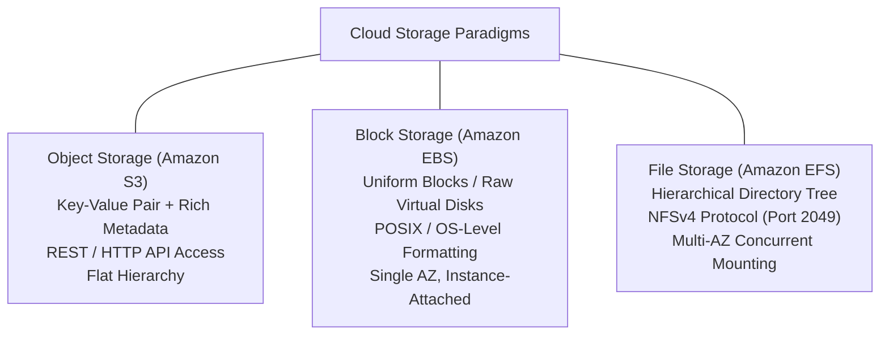
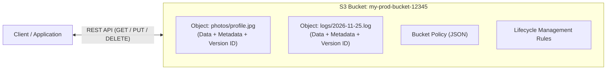
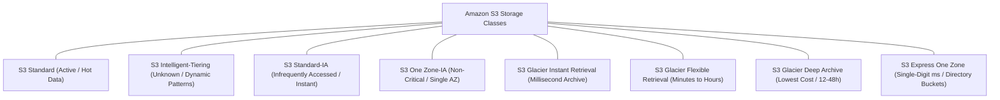
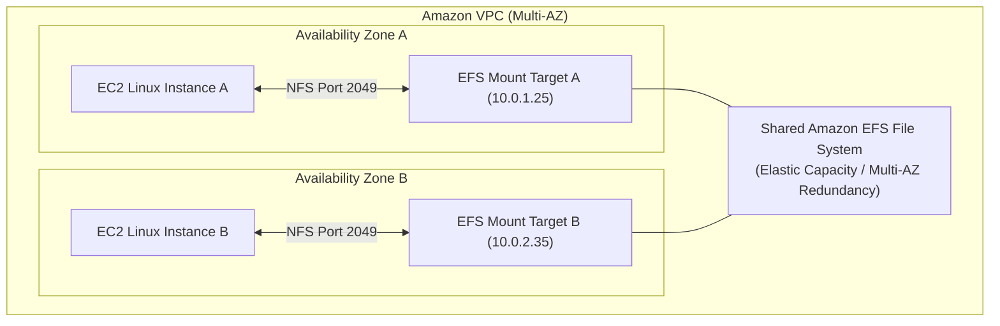
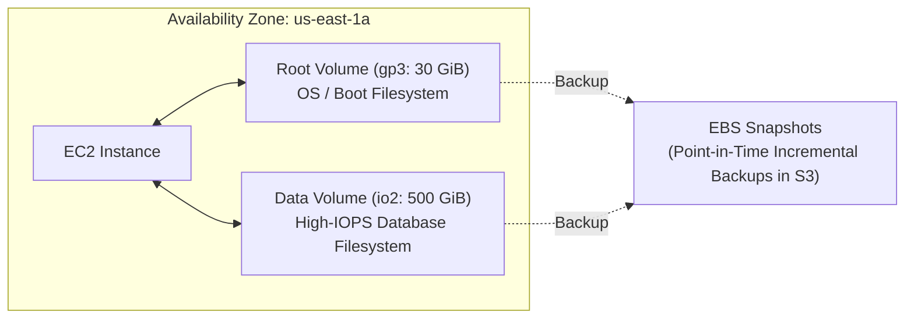
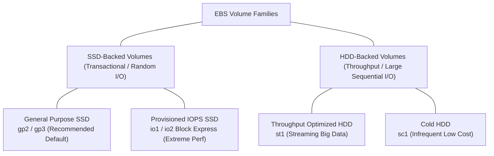
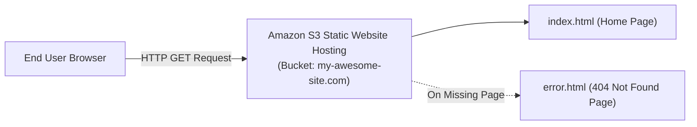
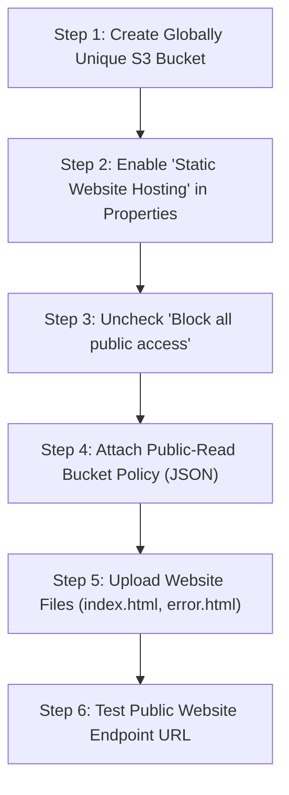

# Unit - 4

:::info[TITLE]
## Storage Services on AWS
:::

## 1. Types of Cloud Storage

Cloud storage forms the data backbone of modern cloud computing architectures. AWS categorizes storage into three fundamental architectures, each optimized for distinct access patterns, protocols, and performance requirements:



### 1.1 Object Storage
Object storage manages data as discrete, autonomous units termed **objects** within a flat address space (no nested physical folders). Each object consists of three essential components:
1. **Data (Payload):** The actual file content (unstructured binary data such as images, videos, audio, documents, backups, or raw logs).
2. **Metadata:** Comprehensive descriptive key-value pairs detailing object attributes (size, content type, creation date, retention tags, custom user metadata).
3. **Globally Unique Identifier (Key):** A unique string name assigned to identify the object within a specific bucket.
- **Access Protocol:** Accessed exclusively via standard web protocols (`HTTP`/`HTTPS` REST APIs: `GET`, `PUT`, `DELETE`).
- **Characteristics:** Highly scalable to petabytes and exabytes; cannot be mounted directly as an operating system boot disk or block device; files cannot be modified in-place (updates require uploading the entire object anew).

### 1.2 Block Storage
Block storage divides raw data into fixed, uniformly sized chunks called **blocks** (typically 4 KB or 512 bytes), each possessing its own unique address without descriptive metadata:
- **Virtual Disk Drive:** Becomes available to the operating system as a raw, unformatted physical hard disk or solid-state drive.
- **Operating System Formatting:** Requires partitioning and formatting with a native file system (e.g., `ext4`, `XFS` for Linux; `NTFS` for Windows) before files can be created.
- **Ultra-Low Latency:** Delivers sub-millisecond read/write access, making it essential for transactional databases, operating system boot volumes, and random I/O-intensive workloads.
- **Direct In-Place Modification:** Modifying a single character in a 10 GB database file alters only the specific 4 KB block containing that character, without rewriting the entire file.

### 1.3 File Storage
File storage organizes data hierarchically in a classic directory tree composed of nested folders and files:
- **Shared Network Access:** Implements standard network file sharing protocols—specifically Network File System (`NFSv4` over TCP port 2049 for Linux) and Server Message Block (`SMB` for Windows).
- **Concurrent Multi-Instance Access:** Simultaneously mountable across hundreds to thousands of compute instances across multiple Availability Zones.
- **File Locking & POSIX Compliance:** Provides native operating system file system semantics, including file locking, symbolic links, and granular POSIX read/write/execute permissions.

### 1.4 Comprehensive Architectural Comparison Matrix

| Dimension / Feature | Object Storage (Amazon S3) | Block Storage (Amazon EBS) | File Storage (Amazon EFS) |
| :--- | :--- | :--- | :--- |
| **Data Structure** | Flat namespace (Buckets & Keys) | Uniform addressed raw data blocks | Hierarchical directory and folder tree |
| **Access Protocol** | `HTTP` / `HTTPS` REST APIs | Storage Area Network (`SAN`) protocols (NVMe / SCSI) | Network File System (`NFSv4` over port 2049) |
| **Bootable OS Drive?** | **No** (Cannot boot an operating system) | **Yes** (Standard EC2 boot root volume) | **No** (Shared network filesystem only) |
| **Concurrent Access** | Millions of concurrent HTTP clients globally | Attached to **1 EC2 instance** at a time (except `io1/io2` Multi-Attach) | **Thousands of EC2 instances** concurrently across multiple AZs |
| **Scalability** | Virtually unlimited capacity | Up to 16 TiB per EBS volume | Elastic; automatically grows/shrinks up to petabytes |
| **In-Place File Edits** | No (Must overwrite the entire object) | Yes (Modifies individual blocks in real time) | Yes (Modifies specific file bytes natively) |
| **Primary Workloads** | Static media, backups, data lakes, static websites | OS root disks, relational DBs (`Oracle`, `PostgreSQL`) | Shared CMS media (`WordPress`), big data home dirs |

## 2. Amazon S3 (Simple Storage Service)

**Amazon Simple Storage Service (Amazon S3)** is an object storage service delivering industry-leading scalability, data availability, security, and performance. S3 is designed to provide **$99.999999999\%$ (11 nines) of data durability**.



### 2.1 Core Architectural Characteristics
1. **Unlimited Capacity:** Customers can store virtually unlimited amounts of data and numbers of objects.
2. **Object Sizing Rules:**
   - Individual objects can range in size from **0 bytes up to 5 TB**.
   - Maximum upload size in a single `PUT` operation is **5 GB**.
   - **Multipart Upload:** Required for objects larger than 5 GB; recommended by AWS for any object exceeding **100 MB** to maximize upload speed and parallelize retry resiliency.
3. **Bucket Namespace & Naming Constraints:**
   - Buckets are the top-level containers for objects.
   - Bucket names must be **globally unique across all AWS accounts worldwide**.
   - Must be between 3 and 63 characters long, consist only of lowercase letters, numbers, and hyphens (`-`), and must NOT be formatted as an IP address.

### 2.2 S3 Versioning & Lifecycle Management
- **S3 Versioning:** Protects against accidental overwrites and unintended deletions. Once enabled on a bucket:
  - Every modification stores a new version of the object with a distinct Version ID.
  - Deleting an object creates a **Delete Marker** rather than permanently purging the data. The object can be restored by simply deleting the Delete Marker.
  - Permanent deletion requires explicitly deleting the specific Version ID (can be protected with MFA Delete).
- **S3 Lifecycle Policies:** Automated rule sets that transition objects between storage classes or permanently delete them after specified intervals:
  - *Example Transition Flow:* Object created in `S3 Standard` $\to$ transitioned to `S3 Standard-IA` after 30 days $\to$ transitioned to `S3 Glacier Flexible Retrieval` after 90 days $\to$ permanently expired/deleted after 365 days.


### 2.3 S3 Replication & Performance Optimization
- **Cross-Region Replication (CRR):** Automatically replicates newly uploaded objects across AWS Regions for geographic disaster recovery, compliance, and reduced latency for international users. Requires Versioning enabled on both source and destination buckets.
- **Same-Region Replication (SRR):** Replicates objects between different buckets in the same AWS Region for log aggregation or environment synchronization (dev/prod separation).
- **S3 Transfer Acceleration:** Accelerates uploads over long geographic distances by routing client traffic to the nearest **AWS Edge Location** (CloudFront PoP), from which data travels across the high-speed AWS private fiber backbone directly to the target S3 bucket.
- **S3 Event Notifications:** Sends automated event messages to **AWS Lambda**, **Amazon SNS**, or **Amazon SQS** whenever objects are created, removed, or restored.

### 2.4 S3 Security & Access Control
AWS provides multiple defense-in-depth mechanisms to protect S3 data:
1. **S3 Block Public Access:** A centralized account- and bucket-level security control that overrides all bucket policies and object ACLs. Provides 4 independent toggle settings to prevent public exposure.
2. **Bucket Policies (Resource-Based):** JSON policy documents attached directly to the bucket defining who can access what objects under what conditions:
   ```json
   {
     "Version": "2012-10-17",
     "Statement": [
       {
         "Sid": "AllowSpecificIPAccess",
         "Effect": "Allow",
         "Principal": "*",
         "Action": "s3:GetObject",
         "Resource": "arn:aws:s3:::corporate-docs-bucket/*",
         "Condition": {
           "IpAddress": {
             "aws:SourceIp": "203.0.113.0/24"
           }
         }
       }
     ]
   }
   ```
3. **IAM Policies (Identity-Based):** Attached to IAM users, groups, or roles to govern what S3 API calls the identity can perform.
4. **Pre-Signed URLs:** Cryptographically signed temporary URLs generated by an authorized user that grant temporary read or write access to a specific private object for a specified duration (up to 7 days).
5. **Data Encryption:**
   - **Server-Side Encryption with S3 Managed Keys (SSE-S3):** Default encryption standard; encrypts data using AES-256 with keys managed entirely by Amazon.
   - **Server-Side Encryption with AWS KMS (SSE-KMS):** Encrypts data using customer master keys managed in AWS Key Management Service, providing audit logging and key rotation.
   - **Server-Side Encryption with Customer-Provided Keys (SSE-C):** Customer manages encryption keys; AWS manages encryption/decryption at the storage layer.
   - **Client-Side Encryption:** Customer encrypts data locally before transmitting it to S3.

## 3. S3 Storage Classes

Amazon S3 provides 8 distinct storage classes engineered to optimize storage expenditure based on data access frequency, retrieval latency, and redundancy requirements:



### 3.1 Exhaustive Storage Class Breakdown

| Storage Class | Durability | Availability | AZ Redundancy | Minimum Duration | Retrieval Latency | Retrieval Fee | Primary Workloads |
| :--- | :--- | :--- | :--- | :--- | :--- | :--- | :--- |
| **S3 Standard** | 11 nines | 99.99% | $\ge 3$ AZs | None | Milliseconds | None | Active websites, mobile apps, content distribution, hot analytics. |
| **S3 Intelligent-Tiering** | 11 nines | 99.9% | $\ge 3$ AZs | None | Milliseconds / Hours | **None** | Data with unpredictable, changing, or unknown access patterns. |
| **S3 Standard-IA** | 11 nines | 99.9% | $\ge 3$ AZs | 30 days | Milliseconds | Per GB fee | Long-term backups, disaster recovery data accessed once a month. |
| **S3 One Zone-IA** | 11 nines | 99.5% | **1 AZ Only** | 30 days | Milliseconds | Per GB fee | Recreatable secondary backup copies, non-critical image thumbnails. |
| **S3 Glacier Instant Retrieval** | 11 nines | 99.9% | $\ge 3$ AZs | 90 days | **Milliseconds** | Per GB fee | Medical imaging, news media archives accessed once a quarter. |
| **S3 Glacier Flexible Retrieval** | 11 nines | 99.9% | $\ge 3$ AZs | 90 days | Expedited (1–5 min)<br/>Standard (3–5 hr)<br/>Bulk (5–12 hr) | Per GB fee | Regulatory compliance data, annual audit archives. |
| **S3 Glacier Deep Archive** | 11 nines | 99.9% | $\ge 3$ AZs | 180 days | Standard (12 hr)<br/>Bulk (48 hr) | Per GB fee | 7–10 year regulatory data retention (cheapest cloud storage: ~\$0.00099/GB). |
| **S3 Express One Zone** | 11 nines | 99.95% | **1 AZ Only** | None | **Single-digit ms** | None | Real-time AI/ML training, financial modeling, high-IOPS batch analytics. |

### 3.2 Deep Dive into Key Tiers
- **S3 Intelligent-Tiering:** Automatically moves objects between 4 tiers: *Frequent Access*, *Infrequent Access* (after 30 days of no access), *Archive Instant Access* (after 90 days), and optional *Deep Archive Access* (after 180 days). Crucially, **there are NO retrieval fees** and no risk of retrieval cost spikes.
- **S3 One Zone-IA:** Provides identical performance to Standard-IA but costs **20% less** because data resides within a single Availability Zone. If that physical AZ is destroyed, data is permanently lost.
- **S3 Glacier Flexible Retrieval Options:**
  - *Expedited Retrieval:* 1–5 minutes (for urgent access needs).
  - *Standard Retrieval:* 3–5 hours (default option).
  - *Bulk Retrieval:* 5–12 hours (free of retrieval fees for massive batch queries).

## 4. Amazon EFS (Elastic File System)

**Amazon Elastic File System (Amazon EFS)** is a fully managed, serverless, elastic Network File System (`NFSv4`) designed for use with Amazon EC2 Linux instances, AWS Lambda, Amazon ECS, and on-premises servers.



### 4.1 Key Characteristics of Amazon EFS
1. **Serverless & Fully Elastic:** Automatically grows and shrinks as files are added or deleted; customers pay only for the storage consumed with zero upfront capacity provisioning.
2. **Multi-AZ Regional Redundancy:** Replicates data across multiple Availability Zones in an AWS Region, delivering 11 nines of durability and high availability.
3. **Massive Parallel Concurrent Access:** Can be mounted concurrently by **thousands of EC2 Linux instances** using POSIX-compliant file system APIs.
4. **Network Protocol:** Operates strictly on **NFSv4.0 and NFSv4.1 over TCP port 2049**.

### 4.2 Performance and Throughput Modes
- **Performance Modes:**
  - *General Purpose Mode:* Recommended default; optimized for latency-sensitive workloads (web serving, content management systems, enterprise home directories).
  - *Max I/O Mode:* Scales to higher levels of aggregate throughput and operations per second at the cost of marginally higher latencies; designed for big data, scientific processing, and parallelized machine learning jobs.
- **Throughput Modes:**
  - *Bursting Throughput:* Throughput scales proportionally to file system storage size (baseline 50 KB/s per GiB with bursts up to 100 MB/s).
  - *Provisioned Throughput:* Guarantees a dedicated throughput level (in MB/s) independent of stored data volume.
  - *Elastic Throughput:* Automatically scales throughput based on real-time application activity with pay-per-use billing.

### 4.3 EFS Storage Classes and Lifecycle Management
- **EFS Standard:** For active, frequently accessed data.
- **EFS Infrequent Access (EFS IA):** Offers up to 92% lower storage costs for files accessed less than once a month. EFS Lifecycle Management automatically moves inactive files from Standard to IA after 7, 14, 30, 60, or 90 days.

### 4.4 Mounting EFS to an EC2 Linux Instance
1. Install the Amazon EFS client utilities:
   ```bash
   sudo dnf install -y amazon-efs-utils
   ```
2. Create the target mount directory:
   ```bash
   sudo mkdir -p /mnt/efs/shared_data
   ```
3. Mount the file system using the EFS Mount Helper:
   ```bash
   sudo mount -t efs -o tls fs-0123456789abcdef0:/ /mnt/efs/shared_data
   ```
4. Configure persistent auto-mounting on system reboot in `/etc/fstab`:
   ```text
   fs-0123456789abcdef0:/ /mnt/efs/shared_data efs _netdev,tls 0 0
   ```

## 5. Amazon EBS (Elastic Block Store)

**Amazon Elastic Block Store (Amazon EBS)** provides persistent, high-performance block-level storage volumes for use with Amazon EC2 instances. EBS volumes function as virtual raw block devices attached directly to an EC2 instance in the **same Availability Zone**.



### 5.1 EBS Volume Families and Types



| Volume Type | API Identifier | Baseline / Max IOPS | Max Throughput | Bootable OS Volume? | Primary Use Cases |
| :--- | :--- | :--- | :--- | :--- | :--- |
| **General Purpose SSD (Latest)** | `gp3` | **3,000 IOPS baseline** (up to 16,000 IOPS) | **125 MB/s baseline** (up to 1,000 MB/s) | **Yes** | Recommended default for all EC2 boot volumes, virtual desktops, medium databases. 20% cheaper than `gp2`. |
| **General Purpose SSD (Legacy)** | `gp2` | 3 IOPS per GiB (min 100, max 16,000 IOPS) | 128 – 250 MB/s | **Yes** | Legacy system boot volumes; IOPS tightly coupled to allocated storage size. |
| **Provisioned IOPS SSD** | `io2 Block Express` | Up to **256,000 IOPS** (1,000 IOPS/GiB) | Up to **4,000 MB/s** (Sub-ms latency) | **Yes** | Mission-critical low-latency OLTP databases (`Oracle`, `SAP HANA`, `SQL Server`). Supports Multi-Attach. |
| **Provisioned IOPS SSD (Legacy)** | `io1` | Up to 64,000 IOPS (50 IOPS/GiB) | Up to 1,000 MB/s | **Yes** | High-performance transactional workloads. Supports Multi-Attach. |
| **Throughput Optimized HDD** | `st1` | Max 500 IOPS | Up to **500 MB/s** | **NO** | Streaming workloads, big data, data warehousing (`Hadoop`, `Kafka`, `Spark`). Cannot boot OS! |
| **Cold HDD** | `sc1` | Max 250 IOPS | Up to **250 MB/s** | **NO** | Lowest-cost block storage for infrequently accessed sequential workloads. Cannot boot OS! |

### 5.2 EBS Snapshots & Lifecycle
- **EBS Snapshots:** Point-in-time backups of EBS volumes stored durably in **Amazon S3**:
  - **Incremental Architecture:** The first snapshot creates a full copy; subsequent snapshots save only the specific blocks changed since the previous snapshot, minimizing storage costs.
  - **Cross-Region Copy:** Snapshots can be shared across AWS accounts or copied to other AWS Regions to build disaster recovery pipelines.
  - **Fast Snapshot Restore (FSR):** Eliminates disk I/O latency when initializing new volumes from large snapshots.
- **Delete on Termination Attribute:**
  - By default, the root EBS volume is **deleted** when the EC2 instance is terminated.
  - Additional attached data EBS volumes are **preserved** by default upon termination unless explicitly overridden.

### 5.3 Step-by-Step Guide: Attaching, Formatting, and Mounting an EBS Volume
1. **Create and Attach Volume:**
   - In the EC2 Console $\to$ **Volumes** $\to$ **Create Volume** (e.g., `gp3`, `50 GiB`, in Availability Zone matching your EC2 instance).
   - Select volume $\to$ **Actions** $\to$ **Attach Volume** $\to$ Select target EC2 instance $\to$ Device name: `/dev/sdf`.
2. **Connect via SSH and Identify Device:**
   ```bash
   lsblk
   ```
   (The volume will appear as `/dev/xvdf` or `/dev/nvme1n1`).
3. **Check for Existing Filesystem:**
   ```bash
   sudo file -s /dev/xvdf
   ```
   If output shows `/dev/xvdf: data`, the disk is raw and unformatted.
4. **Format Volume with ext4 Filesystem:**
   ```bash
   sudo mkfs -t ext4 /dev/xvdf
   ```
5. **Create Mount Point and Mount:**
   ```bash
   sudo mkdir -p /data
   sudo mount /dev/xvdf /data
   ```
6. **Configure Auto-Mounting on System Reboot:**
   - Find volume UUID:
     ```bash
     sudo blkid
     ```
   - Append to `/etc/fstab`:
     ```text
     UUID=a1b2c3d4-e5f6-7890-abcd-ef0123456789  /data  ext4  defaults,nofail  0  2
     ```

## 6. Hosting a Static Website Using Amazon S3

Amazon S3 can serve client-side static websites (composed of HTML, CSS, JavaScript, fonts, and images) with high availability and scalability without deploying or paying for web servers.



### 6.1 Static vs. Dynamic Websites
- **Static Website:** Delivers pre-rendered HTML, client-side JavaScript, images, and CSS stylesheets directly to the browser. Does not execute server-side code (no PHP, Python, Ruby, or Node.js backend processes running inside S3).
- **Dynamic Capabilities:** Client-side JavaScript running in the user's browser can communicate via AJAX/fetch with serverless backend APIs (such as Amazon API Gateway + AWS Lambda + DynamoDB).

### 6.2 Step-by-Step Implementation Guide



#### Step 1: Create the Bucket
1. Open S3 Console $\to$ **Create bucket**.
2. Bucket name: Choose a globally unique name (e.g., `my-portfolio-site-2026`).
3. AWS Region: Select your preferred region (e.g., `us-east-1`).

#### Step 2: Enable Static Website Hosting
1. Select the bucket $\to$ click the **Properties** tab.
2. Scroll to the bottom to **Static website hosting** $\to$ click **Edit**.
3. Select **Enable**.
4. Hosting type: **Host a static website**.
5. Index document: Enter `index.html`.
6. Error document: Enter `error.html`.
7. Click **Save changes**. Note the generated **Bucket website endpoint** (e.g., `http://my-portfolio-site-2026.s3-website-us-east-1.amazonaws.com`).

#### Step 3: Disable Block Public Access
1. Click the **Permissions** tab.
2. Under **Block public access (bucket settings)** $\to$ click **Edit**.
3. **Uncheck** *Block all public access*.
4. Acknowledge the security prompt and click **Save changes**. Confirm by typing `confirm`.

#### Step 4: Attach Public-Read Bucket Policy
1. Under **Permissions** tab $\to$ **Bucket policy** $\to$ click **Edit**.
2. Paste the following JSON policy (replace `<your-bucket-name>` with your actual bucket name):
   ```json
   {
     "Version": "2012-10-17",
     "Statement": [
       {
         "Sid": "PublicReadGetObject",
         "Effect": "Allow",
         "Principal": "*",
         "Action": "s3:GetObject",
         "Resource": "arn:aws:s3:::<your-bucket-name>/*"
       }
     ]
   }
   ```
3. Click **Save changes**.

#### Step 5: Upload Website Files
1. Go to the **Objects** tab $\to$ click **Upload**.
2. Upload `index.html` (e.g., `<h1>Welcome to my AWS Hosted Website!</h1>`) and `error.html` (e.g., `<h1>404: Page Not Found</h1>`).
3. Click **Upload**.

#### Step 6: Test Public Website
1. Open a browser and navigate to the **Bucket website endpoint URL** noted in Step 2.
2. The `index.html` page renders over HTTP.

:::warning[S3 Static Website Limitations & CloudFront Enhancement]
1. **HTTP Only:** S3 static website endpoints support **HTTP only**; they do not support native HTTPS/SSL certificates.
2. **Custom Domains:** To deliver content over **HTTPS** and use a custom domain name (e.g., `https://www.example.com`), deploy an **Amazon CloudFront distribution** in front of the S3 bucket with a free SSL certificate from **AWS Certificate Manager (ACM)** and route domain traffic via **Amazon Route 53**.
:::

## 7. Important Question Bank & Exam Review

### 7.1 Short Answer Questions

#### Q1: Differentiate between Amazon S3 and Amazon EBS in terms of data storage type, access method, and typical use cases.
Amazon S3 is an **object storage** service accessed over the web via HTTP/HTTPS REST APIs (`GET`/`PUT`), providing virtually unlimited scalability and 11 nines durability for unstructured static assets, backups, and data lakes. Amazon EBS is a **block storage** service that provides raw virtual disk volumes attached directly to a single EC2 instance in the same AZ, accessed via POSIX filesystem drivers for OS boot drives and high-IOPS transactional databases.

#### Q2: What is the maximum size of a single object in Amazon S3, and when should Multipart Upload be used?
The maximum size of an individual S3 object is **5 TB**. Multipart Upload must be used for objects larger than **5 GB** and is recommended by AWS for any object exceeding **100 MB** to enable parallel chunk uploads and network failure resiliency.

#### Q3: Explain the function of S3 Versioning and how delete operations behave when it is enabled.
S3 Versioning preserves every historical iteration of an object. When a user deletes an object in a version-enabled bucket, Amazon S3 inserts a **Delete Marker** with a unique Version ID. The object appears deleted in normal directory listings, but previous versions remain intact and recoverable. Permanent deletion requires explicitly providing the specific Version ID in the delete request.

#### Q4: Why can HDD-backed EBS volumes (`st1` and `sc1`) NOT be used as EC2 boot volumes?
Operating system boot sequences require high-speed random read/write I/O operations (small 4 KB block access) to load OS kernels and system libraries. HDD volumes (`st1` and `sc1`) are physically optimized for large, sequential data streaming throughput (500 MB/s) and have poor random I/O performance; therefore, AWS restricts EC2 boot volumes strictly to SSD-backed volume types (`gp2`, `gp3`, `io1`, `io2`).

#### Q5: State the network protocol and port number utilized by Amazon EFS.
Amazon EFS operates using the **Network File System (NFSv4.0 and NFSv4.1)** protocol over **TCP port 2049**.

### 7.2 Long Answer Questions

#### Q6: Provide a detailed architectural comparison of Amazon S3, Amazon EBS, and Amazon EFS. Detail their scalability, redundancy, file locking, and multi-instance attachment capabilities.
- **Amazon S3:** Object storage designed for web-scale storage. Automatically replicates data across at least 3 Availability Zones, delivering 11 nines durability. Offers unlimited capacity with no pre-provisioning. Supports concurrent reads and writes from millions of internet clients via HTTP REST APIs. Does not support POSIX file locking or filesystem mounting.
- **Amazon EBS:** Block storage behaving like an unformatted physical drive. Persists independently of instance lifecycle but is locked to a **single Availability Zone**. Replicated within a single AZ (99.8%–99.9% durability). Typically attached to exactly one EC2 instance at a time (except `io1/io2` Multi-Attach for clustered workloads). Supports random block updates and OS bootability.
- **Amazon EFS:** Managed file storage providing a hierarchical POSIX directory structure. Replicates data across multiple AZs in an AWS Region (11 nines durability). Scales elastically up to petabytes without manual intervention. Simultaneously mountable by **thousands of EC2 Linux instances** across multiple AZs over NFS port 2049. Supports native POSIX file locking and permission models.

#### Q7: Describe all 8 Amazon S3 Storage Classes. Explain their durability, retrieval times, minimum storage durations, and optimal use cases.
- *S3 Standard:* General-purpose hot storage; millisecond retrieval; no minimum storage duration; for active datasets.
- *S3 Intelligent-Tiering:* Automatic cost optimization across 4 access tiers; millisecond retrieval; no retrieval fees; for unpredictable access patterns.
- *S3 Standard-IA:* Cold storage for infrequently accessed data; millisecond retrieval; 30-day minimum duration; per-GB retrieval fees; for disaster recovery and secondary backups.
- *S3 One Zone-IA:* Single-AZ storage (20% cheaper than Standard-IA); millisecond retrieval; 30-day minimum duration; for recreatable thumbnails and secondary copies.
- *S3 Glacier Instant Retrieval:* Archive storage with millisecond access; 90-day minimum duration; for medical records and quarterly compliance data.
- *S3 Glacier Flexible Retrieval:* Archive storage with 3 retrieval speeds (Expedited 1–5 min, Standard 3–5 hr, Bulk 5–12 hr); 90-day minimum duration; for annual enterprise archives.
- *S3 Glacier Deep Archive:* Lowest cost cloud storage; retrieval in 12–48 hours; 180-day minimum duration; for 7–10 year regulatory compliance data.
- *S3 Express One Zone:* Ultra-high performance single-AZ directory bucket storage; single-digit millisecond latency; for AI/ML model training and high-frequency analytics.

### 7.3 Multiple Choice Questions

#### Q8: A company needs to host a static HTML website at minimum cost with zero server maintenance. Which solution is most appropriate?
- (A) Deploy an EC2 `t2.micro` instance running Apache HTTP Server.
- (B) Configure an Amazon S3 bucket with Static Website Hosting enabled.
- (C) Mount an Amazon EFS file system to an AWS Lambda function.
- (D) Store HTML files on an Amazon EBS `io2` volume.
- **Correct Answer:** **(B) Configure an Amazon S3 bucket with Static Website Hosting enabled**.

#### Q9: What is the baseline IOPS provided by an Amazon EBS General Purpose SSD (`gp3`) volume, regardless of the provisioned volume size?
- (A) 100 IOPS
- (B) 1,000 IOPS
- (C) 3,000 IOPS
- (D) 16,000 IOPS
- **Correct Answer:** **(C) 3,000 IOPS** (`gp3` provides 3,000 IOPS and 125 MB/s baseline throughput free of additional cost).

#### Q10: Which Amazon S3 storage class moves objects automatically between access tiers based on usage and charges NO retrieval fees?
- (A) S3 Standard-IA
- (B) S3 Intelligent-Tiering
- (C) S3 Glacier Flexible Retrieval
- (D) S3 One Zone-IA
- **Correct Answer:** **(B) S3 Intelligent-Tiering**.

### 7.4 Architectural Scenarios & Troubleshooting

#### Scenario A: High S3 Bill from Short-Lived IA Objects
- **Problem:** An analytics application uploaded temporary raw log files to `S3 Standard-IA` and deleted them 24 hours later. The end-of-month AWS bill was significantly higher than anticipated.
- **Root Cause:** `S3 Standard-IA` enforces a **30-day minimum storage duration billing rule**. Deleting objects after 24 hours incurs a prorated penalty charge for the remaining 29 days, plus per-GB retrieval fees.
- **Solution:** Store temporary short-lived objects (lifespan &lt;30 days) in `S3 Standard`, or utilize `S3 Express One Zone` / EC2 instance store disks.

#### Scenario B: The Shared Web Cluster Database Lock
- **Problem:** A development team tried attaching a single `gp3` EBS volume containing shared image assets to three separate EC2 instances running a WordPress cluster in different Availability Zones, but the AWS Console rejected the attachment.
- **Root Cause:** `gp3` EBS volumes can only be attached to **a single EC2 instance in the same Availability Zone** at any given time.
- **Solution:** Replace the EBS volume with an **Amazon EFS** file system, create EFS mount targets in each Availability Zone, and mount the file system across all three EC2 instances via NFS over port 2049.

## 8. Quick Revision Cheatsheet & Decision Matrix

### 8.1 Key Numbers to Remember for Exams
- **S3 Durability:** $99.999999999\%$ (11 nines across $\ge 3$ AZs).
- **S3 Standard Availability:** $99.99\%$.
- **Max S3 Object Size:** 5 TB (Single `PUT` max: 5 GB; Multipart upload recommended for &gt;100 MB).
- **Amazon EFS Port:** TCP port `2049` (NFS protocol).
- **EBS `gp3` Baseline Performance:** 3,000 IOPS and 125 MB/s (up to 16,000 IOPS).
- **EBS `io2 Block Express` Max IOPS:** Up to 256,000 IOPS with sub-millisecond latency.
- **S3 Minimum Billing Durations:** Standard-IA = 30 days; Glacier Flexible = 90 days; Glacier Deep Archive = 180 days.

### 8.2 Storage Selection Decision Tree
1. *Do you need an OS boot drive with sub-ms random block I/O?* $\to$ **Amazon EBS (`gp3`/`io2`)**.
2. *Do you need POSIX shared directory access across hundreds of Linux servers concurrently?* $\to$ **Amazon EFS**.
3. *Do you need to store static files, media, backups, or host a static website over HTTP?* $\to$ **Amazon S3**.
4. *Do you have unknown or unpredictable object access patterns?* $\to$ **S3 Intelligent-Tiering**.
5. *Do you need ultra-low-cost 10-year archival compliance where 12–48 hour retrieval is acceptable?* $\to$ **S3 Glacier Deep Archive**.
