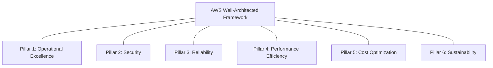
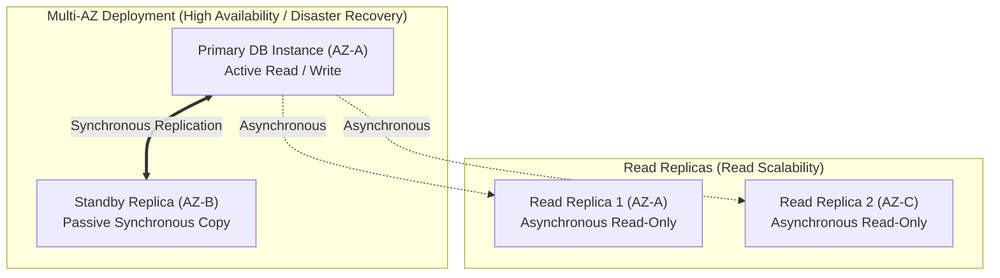
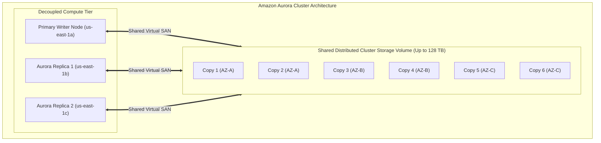
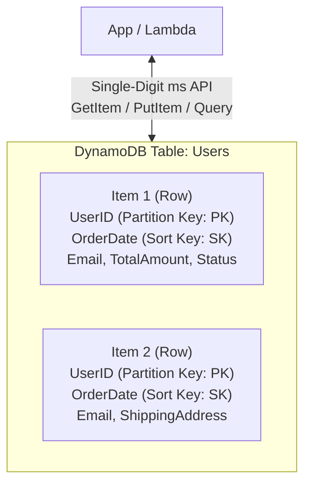
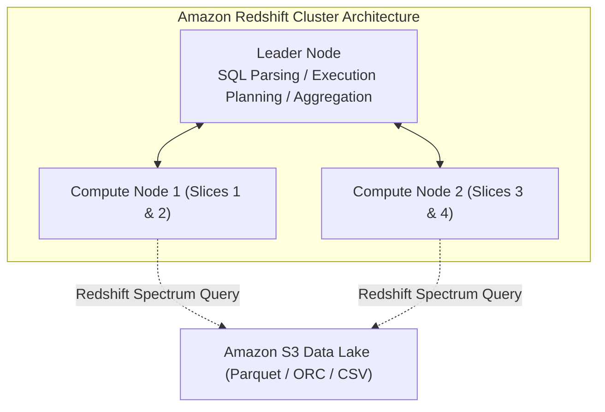
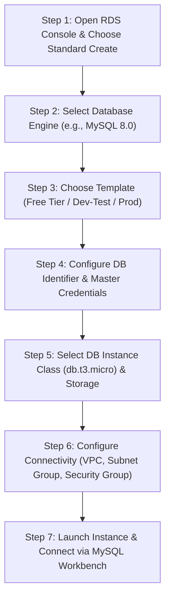

# Unit - 5

:::info[TITLE]
## AWS Architecture & Database Services
:::

## 1. The AWS Well-Architected Framework

The **AWS Well-Architected Framework** provides a consistent, structured methodology for cloud architects to evaluate architectures, implement scalable designs, and align cloud infrastructure with architectural best practices.



### 1.1 Purpose of the Framework
- Provides architectural guidance based on lessons learned across thousands of enterprise customer deployments.
- Helps engineering teams evaluate workload trade-offs between speed, cost, and risk.
- Supported in the AWS Console by the **AWS Well-Architected Tool**, which audits workloads against framework questions and generates prioritized remediation milestones.

### 1.2 General Design Principles of the Cloud Framework
1. **Drive Architectures Using Data:** Collect real-time telemetry metrics and operational logs to make data-backed design modifications rather than relying on guesswork.
2. **Stop Guessing Capacity Needs:** Eliminate physical hardware forecasting errors; leverage automated horizontal scaling to match real-time workload demand dynamically.
3. **Test Systems at Production Scale:** Use the cloud's on-demand elasticity to spin up production-scale test environments, execute load/chaos experiments, and tear them down immediately to minimize costs.
4. **Automate Architectural Experimentation:** Employ Infrastructure as Code (AWS CloudFormation, Terraform, AWS CDK) to provision repeatable, trackable environments.
5. **Allow for Evolutionary Architectures:** Design modular, decoupled microservice systems that allow individual components to be upgraded or replaced without disrupting overall system availability.

### 1.3 The 6 Pillars of the Well-Architected Framework

#### Pillar 1: Operational Excellence
Focuses on running and monitoring systems to deliver business value and continually improving supporting processes and procedures.
- **Design Principles:**
  1. *Perform operations as code:* Define infrastructure and operational event responses through code (CI/CD pipelines, AWS CloudFormation).
  2. *Make frequent, small, reversible changes:* Design workloads to allow modular components to be updated incrementally, minimizing blast radius and enabling instant rollbacks.
  3. *Refine operations procedures frequently:* Review and update operational runbooks as systems evolve.
  4. *Anticipate failure:* Execute "game days" to simulate outages and validate incident response runbooks.
  5. *Learn from all operational failures:* Conduct blameless post-incident reviews (post-mortems) and automate preventative guardrails.

#### Pillar 2: Security
Focuses on protecting information, systems, and assets while delivering business value through risk assessments and mitigation strategies.
- **Design Principles:**
  1. *Implement a strong identity foundation:* Enforce the Principle of Least Privilege, mandate Multi-Factor Authentication (MFA), and eliminate long-term static credentials with temporary IAM roles.
  2. *Enable traceability:* Aggregate, monitor, and alert on real-time audit logs using AWS CloudTrail, Amazon CloudWatch, and AWS Config.
  3. *Apply security at all layers (Defense-in-Depth):* Secure edge endpoints (AWS Shield/WAF), VPC boundaries (NACLs, Security Groups), compute hosts, and application code.
  4. *Automate security best practices:* Implement automated security remediation pipelines via EventBridge and Lambda.
  5. *Protect data in transit and at rest:* Enforce TLS 1.3 encryption across all communication links and AES-256 encryption across storage volumes and databases via AWS KMS.
  6. *Keep people away from data:* Utilize automated data processing tools and direct APIs to eliminate manual human data handling.
  7. *Prepare for security events:* Develop incident management response plans and automated isolation containment strategies.

#### Pillar 3: Reliability
Focuses on ensuring a workload performs its intended function correctly and consistently when expected, and recovers quickly from infrastructure or service disruptions.
- **Design Principles:**
  1. *Automatically recover from failure:* Configure monitoring alarms to trigger automated failovers and self-healing auto-scaling actions.
  2. *Test recovery procedures:* Simulate real-world node and AZ failures using chaos engineering tools (AWS Fault Injection Service) to validate automated recovery.
  3. *Scale horizontally to increase aggregate workload availability:* Replace single large instances with multiple smaller instances behind load balancers to minimize the impact of individual hardware failures.
  4. *Stop guessing capacity:* Automatically provision and de-provision capacity via Auto Scaling to mitigate saturation failures.
  5. *Manage change in automation:* Track and execute infrastructure modifications solely via automated IaC pipelines.

#### Pillar 4: Performance Efficiency
Focuses on utilizing computing resources efficiently to meet system requirements and maintaining that efficiency as demand changes and technologies evolve.
- **Design Principles:**
  1. *Democratize advanced technologies:* Consume complex technologies (machine learning, distributed databases, serverless) as managed cloud services rather than building and managing them internally.
  2. *Go global in minutes:* Deploy workloads across multiple AWS Regions and Edge Locations worldwide to minimize network latency for international end users.
  3. *Use serverless architectures:* Eliminate server management overhead by deploying event-driven serverless architectures (AWS Lambda, Fargate, Aurora Serverless).
  4. *Experiment more often:* Rapidly evaluate different instance types, storage classes, and architectural patterns.
  5. *Consider mechanical sympathy:* Align technology selections with workload operational characteristics (e.g., choosing memory-optimized instances for in-memory caching).

#### Pillar 5: Cost Optimization
Focuses on avoiding unnecessary spending and optimizing cloud expenditures throughout the workload lifecycle.
- **Design Principles:**
  1. *Implement Cloud Financial Management (FinOps):* Establish cost governance, budget alerts, and accountability across cross-functional engineering teams.
  2. *Adopt a consumption model:* Pay only for the computing resources consumed; turn off non-production resources when not in use.
  3. *Measure overall efficiency:* Track business output relative to cloud infrastructure expenditure.
  4. *Stop spending money on undifferentiated heavy lifting:* Let AWS handle data center racking, power, hypervisor patching, and physical hardware maintenance.
  5. *Analyze and attribute expenditure:* Use AWS Cost Allocation Tags to attribute costs directly to business units, projects, or environments.

#### Pillar 6: Sustainability
Focuses on minimizing the environmental impacts of running cloud workloads, with particular emphasis on energy consumption and efficiency.
- **Design Principles:**
  1. *Understand your impact:* Quantify carbon footprint and resource utilization across the workload lifecycle using the AWS Customer Carbon Footprint Tool.
  2. *Establish sustainability goals:* Set measurable efficiency targets for each unit of business work.
  3. *Maximize utilization:* Right-size compute instances and consolidate workloads to eliminate idle physical infrastructure.
  4. *Anticipate and adopt new, efficient hardware/software offerings:* Migrate workloads to energy-efficient ARM-based AWS Graviton processors.
  5. *Use managed services:* Managed services aggregate user capacity, allowing AWS to optimize physical infrastructure efficiency at massive scale.
  6. *Reduce downstream impact of your cloud workloads:* Minimize the data transfer and local processing required on client devices.

## 2. Amazon Relational Database Service (RDS)

**Amazon Relational Database Service (Amazon RDS)** is a fully managed cloud service that simplifies the setup, operation, and scaling of relational database management systems (RDBMS) for Online Transaction Processing (OLTP) workloads.



### 2.1 Managed RDBMS Capabilities
- **Automated Provisioning & Patching:** AWS automatically provisions the underlying EC2 instance, configures storage, applies OS and database engine security patches during user-defined maintenance windows.
- **Automated Backups:** Point-in-time recovery (PITR) with backup retention periods configurable from **1 to 35 days** (default: 7 days). Backups capture full daily snapshots and transaction logs every 5 minutes.
- **Manual DB Snapshots:** User-initiated point-in-time storage snapshots stored durably in Amazon S3 that persist even after the parent RDS instance is deleted.
- **Storage Auto-Scaling:** Automatically expands provisioned storage (up to 64 TB) without downtime when available storage drops below 10%.
- **Supported Database Engines:**
  1. MySQL
  2. PostgreSQL
  3. MariaDB
  4. Oracle (Enterprise, Standard)
  5. Microsoft SQL Server (Enterprise, Standard, Web, Express)
  6. Amazon Aurora (Cloud-native MySQL and PostgreSQL)

### 2.2 High Availability (Multi-AZ) vs. Scalability (Read Replicas)

| Architectural Dimension | Multi-AZ Deployment | Read Replicas |
| :--- | :--- | :--- |
| **Primary Objective** | **High Availability & Disaster Recovery** | **Read Performance Scalability** |
| **Replication Mode** | **Synchronous Replication** (Transactions committed only after written to both nodes) | **Asynchronous Replication** (Primary commits first; replicas update with slight lag) |
| **Standby / Node Accessibility** | Standby is **passive / invisible**; cannot accept read or write traffic | **Active and readable**; accepts read-only queries (`SELECT`) |
| **Failover Mechanism** | **Automatic Failover** (1–2 minutes); DNS endpoint dynamically flips to standby node | **Manual failover**; replica can be manually promoted to standalone read/write DB |
| **Number of Nodes** | Exactly 1 standby node in a different AZ within the same region | Up to **5 Read Replicas** per primary DB (can be cross-AZ or cross-region) |
| **Target Connection Endpoint** | Same single primary DNS endpoint (transparent failover) | Each Read Replica possesses its own unique distinct DNS endpoint |
| **Cost Impact** | Approximately $2\times$ cost (doubles instance and storage consumption) | Billed per individual replica instance and storage provisioned |

## 3. Amazon Aurora

**Amazon Aurora** is AWS's proprietary, cloud-native relational database engine designed for enterprise OLTP workloads. It is fully compatible with MySQL (up to **$5\times$ throughput** of standard MySQL) and PostgreSQL (up to **$3\times$ throughput** of standard PostgreSQL) at one-tenth the cost of commercial engines.



### 3.1 Proprietary Architecture: Decoupled Compute & Storage
- **Decoupled Architecture:** Unlike traditional monolithic databases where compute and storage are bound to the same physical or virtual machine, Aurora completely separates the SQL database compute layer from the underlying storage volume.
- **6-Way Replication Across 3 AZs:** The shared distributed cluster storage volume automatically replicates data **6 ways across 3 Availability Zones** (2 copies in each AZ):
  - **Write Quorum:** Requires $4\text{ out of }6$ copies to acknowledge a write (can tolerate the complete loss of an entire AZ plus an additional copy without losing write availability).
  - **Read Quorum:** Requires $3\text{ out of }6$ copies to acknowledge a read (tolerates loss of 3 copies without read disruption).
- **Auto-Expanding Storage:** Storage auto-scales elastically from 10 GB up to **128 TB** in 10 GB increments without downtime or manual allocation.
- **Self-Healing Storage:** Continuously scans data blocks and disks for corruption, automatically repairing faulty sectors using quorum peer copies.

### 3.2 Advanced Aurora Features
1. **Aurora Replicas:** Supports up to **15 low-latency read replicas** (compared to RDS's 5). Because all replicas read from the same shared storage volume, replication lag is virtually non-existent (typically sub-10 milliseconds).
2. **Aurora Serverless (v1 & v2):** Automatically scales database compute capacity up or down in fine-grained **Aurora Capacity Units (ACUs)** within fractions of a second based on application demand, scaling down to zero during idle periods.
3. **Aurora Global Database:** Replicates an Aurora database across multiple AWS Regions with sub-second replication latency, enabling low-latency local reads globally and rapid cross-region disaster recovery (RPO &lt; 1s, RTO &lt; 1 min).
4. **Backtrack:** Allows administrators to rapidly rewind the entire database to a specific past second (e.g., reverting accidental `DROP TABLE` commands) in seconds without restoring from a backup snapshot.
5. **Database Cloning:** Creates fast, zero-copy, copy-on-write database clones for staging and testing environments without duplicating physical storage blocks until changes are made.

### 3.3 Amazon Aurora vs. Amazon RDS Comparison

| Feature / Metric | Amazon Aurora | Standard Amazon RDS (MySQL / PostgreSQL) |
| :--- | :--- | :--- |
| **Throughput Performance** | $5\times$ MySQL / $3\times$ PostgreSQL performance | Baseline standard community open-source performance |
| **Storage Architecture** | Decoupled distributed shared cluster volume | Attached Amazon EBS volumes (`gp3` or `io2`) |
| **Data Redundancy** | Replicated 6 ways across 3 Availability Zones | Replicated 2 ways (Primary + Standby in Multi-AZ) |
| **Max Read Replicas** | Up to **15 Aurora Replicas** (sub-10 ms lag) | Up to **5 Read Replicas** (seconds-to-minutes lag) |
| **Storage Auto-Scaling** | Auto-scales up to **128 TB** seamlessly | Auto-scales up to **64 TB** with cooldown intervals |
| **Serverless Option** | Yes (**Aurora Serverless v2**) | Limited to specific configurations |
| **Failover Speed** | Under 30 seconds (often immediate) | Approximately 1 to 2 minutes |

## 4. Amazon DynamoDB (NoSQL Database)

**Amazon DynamoDB** is a fully managed, serverless, key-value and document NoSQL database service engineered to deliver single-digit millisecond latency at any scale.



### 4.1 Core Concepts and Data Model
- **Table:** A collection of data items (equivalent to a relational database table).
- **Item:** A group of attributes (equivalent to a row). Items can be up to **400 KB** in size.
- **Attribute:** A fundamental data element (equivalent to a column or JSON key-value field). DynamoDB is **schema-less**: items in the same table can contain completely different attributes, except for the primary key.
- **Primary Key Models:**
  1. *Simple Primary Key (Partition Key / Hash Key):* A single attribute whose value is passed into an internal hash function to determine the physical storage partition.
  2. *Composite Primary Key (Partition Key + Sort Key / Range Key):* Combines a Partition Key with a Sort Key. Items with the same partition key are stored together in physical sort order by the sort key, allowing efficient range queries (`between`, `>`, `<`).

### 4.2 Secondary Indexes: GSI vs. LSI
- **Global Secondary Index (GSI):** An index with a Partition Key and a Sort Key that can be **different from those on the base table**. Can be created at table creation or added to an existing table anytime. Spans queries across all partitions globally.
- **Local Secondary Index (LSI):** An index that possesses the **same Partition Key** as the base table, but a different Sort Key. Can **only be defined at table creation time** and cannot be added or deleted afterward.

### 4.3 Capacity Modes: Provisioned vs. On-Demand

| Metric / Dimension | Provisioned Capacity Mode | On-Demand Capacity Mode |
| :--- | :--- | :--- |
| **Capacity Planning** | Customer specifies expected read/write capacity units | Zero capacity planning; fully automated instant scaling |
| **RCU Definition** | **1 Read Capacity Unit (RCU)** = 1 strongly consistent read/sec (or 2 eventually consistent reads/sec) for items up to 4 KB | Billed per million read request units consumed |
| **WCU Definition** | **1 Write Capacity Unit (WCU)** = 1 write/sec for items up to 1 KB | Billed per million write request units consumed |
| **Auto Scaling** | Supported via DynamoDB auto-scaling policies | Natively accommodates unknown/spiky traffic instantly |
| **Best Used For** | Predictable, steady workloads with consistent traffic | Unpredictable, sporadic, or bursty application traffic |

### 4.4 Advanced Features of DynamoDB
1. **DynamoDB Accelerator (DAX):** A fully managed, highly available in-memory cache for DynamoDB that reduces read response times from milliseconds to **microseconds** ($10\times$ speed improvement) without requiring developers to manage cache invalidation logic.
2. **DynamoDB Streams:** Captures a time-ordered sequence of item-level modifications (insertions, updates, deletions) over a 24-hour rolling window. Native integration with **AWS Lambda** enables event-driven architectures (e.g., sending an email notification when a new order is inserted).
3. **Global Tables:** Provides fully managed, active-active, multi-region replication. Applications can read and write locally to DynamoDB tables across multiple AWS Regions with sub-second replication latency.
4. **Point-in-Time Recovery (PITR):** Delivers continuous backups enabling restoration of table data to any single second within the past 35 days.
5. **Time to Live (TTL):** Automatically purges expired items from tables based on an epoch timestamp attribute at zero write/request cost.

### 4.5 When to Choose DynamoDB vs. Amazon RDS

| Requirement / Characteristic | Choose Amazon DynamoDB | Choose Amazon RDS / Aurora |
| :--- | :--- | :--- |
| **Data Structure** | Semi-structured, JSON documents, key-value data | Highly structured relational tables with fixed schemas |
| **Query Complexity** | Simple lookups by Primary Key, GSI queries | Complex multi-table `JOIN`s, aggregations, SQL queries |
| **Scalability Nature** | Massive horizontal scale (unlimited TPS, single-digit ms) | Vertical scaling (up to max instance size; read replicas) |
| **Server Management** | True serverless; zero server or maintenance management | Managed DB instances; minor maintenance windows required |
| **Transaction Model** | ACID transactions supported; optimized for fast writes | Full ACID compliance; complex multi-row transactional logic |

## 5. Amazon Redshift (Cloud Data Warehouse)

**Amazon Redshift** is a fully managed, petabyte-scale cloud data warehouse service engineered for Online Analytical Processing (OLAP) and business intelligence (BI) reporting.



### 5.1 OLTP vs. OLAP Paradigms
- **Online Transaction Processing (OLTP):** High volumes of small, frequent read and write transactions (e.g., e-commerce order placement, banking transfers). Row-based databases (RDS, Aurora) excel at retrieving individual records quickly.
- **Online Analytical Processing (OLAP):** Complex analytical queries spanning millions to billions of historical records (e.g., calculating quarterly sales trends across regions). Redshift excels at running aggregate queries (`SUM`, `AVG`, `GROUP BY`) across massive datasets.

### 5.2 Columnar Storage & Massively Parallel Processing (MPP)
1. **Columnar Data Storage:** Traditional databases store data row-by-row (`Row 1: ID, Name, Age; Row 2: ID, Name, Age`). Redshift stores each column's data contiguously on disk:
   - Queries requesting `SELECT AVG(Salary) FROM Employees` read **only the Salary column blocks from disk**, skipping ID, Name, and Age columns entirely, reducing disk I/O by up to 90%.
   - Columnar data compresses significantly better because all values in a block share identical data types.
2. **Massively Parallel Processing (MPP):**
   - **Leader Node:** Receives client SQL connections, parses queries, generates distributed execution plans, and aggregates partial results returned by compute nodes.
   - **Compute Nodes:** Execute the compiled query code in parallel across partitioned **Node Slices**.
3. **Redshift Spectrum:** Enables running complex SQL queries against exabytes of unstructured and semi-structured data residing directly in **Amazon S3 data lakes** without loading or transforming the data into Redshift tables.

### 5.3 Comprehensive Database Comparison: RDS vs. DynamoDB vs. Redshift

| Characteristic | Amazon RDS / Aurora | Amazon DynamoDB | Amazon Redshift |
| :--- | :--- | :--- | :--- |
| **Processing Paradigm** | **OLTP** (Online Transaction Processing) | **OLTP** (High-throughput NoSQL) | **OLAP** (Online Analytical Processing) |
| **Data Model** | Relational / SQL Tables | Key-Value & JSON Document | Relational Columnar Data Warehouse |
| **Latency Profile** | Low millisecond (5–20 ms) | **Single-digit millisecond** (1–5 ms) | Seconds to minutes (Analytical queries) |
| **Scaling Mechanism** | Vertical compute scaling; Read Replicas | Instant horizontal automated partitioning | Horizontal node additions / Serverless |
| **Storage Capacity** | Up to 64 TB (RDS) / 128 TB (Aurora) | Unlimited | Up to **exabytes** (via Redshift Spectrum) |
| **Primary Use Cases** | E-commerce backends, ERP, financial ledgers | Mobile games, shopping carts, session state | Business Intelligence, analytics, executive dashboards |

## 6. Step-by-Step Implementation: Launching an Amazon RDS DB Instance

The following step-by-step walkthrough details provisioning a production-grade Amazon RDS database instance using the AWS Management Console and AWS CLI.



### 6.1 Step-by-Step Console Walkthrough
1. **Navigate to RDS Console:**
   - Open AWS Management Console $\to$ **RDS** $\to$ click **Create database**.
2. **Choose a Database Creation Method:**
   - Select **Standard create** (provides full control over network, security, and backup configurations).
3. **Engine Options:**
   - Engine type: **MySQL** (Community Edition).
   - Engine Version: Select the latest stable version (e.g., `MySQL 8.0.35`).
4. **Templates:**
   - Select **Free tier** (automatically configures resource parameters to remain within free tier limits) or **Production** (for Multi-AZ and auto-scaling).
5. **Settings:**
   - **DB instance identifier:** `production-mysql-db`
   - **Master username:** `admin`
   - **Master password:** Provide a secure password (minimum 8 characters).
6. **Instance Configuration & Storage:**
   - **DB instance class:** `db.t3.micro` (2 vCPUs, 1 GiB RAM).
   - **Storage type:** `General Purpose SSD (gp3)`.
   - **Allocated storage:** `20 GiB`.
   - **Enable storage autoscaling:** Checked (Max storage threshold: `100 GiB`).
7. **Connectivity Settings:**
   - **Virtual Private Cloud (VPC):** Select your custom VPC.
   - **DB Subnet Group:** Choose a private DB subnet group spanning at least 2 AZs.
   - **Public access:** **No** (best practice; databases should never have public IPs).
   - **VPC security group:** Create new or select existing `DB-SG` (inbound rule: TCP port 3306 restricted solely to your `Web-SG` security group).
   - **Database port:** `3306`.
8. **Database Authentication & Monitoring:**
   - Database authentication: *Password authentication*.
   - Automated backups: Enabled (Retention period: 7 days).
   - Click **Create database**.

### 6.2 Connecting to the RDS Instance
Once the DB status changes to `Available`, copy the **Endpoint** address (e.g., `production-mysql-db.c123456789.us-east-1.rds.amazonaws.com`):
- Connect from an EC2 web server within the same VPC using the MySQL client:
  ```bash
  mysql -h production-mysql-db.c123456789.us-east-1.rds.amazonaws.com -P 3306 -u admin -p
  ```

### 6.3 Deploying via AWS CLI
The equivalent database instance can be launched instantaneously using the AWS CLI:
```bash
aws rds create-db-instance \
    --db-instance-identifier production-mysql-db \
    --db-instance-class db.t3.micro \
    --engine mysql \
    --engine-version 8.0.35 \
    --master-username admin \
    --master-user-password "SecurePassw0rd123!" \
    --allocated-storage 20 \
    --storage-type gp3 \
    --no-publicly-accessible \
    --backup-retention-period 7
```

## 7. Important Question Bank & Exam Review

### 7.1 Short Answer Questions

#### Q1: List the 6 Pillars of the AWS Well-Architected Framework.
The 6 pillars are:
1. Operational Excellence
2. Security
3. Reliability
4. Performance Efficiency
5. Cost Optimization
6. Sustainability

#### Q2: What is the key architectural difference between an RDS Multi-AZ deployment and an RDS Read Replica?
An **RDS Multi-AZ deployment** is designed for **High Availability and Disaster Recovery** using synchronous replication to a passive standby instance in another AZ with automatic failover (same DNS endpoint). An **RDS Read Replica** is designed for **Read Scalability** using asynchronous replication to an active, readable instance with its own distinct DNS endpoint.

#### Q3: How does Amazon Aurora achieve high durability and fault tolerance at the storage layer?
Amazon Aurora replicates its cluster storage volume **6 ways across 3 Availability Zones** (2 copies per AZ). It uses a quorum-based model requiring 4 of 6 copies for writes and 3 of 6 for reads, allowing it to withstand the complete loss of an Availability Zone plus an additional storage disk without impacting write availability.

#### Q4: Differentiate between a Simple Primary Key and a Composite Primary Key in Amazon DynamoDB.
A **Simple Primary Key** consists of a single attribute called the **Partition Key** (Hash Key) used to determine the physical partition where the item is stored. A **Composite Primary Key** consists of two attributes: a **Partition Key** and a **Sort Key** (Range Key), where items sharing the same partition key are stored together physically and ordered by the sort key.

#### Q5: Explain the difference between Row-Based and Columnar storage in the context of Amazon Redshift.
**Row-based storage** writes entire record tuples sequentially on disk, requiring queries to read all column data even when only one field is requested. **Columnar storage** (used by Redshift) organizes each column's data sequentially on disk, allowing analytical queries (e.g., `SUM(Revenue)`) to read only the target column blocks, dramatically reducing disk I/O and achieving superior data compression.

### 7.2 Long Answer Questions

#### Q6: Explain the design principles of the Security Pillar and the Reliability Pillar of the AWS Well-Architected Framework.
- **Security Pillar Design Principles:**
  - *Strong Identity Foundation:* Enforce least privilege, centralize identities, mandate MFA, and eliminate long-term credentials with temporary roles.
  - *Enable Traceability:* Collect and monitor real-time audit trails with CloudTrail, CloudWatch, and AWS Config.
  - *Apply Security at All Layers:* Implement defense-in-depth across edge PoPs, VPC boundaries, subnets, OS instances, and application logic.
  - *Automate Security:* Use event-driven automation for compliance and incident response.
  - *Protect Data at Rest and in Transit:* Enforce TLS encryption on all network transit and AES-256 KMS encryption on disks and buckets.
  - *Keep People Away from Data:* Eliminate direct manual data access with automated processing tools.
- **Reliability Pillar Design Principles:**
  - *Automatically Recover from Failure:* Monitor system health to initiate automated failovers and self-healing auto-scaling.
  - *Test Recovery Procedures:* Validate resilience using chaos testing and simulated disaster recovery drills.
  - *Scale Horizontally:* Deploy multiple smaller instances behind load balancers to minimize the blast radius of hardware failure.
  - *Stop Guessing Capacity:* Dynamically adjust capacity using Auto Scaling to prevent resource exhaustion.
  - *Manage Change in Automation:* Implement all infrastructure changes via automated CI/CD and IaC pipelines.

#### Q7: Discuss the architecture and advanced capabilities of Amazon Aurora. Explain how it differs from traditional community relational databases.
Amazon Aurora re-architects the traditional database engine by decoupling compute from storage:
- Traditional engines bind SQL parsing, query planning, buffer caches, and disk logging into a single virtual host attached to block storage.
- Aurora moves logging and storage to an independent, distributed, self-healing virtual SAN replicated 6 ways across 3 AZs.
- It delivers up to $5\times$ the throughput of standard MySQL and $3\times$ PostgreSQL.
- Storage scales automatically up to 128 TB in 10 GB increments without performance degradation.
- Compute can be scaled independently, supporting up to 15 Aurora Replicas with sub-10 ms replication lag, Aurora Serverless v2 for sub-second auto-scaling, Global Databases for multi-region active-passive replication, and Backtrack for instantaneous point-in-time rewind without backup restoration.

### 7.3 Multiple Choice Questions

#### Q8: An enterprise requires an in-memory cache for Amazon DynamoDB that delivers microsecond response times for read-heavy workloads. Which service should they deploy?
- (A) Amazon ElastiCache for Redis
- (B) Amazon DynamoDB Accelerator (DAX)
- (C) Amazon CloudFront
- (D) AWS AppSync
- **Correct Answer:** **(B) Amazon DynamoDB Accelerator (DAX)**.

#### Q9: Which Amazon RDS database engine supports automated backtracking to rewind a database to a past point in time within seconds?
- (A) PostgreSQL
- (B) MariaDB
- (C) Amazon Aurora
- (D) Microsoft SQL Server
- **Correct Answer:** **(C) Amazon Aurora**.

#### Q10: A business analyst needs to execute ad-hoc SQL queries directly against multiple petabytes of raw Parquet data stored in Amazon S3 without loading it into a database. Which service is designed for this?
- (A) Amazon RDS for MySQL
- (B) Amazon Redshift Spectrum
- (C) Amazon DynamoDB Streams
- (D) AWS Elastic Beanstalk
- **Correct Answer:** **(B) Amazon Redshift Spectrum**.

### 7.4 Architectural Scenarios & Decision Guide

#### Scenario A: The Black Friday Bottleneck
- **Problem:** An e-commerce relational database running on Amazon RDS MySQL experiences severe read latency during Black Friday traffic because thousands of users are browsing product catalog pages simultaneously.
- **Root Cause:** A single primary database instance is handling both write transactions (orders) and intensive read traffic (product browsing), causing CPU and disk I/O saturation.
- **Solution:** Provision **RDS Read Replicas** across multiple Availability Zones. Update application configuration to direct all read-only `SELECT` traffic to the Read Replica endpoints while directing transactional `INSERT`/`UPDATE` operations to the primary DB instance.

#### Scenario B: The Session State Scaling Wall
- **Problem:** A mobile gaming application storing player session data and active game states in an RDS database crashes whenever a new game launches and traffic spikes by $1,000\%$.
- **Root Cause:** Relational databases have rigid schema constraints and cannot scale horizontally on-demand to absorb millions of rapid, concurrent key-value write transactions.
- **Solution:** Migrate the session state and player profiles to **Amazon DynamoDB** with **On-Demand Capacity Mode**. DynamoDB scales horizontally and partition-balances automatically, delivering predictable single-digit millisecond latency regardless of request volume.
