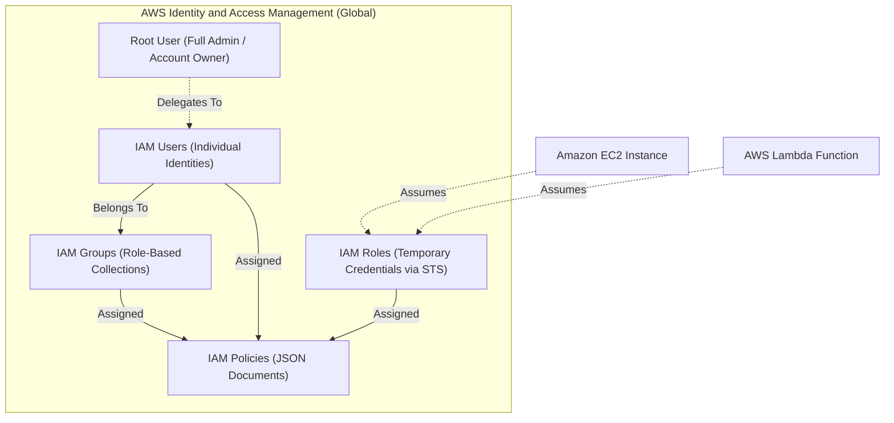
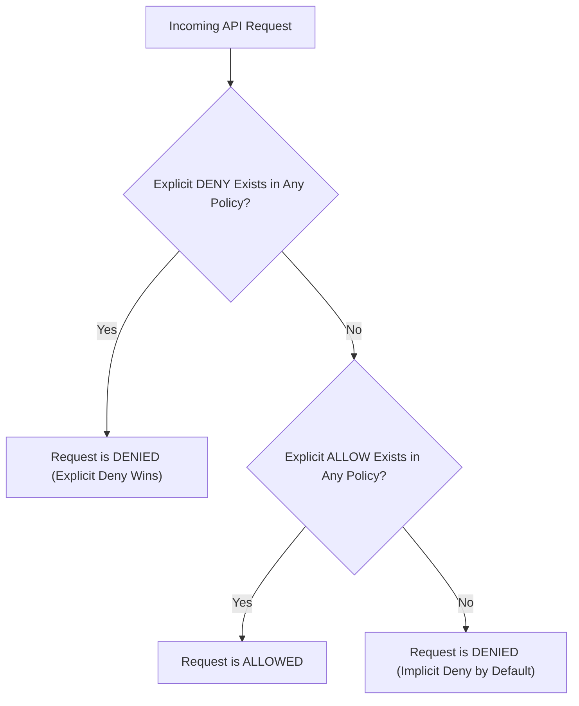
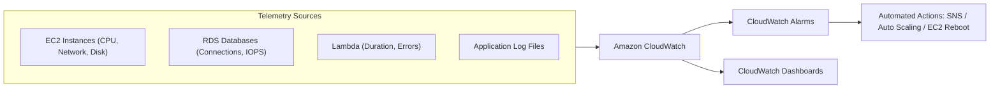
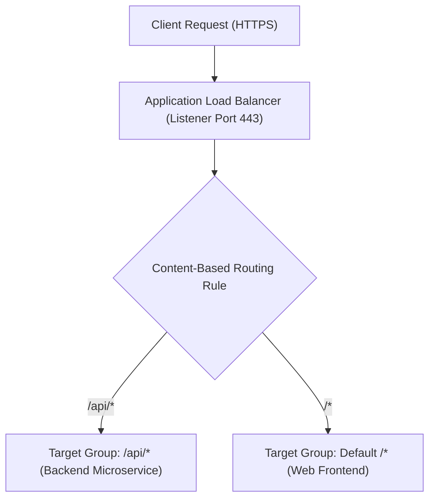
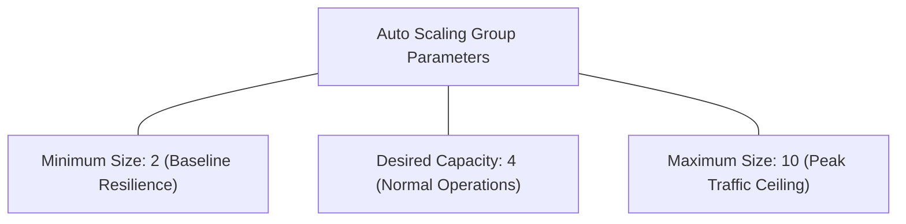
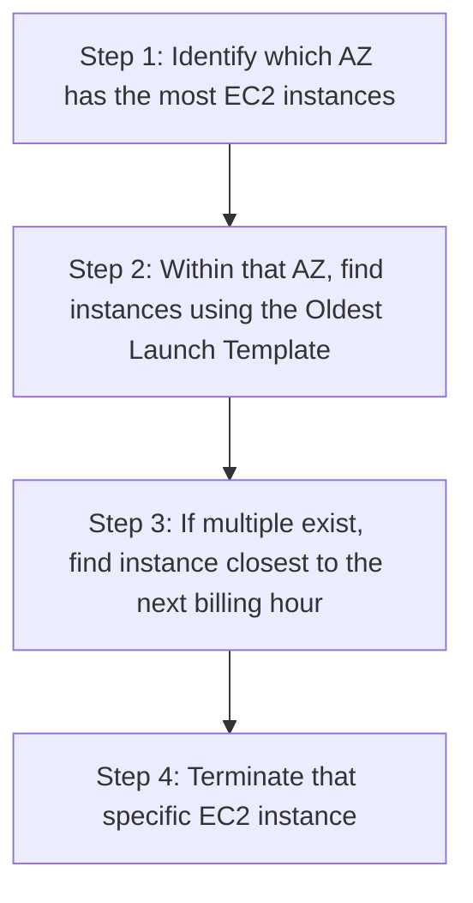
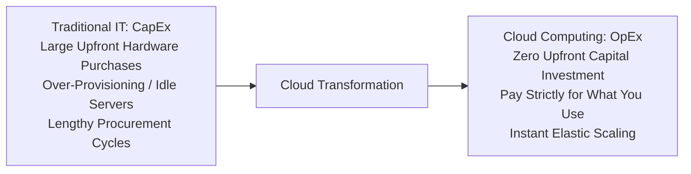
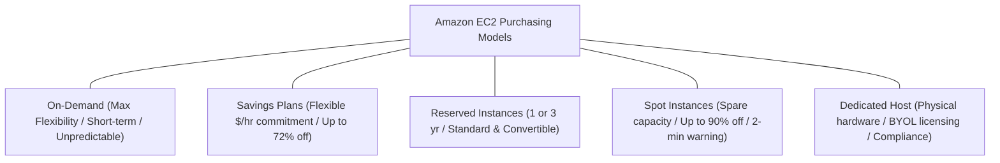
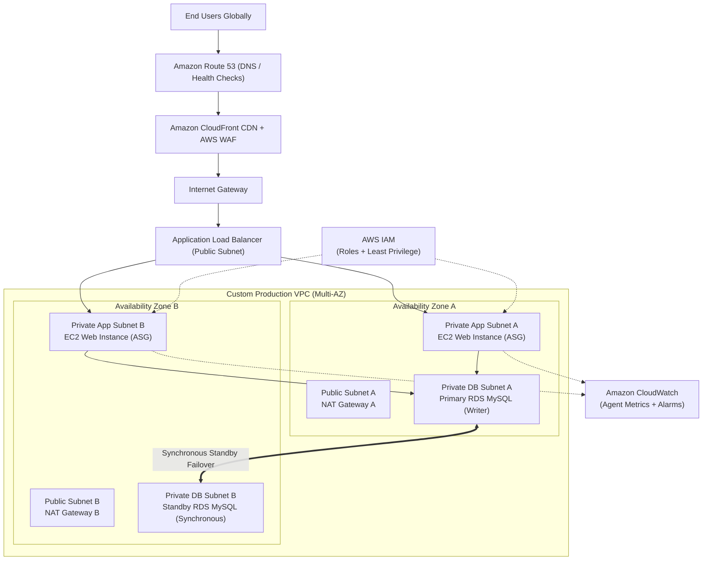

# Unit - 6

:::info[TITLE]
## AWS Security, Monitoring, Scaling, and Billing
:::

## 1. AWS Identity and Access Management (IAM)

**AWS Identity and Access Management (IAM)** is a foundational, web-service security framework that enables cloud administrators to securely manage access to AWS services and resources.

:::important[IAM is a Global Service]
IAM is a **global service**; it does not operate within specific AWS Regions. Users, user groups, roles, and policies created in IAM apply seamlessly across all commercial AWS Regions worldwide.
:::



### 1.1 Core IAM Entities

1. **AWS Account Root User:**
   - Automatically created when the AWS account is first registered.
   - Possesses complete, unrestricted access to all resources and billing information within the account.
   - **Security Mandate:** Never use the root account for daily administrative tasks. Lock root credentials away, enforce hardware/virtual Multi-Factor Authentication (MFA), delete root access keys, and create dedicated IAM administrators.
2. **IAM User:**
   - An entity created in AWS representing a specific human user or system application requiring interaction with AWS resources.
   - **Credentials:** Can possess a console password (for AWS Management Console access) and/or up to two active Access Key pairs (Access Key ID and Secret Access Key) for CLI, SDK, and REST API access.
3. **IAM User Group:**
   - A collection of IAM users. Permissions applied to a group automatically propagate to all member users.
   - Simplifies access management: e.g., create a `Developers` group with `AmazonEC2FullAccess` and an `Auditors` group with `SecurityAudit` permissions.
   - **Constraints:** Groups cannot be nested (a group cannot contain another group); an individual IAM user can belong to up to **10 groups**.
4. **IAM Role:**
   - An IAM identity that you can create in your account that has specific permissions, but is **NOT associated with a specific person or permanent password/access keys**.
   - **Temporary Credentials:** When an entity assumes a role, the **AWS Security Token Service (AWS STS)** dynamically issues temporary security credentials (access key, secret key, and security token) valid for 15 minutes up to 12 hours.
   - **Role Types:**
     - *AWS Service Role:* Assumed by AWS services (e.g., an EC2 instance assuming a role to read from an S3 bucket without embedding credentials in code).
     - *Cross-Account Role:* Allows authorized users in AWS Account A to securely access resources in AWS Account B without creating duplicate user identities.
     - *Federated Role:* Integrates enterprise Identity Providers (`IdP`) via SAML 2.0 or OpenID Connect (`OIDC`) (e.g., Active Directory, Okta, Google).

### 1.2 Anatomy of an IAM Policy (JSON Document)
IAM policies are JavaScript Object Notation (JSON) documents that explicitly define permissions.

```json
{
  "Version": "2012-10-17",
  "Statement": [
    {
      "Sid": "AllowS3ReadAndPut",
      "Effect": "Allow",
      "Action": [
        "s3:GetObject",
        "s3:PutObject"
      ],
      "Resource": "arn:aws:s3:::corporate-finance-bucket/*",
      "Condition": {
        "IpAddress": {
          "aws:SourceIp": "203.0.113.0/24"
        },
        "Bool": {
          "aws:MultiFactorAuthPresent": "true"
        }
      }
    }
  ]
}
```

- **Version:** Specifies the language syntax version. Always set to `"2012-10-17"` (the current standard).
- **Statement (Array):** Container for one or more individual permission statements:
  - **Sid (Optional):** Statement Identifier to describe the policy rule.
  - **Effect:** Specifies whether the policy allows or denies access (`"Allow"` or `"Deny"`).
  - **Principal (Resource Policies Only):** Specifies the user, account, or service allowed or denied access (used in S3 bucket policies; omitted in identity-based policies).
  - **Action:** A list of specific API calls being allowed or denied (e.g., `"ec2:StartInstances"`, `"s3:*"`).
  - **Resource:** Amazon Resource Names (ARNs) specifying the target resources the actions apply to (`"arn:aws:s3:::my-bucket/*"`).
  - **Condition (Optional):** Key-value constraints under which the policy is valid (e.g., matching source IP, requiring MFA, enforcing SSL).

### 1.3 IAM Policy Evaluation Logic
When an identity requests an AWS action, the IAM evaluation engine evaluates all applicable policies following a strict mathematical hierarchy:



1. **Default Deny (Implicit Deny):** By default, all requests are denied unless explicitly allowed.
2. **Explicit Deny Overrides All:** An explicit `"Effect": "Deny"` in **any** applicable policy immediately supersedes all `"Allow"` statements.
3. **Explicit Allow:** If no explicit deny exists and at least one explicit allow matches the action, resource, and conditions, access is granted.
4. **Policy Evaluation Hierarchy:** Service Control Policies (SCPs in AWS Organizations) $\to$ Resource-Based Policies $\to$ IAM Permissions Boundaries $\to$ Identity-Based Policies $\to$ Session Policies.

### 1.4 IAM Best Practices
- **Enforce the Principle of Least Privilege:** Grant only the minimum permissions required to perform the intended job function.
- **Enable Multi-Factor Authentication (MFA):** Enforce MFA on all accounts, especially the root account and privileged administrators.
- **Never Hardcode Credentials:** Use IAM Roles for Amazon EC2, AWS Lambda, and ECS containers instead of hardcoding API access keys inside application source code.
- **Rotate Credentials Periodically:** Enforce regular password expiration and access key rotation via IAM credential reports.
- **Audit Account Activity:** Continuously stream authentication events and API activity to **AWS CloudTrail**.

## 2. AWS CloudWatch (Monitoring & Observability)

**Amazon CloudWatch** is an observability and monitoring service that collects operational telemetry data (metrics, logs, and events) across AWS cloud resources and on-premises applications.



### 2.1 Metrics and Monitoring Intervals
- **Metrics:** Time-ordered numerical data points representing resource utilization and operational performance (e.g., CPU utilization, network traffic).
- **Basic Monitoring:** Enabled by default on AWS resources free of charge; collects metric data points at **5-minute intervals**.
- **Detailed Monitoring:** Optional paid feature; collects metric data points at **1-minute intervals** for high-frequency scaling decisions.

:::caution[CRITICAL EXAM FACT: Memory & Disk Space Monitoring]
By default, Amazon CloudWatch **CANNOT monitor RAM (memory) utilization or free disk space percentage!** The AWS hypervisor operates outside the virtual machine and cannot inspect internal guest operating system memory tables. To capture memory usage and free disk space, administrators **MUST install the unified Amazon CloudWatch Agent** inside the guest operating system.
:::

### 2.2 CloudWatch Alarms
CloudWatch Alarms monitor metric thresholds over a specified time period and initiate automated actions when breached:
- **Alarm States:**
  1. `OK`: The metric is within permissible threshold boundaries.
  2. `ALARM`: The metric has crossed the configured threshold for the specified evaluation periods.
  3. `INSUFFICIENT_DATA`: The alarm has just started, the metric is unavailable, or there is not enough data to determine state.
- **Alarm Actions:**
  - Send notifications to an **Amazon SNS** topic (triggering SMS, email, or Slack alerts).
  - Execute **EC2 Auto Scaling policies** (scale-out or scale-in).
  - Perform **EC2 Instance Actions** (automatically reboot, stop, terminate, or recover an instance with failed hardware).
  - Trigger **AWS Lambda** serverless remediation scripts.

### 2.3 CloudWatch Logs
- **Log Group:** A collection of log streams that share the same retention, monitoring, and access control settings (e.g., `/aws/lambda/MyFunction` or `/ec2/apache/access_log`).
- **Log Stream:** A sequence of log events emitted by the same physical or virtual source (e.g., a specific server instance).
- **Metric Filters:** Search and match terms within raw text logs (e.g., count occurrences of HTTP status `404` or `500` errors) and transform them into numeric CloudWatch metrics that trigger alarms.

### 2.4 CloudWatch vs. CloudTrail vs. AWS Config Comparison

| Dimension | Amazon CloudWatch | AWS CloudTrail | AWS Config |
| :--- | :--- | :--- | :--- |
| **Primary Focus** | **Performance & Operational Telemetry** | **API Auditing & Governance** | **Resource Compliance & Inventory** |
| **Core Question Answered** | *"How is the application performing?"* | *"Who made what API call, when, and from where?"* | *"How has the resource configuration changed over time?"* |
| **Data Collected** | CPU %, disk I/O, network bytes, application logs | Caller identity, API action name, timestamp, IP address | Resource configuration snapshots, relationship graphs |
| **Primary Beneficiary** | System administrators, DevOps engineers | Security auditors, compliance officers | Governance teams, cloud security architects |

## 3. Elastic Load Balancing (ELB) Architecture

Elastic Load Balancing automatically distributes incoming application traffic across multiple targets—such as EC2 instances, containers, and IP addresses—across multiple Availability Zones.



### 3.1 Load Balancer Types Deep Dive
1. **Application Load Balancer (ALB - Layer 7):**
   - Inspects application-layer data (`HTTP`/`HTTPS`).
   - Supports advanced routing rules:
     - *Path-based routing:* Requests to `/api/*` go to API target group; `/images/*` go to static assets target group.
     - *Host-based routing:* Requests to `orders.example.com` route to order servers; `blog.example.com` route to blogging servers.
     - *HTTP Header & Query Parameter routing:* Directs traffic based on authorization headers or query strings.
   - Integrates natively with **AWS WAF** for application firewall inspection.
2. **Network Load Balancer (NLB - Layer 4):**
   - Operates at the transport layer (`TCP`, `UDP`, `TLS`).
   - Capable of handling **millions of requests per second** with ultra-low sub-millisecond latencies.
   - Assigns a **static IP address** (or dedicated Elastic IP) per Availability Zone.
   - Ideal for non-HTTP applications, gaming servers, real-time audio/video streaming, and financial trading platforms.

### 3.2 Target Groups, Health Checks & Sticky Sessions
- **Target Groups:** Logical groupings of compute endpoints registered with the load balancer.
- **Health Checks:** Probes sent periodically to targets (e.g., every 30 seconds on `/healthz`). If a target fails to return HTTP `200–399` for consecutive attempts matching the *Unhealthy Threshold*, ELB marks it unhealthy and stops routing traffic to it.
- **Sticky Sessions (Session Affinity):** Ensures requests from a specific user session are consistently routed to the same backend target using generated HTTP cookies.
- **Deregistration Delay (Connection Draining):** Allows in-flight requests to complete gracefully (default: 300 seconds) when an instance is marked for termination or removal from a target group.

## 4. Amazon EC2 Auto Scaling (ASG)

Amazon EC2 Auto Scaling guarantees that your workload maintains the optimal number of EC2 instances running to handle application load while minimizing infrastructure spend.



### 4.1 Auto Scaling Scaling Policies
- **Target Tracking Scaling:** The modern recommended standard. You define a metric target (e.g., Maintain ASG Average CPU Utilization at $50\%$), and Auto Scaling dynamically adjusts capacity up or down to keep the metric at that value.
- **Step Scaling:** Adjusts capacity in tiered increments based on the size of the metric alarm breach (e.g., if CPU is 70–80%, add 2 instances; if CPU &gt; 80%, add 4 instances).
- **Simple Scaling:** Waits for a CloudWatch alarm and adds/removes a fixed number of instances, then enters a full cooldown period.
- **Scheduled Scaling:** Automatically adjusts capacity according to recurring calendar dates and times (e.g., scale up instances every Monday morning before market opening).
- **Predictive Scaling:** Machine learning algorithms evaluate historical workload patterns over weeks to forecast daily and weekly demand, launching capacity ahead of anticipated traffic surges.

### 4.2 Auto Scaling Cooldown Period
- A configurable duration (default: **300 seconds / 5 minutes**) that pauses scaling activities following an automated scale-out or scale-in action.
- **Purpose:** Prevents rapid fluctuations and thrashing (over-provisioning or prematurely terminating instances) by allowing newly launched virtual machines sufficient time to complete OS initialization, start application processes, and begin handling traffic before new metric calculations take place.

### 4.3 Default Auto Scaling Termination Policy Logic
When a scale-in event occurs, Auto Scaling must choose which instance to terminate first. The default termination policy executes the following deterministic sequence:



1. **Balance Availability Zones:** Identifies the Availability Zone that contains the highest number of instances and that is not protected from scale-in.
2. **Evaluate Launch Template Version:** Within that AZ, identifies instances running the oldest launch template or launch configuration.
3. **Billing Hour Proximity:** Identifies the instance closest to the next billing hour to maximize utilization of already-billed capacity.
4. **Random Selection:** If multiple instances match all criteria, one is chosen at random and terminated.

## 5. Cloud Economics, AWS Billing, and Cost Management

Cloud economics examines the financial benefits and operational cost transformations enabled by shifting from capital-intensive physical data centers to on-demand cloud infrastructure.



### 5.1 Five Core AWS Pricing Fundamentals
1. **Pay-as-you-go:** Pay only for the compute and storage resources consumed, with no long-term contracts or early termination fees.
2. **Save when you reserve:** Earn significant discounts (up to 72%) by committing to 1-year or 3-year usage terms for steady-state workloads.
3. **Pay less by using more:** Benefit from tiered volume discounts as data storage (S3) and network data egress volumes increase.
4. **Pay even less as AWS grows:** AWS passes economies of scale back to customers through periodic service price reductions.
5. **AWS Free Tier:**
   - *Always Free:* Services that remain free indefinitely within monthly quotas (e.g., 1,000,000 AWS Lambda requests/month, 10 custom CloudWatch metrics).
   - *12 Months Free:* Available for new accounts for the first year (e.g., 750 hours/month of `t2.micro` or `t3.micro` EC2 instances, 5 GB S3 storage).
   - *Short-Term Trials:* Free trials activated upon initial service trial (e.g., Amazon Redshift 2-month trial).

### 5.2 Amazon EC2 Purchasing Models



| Purchasing Option | Pricing Discount | Commitment Required | Interruption Risk | Best Workload Fit |
| :--- | :--- | :--- | :--- | :--- |
| **On-Demand** | Baseline rate (0% discount) | None (Billed per second) | **Zero** | Short-term, unpredictable, bursty workloads; dev/test environments. |
| **Standard Reserved (RI)** | **Up to 72% discount** | 1 or 3 years | **Zero** | Steady-state, 24/7 production databases and applications with predictable capacity needs. |
| **Convertible Reserved (RI)** | **Up to 54% discount** | 1 or 3 years | **Zero** | Steady workloads requiring the flexibility to switch instance families, OS, or tenancy. |
| **Savings Plans** | **Up to 72% discount** | 1 or 3 years (\$ commit/hr) | **Zero** | Modern alternative to RIs; automatically applies across EC2, Fargate, and Lambda. |
| **Spot Instances** | **Up to 90% discount** | None (Spare capacity) | **High (2-minute warning)** | Fault-tolerant, stateless batch processing, CI/CD jobs, big data rendering. |
| **Dedicated Hosts** | Standard dedicated rates | On-Demand or 1/3 yr commit | **Zero** | Regulatory compliance requiring physical isolation; socket/core software licensing (BYOL). |
| **Dedicated Instances** | Additional \$2/hr fee | On-Demand or Reserved | **Zero** | Workloads requiring hardware dedicated to a single customer account at the hypervisor level. |

### 5.3 Total Cost of Ownership (TCO) Transformation
TCO compares the complete financial cost of running workloads on-premises versus migrating to the cloud:
- **Capital Expenditures (CapEx):** Traditional IT requires major upfront investments in server chassis, high-speed storage arrays, network switches, uninterruptible power supplies (UPS), air conditioning, real estate, and physical security.
- **Operational Expenditures (OpEx):** Cloud computing transforms capital expenses into flexible operational expenses. Customers eliminate data center depreciation and real estate expenses, paying exclusively for resources consumed.

### 5.4 AWS Billing and Cost Governance Tools
1. **AWS Cost Explorer:** An interactive reporting tool that enables users to visualize, understand, and manage AWS costs and usage over time, providing up to 12 months of historical data and 12 months of predictive forecasting.
2. **AWS Budgets:** Allows customers to set custom monetary and usage budgets with automated email or SNS notifications triggered when costs or usage exceed (or are forecasted to exceed) predefined thresholds.
3. **AWS Cost and Usage Report (CUR):** The most granular and comprehensive billing dataset available, generating hourly or daily CSV reports delivered directly to an Amazon S3 bucket for enterprise financial auditing.
4. **AWS Pricing Calculator:** A web-based modeling tool used to estimate the monthly cost of AWS architectures prior to building or provisioning resources.
5. **Cost Allocation Tags:** Key-value metadata tags assigned to AWS resources (e.g., `Environment: Production`, `CostCenter: Marketing`) used to categorize and track costs across business units.
6. **Consolidated Billing (AWS Organizations):** Aggregates billing across multiple linked AWS accounts into a single master payer account, combining resource usage across accounts to qualify for tiered volume discounts (e.g., aggregated S3 data storage tiers).

### 5.5 AWS Support Plans Comparison

| Feature / Attribute | Basic Support | Developer Support | Business Support | Enterprise Support |
| :--- | :--- | :--- | :--- | :--- |
| **Monthly Cost** | **Included Free** | Greater of \$29/mo or 3% of monthly AWS spend | Greater of \$100/mo or tiered % of AWS spend | Greater of **\$15,000/mo** or tiered % of AWS spend |
| **Technical Support Access** | Customer service & billing only (No tech support) | Business hours email access to Cloud Support Associates | **24/7 phone, chat, and email** access to Cloud Support Engineers | **24/7 phone, chat, and email** access to Senior Cloud Support Engineers |
| **Case Response Time** | N/A | General guidance &lt;24h<br/>System impaired &lt;12h | Production impaired &lt;4h<br/>**Production down &lt;1h** | Business-critical system down &lt;**15 minutes** |
| **AWS Trusted Advisor** | 7 core security & quota checks | 7 core checks | **Full checks** (All 5 categories) | **Full checks** (All 5 categories) |
| **Dedicated Staff** | None | None | None | **Technical Account Manager (TAM)** & Concierge Support |
| **Architectural Reviews** | Documentation only | General architectural guidance | Contextual guidance based on your applications | Consultative Well-Architected reviews & Event Management |

## 6. End-to-End Scalable, Secure & Highly Available Reference Architecture

The diagram below represents the industry-standard reference architecture integrating security, compute, networking, auto-scaling, database resilience, and monitoring:



## 7. Important University Exam Questions

### 7.1 Short Answer Questions

#### Q1: Differentiate between an IAM User and an IAM Role.
An **IAM User** represents a persistent identity with permanent credentials (console password or API access keys) assigned to a specific human or application. An **IAM Role** has no permanent credentials; it is assumed dynamically by authorized entities (users, applications, EC2 instances) to obtain temporary security credentials issued by AWS STS for a limited duration.

#### Q2: What is the primary purpose of an Auto Scaling Cooldown Period?
The **Cooldown Period** (default 300 seconds) temporarily suspends scaling operations following a scale-out or scale-in action. It prevents thrashing (over-compensating capacity changes) by allowing newly launched instances time to boot, initialize applications, and stabilize metrics before additional scaling decisions occur.

#### Q3: Why does Amazon CloudWatch require an agent to monitor EC2 memory utilization?
The AWS hypervisor operates beneath the guest operating system and can only monitor external hardware metrics (CPU utilization, disk I/O, network packets). Memory (RAM) allocation and OS disk space percentages are internal operating system data structures invisible to the hypervisor; thus, the **Amazon CloudWatch Agent** must be installed inside the guest OS to collect and publish these metrics.

#### Q4: Differentiate between AWS CloudWatch and AWS CloudTrail.
**AWS CloudWatch** monitors **operational performance and telemetry** (metrics, logs, alarms, CPU, network activity). **AWS CloudTrail** monitors **governance, compliance, and API auditing** by recording every API call made in the account (who made the call, what service was invoked, timestamp, source IP).

#### Q5: Under what circumstances should an organization select EC2 Spot Instances?
EC2 Spot Instances should be selected for **stateless, fault-tolerant, interruptible workloads** (such as batch data processing, video rendering, scientific modeling, and CI/CD testing) where cost savings of up to 90% are desired and applications can tolerate sudden termination with a 2-minute warning.

### 7.2 Long Answer Questions

#### Q6: Explain the structure of an IAM Policy JSON document. Write a sample policy that grants read-only access to an S3 bucket named `company-confidential` restricted to users connecting from IP address `198.51.100.50`.
An IAM Policy JSON document consists of:
- `Version`: Language syntax standard (`"2012-10-17"`).
- `Statement`: Array containing policy rules with `Effect` (`Allow`/`Deny`), `Action` (API operations), `Resource` (ARNs), and optional `Condition` blocks.

```json
{
  "Version": "2012-10-17",
  "Statement": [
    {
      "Sid": "RestrictS3AccessByIP",
      "Effect": "Allow",
      "Action": [
        "s3:GetObject",
        "s3:ListBucket"
      ],
      "Resource": [
        "arn:aws:s3:::company-confidential",
        "arn:aws:s3:::company-confidential/*"
      ],
      "Condition": {
        "IpAddress": {
          "aws:SourceIp": "198.51.100.50/32"
        }
      }
    }
  ]
}
```

#### Q7: Detail the 5 Amazon EC2 purchasing options. Compare them in terms of discount percentages, commitments, and workload suitability.
1. **On-Demand:** Maximum flexibility, billed by the second, zero upfront commitment, baseline price. Ideal for short-term, irregular dev/test workloads.
2. **Reserved Instances (RIs):** 1 or 3-year commitment. Standard RIs provide up to 72% discount for unchanging workloads; Convertible RIs provide up to 54% discount with the ability to alter instance families.
3. **Savings Plans:** Modern flexible pricing committing to a specific dollar/hour usage across EC2, Fargate, and Lambda for 1 or 3 years (up to 72% discount).
4. **Spot Instances:** Bids on unused AWS spare capacity at up to 90% discount off on-demand rates. AWS can reclaim instances with a 2-minute notice; best for stateless, distributed batch jobs.
5. **Dedicated Hosts:** Physical servers allocated entirely to a single customer, satisfying regulatory compliance and socket-based software licensing (BYOL).

### 7.3 Multiple Choice Questions

#### Q8: An administrator has an IAM Policy granting `Allow` on `s3:*` and another policy granting `Deny` on `s3:DeleteBucket`. What happens when the user attempts to delete an S3 bucket?
- (A) The deletion succeeds because Allow policies override Deny policies.
- (B) The deletion is denied because an explicit Deny always wins over any Allow.
- (C) The deletion request prompts an MFA challenge.
- (D) The deletion is queued for administrator review.
- **Correct Answer:** **(B) The deletion is denied because an explicit Deny always wins over any Allow**.

#### Q9: Which AWS Support plan provides 24/7 access to Cloud Support Engineers, a 1-hour response time for production-down events, and full access to AWS Trusted Advisor checks at a minimum cost of \$100/month?
- (A) Basic Support
- (B) Developer Support
- (C) Business Support
- (D) Enterprise Support
- **Correct Answer:** **(C) Business Support**.

#### Q10: Which Auto Scaling termination policy step occurs FIRST by default when a scale-in event triggers the removal of an EC2 instance?
- (A) Select the instance with the oldest launch configuration.
- (B) Select the instance closest to the next billing hour.
- (C) Identify the Availability Zone with the largest number of instances.
- (D) Terminate an instance at random.
- **Correct Answer:** **(C) Identify the Availability Zone with the largest number of instances** (to preserve high availability and balance across AZs).

## 8. Quick Revision Cheat Sheet

### 8.1 Key Parameters & Exam Facts
- **IAM Scope:** Global service (users/roles exist across all regions).
- **Default Policy State:** Implicit Deny; Explicit Deny always overrides all Allows.
- **CloudWatch Default Frequency:** Basic Monitoring = 5 minutes; Detailed Monitoring = 1 minute.
- **Unmonitored by CloudWatch Hypervisor:** RAM (Memory) utilization and OS free disk space (requires CloudWatch Agent).
- **Auto Scaling Cooldown Period:** Default is **300 seconds (5 minutes)**.
- **Spot Instance Warning Notice:** **2 minutes** before reclamation.
- **Enterprise Support Response Time:** **15 minutes** for business-critical system down emergencies; includes a dedicated Technical Account Manager (TAM).
