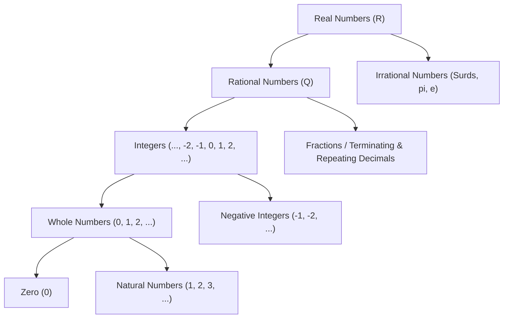

# Unit - 1
:::info[TITLE]
## Number System, LCM & HCF, Simplification and Approximation
:::

## 1. Numbers

### 1.1 Types of Numbers

#### 1.1.1 Natural Numbers, Whole Numbers, and Integers
- **Natural Numbers (Counting Numbers, $\mathbb{N}$):** Numbers used for counting starting from $1$.
  $$\mathbb{N} = \{1, 2, 3, 4, 5, \dots\}$$
- **Whole Numbers ($\mathbb{W}$):** Natural numbers including zero.
  $$\mathbb{W} = \{0, 1, 2, 3, 4, \dots\}$$
- **Integers ($\mathbb{Z}$):** Complete set of whole numbers along with negative counting numbers.
  $$\mathbb{Z} = \{\dots, -3, -2, -1, 0, 1, 2, 3, \dots\}$$

#### 1.1.2 Rational and Irrational Numbers
- **Rational Numbers ($\mathbb{Q}$):** Any number that can be expressed in the form $\frac{a}{b}$, where $a, b \in \mathbb{Z}$ and $b \neq 0$.
  - Includes all integers, terminating decimals (e.g., $0.25 = \frac{1}{4}$), and non-terminating repeating/recurring decimals (e.g., $0.333\dots = \frac{1}{3}$).
  - *Examples:* $\frac{11}{21}, \frac{4}{2}, 0, -\frac{8}{11}$.
- **Irrational Numbers:** Numbers that cannot be expressed as $\frac{a}{b}$ where $a, b$ are integers and $b \neq 0$.
  - Their decimal expansions are **non-terminating and non-repeating**.
  - *Examples:* $\sqrt{2}, \sqrt{3}, \sqrt{5}, \pi, e$.
  - **Important distinction for $\pi$:** $\pi \approx 3.14159265\dots$ is irrational. The common fraction $\frac{22}{7} \approx 3.142857\dots$ is purely an approximate rational substitute and not the exact value.

#### 1.1.3 Real Numbers and Surds
- **Real Numbers ($\mathbb{R}$):** The union of rational and irrational numbers ($\mathbb{R} = \mathbb{Q} \cup \text{Irrational}$). Every point on the number line represents a unique real number.
- **Surds:** An irrational root of a rational number. If $a$ is a rational number and $n \in \mathbb{Z}^+$ such that $\sqrt[n]{a}$ is irrational, then $\sqrt[n]{a}$ is a surd.
  - *Examples:* $\sqrt{3}, \sqrt[6]{10}, 4\sqrt{3}$.
  - Numbers like $\sqrt{9} = 3$ or $\sqrt{81} = 9$ are **not surds** because they simplify to rational integers.
  - *Note:* Every surd is an irrational number, but not every irrational number is a surd (e.g., $\pi$ and $e$ are transcendental irrational numbers, not surds).

### 1.2 Arithmetic Rules for Even and Odd Numbers

#### 1.2.1 Addition and Subtraction Rules
- **Addition:**
  - $\text{Even} \pm \text{Even} = \text{Even}$
  - $\text{Even} \pm \text{Odd} = \text{Odd}$
  - $\text{Odd} \pm \text{Odd} = \text{Even}$
  - Sum of any number of even numbers is **always even**.
  - Sum of an **even count** of odd numbers is **always even** ($3 + 5 = 8$).
  - Sum of an **odd count** of odd numbers is **always odd** ($3 + 5 + 7 = 15$).

#### 1.2.2 Multiplication Rules
- $\text{Even} \times \text{Even} = \text{Even}$
- $\text{Even} \times \text{Odd} = \text{Even}$
- $\text{Odd} \times \text{Odd} = \text{Odd}$
- If at least **one even factor** exists in a product of integers, the entire product is **always even**.

### 1.3 Divisibility Rules

#### 1.3.1 Definition of Divisibility
A whole number $N$ is divisible by another non-zero integer $d$ if the division leaves a remainder of zero:
$$N = q \cdot d + 0 \implies \frac{N}{d} \in \mathbb{Z}$$

#### 1.3.2 Divisibility Rules from 1 to 20, 25, and 50

| Divisor | Test Condition | Example |
| :--- | :--- | :--- |
| **2** | Last digit is even ($0, 2, 4, 6, 8$). | $3,489,076 \to 6$ is even $\implies$ Divisible |
| **3** | Sum of digits is divisible by $3$. | $387 \to 3+8+7 = 18$ ($18 \div 3 = 6$) $\implies$ Divisible |
| **4** | Number formed by last two digits is divisible by $4$, or tens even and ones $0,4,8$, or tens odd and ones $2,6$. | $358,912 \to 12 \div 4 = 3 \implies$ Divisible |
| **5** | Last digit is $0$ or $5$. | $3,783,953,495 \to$ Ends in $5 \implies$ Divisible |
| **6** | Number is divisible by both $2$ and $3$. | $57,342 \to$ Even, and $5+7+3+4+2=21$ ($21\div 3=7$) $\implies$ Divisible |
| **7** | Double the last digit and subtract it from remaining truncated number; result is divisible by $7$ (repeat if needed). | $357 \to 35 - (2 \times 7) = 21$ ($21 \div 7 = 3$) $\implies$ Divisible |
| **8** | Number formed by last three digits is divisible by $8$. | $986,104 \to 104 \div 8 = 13 \implies$ Divisible |
| **9** | Sum of all digits is divisible by $9$. | $24,343,785 \to \sum = 36$ ($36 \div 9 = 4$) $\implies$ Divisible |
| **10** | Last digit is $0$. | $34,789,013,467,593,487,540 \to$ Ends in $0 \implies$ Divisible |
| **11** | Difference between sum of digits at odd places and sum of digits at even places is $0$ or a multiple of $11$. | $918,082 \to (9+8+8) - (1+0+2) = 25 - 3 = 22$ ($22 \div 11 = 2$) $\implies$ Divisible |
| **12** | Divisible by both co-prime factors $3$ and $4$. | $324 \to \sum=9$ (div by 3) and $24 \div 4 = 6 \implies$ Divisible |
| **13** | Add $4$ times the last digit to the rest of the truncated number iteratively; result divisible by $13$. | $637 \to 63 + (4 \times 7) = 91 \to 9 + (4 \times 1) = 13 \implies$ Divisible |
| **14** | Divisible by both $2$ and $7$. | Must be even and satisfy rule for 7 |
| **15** | Divisible by both co-prime factors $3$ and $5$. | Ends in $0$ or $5$, sum of digits divisible by $3$ |
| **16** | If thousands digit is even, last 3 digits divisible by 16. If thousands digit is odd, add 8 to last 3 digits and check divisibility by 16. | $254,176 \to$ Thousands is 4 (even), $176 \div 16 = 11 \implies$ Divisible |
| **17** | Subtract $5$ times the last digit from the remaining truncated number; result divisible by $17$. | $221 \to 22 - (5 \times 1) = 17 \implies$ Divisible |
| **18** | Divisible by both $2$ and $9$ (even number whose sum of digits is divisible by 9). | Must be even and sum of digits divisible by 9 |
| **19** | Add twice the last digit to the remaining truncated number; result divisible by $19$. | $437 \to 43 + (2 \times 7) = 57 \to 5 + (2 \times 7) = 19 \implies$ Divisible |
| **20** | Divisible by $10$ (ends in $0$) and tens digit is even. | $360 \to$ Ends in $0$, tens digit is $6$ (even) $\implies$ Divisible |
| **25** | Last two digits are $00, 25, 50,$ or $75$. | $1,275 \implies$ Divisible |
| **50** | Last two digits are $00$ or $50$. | $4,350 \implies$ Divisible |

### 1.4 Factors of a Number

#### 1.4.1 Definition and Properties
- A factor (or divisor) of an integer $N$ is an integer $d$ such that $\frac{N}{d}$ leaves no remainder.
- **Properties:**
  - The smallest factor of any positive integer is $1$.
  - The greatest factor of any positive integer is the number itself ($N$).
  - If $N$ is divisible by $m$, then $N$ is divisible by every factor of $m$.
    - *Example:* If $108$ is divisible by $36$, it is automatically divisible by all factors of $36$: $\{1, 2, 3, 4, 6, 9, 12, 18, 36\}$.

#### 1.4.2 Systematic Factor Finding Method
Write factor pairs from outside inward until the factors meet in the middle:
- *Example for $72$:*
  1. $1 \times 72 = 72 \implies [1, \dots, 72]$
  2. $72 \div 2 = 36 \implies [1, 2, \dots, 36, 72]$
  3. $72 \div 3 = 24 \implies [1, 2, 3, \dots, 24, 36, 72]$
  4. $72 \div 4 = 18 \implies [1, 2, 3, 4, \dots, 18, 24, 36, 72]$
  5. Check $5$: Not divisible.
  6. $72 \div 6 = 12 \implies [1, 2, 3, 4, 6, \dots, 12, 18, 24, 36, 72]$
  7. Check $7$: Not divisible.
  8. $72 \div 8 = 9 \implies [1, 2, 3, 4, 6, 8, 9, 12, 18, 24, 36, 72]$.
  - Factors of $72$: $\{1, 2, 3, 4, 6, 8, 9, 12, 18, 24, 36, 72\}$.

### 1.5 Prime and Composite Numbers

#### 1.5.1 Prime Numbers
- A **prime number** is a positive integer greater than $1$ that has exactly two distinct positive divisors: $1$ and itself.
  - Primes: $2, 3, 5, 7, 11, 13, 17, 19, 23, 29, 31, \dots$
  - $2$ is the **only even prime number** and the smallest prime number.

#### 1.5.2 Composite Numbers and Special Rules
- A **composite number** has more than two factors (can be divided by at least one integer other than $1$ and itself).
  - Composites: $4, 6, 8, 9, 10, 12, 14, 15, \dots$
- **Special Status of 0 and 1:**
  - $0$ is neither prime nor composite ($0 \div k = 0$ for all $k \neq 0$).
  - $1$ is **neither prime nor composite** (it has only one factor, namely 1).
  - Every whole number $n > 1$ is either prime or composite.

### 1.6 Prime Factorization

#### 1.6.1 Fundamental Theorem of Arithmetic
Every integer greater than $1$ can be uniquely represented as a product of prime powers:
$$N = p_1^{a_1} \cdot p_2^{a_2} \cdots p_k^{a_k}$$
- *Example 1:* $280 = 2 \times 2 \times 2 \times 5 \times 7 = 2^3 \times 5^1 \times 7^1$. Prime factors are $\{2, 5, 7\}$.
- *Example 2:* $72 = 2^3 \times 3^2$. Prime factors are $\{2, 3\}$.

### 1.7 Multiples
- Multiples of a whole number are formed by multiplying the number by $1, 2, 3, 4, \dots$
- If $x$ divides $y$ with remainder $0$, then $x$ is a **factor** of $y$, and $y$ is a **multiple** of $x$.

### 1.8 Comparing Fractions

#### 1.8.1 Fractions with Same Denominators
- Compare numerators directly: the larger the numerator, the larger the fraction.
  $$\frac{8}{7} > \frac{3}{7} > \frac{2}{7}$$

#### 1.8.2 Fractions with Same Numerators
- Compare denominators inversely: the larger the denominator, the smaller the fraction.
  $$\frac{3}{5} > \frac{3}{8} \quad \text{since } 5 < 8$$

#### 1.8.3 Fractions with Different Numerators and Denominators
- **LCM Method:** Find $\text{LCM}$ of denominators, convert each fraction to an equivalent fraction with this common denominator, and compare numerators.
  - *Example:* Compare $\frac{3}{5}$ and $\frac{4}{7}$.
    $$\text{LCM}(5, 7) = 35 \implies \frac{3 \times 7}{35} = \frac{21}{35}, \quad \frac{4 \times 5}{35} = \frac{20}{35}$$
    Since $21 > 20$, $\frac{3}{5} > \frac{4}{7}$.
- **Cross-Multiplication Shortcut:** For $\frac{a}{b}$ vs $\frac{c}{d}$, compare $a \cdot d$ with $b \cdot c$.
  $$3 \times 7 = 21 > 5 \times 4 = 20 \implies \frac{3}{5} > \frac{4}{7}$$

### 1.9 Co-prime (Relatively Prime) Numbers

#### 1.9.1 Definition
Two integers $a$ and $b$ are **co-prime** if their Highest Common Factor (HCF) is $1$:
$$\text{HCF}(a, b) = 1$$
- Co-prime numbers do not need to be individual prime numbers.
  - *Example:* $14$ and $15$ are both composite, but $\text{HCF}(14, 15) = 1$, so they are co-prime.

#### 1.9.2 Pairwise Co-prime and Divisibility Properties
- A set of numbers is **pairwise co-prime** if every distinct pair in the set has an $\text{HCF}$ of $1$.
  - *Example:* $\{10, 7, 33, 13\}$ are pairwise co-prime.
  - Set $\{10, 7, 33, 14\}$ is **not** pairwise co-prime because $\text{HCF}(10, 14) = 2 \neq 1$.
- **Divisibility Rule for Co-primes:**
  - If a number is divisible by two co-prime numbers $a$ and $b$, it is divisible by their product $a \cdot b$.
  - *Application:* To check if $14325$ is divisible by $15$, check divisibility by $3$ and $5$ (co-prime, $3 \times 5 = 15$).
    - Ends in $5 \implies$ divisible by $5$.
    - Sum of digits $= 1+4+3+2+5 = 15$ (divisible by $3$).
    - Hence, $14325$ is divisible by $15$.

## 2. LCM and HCF

### 2.1 Core Definitions

#### 2.1.1 Least Common Multiple (LCM)
The smallest non-zero positive integer that is a multiple of two or more given numbers.
- Multiples of $3$: $3, 6, 9, 12, 15, 18, 21, 24, \dots$
- Multiples of $4$: $4, 8, 12, 16, 20, 24, \dots$
- Common Multiples: $12, 24, 36, \dots \implies \text{LCM}(3, 4) = 12$.

#### 2.1.2 Highest Common Factor (HCF / GCD)
The greatest positive integer that divides each of the two or more given numbers without leaving a remainder.
- Factors of $24$: $\{1, 2, 3, 4, 6, 8, 12, 24\}$
- Factors of $36$: $\{1, 2, 3, 4, 6, 9, 12, 18, 36\}$
- Common Factors: $\{1, 2, 3, 4, 6, 12\} \implies \text{HCF}(24, 36) = 12$.

### 2.2 Important Formulas and Tricks

#### 2.2.1 Product Rule and Fundamental Relationships
1. **Product of two numbers:**
   $$\text{Product of Two Numbers} = \text{HCF} \times \text{LCM}$$
   $$a \times b = \text{HCF}(a, b) \times \text{LCM}(a, b)$$
2. **Divisibility Relation:** The $\text{HCF}$ of a set of numbers **always completely divides** their $\text{LCM}$.
3. **Bézout's Identity:** If $d = \text{HCF}(a, b)$, there exist integers $m$ and $n$ such that:
   $$d = a \cdot m + b \cdot n$$
4. **Euclid's Lemma:** If $p$ is prime and $p \mid (a \cdot b)$, then $p \mid a$ or $p \mid b$.

#### 2.2.2 HCF and LCM of Fractions
$$\text{HCF of Fractions} = \frac{\text{HCF of Numerators}}{\text{LCM of Denominators}}$$
$$\text{LCM of Fractions} = \frac{\text{LCM of Numerators}}{\text{HCF of Denominators}}$$

#### 2.2.3 HCF and LCM of Decimals
To find the HCF/LCM of decimals (e.g., $1.08, 0.36, 0.9$):
1. Equalize the number of decimal places: $1.08, 0.36, 0.90$.
2. Treat them as integers: $108, 36, 90$.
3. Compute $\text{HCF}(108, 36, 90) = 18$.
4. Restore the decimal places: $\text{HCF} = 0.18$.

### 2.3 Remainder Theorems with LCM and HCF

:::tip[EXAM FORMULA SHEET: REMAINDERS]
- **Largest number dividing $x, y, z$ leaving the same remainder $r$:**
  $$\text{Required Number} = \text{HCF}(|x - y|, |y - z|, |z - x|)$$
- **Largest number dividing $x, y, z$ leaving remainders $a, b, c$ respectively:**
  $$\text{Required Number} = \text{HCF}(x - a, y - b, z - c)$$
- **Least number which when divided by $x, y, z$ leaves remainder $R$ in each case:**
  $$\text{Required Number} = \text{LCM}(x, y, z) + R$$
- **Least number which when divided by $x, y, z$ leaves remainders $a, b, c$ such that $(x - a) = (y - b) = (z - c) = k$:**
  $$\text{Required Number} = \text{LCM}(x, y, z) - k$$
:::

### 2.4 Solved Application Examples

#### Example 2.4.1: Constant Difference Remainder
*Problem:* Find the least number which when divided by $35, 45, 55$ leaves remainders $18, 28, 38$ respectively.
- Divisor - Remainder:
  $$35 - 18 = 17, \quad 45 - 28 = 17, \quad 55 - 38 = 17 \implies k = 17$$
- $\text{LCM}(35, 45, 55) = 5 \times 7 \times 9 \times 11 = 3465$.
- $\text{Required Number} = \text{LCM} - k = 3465 - 17 = 3448$.

#### Example 2.4.2: Remainder with Divisibility Constraint
*Problem:* Find the least number which when divided by $5, 6, 7, 8$ leaves remainder $3$, but when divided by $9$ leaves no remainder.
- $\text{LCM}(5, 6, 7, 8) = 840$.
- Form of required number: $N = 840k + 3$.
- Express $840k + 3$ in terms of multiples of $9$:
  $$840k + 3 = (93 \times 9k) + 3k + 3 = 9(93k) + (3k + 3)$$
- For $N$ to be divisible by $9$, $(3k + 3)$ must be divisible by $9$.
  - For $k = 1$: $3(1) + 3 = 6$ (not div by 9).
  - For $k = 2$: $3(2) + 3 = 9$ (divisible by 9).
- Thus, $k = 2 \implies N = 840(2) + 3 = 1683$.

#### Example 2.4.3: Four-Digit Divisibility
*Problem:* Find the greatest four-digit number divisible by each of $12, 18, 21, 28$.
- $\text{LCM}(12, 18, 21, 28) = 252$.
- Greatest 4-digit number $= 9999$.
- $9999 \div 252 = 39$ with a remainder of $171$.
- $\text{Required Number} = 9999 - 171 = 9828$.

#### Example 2.4.4: Simultaneous Tolling of Bells
*Problem:* Six bells commence tolling together and toll at intervals of $2, 4, 6, 8, 10, 12$ seconds respectively. In $30$ minutes, how many times do they toll together?
- Interval between simultaneous tolls $= \text{LCM}(2, 4, 6, 8, 10, 12) = 120\text{ seconds} = 2\text{ minutes}$.
- In $30$ minutes, number of intervals $= \frac{30}{2} = 15$.
- Total tolling count including the initial start toll $= 15 + 1 = 16\text{ times}$.

## 3. Simplification and Approximation

### 3.1 BODMAS Rule

#### 3.1.1 Order of Precedence
Expressions with multiple operators must be evaluated strictly in this sequence:
1. **B** - Brackets (Vinculum/Bar $\to$ Parentheses `()` $\to$ Curly braces `{}` $\to$ Square brackets `[]`)
2. **O** - Order / Of (Powers, square roots, fractions of numbers)
3. **D** - Division (Left-to-right)
4. **M** - Multiplication (Left-to-right)
5. **A** - Addition
6. **S** - Subtraction

### 3.2 Modulus of a Real Number
The absolute value or modulus of $a \in \mathbb{R}$ is defined piecewise:
$$|a| = \begin{cases} a, & \text{if } a \ge 0 \\ -a, & \text{if } a < 0 \end{cases}$$
- *Examples:* $|5| = 5$, $|-5| = -(-5) = 5$.

### 3.3 Speed Multiplication Techniques

#### 3.3.1 Vedic Crosswise Multiplication for Two-Digit Numbers ($AB \times CD$)
1. **Step 1:** Multiply rightmost unit digits ($B \times D$). Write unit digit, carry over tens.
2. **Step 2:** Cross-multiply and sum with carry: $(A \times D) + (B \times C) + \text{carry}$. Write unit digit, carry over tens.
3. **Step 3:** Multiply leftmost tens digits ($A \times C$) and add remaining carry.

*Example:* $24 \times 43$:
- Step 1: $4 \times 3 = 12 \implies 2$, carry $1$.
- Step 2: $(2 \times 3) + (4 \times 4) + 1 = 6 + 16 + 1 = 23 \implies 3$, carry $2$.
- Step 3: $(2 \times 4) + 2 = 8 + 2 = 10$.
- Result: $1032$.

#### 3.3.2 Vedic Crosswise Multiplication for Three-Digit Numbers ($ABC \times DEF$)
1. Unit column: $C \times F$
2. Cross 2 right columns: $(B \times F) + (C \times E)$
3. Cross 3 columns: $(A \times F) + (C \times D) + (B \times E)$
4. Cross 2 left columns: $(A \times E) + (B \times D)$
5. Leftmost column: $A \times D$

### 3.4 Key Algebraic Identities for Fast Simplification
- $(a + b)^2 + (a - b)^2 = 2(a^2 + b^2)$
- $(a + b)^2 - (a - b)^2 = 4ab$
- $a^3 + b^3 = (a + b)(a^2 - ab + b^2) \implies \frac{a^2 - ab + b^2}{a^3 + b^3} = \frac{1}{a + b}$
- $a^3 - b^3 = (a - b)(a^2 + ab + b^2) \implies \frac{a^2 + ab + b^2}{a^3 - b^3} = \frac{1}{a - b}$

## 4. Solved Problems and Exam Practice

### Problem 1: Prime Checking
*Question:* Which one of the following is not a prime number? $\{31, 61, 71, 91\}$
- **Solution:** $91 = 7 \times 13$. Since $91$ has divisors other than $1$ and $91$, it is composite.
- **Answer:** $91$.

### Problem 2: Sum of Primes
*Question:* Find the sum of the first five prime numbers.
- **Solution:** First five primes are $2, 3, 5, 7, 11$.
  $$\text{Sum} = 2 + 3 + 5 + 7 + 11 = 28$$
- **Answer:** $28$.

### Problem 3: Smallest 3-Digit Prime
*Question:* Find the smallest three-digit prime number.
- **Solution:** Smallest 3-digit number is $100$ (even, composite). Check $101$:
  - $\sqrt{101} < 11$. Test primes $< 11$: $2, 3, 5, 7$.
  - $101$ is not divisible by $2, 3, 5,$ or $7$.
  - Hence, $101$ is prime.
- **Answer:** $101$.

### Problem 4: Divisibility by 11
*Question:* Check which number is divisible by 11: $415624$.
- **Solution:**
  - Sum of digits at odd places (from right): $4 + 6 + 1 = 11$.
  - Sum of digits at even places (from right): $2 + 5 + 4 = 11$.
  - Difference $= 11 - 11 = 0 \implies$ Divisible by $11$.
- **Answer:** Divisible.

### Problem 5: Missing Digit for Divisibility by 3
*Question:* If $517*324$ is divisible by $3$, find the smallest whole number in place of $*$.
- **Solution:**
  $$\text{Sum of known digits} = 5 + 1 + 7 + 3 + 2 + 4 = 22$$
  Total sum $= 22 + x$. The smallest single digit $x \ge 0$ making $(22 + x)$ a multiple of $3$ is $x = 2$ ($22 + 2 = 24$).
- **Answer:** $2$.

### Problem 6: Consecutive Odd Integer Divisibility
*Question:* The difference of the squares of two consecutive odd integers is always divisible by which integer?
- **Solution:** Let the consecutive odd integers be $(2n + 1)$ and $(2n + 3)$.
  $$(2n + 3)^2 - (2n + 1)^2 = [(2n + 3) + (2n + 1)][(2n + 3) - (2n + 1)] = (4n + 4) \times 2 = 8(n + 1)$$
  $8(n + 1)$ is always divisible by $8$.
- **Answer:** $8$.

### Problem 7: Algebraic Simplification
*Question:* Evaluate $\frac{753 \times 753 + 247 \times 247 - 753 \times 247}{753 \times 753 \times 753 + 247 \times 247 \times 247}$.
- **Solution:** Let $a = 753, b = 247$.
  $$\text{Expression} = \frac{a^2 - ab + b^2}{a^3 + b^3} = \frac{a^2 - ab + b^2}{(a + b)(a^2 - ab + b^2)} = \frac{1}{a + b} = \frac{1}{753 + 247} = \frac{1}{1000}$$
- **Answer:** $\frac{1}{1000}$.

### Problem 8: Difference of Squares of Sum and Difference
*Question:* Evaluate $\frac{(489 + 375)^2 - (489 - 375)^2}{489 \times 375}$.
- **Solution:** Let $a = 489, b = 375$.
  $$\text{Expression} = \frac{(a + b)^2 - (a - b)^2}{ab} = \frac{4ab}{ab} = 4$$
- **Answer:** $4$.
