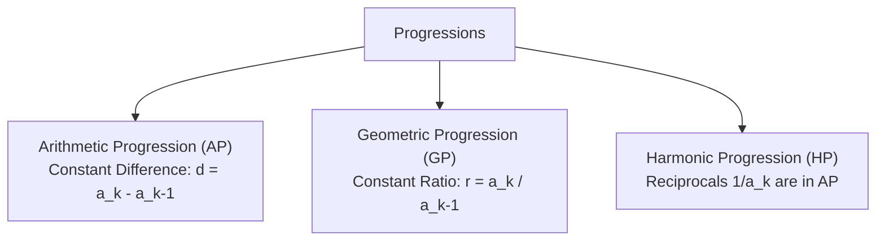

# Unit - 2
:::info[TITLE]
## Averages and Progressions
:::

## 1. Average

### 1.1 Fundamental Concept of Average

#### 1.1.1 Definition and Formula
The average (or arithmetic mean) of a set of observations is defined as the total sum of all values divided by the total number of values:
$$\text{Average} = \frac{\text{Sum of Quantities}}{\text{Number of Quantities}} = \frac{\sum_{i=1}^n x_i}{n}$$
$$\text{Sum of Quantities} = \text{Average} \times \text{Number of Quantities}$$

#### 1.1.2 Weighted Average and Combined Groups
- **Combined Average of Two Groups:**
  If a group of $n_1$ items has an average of $x$, and a second group of $n_2$ items has an average of $y$, the combined average is:
  $$\bar{X}_{\text{comb}} = \frac{n_1 x + n_2 y}{n_1 + n_2}$$
- **Average of Remaining Group:**
  If the average of $n_1$ total items is $x$, and a subset of $n_2$ items has an average of $y$, the average of the remaining $(n_1 - n_2)$ items is:
  $$\bar{X}_{\text{rem}} = \frac{n_1 x - n_2 y}{n_1 - n_2}$$

### 1.2 Mathematical Properties of Averages

#### 1.2.1 Linear Transformations of Data Sets
Let $\bar{x}$ be the average of $x_1, x_2, \dots, x_n$:
1. **Addition:** If each observation is increased by a constant $a$, the new average is:
   $$\bar{x}_{\text{new}} = \bar{x} + a$$
2. **Subtraction:** If each observation is decreased by a constant $a$, the new average is:
   $$\bar{x}_{\text{new}} = \bar{x} - a$$
3. **Multiplication:** If each observation is multiplied by a non-zero constant $a$, the new average is:
   $$\bar{x}_{\text{new}} = a \cdot \bar{x}$$
4. **Division:** If each observation is divided by a non-zero constant $a$, the new average is:
   $$\bar{x}_{\text{new}} = \frac{\bar{x}}{a}$$

### 1.3 Key Problem Patterns in Averages

#### 1.3.1 Replacement and Deviation Method
When a person/item is replaced by a new person/item:
$$\text{Value of New Person} = \text{Value of Replaced Person} \pm (\text{Total Persons} \times \text{Change in Average})$$
- *Positive sign* if the average increases; *negative sign* if the average decreases.

#### 1.3.2 Correction of Misread / Wrong Data
$$\text{Correct Sum} = \text{Incorrect Sum} - \text{Wrong Value} + \text{Correct Value}$$
$$\text{Correct Average} = \frac{\text{Correct Sum}}{\text{Total Number of Observations}}$$

#### 1.3.3 Consecutive Numbers Average
- The average of an odd count of consecutive terms (integers, odd, or even numbers in AP) is **always the exact middle term**.
- Difference between the largest and smallest of $n$ consecutive odd/even numbers is always:
  $$\text{Difference} = 2(n - 1)$$

## 2. Progressions

### 2.1 Sequences and Series Overview
- **Sequence:** An ordered list of numbers following a specific mathematical rule: $a_1, a_2, a_3, \dots, a_n$.
- **Series:** The algebraic sum of the terms of a sequence:
  $$S = a_1 + a_2 + a_3 + \dots + a_n$$
  - A series is **finite** if it terminates after $n$ terms, and **infinite** if it continues indefinitely.

### 2.2 Arithmetic Progression (A.P.)

#### 2.2.1 Definitions and Standard Form
A sequence is an Arithmetic Progression if the difference between any two successive terms is constant:
$$a_{n+1} - a_n = d \quad (\text{common difference}), \quad \forall n \in \mathbb{N}$$
- Standard AP form: $a, a + d, a + 2d, a + 3d, \dots$
- **$n^{\text{th}}$ Term ($a_n$ or Last Term $l$):**
  $$a_n = l = a + (n - 1)d$$
  Where $a$ is the first term, $d$ is the common difference, and $n$ is the number of terms.

#### 2.2.2 Convenient Assumptions of Terms
- Three terms in AP: $a - d, \; a, \; a + d$ (Sum $= 3a$)
- Four terms in AP: $a - 3d, \; a - d, \; a + d, \; a + 3d$ (Common difference $= 2d$, Sum $= 4a$)
- Five terms in AP: $a - 2d, \; a - d, \; a, \; a + d, \; a + 2d$ (Sum $= 5a$)

#### 2.2.3 Sum of $n$ Terms of an A.P. ($S_n$)
$$S_n = \frac{n}{2} [2a + (n - 1)d] = \frac{n}{2} [a + l]$$

#### 2.2.4 Arithmetic Mean (A.M.)
- If three numbers $a, b, c$ are in AP:
  $$b = \frac{a + c}{2}$$
  Here, $b$ is the Arithmetic Mean between $a$ and $c$.

### 2.3 Geometric Progression (G.P.)

#### 2.3.1 Definitions and Standard Form
A sequence of non-zero numbers is a Geometric Progression if the ratio of any term to its preceding term is constant:
$$\frac{a_{n+1}}{a_n} = r \quad (\text{common ratio}), \quad \forall n \in \mathbb{N}$$
- Standard GP form: $a, ar, ar^2, ar^3, \dots$
- **$n^{\text{th}}$ Term ($a_n$):**
  $$a_n = a \cdot r^{n-1}$$

#### 2.3.2 Symmetric Term Selection
- Three terms in GP: $\frac{a}{r}, \; a, \; ar$ (Product $= a^3$)
- Four terms in GP: $\frac{a}{r^3}, \; \frac{a}{r}, \; ar, \; ar^3$ (Common ratio $= r^2$, Product $= a^4$)

#### 2.3.3 Sum of $n$ Terms of a G.P. ($S_n$)
$$S_n = \begin{cases} \dfrac{a(1 - r^n)}{1 - r} = \dfrac{a(r^n - 1)}{r - 1}, & \text{if } r \neq 1 \\ n \cdot a, & \text{if } r = 1 \end{cases}$$

#### 2.3.4 Sum of an Infinite G.P. ($S_\infty$)
When the common ratio satisfies $|r| < 1$ (i.e., $-1 < r < 1$):
$$S_\infty = \frac{a}{1 - r}$$

#### 2.3.5 Geometric Mean (G.M.)
- Three non-zero numbers $a, b, c$ are in GP if and only if:
  $$b^2 = ac \implies b = \sqrt{ac}$$
  Where $b$ is the Geometric Mean of $a$ and $c$.

### 2.4 Harmonic Progression (H.P.)

#### 2.4.1 Definition
A sequence $a_1, a_2, a_3, \dots, a_n$ is in Harmonic Progression if their reciprocals form an Arithmetic Progression:
$$\frac{1}{a_1}, \frac{1}{a_2}, \frac{1}{a_3}, \dots, \frac{1}{a_n} \text{ are in A.P.}$$
- **$n^{\text{th}}$ Term of an H.P.:**
  $$a_n = \frac{1}{n^{\text{th}}\text{ term of corresponding AP}} = \frac{1}{\frac{1}{a_1} + (n - 1)d_{\text{AP}}}$$
- **Important Constraint:** No term of an HP can be equal to zero (division by zero is undefined).

#### 2.4.2 Harmonic Mean (H.M.)
If $a, b, c$ are in HP:
$$b = \frac{2ac}{a + c}$$
- Relation between AM, GM, and HM for positive distinct real numbers:
  $$\text{AM} \ge \text{GM} \ge \text{HM} \quad \text{and} \quad \text{GM}^2 = \text{AM} \times \text{HM}$$

### 2.5 Summation Formulas for Special Sequences

:::tip[STANDARD POWER SUM FORMULAS]
1. **Sum of first $n$ natural numbers:**
   $$\sum_{k=1}^n k = 1 + 2 + 3 + \dots + n = \frac{n(n + 1)}{2}$$
2. **Sum of squares of first $n$ natural numbers:**
   $$\sum_{k=1}^n k^2 = 1^2 + 2^2 + 3^2 + \dots + n^2 = \frac{n(n + 1)(2n + 1)}{6}$$
3. **Sum of cubes of first $n$ natural numbers:**
   $$\sum_{k=1}^n k^3 = 1^3 + 2^3 + 3^3 + \dots + n^3 = \left[\frac{n(n + 1)}{2}\right]^2 = \left(\sum_{k=1}^n k\right)^2$$
:::

## 3. Solved Problems and Exam Practice

### Problem 1: Combined Group Average
*Question:* The average weight of $24$ students of section A is $58\text{ kg}$, whereas the average weight of $26$ students of section B is $60.5\text{ kg}$. Find the average weight of all $50$ students.
- **Solution:**
  $$n_1 = 24, \quad x = 58, \quad n_2 = 26, \quad y = 60.5$$
  $$\bar{X}_{\text{comb}} = \frac{n_1 x + n_2 y}{n_1 + n_2} = \frac{(24 \times 58) + (26 \times 60.5)}{24 + 26} = \frac{1392 + 1573}{50} = \frac{2965}{50} = 59.3\text{ kg}$$
- **Answer:** $59.3\text{ kg}$.

### Problem 2: Remaining Group Average
*Question:* The average salary of all $50$ employees including $5$ officers is ₹$850$. If the average salary of the officers is ₹$2500$, find the average salary of the remaining staff.
- **Solution:**
  $$n_{\text{total}} = 50, \quad \bar{x}_{\text{total}} = 850, \quad n_{\text{officers}} = 5, \quad \bar{y}_{\text{officers}} = 2500$$
  $$\bar{X}_{\text{staff}} = \frac{(50 \times 850) - (5 \times 2500)}{50 - 5} = \frac{42500 - 12500}{45} = \frac{30000}{45} = ₹666.67$$
- **Answer:** ₹$666.67$ (or ₹$667$).

### Problem 3: Target Average Calculation
*Question:* A grocer has sales of ₹$6435$, ₹$6927$, ₹$6855$, ₹$7230$, and ₹$6562$ for $5$ consecutive months. How much sale must he have in the 6th month to achieve an average sale of ₹$6500$?
- **Solution:**
  $$\text{Total required sale for 6 months} = 6500 \times 6 = 39000$$
  $$\text{Total sale for first 5 months} = 6435 + 6927 + 6855 + 7230 + 6562 = 34009$$
  $$\text{6th month sale} = 39000 - 34009 = ₹4991$$
- **Answer:** ₹$4991$.

### Problem 4: Cricket Average Inning Increment
*Question:* The average runs of a cricket player over $10$ innings was $32$. How many runs must he score in his next inning to increase his average by $4$?
- **Solution:**
  $$\text{Initial total runs} = 32 \times 10 = 320$$
  $$\text{New average} = 32 + 4 = 36, \quad \text{New number of innings} = 11$$
  $$\text{New total runs} = 36 \times 11 = 396$$
  $$\text{Runs in 11th inning} = 396 - 320 = 76$$
- **Answer:** $76\text{ runs}$.

### Problem 5: Misread Entry Correction
*Question:* A student's marks were wrongly entered as $83$ instead of $63$. Due to that, the average marks for the class increased by $\frac{1}{2}$. Find the number of students in the class.
- **Solution:**
  $$\text{Excess marks added} = 83 - 63 = 20$$
  $$\text{Total increase in marks} = n \times \frac{1}{2} = 20 \implies n = 40$$
- **Answer:** $40\text{ students}$.

### Problem 6: Replacement of a Person
*Question:* The average weight of $8$ persons increases by $2.5\text{ kg}$ when a new person comes in place of someone weighing $65\text{ kg}$. Find the weight of the new person.
- **Solution:**
  $$\text{Total weight increase} = 8 \times 2.5 = 20\text{ kg}$$
  $$\text{Weight of new person} = 65 + 20 = 85\text{ kg}$$
- **Answer:** $85\text{ kg}$.

### Problem 7: Consecutive Odd Numbers
*Question:* The average of $5$ consecutive odd numbers is $61$. What is the difference between the highest and lowest numbers?
- **Solution:**
  For any $n$ consecutive odd numbers, the difference between the highest and lowest is always $2(n - 1)$.
  $$\text{Difference} = 2(5 - 1) = 8$$
  *(Direct verification: The numbers centered at $61$ are $57, 59, 61, 63, 65$. Difference $= 65 - 57 = 8$.)*
- **Answer:** $8$.

### Problem 8: Finding Term in AP
*Question:* Which term of the AP $5, 13, 21, \dots$ is $181$?
- **Solution:**
  $$a = 5, \quad d = 13 - 5 = 8$$
  $$a_n = a + (n - 1)d \implies 181 = 5 + (n - 1)8$$
  $$176 = 8(n - 1) \implies n - 1 = 22 \implies n = 23$$
- **Answer:** $23^{\text{rd}}\text{ term}$.

### Problem 9: Condition for Three Terms in AP
*Question:* Determine $k$ such that $\frac{2}{3}, k,$ and $\frac{5k}{8}$ are three consecutive terms of an AP.
- **Solution:**
  By arithmetic mean property:
  $$2k = \frac{2}{3} + \frac{5k}{8}$$
  $$2k - \frac{5k}{8} = \frac{2}{3} \implies \frac{11k}{8} = \frac{2}{3} \implies k = \frac{16}{33}$$
- **Answer:** $\frac{16}{33}$.

### Problem 10: Infinite GP Sum
*Question:* Find the sum of the infinite series $\frac{1}{2} + \frac{1}{4} + \frac{1}{8} + \frac{1}{16} + \dots$
- **Solution:**
  $$a = \frac{1}{2}, \quad r = \frac{1/4}{1/2} = \frac{1}{2}$$
  Since $|r| = \frac{1}{2} < 1$:
  $$S_\infty = \frac{a}{1 - r} = \frac{1/2}{1 - 1/2} = 1$$
- **Answer:** $1$.
