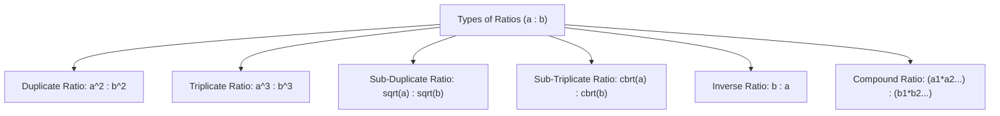

# Unit - 3
:::info[TITLE]
## Ratio & Proportion, Problems on Ages and Percentage
:::

## 1. Ratio and Proportion

### 1.1 Fundamentals of Ratio

#### 1.1.1 Definition and Basic Properties
A **ratio** is a comparison between two quantities of the same kind and in the same units by magnitude:
$$\text{Ratio of } a \text{ to } b = \frac{a}{b} = a : b \quad (b \neq 0)$$
- **Antecedent:** The first term $a$.
- **Consequent:** The second term $b$.
- **Invariance:** A ratio remains unchanged if both antecedent and consequent are multiplied or divided by the same non-zero quantity:
  $$\frac{a}{b} = \frac{a \cdot k}{b \cdot k} = \frac{a / k}{b / k} \quad (k \neq 0)$$

#### 1.1.2 Types of Ratios

| Ratio Type | Definition / Algebraic Expression | Example (for $3:4$) |
| :--- | :--- | :--- |
| **Duplicate Ratio** | Ratio of squares: $a^2 : b^2$ | $3^2 : 4^2 = 9 : 16$ |
| **Triplicate Ratio** | Ratio of cubes: $a^3 : b^3$ | $3^3 : 4^3 = 27 : 64$ |
| **Sub-Duplicate Ratio** | Ratio of square roots: $\sqrt{a} : \sqrt{b}$ | Sub-duplicate of $9:16$ is $\sqrt{9}:\sqrt{16} = 3:4$ |
| **Sub-Triplicate Ratio** | Ratio of cube roots: $\sqrt[3]{a} : \sqrt[3]{b}$ | Sub-triplicate of $8:27$ is $\sqrt[3]{8}:\sqrt[3]{27} = 2:3$ |
| **Inverse / Reciprocal Ratio** | Interchanged antecedent and consequent: $\frac{1}{a} : \frac{1}{b} = b : a$ | Inverse of $3:4$ is $4:3$ |
| **Compound Ratio** | Product of antecedents to product of consequents: $(a \cdot c \cdot e) : (b \cdot d \cdot f)$ | Compound of $3:4, 4:5, 5:7$ is $\frac{3 \times 4 \times 5}{4 \times 5 \times 7} = \frac{3}{7}$ |

### 1.2 Fundamentals of Proportion

#### 1.2.1 Definition
An equality of two ratios constitutes a **proportion**:
$$a : b = c : d \iff a : b :: c : d \iff \frac{a}{b} = \frac{c}{d}$$
- **Extreme terms:** $a$ and $d$.
- **Mean terms:** $b$ and $c$.
- **Fundamental Law of Proportion:**
  $$\text{Product of Extremes} = \text{Product of Means} \implies a \cdot d = b \cdot c$$

#### 1.2.2 Proportional Terms
- **Fourth Proportional:** If $a : b = c : d$, then $d$ is the fourth proportional:
  $$d = \frac{b \cdot c}{a}$$
- **Third Proportional:** If $a : b = b : c$, then $c$ is called the third proportional to $a$ and $b$:
  $$b^2 = a \cdot c \implies c = \frac{b^2}{a}$$
- **Mean Proportional (Second Proportional):** If $a : x = x : b$, then $x$ is the mean proportional between $a$ and $b$:
  $$x^2 = a \cdot b \implies x = \sqrt{a \cdot b}$$

#### 1.2.3 Combining Ratios (Compound Linkage)
1. **Three variables ($a : b$ and $b : c$):**
   If $a : b = n_1 : d_1$ and $b : c = n_2 : d_2$:
   $$a : b : c = (n_1 \times n_2) : (d_1 \times n_2) : (d_1 \times d_2)$$
   - *Example:* If $A:B = 3:4$ and $B:C = 8:9$:
     $$A:B:C = (3 \times 8) : (4 \times 8) : (4 \times 9) = 24 : 32 : 36 = 6 : 8 : 9$$
2. **Four variables ($a : b$, $b : c$, and $c : d$):**
   If $a:b = n_1:d_1, \; b:c = n_2:d_2, \; c:d = n_3:d_3$:
   $$a : b : c : d = (n_1 n_2 n_3) : (d_1 n_2 n_3) : (d_1 d_2 n_3) : (d_1 d_2 d_3)$$
   - Ratio $a : d$:
     $$\frac{a}{d} = \frac{a}{b} \times \frac{b}{c} \times \frac{c}{d} = \frac{n_1 n_2 n_3}{d_1 d_2 d_3}$$

#### 1.2.4 Shift Shortcuts (Adding or Subtracting a Constant)
If two numbers are in the ratio $a : b$, and adding/subtracting $x$ changes the ratio to $c : d$:
- The two original numbers are:
  $$\text{First Number} = \frac{a \cdot x(c \sim d)}{|ad - bc|}, \quad \text{Second Number} = \frac{b \cdot x(c \sim d)}{|ad - bc|}$$

## 2. Problems on Ages

### 2.1 Standard Mathematical Framework
Let the present age of a person be $x$ years:
1. Age $n$ years hence (later / in the future):
   $$\text{Future Age} = x + n$$
2. Age $n$ years ago (past):
   $$\text{Past Age} = x - n$$
3. If ages are in the ratio $a : b$, express them as $a x$ and $b x$.
4. $\frac{1}{n}\text{ of the age}$ is represented as $\frac{x}{n}$.

:::tip[AGE GAP INVARIANCE]
The age difference between two individuals remains strictly **constant throughout their lifetimes**. If person A is $5$ years older than person B today, person A will still be exactly $5$ years older $50$ years from now.
:::

## 3. Percentage

### 3.1 Core Concepts of Percentage

#### 3.1.1 Definitions and Conversions
Percentage means "per hundred" (parts out of $100$):
$$x\% = \frac{x}{100}$$
- **To convert a fraction $\frac{a}{b}$ to a percentage:**
  $$\text{Percentage} = \left(\frac{a}{b} \times 100\right)\%$$
  $$\frac{1}{4} = \left(\frac{1}{4} \times 100\right)\% = 25\%, \quad \frac{1}{5} = 20\%$$

### 3.2 Percentage Increase, Decrease, and Expenditure Rules

#### 3.2.1 Consumption and Expenditure Invariance
If the price of an essential commodity changes by $R\%$:
- **Price Increases by $R\%$:** To keep the total expenditure constant, consumption must be reduced by:
  $$\text{Reduction in Consumption} = \left[\frac{R}{100 + R} \times 100\right]\%$$
- **Price Decreases by $R\%$:** To keep the total expenditure constant, consumption can be increased by:
  $$\text{Increase in Consumption} = \left[\frac{R}{100 - R} \times 100\right]\%$$

#### 3.2.2 Asymmetric Comparison Shortcut
- If $A$ is $R\%$ more than $B$, then $B$ is less than $A$ by:
  $$\left[\frac{R}{100 + R} \times 100\right]\%$$
- If $A$ is $R\%$ less than $B$, then $B$ is more than $A$ by:
  $$\left[\frac{R}{100 - R} \times 100\right]\%$$

### 3.3 Population and Depreciation Formulas

#### 3.3.1 Population Growth (Compound Compounding)
Let the initial population be $P$, increasing at an annual rate of $R\%$:
1. **Population after $n$ years:**
   $$P_n = P \left(1 + \frac{R}{100}\right)^n$$
2. **Population $n$ years ago:**
   $$P_{\text{past}} = \frac{P}{\left(1 + \dfrac{R}{100}\right)^n}$$

#### 3.3.2 Machine Depreciation (Compound Decay)
Let the present purchase value of equipment be $P$, depreciating at an annual rate of $R\%$:
1. **Value after $n$ years:**
   $$V_n = P \left(1 - \frac{R}{100}\right)^n$$
2. **Value $n$ years ago:**
   $$V_{\text{past}} = \frac{P}{\left(1 - \dfrac{R}{100}\right)^n}$$

### 3.4 Successive Percentage Change
If a quantity is first increased/decreased by $x\%$ and then changed by $y\%$, the net effective change is:
$$\text{Net Change} = \left(x + y + \frac{x \cdot y}{100}\right)\%$$
*(Use negative values for percentage decreases).*

## 4. Solved Problems and Exam Practice

### Problem 1: Chain of Inherited Sum
*Question:* A sum of ₹$53$ is divided among Rohit, Mohit, and Shobhit such that Rohit gets ₹$7$ more than Mohit, and Mohit gets ₹$8$ more than Shobhit. Find the ratio of their shares.
- **Solution:**
  Let Shobhit's share be ₹$x$.
  - Mohit's share $= x + 8$
  - Rohit's share $= (x + 8) + 7 = x + 15$
  $$\text{Total Sum} = (x + 15) + (x + 8) + x = 53 \implies 3x + 23 = 53 \implies 3x = 30 \implies x = 10$$
  - Shobhit $= 10$, Mohit $= 18$, Rohit $= 25$.
  - Ratio (Rohit : Mohit : Shobhit) $= 25 : 18 : 10$.
- **Answer:** $25 : 18 : 10$.

### Problem 2: Mean and Third Proportional
*Question:* Find two numbers whose mean proportional is $6$ and third proportional is $20.25$.
- **Solution:**
  Let the two numbers be $x$ and $y$.
  $$\sqrt{xy} = 6 \implies xy = 36 \implies y = \frac{36}{x}$$
  $$\text{Third Proportional } = \frac{y^2}{x} = 20.25 \implies \frac{(36/x)^2}{x} = 20.25 \implies \frac{1296}{x^3} = \frac{81}{4}$$
  $$x^3 = \frac{1296 \times 4}{81} = 16 \times 4 = 64 \implies x = 4$$
  $$y = \frac{36}{4} = 9$$
- **Answer:** $4$ and $9$.

### Problem 3: Coin Denominations in Bag
*Question:* A bag contains $50\text{p}$, $25\text{p}$, and $10\text{p}$ coins in the ratio $5 : 9 : 4$, amounting to ₹$206$. Find the number of coins of each type.
- **Solution:**
  Let the number of coins be $5x, 9x, 4x$.
  $$\text{Total Value in ₹} = (5x \times 0.50) + (9x \times 0.25) + (4x \times 0.10) = 206$$
  $$2.5x + 2.25x + 0.40x = 206 \implies 5.15x = 206 \implies x = \frac{206}{5.15} = 40$$
  - $50\text{p coins} = 5 \times 40 = 200$
  - $25\text{p coins} = 9 \times 40 = 360$
  - $10\text{p coins} = 4 \times 40 = 160$
- **Answer:** $200, 360, 160$.

### Problem 4: Age Multiplier Condition
*Question:* A father is aged three times more than his son Ronit ($4$ times Ronit's age). After $8$ years, he would be $2\frac{1}{2}$ times Ronit's age. After further $8$ years, how many times will he be of Ronit's age?
- **Solution:**
  Let Ronit's present age be $x$ years. Father's present age $= x + 3x = 4x$ years.
  - After $8$ years:
    $$(4x + 8) = \frac{5}{2}(x + 8) \implies 8x + 16 = 5x + 40 \implies 3x = 24 \implies x = 8$$
  - Father's present age $= 4(8) = 32$ years, Ronit $= 8$ years.
  - After further $8$ years ($16$ years total from present):
    $$\text{Father's Age} = 32 + 16 = 48, \quad \text{Ronit's Age} = 8 + 16 = 24$$
    $$\text{Ratio} = \frac{48}{24} = 2\text{ times}$$
- **Answer:** $2\text{ times}$.

### Problem 5: Examination Pass Threshold
*Question:* A student has to obtain $33\%$ of total marks to pass. He gets $125$ marks and fails by $40$ marks. Find the maximum marks.
- **Solution:**
  $$\text{Minimum Passing Marks} = 125 + 40 = 165$$
  $$33\% \text{ of Maximum Marks} = 165 \implies \frac{33}{100} \times M = 165 \implies M = \frac{165 \times 100}{33} = 500$$
- **Answer:** $500$.

### Problem 6: Successive Price Changes
*Question:* If the price of a book is first decreased by $25\%$ and then increased by $20\%$, find the net percentage change.
- **Solution:**
  Using successive percentage formula with $x = -25$ and $y = +20$:
  $$\text{Net Change} = -25 + 20 + \frac{(-25)(20)}{100} = -5 - 5 = -10\%$$
  The negative sign indicates a net decrease of $10\%$.
- **Answer:** $10\%\text{ decrease}$.

### Problem 7: Depreciation of Equipment
*Question:* A machine depreciates at $10\%$ per annum. Its current value is ₹$8748$. What was its purchase price $3$ years ago?
- **Solution:**
  $$V_{\text{present}} = P \left(1 - \frac{R}{100}\right)^3 \implies 8748 = P \left(1 - \frac{10}{100}\right)^3 = P \left(\frac{9}{10}\right)^3 = P \times \frac{729}{1000}$$
  $$P = \frac{8748 \times 1000}{729} = 12 \times 1000 = ₹12,000$$
- **Answer:** ₹$12,000$.
