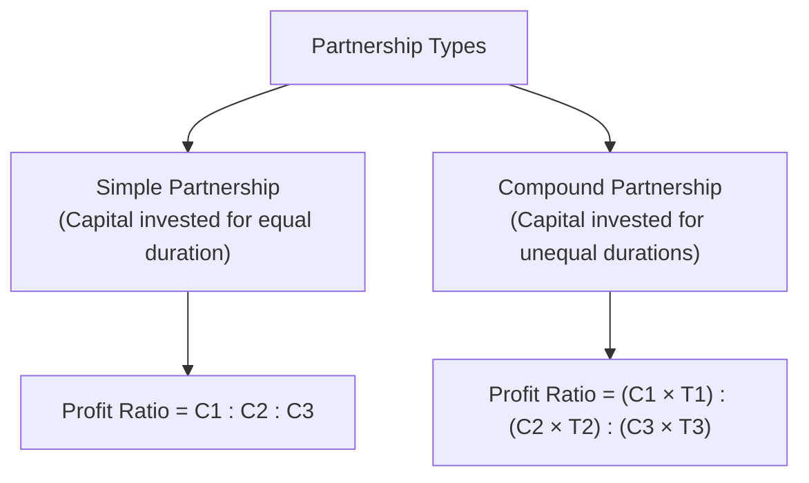
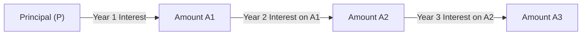

# Unit - 4

:::info[TITLE]
## Profit & Loss, Partnerships, S.I & C.I
:::

## 1. Profit and Loss

Commercial transactions revolve around buying and selling goods and services. The fundamental objective in trade is generating profit.

### 1.1 Core Terminologies

- **Cost Price ($\text{CP}$):** The total price paid to acquire an article, including additional overhead costs (freight, transportation, repairs, labor).
- **Selling Price ($\text{SP}$):** The price at which an article is sold to a customer.
- **Marked Price / List Price ($\text{MP}$):** The price labeled or printed on the product before discounts.
- **Profit / Gain ($P$):** When $\text{SP} > \text{CP}$, the seller makes a profit:
  $$P = \text{SP} - \text{CP}$$
- **Loss ($L$):** When $\text{CP} > \text{SP}$, the seller incurs a loss:
  $$L = \text{CP} - \text{SP}$$
- **Profit Percentage ($\text{Gain}\%$):** Always calculated with respect to Cost Price:
  $$\text{Gain}\% = \left(\frac{P}{\text{CP}}\right) \times 100 = \left(\frac{\text{SP} - \text{CP}}{\text{CP}}\right) \times 100$$
- **Loss Percentage ($\text{Loss}\%$):** Always calculated with respect to Cost Price:
  $$\text{Loss}\% = \left(\frac{L}{\text{CP}}\right) \times 100 = \left(\frac{\text{CP} - \text{SP}}{\text{CP}}\right) \times 100$$

### 1.2 Fundamental Relationships

Expressing $\text{SP}$ in terms of $\text{CP}$:
$$\text{SP} = \text{CP} \times \left(\frac{100 + \text{Gain}\%}{100}\right) \quad \text{or} \quad \text{SP} = \text{CP} \times \left(\frac{100 - \text{Loss}\%}{100}\right)$$

Expressing $\text{CP}$ in terms of $\text{SP}$:
$$\text{CP} = \text{SP} \times \left(\frac{100}{100 + \text{Gain}\%}\right) \quad \text{or} \quad \text{CP} = \text{SP} \times \left(\frac{100}{100 - \text{Loss}\%}\right)$$

### 1.3 Discount and Marked Price

Discount is the reduction given on the Marked Price:
$$\text{Discount} = \text{MP} - \text{SP}$$
$$\text{Discount}\% = \left(\frac{\text{Discount}}{\text{MP}}\right) \times 100$$
$$\text{SP} = \text{MP} \times \left(1 - \frac{D\%}{100}\right)$$

#### Successive Discounts
If successive discounts of $d_1\%, d_2\%, \dots, d_n\%$ are given:
$$\text{SP} = \text{MP} \times \left(1 - \frac{d_1}{100}\right) \times \left(1 - \frac{d_2}{100}\right) \times \dots \times \left(1 - \frac{d_n}{100}\right)$$

For two successive discounts of $a\%$ and $b\%$, the single equivalent discount is:
$$\text{Equivalent Discount}\% = \left(a + b - \frac{a \times b}{100}\right)\%$$

### 1.4 Exam Shortcuts and Special Cases

#### Case 1: CP of $m$ Articles equals SP of $n$ Articles
$$\text{Gain or Loss}\% = \left(\frac{m - n}{n}\right) \times 100$$
- If $m > n$, it is a **Gain**.
- If $m < n$, it is a **Loss**.

#### Case 2: Cross-Multiplication Method for Unit Transactions
If a person buys $x$ items for ₹$y$ and sells $z$ items for ₹$w$:
$$\text{Profit or Loss}\% = \left(\frac{x \cdot w - z \cdot y}{z \cdot y}\right) \times 100$$
- A positive result indicates profit, while a negative result indicates loss.

#### Case 3: Same Selling Price with Equal Gain% and Loss%
When two different articles are sold at the same selling price ($\text{SP}_1 = \text{SP}_2$), one at a gain of $x\%$ and the other at a loss of $x\%$:
- There is **always an overall loss**.
$$\text{Overall Loss}\% = \left(\frac{x}{10}\right)^2 \% = \frac{x^2}{100}\%$$

#### Case 4: Dishonest Dealer / False Weights
When a trader professes to sell at cost price but uses a false weight / false scale:
$$\text{Gain}\% = \left(\frac{\text{Error}}{\text{True Value} - \text{Error}}\right) \times 100 = \left(\frac{\text{True Weight} - \text{False Weight}}{\text{False Weight}}\right) \times 100$$

#### Case 5: Consecutive Selling Prices for Unknown CP
If an article sold at price $\text{SP}_1$ yields a gain/loss of $r_1\%$ and at $\text{SP}_2$ yields a gain/loss of $r_2\%$:
$$\frac{\text{SP}_1}{100 \pm r_1} = \frac{\text{SP}_2}{100 \pm r_2} = \frac{\text{CP}}{100}$$

#### Case 6: Chain of Sales ($A \to B \to C$)
If $A$ sells to $B$ at a profit of $x\%$, and $B$ sells to $C$ at a profit of $y\%$:
$$\text{Cost for } C = \text{Cost for } A \times \left(1 + \frac{x}{100}\right) \times \left(1 + \frac{y}{100}\right)$$

## 2. Partnership

A partnership is an association of two or more persons who combine capital, labor, or skill to carry on a business and agree to share profits and losses proportionally.

### 2.1 Types of Partners
- **Working Partner:** A partner who actively manages business operations. Such a partner often receives an agreed salary or percentage allowance from the gross profit before residual profits are split.
- **Sleeping / Dormant Partner:** A partner who only contributes financial capital without taking part in daily operations.

### 2.2 Ratio of Division of Gains

#### Simple Partnership (Equal Time)
When partners invest capital $C_1, C_2, C_3, \dots, C_n$ for the exact same duration:
$$\text{Ratio of Profits} = C_1 : C_2 : C_3 : \dots : C_n$$

#### Compound Partnership (Unequal Time)
When partners invest capital $C_1, C_2, \dots$ for different time periods $T_1, T_2, \dots$:
$$\text{Ratio of Profits} = (C_1 \times T_1) : (C_2 \times T_2) : (C_3 \times T_3) : \dots$$

Individual share of total profit $P_{\text{total}}$:
$$\text{Share of Partner } A = P_{\text{total}} \times \frac{C_A T_A}{C_A T_A + C_B T_B + \dots}$$

### 2.3 Variable Capital Adjustments
When partners inject or withdraw capital over the investment cycle:
$$\text{Equivalent Monthly Capital} = \sum (\text{Capital}_i \times \text{Duration}_i)$$
$$\text{Profit Ratio} = \left(\sum C_{A,i} T_{A,i}\right) : \left(\sum C_{B,i} T_{B,i}\right)$$

## 3. Simple Interest (S.I) and Compound Interest (C.I)

### 3.1 Simple Interest (S.I)

In Simple Interest, interest is computed uniformly on the initial principal alone throughout the loan tenure.

#### Formula
$$\text{S.I} = \frac{P \times R \times T}{100}$$
- $P$ = Principal amount (borrowed or invested sum)
- $R$ = Rate of interest per annum ($\%$)
- $T$ = Time period (in years)

Total Amount ($A$):
$$A = P + \text{S.I} = P \times \left(1 + \frac{R \times T}{100}\right)$$

#### Key Shortcuts for S.I
- **Sum doubles in $T$ years:**
  $$\text{S.I} = P \implies \frac{P \cdot R \cdot T}{100} = P \implies R = \frac{100}{T}\% \quad \text{and} \quad T = \frac{100}{R} \text{ years}$$
- **Sum becomes $n$ times in $T$ years:**
  $$\text{S.I} = (n - 1)P \implies R = \frac{(n - 1) \times 100}{T}\%$$
- **If a sum becomes $n_1$ times in $T_1$ years, it becomes $n_2$ times in $T_2$ years:**
  $$\frac{T_1}{T_2} = \frac{n_1 - 1}{n_2 - 1}$$

### 3.2 Compound Interest (C.I)

In Compound Interest, the interest earned at the end of each conversion period is added to the principal to form the new principal for the subsequent period ("interest on interest").

#### Standard Annual Compounding Formula
$$A = P \times \left(1 + \frac{R}{100}\right)^T$$
$$\text{C.I} = A - P = P \times \left[\left(1 + \frac{R}{100}\right)^T - 1\right]$$

#### Compounding Frequencies
- **Half-Yearly (Semi-Annually):** Interest is compounded every 6 months (2 times a year).
  $$\text{Rate} = \frac{R}{2}\%, \quad \text{Time} = 2T \implies A = P \times \left(1 + \frac{R}{200}\right)^{2T}$$
- **Quarterly:** Interest is compounded every 3 months (4 times a year).
  $$\text{Rate} = \frac{R}{4}\%, \quad \text{Time} = 4T \implies A = P \times \left(1 + \frac{R}{400}\right)^{4T}$$
- **Fractional Time (e.g., $T = a \frac{b}{c}$ years):**
  $$A = P \times \left(1 + \frac{R}{100}\right)^a \times \left(1 + \frac{\frac{b}{c} \times R}{100}\right)$$
- **Varying Annual Rates ($R_1\%, R_2\%, R_3\%$ for years 1, 2, and 3):**
  $$A = P \times \left(1 + \frac{R_1}{100}\right)\left(1 + \frac{R_2}{100}\right)\left(1 + \frac{R_3}{100}\right)$$

### 3.3 Difference Between C.I and S.I

For a given principal $P$ and annual rate $R\%$:

#### For 2 Years:
$$D_2 = \text{C.I}_2 - \text{S.I}_2 = P \times \left(\frac{R}{100}\right)^2$$

#### For 3 Years:
$$D_3 = \text{C.I}_3 - \text{S.I}_3 = P \times \left(\frac{R}{100}\right)^2 \times \left(\frac{300 + R}{100}\right)$$

$$\frac{D_3}{D_2} = \frac{300 + R}{100} = 3 + \frac{R}{100}$$

### 3.4 Summary Comparison

| Feature | Simple Interest (S.I) | Compound Interest (C.I) |
| :--- | :--- | :--- |
| **Principal Basis** | Constant initial principal throughout | Principal changes at every compounding cycle |
| **Annual Growth** | Linear ($A$ is a linear function of $T$) | Exponential ($A$ is an exponential function of $T$) |
| **Year 1 Value** | Equal to C.I for annual compounding | Equal to S.I for annual compounding |
| **Subsequent Years** | Interest remains constant each year | Interest increases progressively each year |

## 4. Solved Problems and Exam Practice

### Problem 1 (Profit Calculation)
Mr. Sharma buys a cooler for ₹4,500. For how much should he sell it to gain 8%?

**Solution:**
$$\text{CP} = 4500, \quad \text{Gain}\% = 8\%$$
$$\text{SP} = \text{CP} \times \left(\frac{100 + 8}{100}\right) = 4500 \times 1.08 = 4860$$
He should sell the cooler for ₹4,860.

### Problem 2 (Selling Price to Cost Price Conversion)
A man sold a radio for ₹1,980 at a gain of 10%. What was the cost price?

**Solution:**
$$\text{CP} = \text{SP} \times \frac{100}{100 + \text{Gain}\%} = 1980 \times \frac{100}{110} = 1980 \times \frac{10}{11} = 1800$$
The cost price is ₹1,800.

### Problem 3 (Cross-Multiplication Unit Transaction)
A fruit vendor buys lemons at the rate of 6 for ₹10 and sells them at 4 for ₹8. Find his profit or loss percentage.

**Solution:**
Using the cross-multiplication formula:
- Bought: $x = 6$ items for $y = 10$
- Sold: $z = 4$ items for $w = 8$
$$\text{Gain}\% = \left(\frac{x \cdot w - z \cdot y}{z \cdot y}\right) \times 100 = \left(\frac{6 \times 8 - 4 \times 10}{4 \times 10}\right) \times 100 = \left(\frac{48 - 40}{40}\right) \times 100 = \frac{8}{40} \times 100 = 20\%$$
The vendor gains 20%.

### Problem 4 (Dishonest Dealer Weight Error)
A dishonest dealer sells goods at cost price but uses a weight of 900 grams instead of a 1 kg weight. What is his percentage profit?

**Solution:**
$$\text{Error} = 1000\text{ g} - 900\text{ g} = 100\text{ g}$$
$$\text{Gain}\% = \left(\frac{\text{Error}}{\text{True Weight} - \text{Error}}\right) \times 100 = \left(\frac{100}{900}\right) \times 100 = \frac{100}{9}\% = 11\frac{1}{9}\%$$

### Problem 5 (Equal SP with Common Gain/Loss)
A shopkeeper sells two television sets at ₹9,900 each. On one he gains 10%, and on the other he loses 10%. Find his overall profit or loss percentage.

**Solution:**
When SPs are identical with equal gain and loss percentage $x = 10$:
$$\text{Overall Loss}\% = \left(\frac{x}{10}\right)^2\% = \left(\frac{10}{10}\right)^2\% = 1\%$$
To find the absolute loss in ₹:
$$\text{Total SP} = 9900 + 9900 = 19800$$
$$\text{Total CP} = \frac{9900}{1.10} + \frac{9900}{0.90} = 9000 + 11000 = 20000$$
$$\text{Total Loss} = 20000 - 19800 = ₹200$$

### Problem 6 (Partnership with Charity Deduction)
$A$ and $B$ invest in a business in the ratio $3:2$. If 5% of the total profit is donated to charity and $A$'s share is ₹855, find the total profit.

**Solution:**
Let the total profit be ₹100.
- Remaining profit after 5% charity = ₹95.
- Ratio of investment = $3 : 2 \implies$ Total parts = 5.
- $A$'s share $= 95 \times \frac{3}{5} = 19 \times 3 = 57$.
When $A$'s share is ₹57, total profit is ₹100.
When $A$'s share is ₹855:
$$\text{Total Profit} = \frac{100}{57} \times 855 = 100 \times 15 = ₹1,500$$

### Problem 7 (Partnership with Staggered Investment Durations)
Three partners $A, B, C$ share profits in the ratio $5 : 7 : 8$. They partnered for 14 months, 8 months, and 7 months respectively. What was the ratio of their investments?

**Solution:**
Let investments be $C_A, C_B, C_C$.
$$\text{Profit Ratio} = C_A \times 14 : C_B \times 8 : C_C \times 7 = 5 : 7 : 8$$
$$C_A \times 14 = 5k \implies C_A = \frac{5}{14}k$$
$$C_B \times 8 = 7k \implies C_B = \frac{7}{8}k$$
$$C_C \times 7 = 8k \implies C_C = \frac{8}{7}k$$
Find common multiple of denominators 14, 8, 7: $\text{LCM}(14, 8, 7) = 56$.
$$C_A : C_B : C_C = \left(\frac{5}{14} \times 56\right) : \left(\frac{7}{8} \times 56\right) : \left(\frac{8}{7} \times 56\right) = 20 : 49 : 64$$

### Problem 8 (Simple Interest Rate Determination)
A sum of money amounts to ₹815 in 3 years and to ₹854 in 4 years at simple interest. Find the sum and the rate of interest.

**Solution:**
$$\text{S.I for 1 year} = A_4 - A_3 = 854 - 815 = ₹39$$
$$\text{S.I for 3 years} = 39 \times 3 = ₹117$$
$$\text{Principal } P = A_3 - \text{S.I}_3 = 815 - 117 = ₹698$$
$$\text{Rate } R = \frac{\text{S.I} \times 100}{P \times T} = \frac{39 \times 100}{698 \times 1} \approx 5.587\%$$

### Problem 9 (Compound Interest Period)
The compound interest on ₹30,000 at 7% per annum is ₹4,347. What is the time period in years?

**Solution:**
$$A = P + \text{C.I} = 30000 + 4347 = 34347$$
Using $A = P\left(1 + \frac{R}{100}\right)^n$:
$$34347 = 30000 \times \left(1 + \frac{7}{100}\right)^n$$
$$\frac{34347}{30000} = \left(\frac{107}{100}\right)^n$$
Dividing numerator and denominator on LHS by 3:
$$\frac{11449}{10000} = \left(\frac{107}{100}\right)^n$$
Since $107^2 = 11449$ and $100^2 = 10000$:
$$\left(\frac{107}{100}\right)^2 = \left(\frac{107}{100}\right)^n \implies n = 2 \text{ years}$$

### Problem 10 (S.I Doubling Principle)
If a sum of money at simple interest doubles in 6 years, in how many years will it become 4 times its original value?

**Solution:**
Using the proportional doubling shortcut:
$$\frac{T_1}{T_2} = \frac{n_1 - 1}{n_2 - 1}$$
Given $n_1 = 2$, $T_1 = 6$, $n_2 = 4$:
$$\frac{6}{T_2} = \frac{2 - 1}{4 - 1} = \frac{1}{3} \implies T_2 = 6 \times 3 = 18 \text{ years}$$
