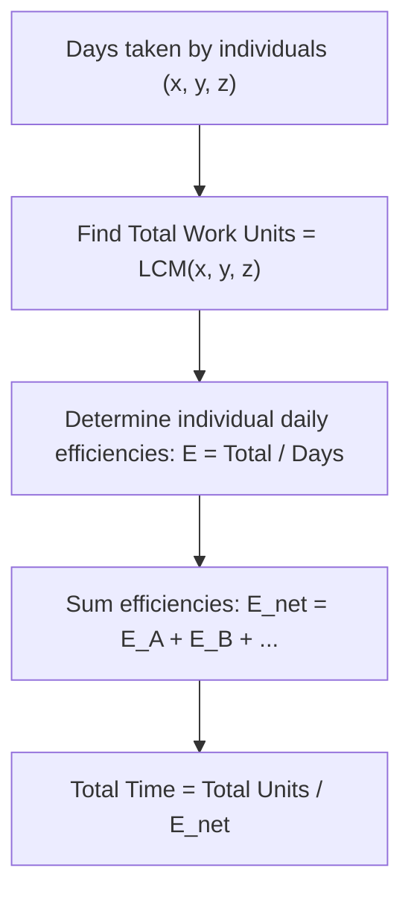
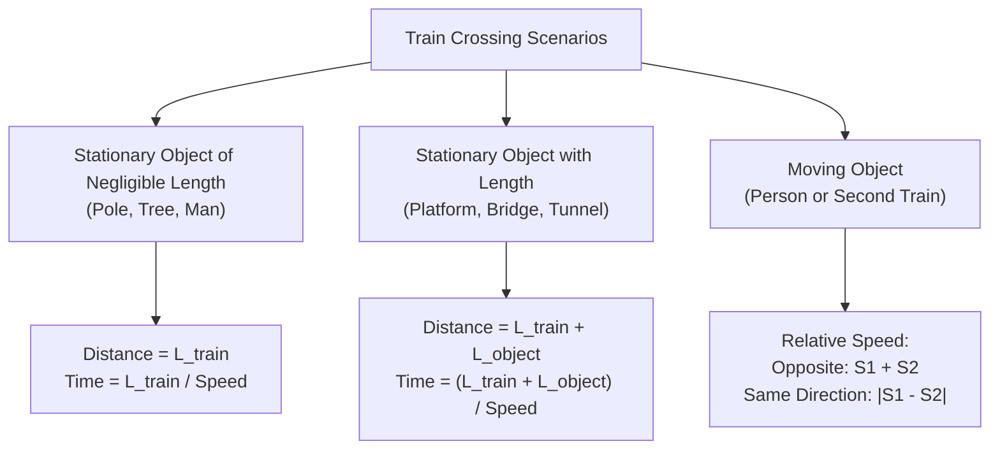

# Unit - 5

:::info[TITLE]
## Time & Work, Pipes & Cisterns, Time Speed & Distance, Train Crossings, Boats & Streams
:::

## 1. Time and Work

Time and work problems model the relationship between the workforce, work done, and time taken. Work and time are inversely proportional when efficiency and workforce are held constant.

### 1.1 Fundamental Principles

- **Work as a Whole:** Complete work is conventionally quantified as $1$ unit (or $100\%$).
- **Per Day's Work:** If a person completes an entire piece of work in $n$ days:
  $$\text{Work done in 1 day} = \frac{1}{n}$$
  Conversely, if 1 day's work is $\frac{1}{n}$, the total time to finish the work is $n$ days.
- **Combined Work (Two Entities):**
  If person $A$ finishes work in $x$ days and person $B$ in $y$ days:
  $$\text{Work done by } (A + B) \text{ in 1 day} = \frac{1}{x} + \frac{1}{y} = \frac{x + y}{xy}$$
  $$\text{Total time taken together} = \frac{xy}{x + y} \text{ days}$$
- **Combined Work (Three Entities):**
  If $A, B, C$ finish work in $x, y, z$ days respectively:
  $$\text{Work done by } (A + B + C) \text{ in 1 day} = \frac{1}{x} + \frac{1}{y} + \frac{1}{z} = \frac{xy + yz + zx}{xyz}$$
  $$\text{Total time taken together} = \frac{xyz}{xy + yz + zx} \text{ days}$$

### 1.2 The LCM (Total Units) Method

Rather than manipulating fractions, assume total work to be the $\text{LCM}$ of the individual days:
1. $\text{Total Work (in units)} = \text{LCM}(d_1, d_2, \dots, d_k)$.
2. Calculate individual daily efficiency:
   $$\text{Efficiency } E_i = \frac{\text{Total Work Units}}{d_i}$$
3. Total combined daily efficiency:
   $$E_{\text{net}} = \sum E_i$$
4. Total days required:
   $$\text{Days} = \frac{\text{Total Work Units}}{E_{\text{net}}}$$

### 1.3 Efficiency and Wages

- **Efficiency-Time Invariance:** Efficiency is inversely proportional to time taken:
  $$\frac{E_1}{E_2} = \frac{T_2}{T_1}$$
  If $A$ is $k$ times as efficient as $B$, then $A$ takes $\frac{1}{k}$ of the time taken by $B$.
- **Wages Distribution:** When individuals work for the same duration, wages are distributed strictly in the ratio of their efficiencies (or work completed):
  $$\text{Ratio of Wages} = E_1 : E_2 : \dots : E_n = \frac{1}{T_1} : \frac{1}{T_2} : \dots : \frac{1}{T_n}$$

### 1.4 The General Chain Rule ($M-D-H-W$)

If $M_1$ persons work $D_1$ days for $H_1$ hours per day with efficiency $E_1$ to complete $W_1$ amount of work, and $M_2$ persons work $D_2$ days for $H_2$ hours per day with efficiency $E_2$ to complete $W_2$ work:
$$\frac{M_1 \cdot D_1 \cdot H_1 \cdot E_1}{W_1} = \frac{M_2 \cdot D_2 \cdot H_2 \cdot E_2}{W_2}$$

## 2. Pipes and Cisterns

Pipes and cisterns problems are mathematically identical to time and work, with the addition of negative work done by drain or leak pipes.

### 2.1 Core Concepts
- **Inlet Pipe:** Fills the tank (performs **positive work**). If an inlet fills a tank in $x$ hours, part filled in 1 hour $= +\frac{1}{x}$.
- **Outlet / Leak Pipe:** Empties the tank (performs **negative work**). If an outlet empties a tank in $y$ hours, part emptied in 1 hour $= -\frac{1}{y}$.
- **Net Work Rate:** If an inlet fills the tank in $x$ hours and an outlet empties it in $y$ hours ($y > x$):
  $$\text{Net part filled in 1 hour} = \frac{1}{x} - \frac{1}{y} = \frac{y - x}{xy}$$
  $$\text{Time taken to fill the tank completely} = \frac{xy}{y - x} \text{ hours}$$
- If $x > y$, the net rate is negative and the tank is drained in:
  $$\text{Time to empty full tank} = \frac{xy}{x - y} \text{ hours}$$

## 3. Time, Speed and Distance (TSD)

### 3.1 Fundamental Equation and Conversions

$$\text{Distance } (D) = \text{Speed } (S) \times \text{Time } (T)$$
$$S = \frac{D}{T}, \quad T = \frac{D}{S}$$

#### Unit Conversion Factors
- **$\text{km/h}$ to $\text{m/s}$:**
  $$1 \text{ km/h} = \frac{1000 \text{ m}}{3600 \text{ s}} = \frac{5}{18} \text{ m/s}$$
  Multiply by $\frac{5}{18}$ to convert $\text{km/h} \to \text{m/s}$.
- **$\text{m/s}$ to $\text{km/h}$:**
  $$1 \text{ m/s} = \frac{18}{5} \text{ km/h}$$
  Multiply by $\frac{18}{5}$ to convert $\text{m/s} \to \text{km/h}$.

### 3.2 Proportionality Rules
- **Constant Distance ($D$ constant):** Speed is inversely proportional to time ($S \propto \frac{1}{T}$):
  $$\frac{S_1}{S_2} = \frac{T_2}{T_1}$$
- **Constant Time ($T$ constant):** Distance is directly proportional to speed ($D \propto S$):
  $$\frac{D_1}{D_2} = \frac{S_1}{S_2}$$
- **Constant Speed ($S$ constant):** Distance is directly proportional to time ($D \propto T$):
  $$\frac{D_1}{D_2} = \frac{T_1}{T_2}$$

### 3.3 Average Speed

$$\text{Average Speed} = \frac{\text{Total Distance Traveled}}{\text{Total Time Taken}}$$

- **Equal Distances:** If a body covers a distance at speed $x$ and returns the same distance at speed $y$:
  $$\text{Average Speed} = \frac{2xy}{x + y}$$
- **Three Equal Distances:** Traveled at speeds $x, y, z$:
  $$\text{Average Speed} = \frac{3xyz}{xy + yz + zx}$$
- **Equal Time Intervals:** If a body travels for equal durations at speeds $x$ and $y$:
  $$\text{Average Speed} = \frac{x + y}{2}$$

## 4. Problems on Train Crossings

When dealing with moving trains, the distance covered depends on whether the object has negligible width (pole, tree, standing person) or significant length (platform, bridge, tunnel, another train).

### 4.1 Summary of Train Crossing Formulas

| Scenario | Total Distance ($D$) | Relative Speed ($S_{\text{rel}}$) | Time Taken ($T$) |
| :--- | :--- | :--- | :--- |
| **Train passes a point object** (pole, tree, stationary man) | $L_{\text{train}}$ | $S_{\text{train}}$ | $\frac{L_{\text{train}}}{S_{\text{train}}}$ |
| **Train passes a stationary length object** (platform, tunnel, bridge) | $L_{\text{train}} + L_{\text{object}}$ | $S_{\text{train}}$ | $\frac{L_{\text{train}} + L_{\text{object}}}{S_{\text{train}}}$ |
| **Train passes a moving person** (same direction) | $L_{\text{train}}$ | $S_{\text{train}} - S_{\text{man}}$ | $\frac{L_{\text{train}}}{S_{\text{train}} - S_{\text{man}}}$ |
| **Train passes a moving person** (opposite direction) | $L_{\text{train}}$ | $S_{\text{train}} + S_{\text{man}}$ | $\frac{L_{\text{train}}}{S_{\text{train}} + S_{\text{man}}}$ |
| **Two trains crossing** (opposite directions) | $L_1 + L_2$ | $S_1 + S_2$ | $\frac{L_1 + L_2}{S_1 + S_2}$ |
| **Two trains crossing** (same direction, overtaking) | $L_1 + L_2$ | $\|S_1 - S_2\|$ | $\frac{L_1 + L_2}{\|S_1 - S_2\|}$ |

## 5. Boats and Streams

When water moves with a velocity of its own, it aids or opposes the motion of a boat or swimmer.

### 5.1 Basic Definitions
- Let $u$ = Speed of the boat in still water ($\text{km/h}$).
- Let $v$ = Speed of the water current / stream ($\text{km/h}$).

### 5.2 Downstream and Upstream Speeds
- **Downstream Speed ($D$):** Motion along the direction of water flow:
  $$D = u + v$$
- **Upstream Speed ($U$):** Motion opposing the direction of water flow:
  $$U = u - v \quad (u > v)$$

### 5.3 Calculating Boat and Stream Speeds
Given downstream speed $D$ and upstream speed $U$:
$$\text{Speed of Boat in Still Water } (u) = \frac{D + U}{2}$$
$$\text{Speed of Stream } (v) = \frac{D - U}{2}$$

### 5.4 Round Trip Shortcuts
- If a boat travels a distance $d$ downstream and returns the same distance $d$ upstream in total time $T$:
  $$T = \frac{d}{u + v} + \frac{d}{u - v} = \frac{2du}{u^2 - v^2}$$
  $$d = \frac{T(u^2 - v^2)}{2u}$$
- If the time taken upstream is $k$ times the time taken downstream for the same distance:
  $$\frac{u + v}{u - v} = k \implies u = v \left(\frac{k + 1}{k - 1}\right)$$

## 6. Solved Problems and Exam Practice

### Problem 1 (Time and Work - LCM Method)
$A$ can do a piece of work in 10 days, and $B$ can do it in 15 days. How many days will they take to complete the work together?

**Solution:**
1. Assume total work units $= \text{LCM}(10, 15) = 30$ units.
2. Efficiency of $A = \frac{30}{10} = 3$ units/day.
3. Efficiency of $B = \frac{30}{15} = 2$ units/day.
4. Combined efficiency $= 3 + 2 = 5$ units/day.
$$\text{Time taken} = \frac{30}{5} = 6 \text{ days}$$

### Problem 2 (Work with Leaving Worker)
$A$ can do a work in 14 days and $B$ in 21 days. They begin together, but 3 days before the completion of the work, $A$ leaves off. What is the total time taken to complete the work?

**Solution:**
Total work units $= \text{LCM}(14, 21) = 42$ units.
- Efficiency of $A = \frac{42}{14} = 3$ units/day.
- Efficiency of $B = \frac{42}{21} = 2$ units/day.

In the last 3 days, $B$ works alone:
$$\text{Work done by } B \text{ in last 3 days} = 3 \times 2 = 6 \text{ units}$$
$$\text{Remaining work completed by } (A + B) \text{ together} = 42 - 6 = 36 \text{ units}$$
$$\text{Days worked together} = \frac{36}{3 + 2} = \frac{36}{5} = 7.2 \text{ days}$$
$$\text{Total time} = 7.2 + 3 = 10.2 \text{ days} = 10\frac{1}{5} \text{ days}$$

### Problem 3 (Efficiency Comparison)
$A$ is twice as fast as $B$. If $B$ alone can complete a piece of work in 30 days, in what time can $A$ and $B$ together complete the work?

**Solution:**
- Since $A$ is twice as fast as $B$, $A$ takes half the time of $B$:
  $$\text{Time for } A = \frac{30}{2} = 15 \text{ days}$$
- Total work $= \text{LCM}(15, 30) = 30$ units.
- Efficiency of $A = 2$ units/day; efficiency of $B = 1$ unit/day.
- Combined efficiency $= 2 + 1 = 3$ units/day.
$$\text{Time taken together} = \frac{30}{3} = 10 \text{ days}$$

### Problem 4 (Pipes and Cisterns with Leak)
A pipe can fill a tank in 10 hours. Due to a leak in the bottom, it fills in 12 hours. If the tank is full, in how many hours will the leak empty it?

**Solution:**
$$\text{Rate of pipe } P = +\frac{1}{10}$$
$$\text{Net rate of pipe and leak } (P - L) = +\frac{1}{12}$$
$$\text{Rate of leak } L = \frac{1}{10} - \frac{1}{12} = \frac{6 - 5}{60} = \frac{1}{60}$$
The leak will empty the full tank in 60 hours.

### Problem 5 (Average Speed over Equal Distances)
A car covers a distance of 120 km at 40 km/h and returns the same distance at 60 km/h. Find the average speed of the car for the entire journey.

**Solution:**
Since the forward and return distances are equal:
$$\text{Average Speed} = \frac{2xy}{x + y} = \frac{2 \times 40 \times 60}{40 + 60} = \frac{4800}{100} = 48 \text{ km/h}$$

### Problem 6 (Train Crossing a Stationary Platform)
A train 150 meters long is traveling at a speed of 54 km/h. How much time will it take to pass a railway platform 250 meters in length?

**Solution:**
1. Convert speed to m/s:
   $$S = 54 \times \frac{5}{18} = 15 \text{ m/s}$$
2. Total distance to be cleared:
   $$D = L_{\text{train}} + L_{\text{platform}} = 150 + 250 = 400 \text{ m}$$
3. Time taken:
   $$T = \frac{D}{S} = \frac{400}{15} = \frac{80}{3} = 26.67 \text{ seconds}$$

### Problem 7 (Two Trains Crossing in Opposite Directions)
Two trains of length 140 m and 160 m run on parallel tracks in opposite directions with speeds of 60 km/h and 48 km/h respectively. In what time will they clear each other?

**Solution:**
1. Total distance:
   $$D = L_1 + L_2 = 140 + 160 = 300 \text{ m}$$
2. Relative speed (opposite directions):
   $$S_{\text{rel}} = 60 + 48 = 108 \text{ km/h}$$
3. Convert to m/s:
   $$S_{\text{rel}} = 108 \times \frac{5}{18} = 6 \times 5 = 30 \text{ m/s}$$
4. Time taken:
   $$T = \frac{300}{30} = 10 \text{ seconds}$$

### Problem 8 (Two Trains Crossing in the Same Direction)
Two trains 100 m and 120 m long are running in the same direction on parallel tracks. The faster train runs at 72 km/h and the slower train at 54 km/h. In what time will the faster train completely pass the slower one?

**Solution:**
1. Total distance:
   $$D = 100 + 120 = 220 \text{ m}$$
2. Relative speed:
   $$S_{\text{rel}} = 72 - 54 = 18 \text{ km/h} = 18 \times \frac{5}{18} = 5 \text{ m/s}$$
3. Time taken:
   $$T = \frac{220}{5} = 44 \text{ seconds}$$

### Problem 9 (Boats and Streams Speed Determination)
A man can row upstream at 16 km/h and downstream at 26 km/h. Find his rowing speed in still water and the rate of the water current.

**Solution:**
Given $D = 26 \text{ km/h}$ and $U = 16 \text{ km/h}$:
$$\text{Speed in still water } (u) = \frac{D + U}{2} = \frac{26 + 16}{2} = \frac{42}{2} = 21 \text{ km/h}$$
$$\text{Speed of current } (v) = \frac{D - U}{2} = \frac{26 - 16}{2} = \frac{10}{2} = 5 \text{ km/h}$$

### Problem 10 (Boats and Streams Time Multiple)
A man takes twice as long to row a distance upstream as to row the same distance downstream. If the stream flows at 3 km/h, find his speed in still water.

**Solution:**
Using the ratio shortcut:
$$\frac{U_{\text{time}}}{D_{\text{time}}} = 2 \implies \frac{u + v}{u - v} = 2$$
$$u + v = 2(u - v) \implies u + v = 2u - 2v \implies u = 3v$$
Given $v = 3 \text{ km/h}$:
$$u = 3 \times 3 = 9 \text{ km/h}$$
The speed of the boat in still water is 9 km/h.
