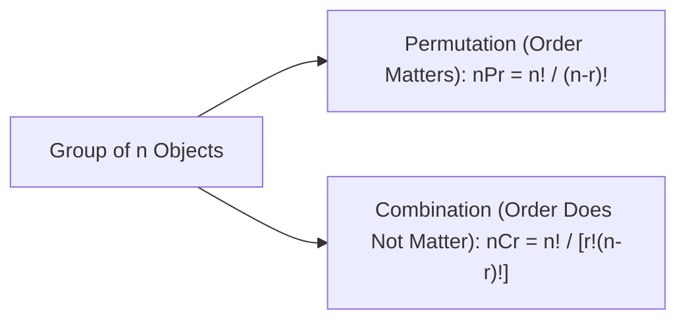

# Unit - 6

:::info[TITLE]
## Permutation, Combinations and Probability
:::

## 1. Permutations

A permutation is an arrangement of objects in a definite order. The order of selection matters.

### 1.1 Fundamental Principles of Counting

#### Multiplication Principle (AND Rule)
If an operation can be performed in $m$ different ways, and following it a second operation can be performed in $n$ different ways, then the two operations in succession can be performed in:
$$\text{Total Ways} = m \times n$$

#### Addition Principle (OR Rule)
If two tasks are mutually exclusive such that the first can be performed in $m$ ways and the second in $n$ ways, then either the first or the second task can be performed in:
$$\text{Total Ways} = m + n$$

### 1.2 Repetition of Events
If an event can occur in $n$ different ways, the number of ways in which $r$ such events can occur when repetition is permitted is:
$$\text{Total Ways} = n^r$$

### 1.3 Factorial Representation
The continued product of the first $n$ natural numbers is called factorial $n$, denoted by $n!$ or $\lfloor{n}$:
$$n! = n \times (n - 1) \times (n - 2) \times \dots \times 3 \times 2 \times 1$$
Special values:
$$0! = 1, \quad 1! = 1, \quad 2! = 2, \quad 3! = 6, \quad 4! = 24, \quad 5! = 120, \quad 6! = 720, \quad 7! = 5040$$

### 1.4 Linear Permutations

The number of permutations of $n$ distinct objects taken $r$ at a time without repetition is:
$$^n P_r = \frac{n!}{(n - r)!} = n(n - 1)(n - 2)\dots(n - r + 1)$$
- When $r = n$:
  $$^n P_n = n!$$
- When $r = 0$:
  $$^n P_0 = 1$$

#### Permutations of Objects Not All Distinct
The number of mutually distinguishable permutations of $n$ objects where $p$ are of one kind, $q$ of a second kind, and $r$ of a third kind is:
$$\text{Ways} = \frac{n!}{p! \cdot q! \cdot r!}$$

#### The "Tie Together" (String) Method
When specific items must **always occur together**:
1. Treat the group of items as a single compound entity.
2. Arrange the remaining items along with this compound entity.
3. Multiply by the internal arrangements of the grouped items.

#### The "Gap" Method
When specific items must **never occur together**:
1. First arrange the items that have no restrictions.
2. Place the restricted items into the empty gaps created between and at the ends of the arranged items.

### 1.5 Circular Permutations

Arranging $n$ distinct objects around a closed circle:
- Since rotational shifts represent identical configurations, fixing one reference position leaves $(n - 1)$ positions to fill:
  $$\text{Circular Permutations} = (n - 1)!$$
- **Clockwise and Anticlockwise Indistinguishable (Necklaces / Garlands):**
  Flipping the ring yields an identical arrangement, eliminating half the configurations:
  $$\text{Ways} = \frac{(n - 1)!}{2}$$

## 2. Combinations

A combination is a selection of items where the order of selection does not matter.

### 2.1 Formula and Properties

The number of combinations of $n$ distinct objects taken $r$ at a time is:
$$^n C_r = \frac{n!}{r! \cdot (n - r)!} = \frac{^n P_r}{r!}$$

#### Key Algebraic Properties
- **Symmetry:**
  $$^n C_r = ^n C_{n - r}$$
- **Boundary Values:**
  $$^n C_0 = ^n C_n = 1, \quad ^n C_1 = n$$
- **Pascal's Identity:**
  $$^n C_r + ^n C_{r - 1} = ^{n + 1} C_r$$
- **Equality Condition:**
  $$\text{If } ^n C_x = ^n C_y, \quad \text{then either } x = y \quad \text{or } x + y = n$$
- **Total Subsets (Sum of Combinations):**
  $$^n C_0 + ^n C_1 + ^n C_2 + \dots + ^n C_n = 2^n$$

### 2.2 Geometric Combinations
- **Number of straight lines** formed by $n$ points (no 3 collinear):
  $$\text{Lines} = ^n C_2$$
- If $m$ points out of $n$ are collinear:
  $$\text{Lines} = ^n C_2 - ^m C_2 + 1$$
- **Number of triangles** formed by $n$ points:
  $$\text{Triangles} = ^n C_3 - ^m C_3$$
- **Number of diagonals in an $n$-sided polygon:**
  $$\text{Diagonals} = ^n C_2 - n = \frac{n(n - 1)}{2} - n = \frac{n(n - 3)}{2}$$

## 3. Probability

Probability quantifies the likelihood of occurrence of a random event.

### 3.1 Terminology
- **Random Experiment:** An experiment whose outcomes cannot be predicted with certainty in advance, but the set of all possible outcomes is known.
- **Sample Space ($S$):** The set of all possible outcomes of a random experiment.
- **Event ($E$):** Any subset of the sample space ($E \subseteq S$).

### 3.2 Types of Events
- **Impossible Event ($\emptyset$):** An event that cannot occur ($P(\emptyset) = 0$).
- **Sure / Certain Event ($S$):** An event that always occurs ($P(S) = 1$).
- **Simple / Elementary Event:** An event containing exactly one sample point.
- **Mutually Exclusive (Disjoint) Events:** Two events that cannot occur simultaneously:
  $$A \cap B = \emptyset \implies P(A \cap B) = 0$$
- **Independent Events:** Occurrence of one event does not affect the occurrence of the other:
  $$P(A \cap B) = P(A) \times P(B)$$
- **Exhaustive Events:** A set of events whose union covers the entire sample space:
  $$A_1 \cup A_2 \cup \dots \cup A_k = S \implies \sum P(A_i) = 1 \text{ (if disjoint)}$$
- **Complementary Event ($E'$ or $\bar{E}$):** The non-occurrence of event $E$:
  $$P(E') = 1 - P(E)$$

### 3.3 Classical Definition of Probability

If a trial results in $n$ mutually exclusive, equally likely, and exhaustive outcomes, and $m$ of them are favorable to event $E$:
$$P(E) = \frac{\text{Number of favorable outcomes } m}{\text{Total number of possible outcomes } n} = \frac{n(E)}{n(S)}$$
$$0 \le P(E) \le 1$$

### 3.4 Addition Theorem of Probability

- **For any two arbitrary events $A$ and $B$:**
  $$P(A \cup B) = P(A) + P(B) - P(A \cap B)$$
- **For mutually exclusive events ($A \cap B = \emptyset$):**
  $$P(A \cup B) = P(A) + P(B)$$
- **For three events $A, B, C$:**
  $$P(A \cup B \cup C) = P(A) + P(B) + P(C) - P(A \cap B) - P(B \cap C) - P(A \cap C) + P(A \cap B \cap C)$$

### 3.5 Common Sample Space Reference Tables

#### Standard Deck of 52 Cards
- **Total:** 52 cards divided into 4 suits of 13 cards each.
  - **Red Suits (26):** Hearts (13), Diamonds (13).
  - **Black Suits (26):** Spades (13), Clubs (13).
- **Ranks in each suit:** Ace, 2, 3, 4, 5, 6, 7, 8, 9, 10, Jack, Queen, King.
- **Face Cards (Honors with faces):** Jack, Queen, King ($4 \times 3 = 12$ cards).
- **Aces:** 4 cards (one in each suit).

#### Rolling Two Standard Dice
- Total outcomes $= 6 \times 6 = 36$.
- Sum distribution:
  - $\text{Sum} = 2$ or $12$: 1 way each
  - $\text{Sum} = 3$ or $11$: 2 ways each
  - $\text{Sum} = 4$ or $10$: 3 ways each
  - $\text{Sum} = 5$ or $9$: 4 ways each
  - $\text{Sum} = 6$ or $8$: 5 ways each
  - $\text{Sum} = 7$: 6 ways (most frequent)

## 4. Solved Problems and Exam Practice

### Problem 1 (Permutation of Words with Repeated Letters)
How many different 8-letter words can be formed from the letters of the word **COURTESY** so that vowels are always together?

**Solution:**
1. The word **COURTESY** has 8 distinct letters.
2. Vowels: O, U, E (3 vowels).
3. Consonants: C, R, T, S, Y (5 consonants).
4. Bundle the 3 vowels as one single unit: $(O, U, E)$.
5. Total units to arrange $= 5 \text{ consonants} + 1 \text{ vowel-unit} = 6 \text{ units}$.
6. Number of ways to arrange the 6 units $= 6! = 720$.
7. The 3 vowels inside the unit can be arranged among themselves in $3! = 6$ ways.
$$\text{Total Words} = 6! \times 3! = 720 \times 6 = 4,320$$

### Problem 2 (Permutation with Repetition)
How many different words can be formed using the letters of the word **MATHEMATICS**?

**Solution:**
Total letters $n = 11$.
Letter frequencies:
- $\text{M}: 2$
- $\text{A}: 2$
- $\text{T}: 2$
- $\text{H}: 1, \text{E}: 1, \text{I}: 1, \text{C}: 1, \text{S}: 1$
$$\text{Total Words} = \frac{11!}{2! \cdot 2! \cdot 2!} = \frac{39,916,800}{8} = 4,989,600$$

### Problem 3 (Circular Permutation)
In how many ways can 7 people sit around a circular table? In how many ways can 7 beads of different colors be strung on a necklace?

**Solution:**
- For 7 people around a circular table:
  $$\text{Ways} = (7 - 1)! = 6! = 720$$
- For 7 beads on a necklace (clockwise and counterclockwise are identical):
  $$\text{Ways} = \frac{(7 - 1)!}{2} = \frac{6!}{2} = \frac{720}{2} = 360$$

### Problem 4 (Committee Selection Combination)
A committee of 5 persons is to be formed from 6 men and 4 women. In how many ways can this be done if the committee must contain at least 2 women?

**Solution:**
Possible team compositions:
1. **2 women and 3 men:**
   $$^4 C_2 \times ^6 C_3 = 6 \times 20 = 120$$
2. **3 women and 2 men:**
   $$^4 C_3 \times ^6 C_2 = 4 \times 15 = 60$$
3. **4 women and 1 man:**
   $$^4 C_4 \times ^6 C_1 = 1 \times 6 = 6$$
$$\text{Total Ways} = 120 + 60 + 6 = 186$$

### Problem 5 (Polygon Diagonals)
Find the number of diagonals in an octagon (8-sided polygon).

**Solution:**
$$n = 8$$
$$\text{Diagonals} = \frac{n(n - 3)}{2} = \frac{8 \times (8 - 3)}{2} = \frac{8 \times 5}{2} = 20$$

### Problem 6 (Card Drawing Probability)
A card is drawn at random from a well-shuffled pack of 52 playing cards. Find the probability that the card drawn is either a King or a Heart.

**Solution:**
- Total cards $n(S) = 52$.
- Let $A$ be the event of drawing a King: $n(A) = 4$.
- Let $B$ be the event of drawing a Heart: $n(B) = 13$.
- Intersection $A \cap B$ (the King of Hearts): $n(A \cap B) = 1$.
Using the addition theorem:
$$P(A \cup B) = P(A) + P(B) - P(A \cap B) = \frac{4}{52} + \frac{13}{52} - \frac{1}{52} = \frac{16}{52} = \frac{4}{13}$$

### Problem 7 (Two Dice Sum Probability)
In a simultaneous throw of two dice, what is the probability of getting a total sum of 8?

**Solution:**
Total outcomes $n(S) = 6 \times 6 = 36$.
Favorable pairs giving a sum of 8:
$$(2, 6), (3, 5), (4, 4), (5, 3), (6, 2)$$
Total favorable outcomes $n(E) = 5$.
$$P(\text{Sum} = 8) = \frac{5}{36}$$

### Problem 8 (Urn Selection Probability)
A bag contains 5 red balls, 4 green balls, and 3 blue balls. If 3 balls are drawn at random, find the probability that all 3 balls are red.

**Solution:**
Total balls $= 5 + 4 + 3 = 12$.
Total ways to draw 3 balls from 12:
$$n(S) = ^{12} C_3 = \frac{12 \times 11 \times 10}{3 \times 2 \times 1} = 220$$
Ways to draw 3 red balls from 5:
$$n(E) = ^5 C_3 = \frac{5 \times 4}{2 \times 1} = 10$$
$$P(\text{All Red}) = \frac{n(E)}{n(S)} = \frac{10}{220} = \frac{1}{22}$$

### Problem 9 (Independent Events Probability)
$A$ and $B$ shoot at a target. The probability that $A$ hits the target is $\frac{2}{3}$, and the probability that $B$ hits the target is $\frac{3}{4}$. Find the probability that the target is hit at least once if both shoot independently.

**Solution:**
Probability of $A$ missing: $P(A') = 1 - \frac{2}{3} = \frac{1}{3}$.
Probability of $B$ missing: $P(B') = 1 - \frac{3}{4} = \frac{1}{4}$.
Since the events are independent, probability that both miss:
$$P(A' \cap B') = P(A') \times P(B') = \frac{1}{3} \times \frac{1}{4} = \frac{1}{12}$$
Probability that target is hit at least once:
$$P(\text{At least one hit}) = 1 - P(A' \cap B') = 1 - \frac{1}{12} = \frac{11}{12}$$

### Problem 10 (Selection with Restrictions)
From a group of 7 men and 6 women, 5 persons are to be selected to form a committee so that at least 3 men are there on the committee. In how many ways can it be done?

**Solution:**
The combinations are:
1. 3 men and 2 women:
   $$^7 C_3 \times ^6 C_2 = 35 \times 15 = 525$$
2. 4 men and 1 woman:
   $$^7 C_4 \times ^6 C_1 = 35 \times 6 = 210$$
3. 5 men and 0 women:
   $$^7 C_5 \times ^6 C_0 = 21 \times 1 = 21$$
$$\text{Total Ways} = 525 + 210 + 21 = 756$$
