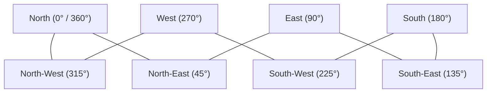
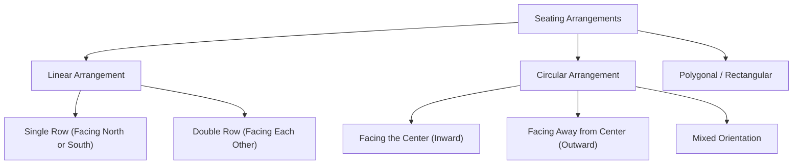

# Unit - 7

:::info[TITLE]
## Directions & Seating Arrangements
:::

## 1. Directions Sense Reasoning

Direction sense tests evaluate spatial orientation and the ability to trace motion trajectories across two-dimensional coordinate grids.

### 1.1 The Compass Framework

There are four primary cardinal directions and four intermediate ordinal (intercardinal) directions, spaced at intervals of $45^\circ$:

- **Cardinal Directions:** North ($\text{N}$), South ($\text{S}$), East ($\text{E}$), West ($\text{W}$).
- **Intercardinal Directions:** North-East ($\text{NE}$), South-East ($\text{SE}$), South-West ($\text{SW}$), North-West ($\text{NW}$).
- **Angular Separation:** Each adjacent main direction is separated by $90^\circ$. Each adjacent cardinal and intercardinal direction is separated by $45^\circ$.

### 1.2 Orientation and Directional Turns

A standard "left" or "right" turn implies an exact orthogonal rotation of $90^\circ$:
- **Facing North:** Right = East ($90^\circ\text{ CW}$), Left = West ($90^\circ\text{ ACW}$)
- **Facing South:** Right = West ($90^\circ\text{ CW}$), Left = East ($90^\circ\text{ ACW}$)
- **Facing East:** Right = South ($90^\circ\text{ CW}$), Left = North ($90^\circ\text{ ACW}$)
- **Facing West:** Right = North ($90^\circ\text{ CW}$), Left = South ($90^\circ\text{ ACW}$)

#### Net Angular Rotation Rule
When multiple rotational turns (clockwise $\text{CW}$ and anticlockwise $\text{ACW}$) are executed:
$$\theta_{\text{net}} = \sum \theta_{\text{CW}} - \sum \theta_{\text{ACW}}$$
- If $\theta_{\text{net}} > 0$: Rotate clockwise from initial orientation by $\theta_{\text{net}}$.
- If $\theta_{\text{net}} < 0$: Rotate anticlockwise from initial orientation by $|\theta_{\text{net}}|$.

### 1.3 Shadow Principles

Shadows always project directly opposite to the position of the light source:

| Time Period | Sun Position | Shadow Direction | Person Facing North | Person Facing South | Person Facing East | Person Facing West |
| :--- | :--- | :--- | :--- | :--- | :--- | :--- |
| **Morning (Sunrise)** | East | **West** | Left | Right | Behind | In Front |
| **Evening (Sunset)** | West | **East** | Right | Left | In Front | Behind |
| **12:00 Noon** | Overhead | **No Shadow** | None | None | None | None |

### 1.4 Shortest Distance and Displacement (Pythagoras Theorem)

To find the straight-line distance between the starting point $(x_1, y_1)$ and ending point $(x_2, y_2)$:
$$d = \sqrt{(\Delta x)^2 + (\Delta y)^2} = \sqrt{(x_2 - x_1)^2 + (y_2 - y_1)^2}$$

## 2. Seating Arrangements

Seating arrangement puzzles test logical grouping, sequential deduction, and relative positional tracking under defined constraints.

### 2.1 Linear Arrangements

- **Single Row Facing North:**
  - "To the right" means moving towards the **East** (observer's right).
  - "To the left" means moving towards the **West** (observer's left).
- **Single Row Facing South:**
  - "To the right" means moving towards the **West** (observer's left).
  - "To the left" means moving towards the **East** (observer's right).
- **Two Parallel Rows Facing Each Other:**
  - Row 1 faces South $\implies$ their right is to the observer's left.
  - Row 2 faces North $\implies$ their right is to the observer's right.
  - Diagonally opposite positions form an $X$-pattern between the ends.

### 2.2 Circular Arrangements

Let $N$ persons sit in a circle:

#### Case 1: All Persons Facing Inward (Towards the Center)
- Moving **Clockwise** $\implies$ Moving to the **Left**.
- Moving **Anticlockwise** $\implies$ Moving to the **Right**.

#### Case 2: All Persons Facing Outward (Away from Center)
- Moving **Clockwise** $\implies$ Moving to the **Right**.
- Moving **Anticlockwise** $\implies$ Moving to the **Left**.

#### Positional Mapping in an 8-Person Circle
- Opposite person: Exactly 3 persons sit between any pair of diametrically opposite individuals ($8 / 2 = 4$ positions away).
- "Second to the right of $X$": Count two steps in the respective rightward direction from $X$.
- "Immediate neighbor": The two adjacent slots directly adjacent to $X$.

### 2.3 Systematic Puzzle Solving Strategy
1. **Identify Fixed / Definite Clues:** Begin with statements that lock an absolute position (e.g., "$A$ sits at an extreme end" or "$B$ sits third to the right of $C$").
2. **Chain Connected Clues:** Link secondary clues that reference the already placed individuals.
3. **Branch Dual Possibilities:** If an ambiguity arises (e.g., "$D$ sits adjacent to $E$"), draw two parallel diagrams rather than guessing.
4. **Apply Negative Constraints:** Eliminate invalid branches using exclusion statements (e.g., "$F$ does not sit near $G$").

## 3. Solved Problems and Exam Practice

### Problem 1 (Shadow at Sunrise)
One morning after sunrise, Juhi while going to school met Anshika at a road crossing. Anshika's shadow was exactly to the right of Juhi. If they were standing face-to-face, which direction was Juhi facing?

**Solution:**
1. In the morning after sunrise, the sun is in the East.
2. Therefore, all shadows fall towards the **West**.
3. The shadow was to Juhi's **right**.
4. Thus, Juhi's right side points towards the **West**.
5. When a person's right points to the West, the person must be facing **South**.
Juhi was facing South (and Anshika was facing North).

### Problem 2 (Displacement with Multiple Orthogonal Turns)
Rasik walked 20 m towards North. Then he turned right and walked 30 m. Then he turned right and walked 35 m. Then he turned left and walked 15 m. Finally, he turned left and walked 15 m. In which direction and how many meters is he from his starting position?

**Solution:**
Trace coordinates starting at $(0, 0)$:
1. North 20 m: $(0, 20)$
2. Turn right (East) 30 m: $(30, 20)$
3. Turn right (South) 35 m: $(30, 20 - 35) = (30, -15)$
4. Turn left (East) 15 m: $(30 + 15, -15) = (45, -15)$
5. Turn left (North) 15 m: $(45, -15 + 15) = (45, 0)$
Ending coordinate is $(45, 0)$:
- Distance from origin $= \sqrt{45^2 + 0^2} = 45\text{ m}$.
- Direction from origin is along the positive $x$-axis, which is **East**.
Rasik is 45 m East of his starting position.

### Problem 3 (Angular Rotations)
A man is facing West. He turns $45^\circ$ in the clockwise direction, then another $180^\circ$ in the same direction, and then $270^\circ$ in the anticlockwise direction. Which direction is he facing now?

**Solution:**
Initial direction: West ($270^\circ$).
- Clockwise turns: $+45^\circ + 180^\circ = +225^\circ$.
- Anticlockwise turns: $-270^\circ$.
- Net rotation:
  $$\theta_{\text{net}} = 225^\circ - 270^\circ = -45^\circ \quad (45^\circ \text{ anticlockwise})$$
Rotating $45^\circ$ anticlockwise from West:
$$\text{West} - 45^\circ = \text{South-West}$$
The man is facing South-West.

### Problem 4 (Pythagoras Displacement)
A child went 90 m in the East to look for his father, then turned right and went 20 m. After this, he turned right and went 30 m to reach his uncle's house. From there, he went 100 m to his North and met his father. How far did he meet his father from the starting point?

**Solution:**
Coordinate tracking from $(0, 0)$:
1. East 90 m: $(90, 0)$
2. Right (South) 20 m: $(90, -20)$
3. Right (West) 30 m: $(90 - 30, -20) = (60, -20)$
4. North 100 m: $(60, -20 + 100) = (60, 80)$
The ending point is $(60, 80)$.
$$\text{Distance } d = \sqrt{60^2 + 80^2} = \sqrt{3600 + 6400} = \sqrt{10000} = 100\text{ m}$$
The child met his father 100 m from the starting point.

### Problem 5 (Coded Directions)
If $A \times B$ means $A$ is to the South of $B$, $A + B$ means $A$ is to the North of $B$, $A \% B$ means $A$ is to the East of $B$, and $A - B$ means $A$ is to the West of $B$, then in $P \% Q + R - S$, in which direction is $S$ with respect to $Q$?

**Solution:**
Decode statement by statement:
1. $P \% Q \implies P$ is East of $Q$.
2. $Q + R \implies Q$ is North of $R$ (so $R$ is South of $Q$).
3. $R - S \implies R$ is West of $S$ (so $S$ is East of $R$).
Now determine position of $S$ with respect to $Q$:
- $S$ is South of $Q$'s horizontal latitude (since $R$ is South of $Q$ and $S$ shares $R$'s latitude).
- $S$ is to the East of $R$.
Therefore, $S$ lies to the **South-East** of $Q$.

### Problem 6 (6-Person Circular Arrangement Facing Inward)
6 boys (Rajeev, Mohan, Vijay, Babu, Suresh, Ajay) are sitting in a circle facing towards the center:
- Rajeev is sitting to the right of Mohan, but not just at the left of Vijay.
- Suresh is between Babu and Vijay.
- Ajay is sitting to the left of Vijay.
Who is sitting opposite Mohan?

**Solution:**
1. Fix Mohan at bottom position (6 o'clock).
2. Rajeev is to the right (anticlockwise) of Mohan $\implies$ position 5 o'clock.
3. Suresh is between Babu and Vijay.
4. Ajay is immediately to the left (clockwise) of Vijay.
5. Arrangement in clockwise order:
   $$\text{Mohan} \to \text{Ajay} \to \text{Vijay} \to \text{Suresh} \to \text{Babu} \to \text{Rajeev}$$
6. Opposite pairings across the circle of 6:
   - Mohan is opposite Suresh.
   - Ajay is opposite Babu.
   - Vijay is opposite Rajeev.
Suresh is sitting opposite Mohan.

### Problem 7 (4-Person Card Game Positions)
Siva, Sathish, Amar, and Praveen are playing cards around a table facing inward. Amar is to the right of Sathish, who is to the right of Siva. Who is to the right of Amar?

**Solution:**
1. Facing inward: "to the right" means moving anticlockwise.
2. Sathish is to the right of Siva $\implies \text{Siva} \xrightarrow{\text{anticlockwise}} \text{Sathish}$.
3. Amar is to the right of Sathish $\implies \text{Sathish} \xrightarrow{\text{anticlockwise}} \text{Amar}$.
4. The fourth person Praveen must occupy the next position:
   $$\text{Amar} \xrightarrow{\text{anticlockwise}} \text{Praveen}$$
Therefore, Praveen is to the right of Amar.

### Problem 8 (8-Person Circular Arrangement Facing Center)
Eight persons ($P, Q, R, S, T, U, V, W$) sit in a circle facing the center:
- $P$ is second to the right of $T$.
- $T$ is the neighbor of $R$ and $V$.
- $S$ is not the neighbor of $P$.
- $V$ is the neighbor of $U$.
- $Q$ is not between $S$ and $W$.
- $W$ is not between $U$ and $S$.
What is the position of $S$?

**Solution:**
1. Place $T$ at position 1.
2. $P$ is second to the right of $T \implies P$ is at position 3.
3. $T$ is neighbor of $R$ and $V$. Position 2 must be either $R$ or $V$.
   - Since $V$ is neighbor of $U$, if $V$ is at position 8 (left of $T$), then $U$ is at 7, and $R$ is at 2.
4. $S$ is not neighbor of $P$ (cannot be at 4), so $S$ is at position 6 (between $U$ at 7 and $W$ at 5).
5. Then $Q$ occupies position 4.
6. Check all negative conditions: $Q$ is between $P$ and $W$ (valid), $W$ is between $S$ and $Q$ (valid).
$S$ is seated between $U$ and $W$, exactly opposite to $R$.

### Problem 9 (Facing Outward Seating Puzzle)
Eight persons ($L, M, N, O, P, Q, R, S$) sit around a circular table facing outward:
- $P$ sits second to the right of $R$.
- Two persons sit between $S$ and $Q$.
- $Q$ sits adjacent to $R$.
- $M$ sits third to the right of $L$.
- $M$ and $P$ are not immediate neighbors.
- $L$ sits second to the left of $O$.
- The number of persons sitting between $N$ and $M$ is the same as between $N$ and $S$.
Determine the arrangement order.

**Solution:**
Facing outward means:
- Right $\implies$ Clockwise.
- Left $\implies$ Anticlockwise.
1. Fix $R$ at position 1. $P$ is second clockwise $\implies P$ is at position 3.
2. $Q$ is adjacent to $R$ (position 8 or 2). Since 2 persons sit between $S$ and $Q$, testing positions gives $Q$ at 8 and $S$ at 5.
3. $L$ sits second anticlockwise of $O$, and $M$ is third clockwise of $L$. Fitting remaining slots while ensuring $M$ is not next to $P$:
   - $O$ sits at 4, $L$ at 2, $M$ at 7.
4. The remaining slots are filled with $N$ at 6, satisfying that $N$ is equidistant from $M$ (slot 7) and $S$ (slot 5).
The final clockwise order is: $R \to L \to P \to O \to S \to N \to M \to Q$.
