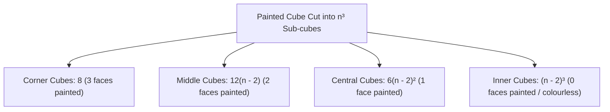
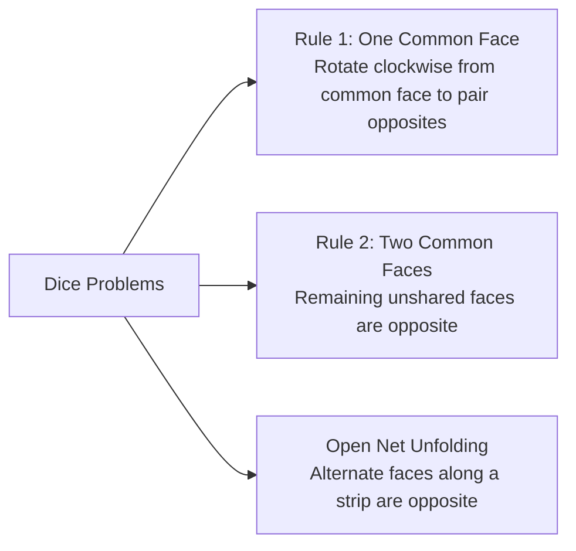
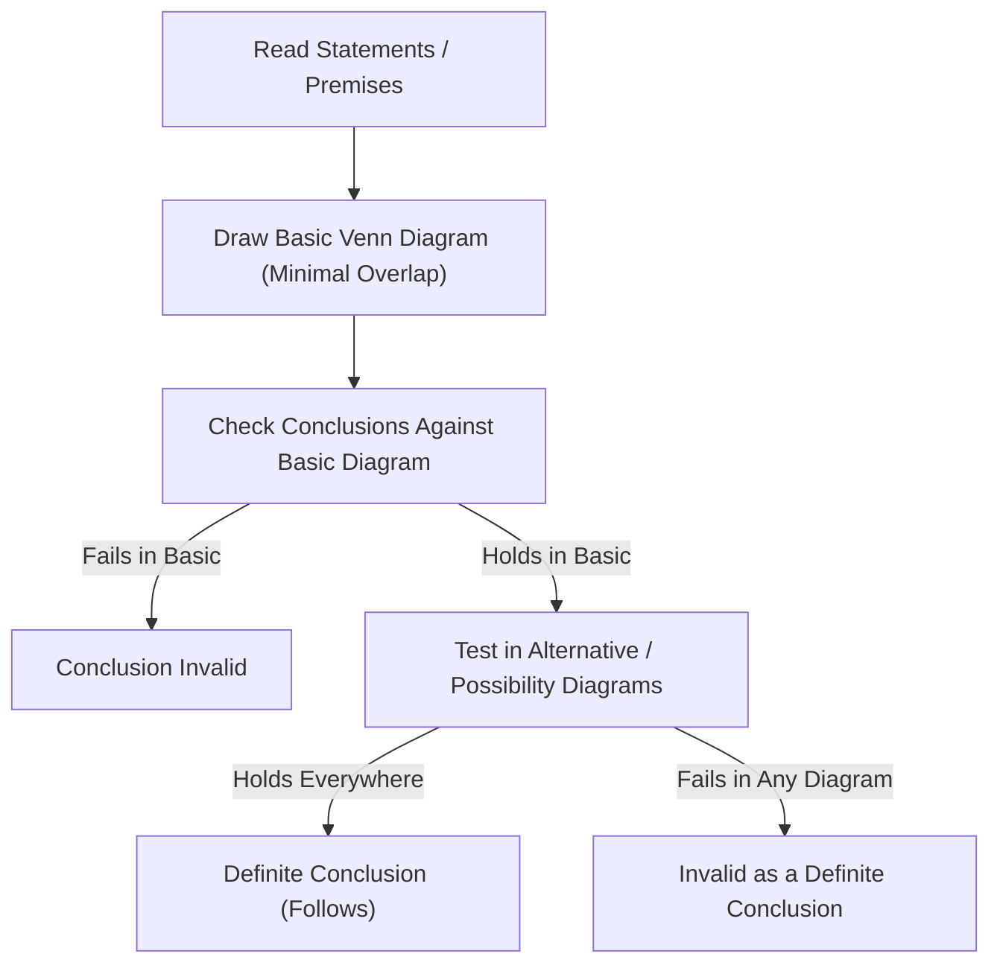

# Unit - 8

:::info[TITLE]
## Cubes & Dice, Syllogism
:::

## 1. Cubes

A cube is a three-dimensional solid object bounded by six identical square faces, meeting each other at right angles.

### 1.1 Structural Properties of a Cube
- **Faces:** 6 flat square surfaces.
- **Edges:** 12 straight lines where two adjacent faces meet.
- **Corners / Vertices:** 8 points where three edges meet.

### 1.2 Cutting and Painted Cube Formulas

When a large cube of side $L$ painted on its exterior is cut into smaller identical cubes of side $s$:
$$\text{Scale Factor } n = \frac{\text{Side of Larger Cube } (L)}{\text{Side of Smaller Cube } (s)} = \sqrt[3]{\text{Total Smaller Cubes}}$$
$$\text{Total Smaller Cubes} = n^3$$
$$\text{Total Cuts Required} = 3 \times (n - 1)$$

#### Classification of Smaller Sub-Cubes

| Sub-Cube Type | Location on Cube | Number of Painted Faces | Mathematical Formula |
| :--- | :--- | :--- | :--- |
| **Corner Cubes** | Vertices / Corners | **3 Faces** | **$8$** (constant for any $n \ge 2$) |
| **Middle Cubes** | Along the 12 Edges (excluding corners) | **2 Faces** | **$12(n - 2)$** |
| **Central Cubes** | On the 6 Faces (center region) | **1 Face** | **$6(n - 2)^2$** |
| **Inner / Core Cubes** | Hidden inside the volume | **0 Faces (Colourless)** | **$(n - 2)^3$** |

#### Verification Identity
The sum of all categorized cubes equals the total volume:
$$8 + 12(n - 2) + 6(n - 2)^2 + (n - 2)^3 = n^3$$

### 1.3 Multi-Colored Cubes
If different pairs of opposite faces are painted with different colors (e.g., Red-Red, Blue-Blue, Green-Green):
- **Cubes with 2 specified colors** (e.g., Red and Blue): Edges joining a Red face and a Blue face contain these cubes.
- **Cubes with 1 specified color only:** Central cubes on the faces carrying that color: $2 \times (n - 2)^2$.

## 2. Dice

A die (plural: dice) is a specialized cube whose six faces are inscribed with numbers, letters, colors, or dot patterns (pips) from 1 to 6.

### 2.1 Standard vs. Ordinary Dice
- **Standard Dice:** The sum of numbers on opposite faces is **always equal to 7**:
  $$1 \leftrightarrow 6, \quad 2 \leftrightarrow 5, \quad 3 \leftrightarrow 4$$
  In any view of a standard die, adjacent faces can never sum to 7.
- **Ordinary / General Dice:** Any die where opposite faces do not necessarily sum to 7. Opposite faces must be deduced from relative positional views.

### 2.2 Rules for Determining Opposite Faces

#### Rule 1: Single Common Face
When two different positions of the same die display **one common face**:
1. Align both views starting from the common face.
2. List the visible faces in **clockwise order** for both positions.
3. The paired numbers in corresponding positions are opposite to each other.
4. The remaining number is opposite to the common face.

#### Rule 2: Two Common Faces
When two different positions display **two common faces**:
- The remaining non-common faces on both views are **strictly opposite to each other**.

#### Rule 3: Common Face in the Same Position
When one common face appears in the exact same spatial position (e.g., top face):
- The remaining faces on corresponding sides (front to front, right to right) are mutually opposite.

### 2.3 Unfolded Cube Nets (Construction of Boxes)

When a cube is unfolded into a flat two-dimensional net:
- **Alternating Face Rule:** In any continuous straight row or column of squares, **every alternate face is opposite** (separated by exactly one intermediate square).
- **Adjacency Invariance:** Two faces that are opposite in the net can **never appear adjacent** in the folded cube.

## 3. Syllogisms

Syllogism is deductive reasoning wherein conclusions are drawn strictly from two or more premises, regardless of real-world factual truth.

### 3.1 The Four Standard Categorical Propositions

| Code | Proposition Form | Nature | Quantity & Quality | Venn Representation |
| :--- | :--- | :--- | :--- | :--- |
| **A** | **All $S$ are $P$** | Universal Affirmative | Universal (+) | Circle $S$ is entirely inside circle $P$ |
| **E** | **No $S$ is $P$** | Universal Negative | Universal (-) | Circle $S$ and circle $P$ are completely disjoint |
| **I** | **Some $S$ are $P$** | Particular Affirmative | Particular (+) | Circle $S$ and circle $P$ overlap in at least one point |
| **O** | **Some $S$ are not $P$** | Particular Negative | Particular (-) | At least one element of $S$ lies outside $P$ |

### 3.2 Venn Diagram Analysis Technique

To test the validity of a given conclusion:
1. **Draw the Basic (Minimum Overlap) Diagram:** Draw circles showing strictly the minimal necessary overlap demanded by the statements without assuming extra overlap.
2. **Draw Alternative / Possibility Diagrams:** Test if any non-essential overlap or subset arrangement can satisfy the premises while violating the conclusion.
3. **Evaluation Rule:**
   - A conclusion is **definitely true** if and only if it holds valid across **all** possible valid diagrams.
   - If a conclusion fails in even a single diagram, it is rejected as invalid.

### 3.3 The "Either - Or" Complementary Pair Conditions

Two conclusions form an **"Either I or II follows"** relationship if:
1. Both conclusions are individually uncertain / doubtful (they hold in some diagrams but fail in others).
2. Both conclusions share the **exact same subject and predicate**.
3. They form one of the recognized complementary pairs:
   - **Some + No** ($I + E$)
   - **All + Some Not** ($A + O$)
   - **Some + Some Not** ($I + O$)
*(Note: "All + No" is NOT a valid complementary pair).*

## 4. Solved Problems and Exam Practice

### Problem 1 (Cube Division Count)
A wooden cube of edge 12 cm is painted red on all its faces. It is then cut into smaller cubes of edge 3 cm each. Find the total number of smaller cubes and the number of cuts made.

**Solution:**
$$n = \frac{12}{3} = 4$$
$$\text{Total Smaller Cubes} = n^3 = 4^3 = 64$$
$$\text{Total Cuts} = 3 \times (n - 1) = 3 \times (4 - 1) = 3 \times 3 = 9 \text{ cuts}$$

### Problem 2 (Painted Cube Breakdown)
For the 64 cubes from Problem 1 ($n = 4$), determine the number of cubes with:
1. Exactly 3 faces painted
2. Exactly 2 faces painted
3. Exactly 1 face painted
4. No face painted (colourless)

**Solution:**
1. Exactly 3 faces painted $= 8$ (Corner cubes).
2. Exactly 2 faces painted $= 12(n - 2) = 12(4 - 2) = 12 \times 2 = 24$ (Middle cubes).
3. Exactly 1 face painted $= 6(n - 2)^2 = 6(4 - 2)^2 = 6 \times 4 = 24$ (Central cubes).
4. No face painted $= (n - 2)^3 = (4 - 2)^3 = 2^3 = 8$ (Inner cubes).
Sum check: $8 + 24 + 24 + 8 = 64$.

### Problem 3 (At Least 2 Faces Painted)
A cube is cut into 125 small cubes. How many small cubes will have at least two faces painted?

**Solution:**
$$\text{Total cubes} = n^3 = 125 \implies n = 5$$
"At least 2 faces painted" means:
$$\text{Count} = (\text{Cubes with 2 faces painted}) + (\text{Cubes with 3 faces painted})$$
$$\text{Cubes with 2 faces} = 12(n - 2) = 12(5 - 2) = 12 \times 3 = 36$$
$$\text{Cubes with 3 faces} = 8$$
$$\text{Total} = 36 + 8 = 44 \text{ cubes}$$

### Problem 4 (Dice - Opposite Face Deduction via Clockwise Rule)
Two positions of a single die are shown:
- View 1: Top = 3, Front = 5, Right = 1
- View 2: Top = 3, Front = 2, Right = 4
Which number is opposite to 5? Which number is opposite to 3?

**Solution:**
1. Common face in both views is **3**.
2. Trace clockwise around the perimeter starting from 3:
   - View 1: $3 \to 1 \to 5$
   - View 2: $3 \to 4 \to 2$
3. Pair the corresponding positions:
   - $1$ is opposite $4$.
   - $5$ is opposite $2$.
4. The remaining number is $6$, so $3$ is opposite $6$.
Therefore, opposite to 5 is **2**, and opposite to 3 is **6**.

### Problem 5 (Dice - Two Common Faces Rule)
Two views of a die are given:
- View 1 shows faces: 4, 6, 2
- View 2 shows faces: 4, 6, 5
Which number is opposite to 2?

**Solution:**
Both views display two common faces: **4** and **6**.
According to Rule 2, the remaining unmatched faces are opposite to each other.
Therefore, face **2 is opposite to 5**.

### Problem 6 (Unfolded Cube Net Verification)
An unfolded net of a die has a vertical strip with squares labeled 1, 2, 3, 4 from top to bottom, with square 5 attached to the left of 2 and square 6 attached to the right of 3. Which faces are opposite?

**Solution:**
1. Along the vertical column, alternate squares are opposite:
   - Square **1 is opposite to 3**.
   - Square **2 is opposite to 4**.
2. The remaining lateral flaps are opposite each other:
   - Square **5 is opposite to 6**.

### Problem 7 (Syllogism - Basic Two-Statement Deduction)
**Statements:**
1. All flowers are trees.
2. No tree is a fruit.

**Conclusions:**
- I. No flower is a fruit.
- II. Some trees are flowers.

**Solution:**
1. **Conclusion I:** Since all flowers are entirely within trees, and trees are completely disjoint from fruits, no flower can ever intersect fruit. Conclusion I definitely follows.
2. **Conclusion II:** Since all flowers are trees, the flower region is a non-empty subset of trees, which means some trees are flowers. Conclusion II definitely follows.
**Answer:** Both Conclusion I and Conclusion II follow.

### Problem 8 (Syllogism with "Some" Relations)
**Statements:**
1. Some pens are books.
2. All books are pencils.

**Conclusions:**
- I. Some pencils are pens.
- II. All pens are pencils.

**Solution:**
1. Let pens $= P$, books $= B$, pencils $= C$.
2. $B$ is entirely inside $C$. $P$ overlaps $B$.
3. Since $P$ overlaps $B$, and $B$ is completely within $C$, $P$ must overlap $C$.
   - Thus, "Some pencils are pens" is definitely true. Conclusion I follows.
4. "All pens are pencils" is only a possibility, not a necessity (part of $P$ can lie outside $C$). Conclusion II does not follow.
**Answer:** Only Conclusion I follows.

### Problem 9 (Syllogism - Complementary Pair Either/Or)
**Statements:**
1. Some doctors are lawyers.
2. Some lawyers are engineers.

**Conclusions:**
- I. Some doctors are engineers.
- II. No doctor is an engineer.

**Solution:**
1. In the basic minimum overlap diagram: doctors and engineers do not touch. Conclusion I is false, Conclusion II is true.
2. In an alternative valid diagram: doctors and engineers overlap. Conclusion I is true, Conclusion II is false.
3. Both conclusions are individually uncertain.
4. They share the same subject (doctors) and predicate (engineers).
5. They form an **$I + E$** pair ("Some" + "No").
**Answer:** Either Conclusion I or Conclusion II follows.
