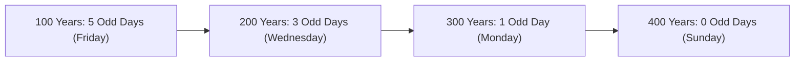
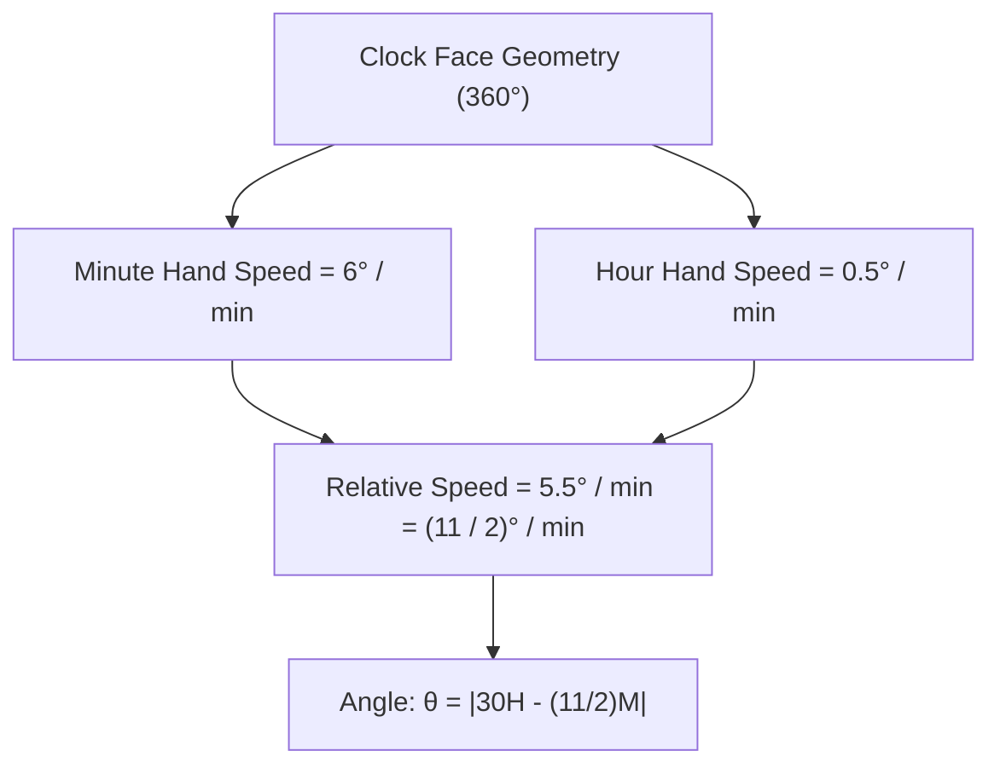

# Unit - 9

:::info[TITLE]
## Clocks and Calendars
:::

## 1. Calendar Reasoning

Calendar problems rely on cyclical modular arithmetic modulo 7, termed the concept of **Odd Days**.

### 1.1 The Concept of Odd Days

An **odd day** is the remainder obtained when the total number of days in a given period is divided by 7:
$$\text{Odd Days} = \text{Total Days} \pmod 7$$

#### Day of the Week Reference Code

| Remainder (Odd Days) | Day of the Week |
| :---: | :--- |
| **0** | Sunday |
| **1** | Monday |
| **2** | Tuesday |
| **3** | Wednesday |
| **4** | Thursday |
| **5** | Friday |
| **6** | Saturday |

### 1.2 Ordinary Years vs. Leap Years

- **Ordinary (Normal) Year:**
  - Contains 365 days:
    $$365 = 52 \times 7 + 1 \implies \mathbf{1 \text{ Odd Day}}$$
  - The first day and the last day of an ordinary year are always the same (e.g., if Jan 1 is Monday, Dec 31 is Monday).
- **Leap Year:**
  - Contains 366 days (February has 29 days):
    $$366 = 52 \times 7 + 2 \implies \mathbf{2 \text{ Odd Days}}$$
  - The year ends on the day following its starting day.
- **Leap Year Determination Rules:**
  - Non-century years are leap years if divisible by 4 (e.g., 2004, 2024, 2028).
  - **Century years** are leap years **if and only if divisible by 400** (e.g., 1600, 2000, 2400 are leap years; 1700, 1800, 1900, 2100 are ordinary years).

### 1.3 Odd Days in Months

| Month | Days | Odd Days ($D \pmod 7$) |
| :--- | :---: | :---: |
| January | 31 | **3** |
| February (Ordinary / Leap) | 28 / 29 | **0 / 1** |
| March | 31 | **3** |
| April | 30 | **2** |
| May | 31 | **3** |
| June | 30 | **2** |
| July | 31 | **3** |
| August | 31 | **3** |
| September | 30 | **2** |
| October | 31 | **3** |
| November | 30 | **2** |
| December | 31 | **3** |

### 1.4 Century Odd Days

1. **In 100 Years:**
   - 76 Ordinary Years $+ 24$ Leap Years
   $$\text{Total Odd Days} = (76 \times 1) + (24 \times 2) = 76 + 48 = 124$$
   $$124 = 17 \times 7 + 5 \implies \mathbf{5 \text{ Odd Days}}$$
2. **In 200 Years:**
   $$5 \times 2 = 10 \equiv \mathbf{3 \text{ Odd Days}}$$
3. **In 300 Years:**
   $$5 \times 3 = 15 \equiv \mathbf{1 \text{ Odd Day}}$$
4. **In 400 Years (400 is a leap century year):**
   $$(5 \times 4) + 1 = 21 \equiv \mathbf{0 \text{ Odd Days}}$$
- Multiple of 400 years ($800, 1200, 1600, 2000, 2400$) always contain **0 odd days**.

> [!NOTE]
> The last day of a century can only be **Sunday, Monday, Wednesday, or Friday**. The last day of a century can **never** be **Tuesday, Thursday, or Saturday**.

### 1.5 Repetition of Calendars

A calendar for a given year will repeat when the net sum of odd days from the starting year becomes a multiple of 7:
- A **Leap Year** calendar repeats every **28 years**.
- A year immediately following a leap year ($\text{Leap} + 1$) repeats every **6 years**.
- Other ordinary years ($\text{Leap} + 2$ or $\text{Leap} + 3$) repeat every **11 years**.

## 2. Clock Reasoning

A clock is a circular dial of $360^\circ$ divided into 12 hour sectors of $30^\circ$ each, and 60 minute intervals of $6^\circ$ each.

### 2.1 Angular Speeds of Hands

- **Minute Hand:**
  - Completes $360^\circ$ in 60 minutes:
    $$\text{Speed} = \frac{360^\circ}{60} = 6^\circ \text{ per minute}$$
- **Hour Hand:**
  - Completes $360^\circ$ in 12 hours (720 minutes):
    $$\text{Speed} = \frac{360^\circ}{720} = 0.5^\circ = \frac{1}{2}^\circ \text{ per minute}$$
- **Relative Speed of Minute Hand over Hour Hand:**
  $$S_{\text{rel}} = 6^\circ - 0.5^\circ = 5.5^\circ = \frac{11}{2}^\circ \text{ per minute}$$
  The minute hand gains $55$ minute spaces over the hour hand every 60 minutes ($\frac{55}{60} = \frac{11}{12}$ spaces/min).

### 2.2 The Fundamental Angle Formula

At $H$ hours and $M$ minutes, the acute angle $\theta$ between the two hands is:
$$\theta = \left|30H - \frac{11}{2}M\right|$$
- If the calculated angle $\theta > 180^\circ$, the reflex angle is:
  $$\theta_{\text{reflex}} = 360^\circ - \theta$$

### 2.3 Special Hand Alignments

| Position | Relative Angle | Frequency in 12 Hours | Frequency in 24 Hours | Note |
| :--- | :---: | :---: | :---: | :--- |
| **Coincident (Overlapping)** | $0^\circ$ | **11 times** | **22 times** | Coincide only once between 11:00 and 1:00 (at 12:00) |
| **Opposite (In a Straight Line)** | $180^\circ$ | **11 times** | **22 times** | Opposite only once between 5:00 and 7:00 (at 6:00) |
| **Straight Line ($0^\circ$ or $180^\circ$)** | $0^\circ \text{ or } 180^\circ$ | **22 times** | **44 times** | Sum of coincident and opposite occurrences |
| **Right Angle (Perpendicular)** | $90^\circ$ | **22 times** | **44 times** | Exactly twice per hour except at 3:00 and 9:00 |

### 2.4 Determining the Exact Time of an Angle

To find the minute $M$ between hour $H$ and $H + 1$ when the hands make an angle $\theta$:
$$M = \frac{2}{11} \times (30H \pm \theta)$$
- Use $(+)$ when the minute hand is ahead of the hour hand.
- Use $(-)$ when the minute hand is behind the hour hand.

### 2.5 Slow and Fast (Faulty) Clocks

Under standard correct operation, the hands of a clock coincide precisely every:
$$\text{Standard Coincidence Interval} = \frac{360^\circ}{\frac{11}{2}^\circ/\text{min}} = \frac{720}{11} = 65\frac{5}{11} \text{ minutes}$$

If the hands of a faulty clock coincide every $X$ minutes:
- If $X < 65\frac{5}{11}$: The clock is **gaining time (running fast)**.
- If $X > 65\frac{5}{11}$: The clock is **losing time (running slow)**.
$$\text{Total Gain or Loss in 24 Hours} = \left(\frac{65\frac{5}{11} - X}{X}\right) \times 24 \times 60 \text{ minutes}$$

## 3. Solved Problems and Exam Practice

### Problem 1 (Finding Day of a Historical Date)
What was the day of the week on 15th August 1947?

**Solution:**
Break down the period up to 15th August 1947 into completed years and current year:
1. **Completed years = 1946 years:**
   - $1600 \text{ years} = 0 \text{ odd days}$
   - $300 \text{ years} = 1 \text{ odd day}$
   - $46 \text{ years}:$
     $$\text{Leap years in 46} = \lfloor 46 / 4 \rfloor = 11$$
     $$\text{Ordinary years} = 46 - 11 = 35$$
     $$\text{Odd days} = (11 \times 2) + (35 \times 1) = 22 + 35 = 57 \equiv 57 \pmod 7 = 1 \text{ odd day}$$
   $$\text{Total odd days in 1946 years} = 0 + 1 + 1 = 2 \text{ odd days}$$
2. **Current year (1947) up to 15th August:**
   - Jan: 3
   - Feb (1947 is normal): 0
   - Mar: 3
   - Apr: 2
   - May: 3
   - Jun: 2
   - Jul: 3
   - Aug (up to 15): $15 \pmod 7 = 1$
   $$\text{Sum} = 3 + 0 + 3 + 2 + 3 + 2 + 3 + 1 = 17 \equiv 17 \pmod 7 = 3 \text{ odd days}$$
3. **Total Odd Days:**
   $$2 + 3 = 5 \text{ odd days}$$
Referring to the reference code, **5 corresponds to Friday**.
15th August 1947 was a **Friday**.

### Problem 2 (Finding Day of Republic Day)
What day of the week was 26th January 1950?

**Solution:**
1. **Completed years = 1949 years:**
   - $1600 \text{ years} = 0 \text{ odd days}$
   - $300 \text{ years} = 1 \text{ odd day}$
   - $49 \text{ years}:$
     $$\text{Leap years} = \lfloor 49 / 4 \rfloor = 12$$
     $$\text{Ordinary years} = 49 - 12 = 37$$
     $$\text{Odd days} = (12 \times 2) + 37 = 24 + 37 = 61 \equiv 61 \pmod 7 = 5 \text{ odd days}$$
   $$\text{Total odd days in 1949 years} = 0 + 1 + 5 = 6 \text{ odd days}$$
2. **Current year (1950):**
   - 26 days of January: $26 \pmod 7 = 5 \text{ odd days}$
3. **Total Odd Days:**
   $$6 + 5 = 11 \equiv 11 \pmod 7 = 4 \text{ odd days}$$
Code 4 corresponds to **Thursday**.
26th January 1950 was a **Thursday**.

### Problem 3 (Date Shift Across Normal / Leap Years)
If 1st January 2007 was a Monday, what was the day of the week on 1st January 2008?

**Solution:**
2007 is an ordinary year, containing 365 days $= 1 \text{ odd day}$.
$$\text{Day on Jan 1, 2008} = \text{Monday} + 1 = \text{Tuesday}$$

### Problem 4 (Date Shift Across a Leap February)
If 8th February 2004 was a Sunday, what day was 8th February 2005?

**Solution:**
Year 2004 is a leap year, and the period spans 29th February 2004.
Hence, 1 leap year is traversed $= 2 \text{ odd days}$.
$$\text{Day on Feb 8, 2005} = \text{Sunday} + 2 = \text{Tuesday}$$

### Problem 5 (Angle Between Clock Hands)
Find the angle between the hour hand and the minute hand of a clock at 4:20.

**Solution:**
Here $H = 4$, $M = 20$.
$$\theta = \left|30H - \frac{11}{2}M\right| = \left|30(4) - \frac{11}{2}(20)\right| = |120 - 110| = 10^\circ$$
The angle between the hands is $10^\circ$.

### Problem 6 (Angle at 8:30)
Find the acute and reflex angle between the hands of a clock at 8:30.

**Solution:**
Here $H = 8$, $M = 30$.
$$\theta = \left|30(8) - \frac{11}{2}(30)\right| = |240 - 165| = 75^\circ$$
- Acute angle $= 75^\circ$.
- Reflex angle $= 360^\circ - 75^\circ = 285^\circ$.

### Problem 7 (Coincidence of Hands)
At what time between 3 and 4 o'clock will the hands of a clock coincide?

**Solution:**
Hands coincide when $\theta = 0^\circ$, with $H = 3$:
$$M = \frac{2}{11}(30H \pm \theta) = \frac{2}{11}(30 \times 3 + 0) = \frac{2 \times 90}{11} = \frac{180}{11} = 16\frac{4}{11} \text{ minutes}$$
The hands coincide at **$3 \text{ hours } 16\frac{4}{11} \text{ minutes}$**.

### Problem 8 (Opposite Hands in Straight Line)
At what time between 7 and 8 o'clock will the hands of a clock be in the same straight line but not together?

**Solution:**
Hands are opposite when $\theta = 180^\circ$. Here $H = 7$:
$$30H = 30 \times 7 = 210^\circ$$
Since $210^\circ > 180^\circ$, we take $(30H - 180^\circ)$:
$$M = \frac{2}{11}(210 - 180) = \frac{2}{11}(30) = \frac{60}{11} = 5\frac{5}{11} \text{ minutes}$$
The hands are in a straight line opposite each other at **$7 \text{ hours } 5\frac{5}{11} \text{ minutes}$**.

### Problem 9 (Right Angle Between Hands)
At what time between 4 and 5 o'clock will the hands of a clock be at a right angle ($90^\circ$)?

**Solution:**
Here $H = 4 \implies 30H = 120^\circ$.
Right angles occur twice:
1. **First occurrence (before crossing hour hand):**
   $$M_1 = \frac{2}{11}(120 - 90) = \frac{2}{11}(30) = \frac{60}{11} = 5\frac{5}{11} \text{ minutes}$$
2. **Second occurrence (after crossing hour hand):**
   $$M_2 = \frac{2}{11}(120 + 90) = \frac{2}{11}(210) = \frac{420}{11} = 38\frac{2}{11} \text{ minutes}$$
The hands form a right angle at **$4:05\frac{5}{11}$** and at **$4:38\frac{2}{11}$**.

### Problem 10 (Faulty Clock Gain Calculation)
The hands of a clock coincide every 64 minutes. How much does the clock gain or lose in a day?

**Solution:**
Standard coincidence takes $\frac{720}{11} = 65\frac{5}{11}$ minutes.
Since the hands coincide in 64 minutes ($< 65\frac{5}{11}$), the clock is **gaining time (fast)**.
$$\text{Gain in 64 minutes} = 65\frac{5}{11} - 64 = 1\frac{5}{11} = \frac{16}{11} \text{ minutes}$$
$$\text{Gain in 24 hours (1440 minutes)} = \frac{\frac{16}{11}}{64} \times 1440 = \frac{16}{11 \times 64} \times 1440 = \frac{1}{44} \times 1440 = \frac{360}{11} = 32\frac{8}{11} \text{ minutes}$$
The clock gains $32\frac{8}{11}$ minutes in 24 hours.
