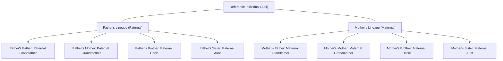
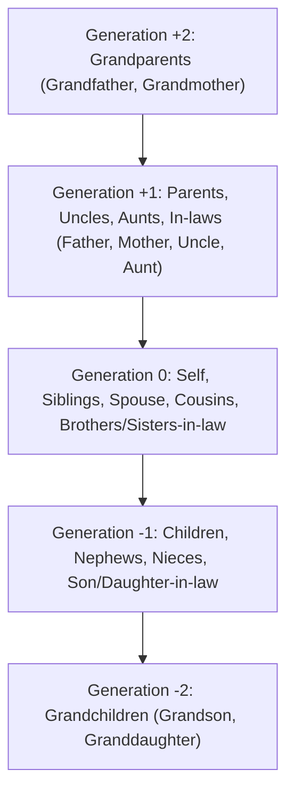

# Unit - 10

:::info[TITLE]
## Blood Relations
:::

## 1. Introduction and Family Tree Framework

Blood relation problems test logical reasoning by analyzing complex familial connections across successive ancestral and descendant generations.

### 1.1 Lineage Sides: Paternal vs. Maternal

Familial relationships are fundamentally bifurcated based on the parental lineage:

#### Detailed Relationship Reference

| Relationship Description | Formal Kinship Designation |
| :--- | :--- |
| Father's father / Mother's father | Grandfather (Paternal / Maternal) |
| Father's mother / Mother's mother | Grandmother (Paternal / Maternal) |
| Father's brother / Mother's brother | Uncle (Paternal Uncle / Maternal Uncle) |
| Father's sister / Mother's sister | Aunt (Paternal Aunt / Maternal Aunt) |
| Children of uncle or aunt | Cousin (never "cousin brother" or "cousin sister") |
| Wife of uncle | Aunt |
| Husband of aunt | Uncle |
| Son's wife | Daughter-in-law |
| Daughter's husband | Son-in-law |
| Husband's / Wife's father | Father-in-law |
| Husband's / Wife's mother | Mother-in-law |
| Husband's / Wife's brother | Brother-in-law |
| Husband's / Wife's sister | Sister-in-law |
| Brother's / Sister's son | Nephew |
| Brother's / Sister's daughter | Niece |
| Brother's wife / Sister's husband | Sister-in-law / Brother-in-law |
| Grandson's / Granddaughter's child | Great-grandchild |

### 1.2 Generation Levels

Tracking generation indices ($\Delta G$) prevents cyclical errors:

### 1.3 Standard Family Tree Notational Symbols

To draw fast and unambiguous family tree diagrams:

| Symbol | Representation |
| :---: | :--- |
| **$[+]$ or Square** | Male individual |
| **$[-]$ or Circle** | Female individual |
| **$=$ or $\Leftrightarrow$** | Married couple / Spouses |
| **$-$ (horizontal bar)** | Siblings (brothers and sisters) |
| **$\vert$ (vertical bar)** | Parent-child link (downward generation step) |
| **Dashed line** | Uncertain / hypothesized link |

> [!IMPORTANT]
> Never assume the gender of a person merely from their first name (e.g., Suman, Kiran, Robin). Gender must be explicitly stated in the problem text or deduced through defined relationships (such as "mother", "father", "son-in-law", "wife").

## 2. Types of Blood Relation Problems

### 2.1 Type 1: Pointing / Introducing Statements

In these questions, a speaker describes an individual by detailing a chain of kinship backwards from themselves or an anchor entity.
- **Deconstruction Technique:**
  1. Identify the reference pronoun: "My", "His", "Her".
  2. Parse the phrase from the end towards the beginning (Right-to-Left breakdown).
  3. Example: *"He is the only son of the father of my grandfather."*
     - "My grandfather" $\implies G+2$
     - "Father of my grandfather" $\implies$ Great-grandfather ($G+3$)
     - "Only son of my great-grandfather" $\implies$ Grandfather ($G+2$)
     - "He is the son" $\implies$ Father or Uncle ($G+1$).

### 2.2 Type 2: Coded Blood Relations

Kinship links are represented by mathematical symbols or punctuation:
- E.g., $P + Q$ means "$P$ is the father of $Q$"; $P - Q$ means "$P$ is the sister of $Q$"; $P \times Q$ means "$P$ is the brother of $Q$".

#### Fast Elimination Techniques
1. **Gender Filter:** If the question asks *"How is $M$ related to $T$ as an uncle?"*, $M$ must be **male**. Any answer choice where $M$ is coded as female or where $M$'s gender cannot be determined can be immediately eliminated.
2. **Generation Gap Matrix ($\Delta G$):**
   - Assign numerical values: Father/Mother $= +1$, Brother/Sister $= 0$, Son/Daughter $= -1$.
   - Sum the generation steps across the expression.
   - If asking for a Grandfather relation, the net sum must equal $+2$. Any option yielding a different net generation gap is invalid.

### 2.3 Type 3: Family Tree Puzzles

Complex multi-sentence scenarios involving 6 to 10 family members with overlapping attributes (generations, marital pairs, occupations, hobbies).
- **Solution Strategy:**
  1. Tabulate the fixed married couples first.
  2. Map vertical generational branches.
  3. Ensure count constraints (e.g., "only two married couples", "three generations", "two male children") match the tree.

## 3. Solved Problems and Exam Practice

### Problem 1 (Pointing to a Photograph)
Pointing to a photograph of a boy, Suresh said, "He is the son of the only son of my mother." How is Suresh related to that boy?

**Solution:**
1. "My mother" $\implies$ Suresh's mother.
2. "The only son of my mother" $\implies$ Suresh himself (assuming Suresh is male, being an only son).
3. "He is the son of [Suresh]" $\implies$ Suresh's son.
Therefore, Suresh is the **father** of the boy.

### Problem 2 (Introducing a Lady)
Pointing to a lady, a man said, "The son of her only brother is the brother of my wife." How is the lady related to the man?

**Solution:**
1. "My wife's brother" $\implies$ the man's brother-in-law.
2. "The son of her only brother is [the brother of my wife]".
3. This means the lady's brother is the father of the man's wife.
4. The father of one's wife is father-in-law.
5. The lady is the sister of the father-in-law.
Therefore, the lady is the **sister of father-in-law** (or paternal aunt of the man's wife).

### Problem 3 (Coded Blood Relation - Gender & Gap)
Read the following definitions:
- $A + B$ means $A$ is the brother of $B$
- $A - B$ means $A$ is the sister of $B$
- $A \times B$ means $A$ is the father of $B$
Which of the following means that **$C$ is the son of $M$**?
1. $M - N \times C + F$
2. $F - C + N \times M$
3. $N + M - F \times C$
4. $M \times N - C + F$

**Solution:**
$C$ must be male ($C$ is a son), and generation gap between $M$ and $C$ must be $M \to C = +1$.
- In Option 1:
  - $N \times C \implies N$ is father of $C$.
  - $M - N \implies M$ is sister of $N$.
  - Thus $M$ is aunt of $C$. Incorrect.
- In Option 4:
  - Let us test $M \times C + F$: if $M \times C$, $M$ is father of $C$.
  - Let us re-examine: $C$ must be male. In $C + F$, $C$ is brother of $F$ (male).
  - If the expression is $M \times C + F$: $M$ is father of $C$, and $C$ is male $\implies C$ is the son of $M$.
Therefore, an expression with $M \text{ (parent)} \dots C \text{ (male)}$ satisfies the condition.

### Problem 4 (Family Tree Puzzle - 8 Members, 3 Generations)
Study the information carefully and answer the questions:
- Eight persons are in three generations of a family with two married couples.
- $P$ is the son-in-law of $H$, who has three children.
- $M$ is the nephew of $L$.
- $W$ is the father of $K$, who is the sister-in-law of $U$.
- $U$ is the only daughter of $H$, who is the father of $N$.
- $L$ is unmarried.
- $N$ and $K$ don't have any children.

**Questions:**
1. How is $P$ related to $M$?
2. How is $K$ related to $N$?
3. How many male members are in the family?

**Solution:**
1. **Generations and Couples Analysis:**
   - $H$ has three children and is in Generation 1.
   - $U$ is the only daughter of $H \implies U$ is female.
   - Since $H$ has three children, and $U$ is the only daughter, the other two children must be sons.
   - $H$ is father of $N \implies N$ is a son (male).
   - $L$ is unmarried, so $L$ must be the other son (male).
   - Thus, children of $H$ are: $U [-]$, $N [+]$, $L [+]$.
2. **Couples:**
   - $P$ is son-in-law of $H$. Since $U$ is the only daughter, $P$ must be married to $U$:
     $$P [+] = U [-]$$
   - $K$ is sister-in-law of $U$, and $N$ is married to $K$:
     $$N [+] = K [-]$$
   - $W$ is father of $K \implies W [+]$.
3. **Children in Generation 3:**
   - $N$ and $K$ have no children.
   - $L$ is unmarried.
   - $M$ is nephew of $L \implies M$ must be the son of $P$ and $U$:
     $$M [+] \text{ is the son of } P \text{ and } U$$
4. **Answering the questions:**
   - **Q1:** $P$ is the **father** of $M$.
   - **Q2:** $K$ is the **wife** of $N$.
   - **Q3:** Count of male members: $H [+]$, $P [+]$, $N [+]$, $L [+]$, $W [+]$, $M [+] \implies$ **6 males** (assuming $H$ is father; if $H$'s gender is grandfather, exactly 5 or 6 depending on whether $H$ or $W$ is specified).

### Problem 5 (Profession and Relationship Puzzle)
In a family of six members $P, Q, R, S, T, U$, there are two married couples. The members include a doctor, a lawyer, a teacher, an engineer, a nurse, and a student:
- $R$, a lawyer, is married to the teacher.
- $T$, an engineer, is the son of $R$ and brother of $U$.
- $S$, a doctor, is the grandmother of $U$.
- $P$, a housewife/nurse, is the mother of $T$.
How is $U$ related to $S$?

**Solution:**
1. Generation $+2$: Grandmother $S$ (doctor, female).
2. Married couples:
   - Couple 1 (Gen $+1$): $R$ (lawyer, male) is married to $P$ (female, teacher/housewife).
   - $S$ is grandmother $\implies S$ is in Gen $+2$.
3. Generation $0$: $T$ (engineer, son, male) and $U$ (sibling of $T$).
4. Since $S$ is the grandmother of $U$, $U$ is the grandchild (grandson or granddaughter) of $S$.
If $U$'s gender is female, $U$ is the **granddaughter**; if unspecified, **grandchild**.

### Problem 6 (Point-to-Point Chain)
Pointing to Ketan, Namrata said, "He is the son of my father's only son." How is Ketan's mother related to Namrata?

**Solution:**
1. "My father's only son" $\implies$ Namrata's brother.
2. "He is the son of [Namrata's brother]" $\implies$ Ketan is Namrata's nephew.
3. Ketan's mother is the wife of Namrata's brother.
Therefore, Ketan's mother is Namrata's **sister-in-law**.

### Problem 7 (Sibling Direct Statement)
$A$ is the brother of $B$. $B$ is the daughter of $C$. $D$ is the father of $A$. How is $C$ related to $D$?

**Solution:**
1. $A$ and $B$ are siblings ($A$ is male, $B$ is female).
2. $B$ is daughter of $C$, and $A$ is son of $D$.
3. Therefore, $C$ and $D$ are the parents of $A$ and $B$.
4. Since $D$ is the father (male), $C$ must be the **mother (female)** and the **wife** of $D$.
