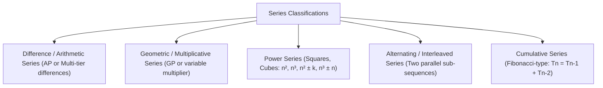
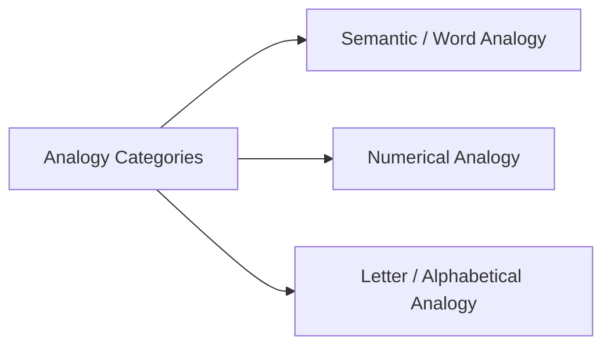

# Unit - 11

:::info[TITLE]
## Series Analogy, Odd Man Out, Coding and Decoding
:::

## 1. Number and Letter Series

A series is an ordered sequence of numbers or letters governed by a logical underlying mathematical or positional rule.

### 1.1 Types of Number Series

1. **Arithmetic / Difference Series:**
   - **Constant Difference:** Common difference $d = T_{k+1} - T_k$.
   - **Variable Difference (Double-tier difference):** The first differences form an arithmetic progression:
     $$\Delta_1 = T_{k+1} - T_k, \quad \Delta_2 = \Delta_{1, k+1} - \Delta_{1, k} = \text{constant}$$
2. **Geometric / Ratio Series:**
   - Successive terms are multiplied or divided by a constant factor $r$: $T_{k+1} = T_k \times r$.
3. **Power Series (Squares and Cubes):**
   - Pure squares: $n^2 \implies 1, 4, 9, 16, 25, 36, 49, 64, \dots$
   - Pure cubes: $n^3 \implies 1, 8, 27, 64, 125, 216, 343, \dots$
   - Shifted squares: $n^2 \pm 1$ or $n^2 \pm n$
   - Shifted cubes: $n^3 \pm 1$ or $n^3 \pm n$
4. **Consecutive Integer Products:**
   - Terms of the form $n(n + 1)$:
     $$1 \times 2 = 2, \quad 2 \times 3 = 6, \quad 3 \times 4 = 12, \quad 4 \times 5 = 20, \quad 5 \times 6 = 30, \dots$$
5. **Cumulative / Fibonacci Series:**
   - Each term is the sum of the preceding two or three terms:
     $$T_n = T_{n - 1} + T_{n - 2}$$
6. **Alternating / Interleaved Series:**
   - Two independent series interwoven into alternating odd-indexed and even-indexed positions:
     $$T_1, T_3, T_5, \dots \quad \text{and} \quad T_2, T_4, T_6, \dots$$

### 1.2 Odd Man Out (Wrong Number in Series)

In "Odd Man Out" problems:
1. Identify the consistent governing law obeyed by the majority of elements.
2. Calculate the theoretical value required by the pattern at each step.
3. Locate the single anomaly that violates the established succession.

## 2. Analogies

An analogy tests the ability to recognize identical relationships between pairs of entities:
$$A : B :: C : D$$
*(Read as "$A$ is related to $B$ in the same way as $C$ is related to $D$").*

### 2.1 Types of Analogies

1. **Semantic / Word Analogies:**
   - **Worker and Tool:** Carpenter : Saw :: Author : Pen
   - **Worker and Product:** Mason : Wall :: Poet : Poem
   - **Cause and Effect:** Fire : Smoke :: Infection : Fever
   - **Country and Capital / Currency:** India : New Delhi :: Japan : Tokyo
   - **Individual and Category:** Whale : Mammal :: Snake : Reptile
2. **Numerical Analogies:**
   - Squares, cubes, prime transforms, or arithmetic scaling between pairs:
     $$4 : 64 :: 5 : 125 \quad (x : x^3)$$
3. **Letter Analogies:**
   - Positional shifts across alphabetical indices.

## 3. Coding and Decoding

Coding is the transformation of a message into a cipher following a set of systematic rules. Decoding is reversing the cipher back to plain text.

### 3.1 The English Alphabet Reference Grid

#### Forward Positional Values ($1$ to $26$)

| A | B | C | D | E | F | G | H | I | J | K | L | M |
| :-: | :-: | :-: | :-: | :-: | :-: | :-: | :-: | :-: | :-: | :-: | :-: | :-: |
| 1 | 2 | 3 | 4 | 5 | 6 | 7 | 8 | 9 | 10 | 11 | 12 | 13 |

| N | O | P | Q | R | S | T | U | V | W | X | Y | Z |
| :-: | :-: | :-: | :-: | :-: | :-: | :-: | :-: | :-: | :-: | :-: | :-: | :-: |
| 14 | 15 | 16 | 17 | 18 | 19 | 20 | 21 | 22 | 23 | 24 | 25 | 26 |

#### Helpful Positional Mnemonics
- **EJOTY (Multiples of 5):**
  $$E = 5, \quad J = 10, \quad O = 15, \quad T = 20, \quad Y = 25$$
- **CFILORUX (Multiples of 3):**
  $$C = 3, \quad F = 6, \quad I = 9, \quad L = 12, \quad O = 15, \quad R = 18, \quad U = 21, \quad X = 24$$

### 3.2 Backward (Reverse) Positional Values

The reverse position (counted from $Z = 1$ to $A = 26$) of any letter is:
$$\text{Reverse Position} = 27 - \text{Forward Position}$$

### 3.3 Opposite Letter Pairs (Sum to 27)

Two letters are opposite if their forward positions sum to $27$:

| Letter 1 | Letter 2 | Memory Trick |
| :---: | :---: | :--- |
| **A** (1) | **Z** (26) | **A**-**Z** (Azad) |
| **B** (2) | **Y** (25) | **B**-**Y** (Boy) |
| **C** (3) | **X** (24) | **C**-**X** (Crux) |
| **D** (4) | **W** (23) | **D**-**W** (Dew) |
| **E** (5) | **V** (22) | **E**-**V** (Even) |
| **F** (6) | **U** (21) | **F**-**U** (Full) |
| **G** (7) | **T** (20) | **G**-**T** (GT Road) |
| **H** (8) | **S** (19) | **H**-**S** (High School) |
| **I** (9) | **R** (18) | **I**-**R** (Indian Railway) |
| **J** (10) | **Q** (17) | **J**-**Q** (Jungle Queen) |
| **K** (11) | **P** (16) | **K**-**P** (KanPur / PK) |
| **L** (12) | **O** (15) | **L**-**O** (Love) |
| **M** (13) | **N** (14) | **M**-**N** (Man) |

### 3.4 Coding Methodologies

1. **Letter-to-Letter Coding:**
   - **Forward/Backward Shifts:** Each letter shifted by a uniform constant $+k$ or alternating sequence ($+1, -1, +2, -2$).
   - **Reverse Order:** Word written in backward sequence.
   - **Opposite Letter Mapping:** Each letter replaced by its complementary pair letter.
2. **Letter-to-Number Coding:**
   - Letters replaced directly by their positional values ($A=1, B=2$).
   - Sum of positional numbers:
     $$\text{Code} = \sum \text{Positions}$$
   - Sum multiplied by number of letters:
     $$\text{Code} = \left(\sum \text{Positions}\right) \times (\text{Length})$$
3. **Mixed Sentence / Word Coding (Deciphering by Elimination):**
   - Compare statements pairwise.
   - A word appearing in two statements must correspond to the unique code word or digit shared between those two coded outputs.

## 4. Solved Problems and Exam Practice

### Problem 1 (Missing Number in Arithmetic Difference Series)
Find the missing number in the series: $2, 5, 9, 19, 37, ?$

**Solution:**
Examine the pattern of differences or transitions:
- $2 \times 2 + 1 = 5$
- $5 \times 2 - 1 = 9$
- $9 \times 2 + 1 = 19$
- $19 \times 2 - 1 = 37$
The pattern is alternating: $\times 2 + 1, \times 2 - 1, \times 2 + 1, \times 2 - 1$.
$$\text{Next term} = 37 \times 2 + 1 = 74 + 1 = 75$$
The missing number is 75.

### Problem 2 (Odd Man Out in Power Series)
Find the odd number out in the following series:
$$9, 16, 25, 36, 125, 169, 196, 225$$

**Solution:**
Analyze the elements:
- $9 = 3^2$
- $16 = 4^2$
- $25 = 5^2$
- $36 = 6^2$
- $125 = 5^3$ (cube of 5, not a square of an integer)
- $169 = 13^2$
- $196 = 14^2$
- $225 = 15^2$
All elements in the sequence are perfect squares except **125**, which is a perfect cube.
The odd man out is **125**.

### Problem 3 (Consecutive Integer Products Series)
Find the missing number in the series: $6, 12, 20, 30, 42, 56, ?$

**Solution:**
Express each term as the product of two consecutive integers:
- $2 \times 3 = 6$
- $3 \times 4 = 12$
- $4 \times 5 = 20$
- $5 \times 6 = 30$
- $6 \times 7 = 42$
- $7 \times 8 = 56$
$$\text{Next term} = 8 \times 9 = 72$$
Alternatively, examine first differences: $6, 8, 10, 12, 14, 16 \implies 56 + 16 = 72$.
The missing number is 72.

### Problem 4 (Alternating Interleaved Series)
Find the next term in the series: $3, 8, 6, 14, 9, 20, 12, ?$

**Solution:**
Split the sequence into two interleaved sub-series:
- Odd positions ($1^{\text{st}}, 3^{\text{rd}}, 5^{\text{th}}, 7^{\text{th}}$):
  $$3, 6, 9, 12 \quad (+3 \text{ each step})$$
- Even positions ($2^{\text{nd}}, 4^{\text{th}}, 6^{\text{th}}, 8^{\text{th}}$):
  $$8, 14, 20, ? \quad (+6 \text{ each step})$$
$$\text{Next term} = 20 + 6 = 26$$
The next term is 26.

### Problem 5 (Semantic Analogy - Solar System Classification)
Choose the odd entity from the group:
*(a) Mercury, (b) Venus, (c) Titan, (d) Earth*

**Solution:**
- Mercury, Venus, and Earth are primary planets revolving around the Sun in our solar system.
- Titan is a planetary moon (natural satellite) of Saturn.
The odd man out is **(c) Titan**.

### Problem 6 (Letter Coding with Uniform Shift)
If in a certain code language, **MADRAS** is coded as **NBESBT**, how is **BOMBAY** coded in that same language?

**Solution:**
Observe the shift for each letter:
- $\text{M} (+1) \to \text{N}$
- $\text{A} (+1) \to \text{B}$
- $\text{D} (+1) \to \text{E}$
- $\text{R} (+1) \to \text{S}$
- $\text{A} (+1) \to \text{B}$
- $\text{S} (+1) \to \text{T}$
Each letter is shifted forward by $+1$.
Applying $+1$ to **BOMBAY**:
- $\text{B} (+1) \to \text{C}$
- $\text{O} (+1) \to \text{P}$
- $\text{M} (+1) \to \text{N}$
- $\text{B} (+1) \to \text{C}$
- $\text{A} (+1) \to \text{B}$
- $\text{Y} (+1) \to \text{Z}$
**BOMBAY** is coded as **CPNCBZ**.

### Problem 7 (Letter Shift with Decrement)
If **ORANGE** is coded as **MPYLEC**, what is the underlying rule?

**Solution:**
Compare positional values of corresponding letters:
- $\text{O}(15) \to \text{M}(13): -2$
- $\text{R}(18) \to \text{P}(16): -2$
- $\text{A}(1 \text{ or } 27) \to \text{Y}(25): -2$
- $\text{N}(14) \to \text{L}(12): -2$
- $\text{G}(7) \to \text{E}(5): -2$
- $\text{E}(5) \to \text{C}(3): -2$
The rule is a uniform decrement of **$-2$** for each letter in the word.

### Problem 8 (Number Coding - Sum of Positions)
If $\text{A} = 1$, $\text{AND} = 19$, find the numerical code for $\text{BAT}$.

**Solution:**
- $\text{A} = 1$
- $\text{AND} = \text{A}(1) + \text{N}(14) + \text{D}(4) = 1 + 14 + 4 = 19$
For $\text{BAT}$:
$$\text{BAT} = \text{B}(2) + \text{A}(1) + \text{T}(20) = 2 + 1 + 20 = 23$$
The numerical code for BAT is 23.

### Problem 9 (Mixed Number Sentence Coding)
In a code language:
1. *"the monster hunter"* is coded as $324$
2. *"will be the"* is coded as $476$
3. *"they are in"* is coded as $158$
Which digit represents *"the"*?

**Solution:**
- Comparing Statement 1 and Statement 2:
  - Common word on LHS: *"the"*
  - Common digit on RHS: $4$ (since $324 \cap 476 = \{4\}$).
Therefore, the digit representing *"the"* is **4**.

### Problem 10 (Mixed Sentence Elimination)
Study the following coded phrases:
- *"Critical Rates Affects Growth"* is coded as *"su phi chi da"*
- *"Economic Rates Need Growth"* is coded as *"phi zo da ti"*
- *"Government Affects Economic Policies"* is coded as *"zo koo su ma"*
Find the code for *"Critical"*.

**Solution:**
1. Compare Statement 1 and Statement 2:
   - Shared words: *"Rates"*, *"Growth"*
   - Shared codes: *"phi"*, *"da"*
   - Thus, $\{ \text{Rates}, \text{Growth} \} = \{ \text{phi}, \text{da} \}$.
2. Compare Statement 1 and Statement 3:
   - Shared word: *"Affects"*
   - Shared code: *"su"*
   - Thus, $\text{Affects} = \text{su}$.
3. In Statement 1:
   - Words are: *"Critical"*, *"Rates"*, *"Affects"*, *"Growth"*.
   - We know: $\text{Affects} = \text{su}$ and $\{ \text{Rates}, \text{Growth} \} = \{ \text{phi}, \text{da} \}$.
   - The only remaining word is **"Critical"**, and the only remaining code is **"chi"**.
Therefore, the code for **"Critical"** is **chi**.
